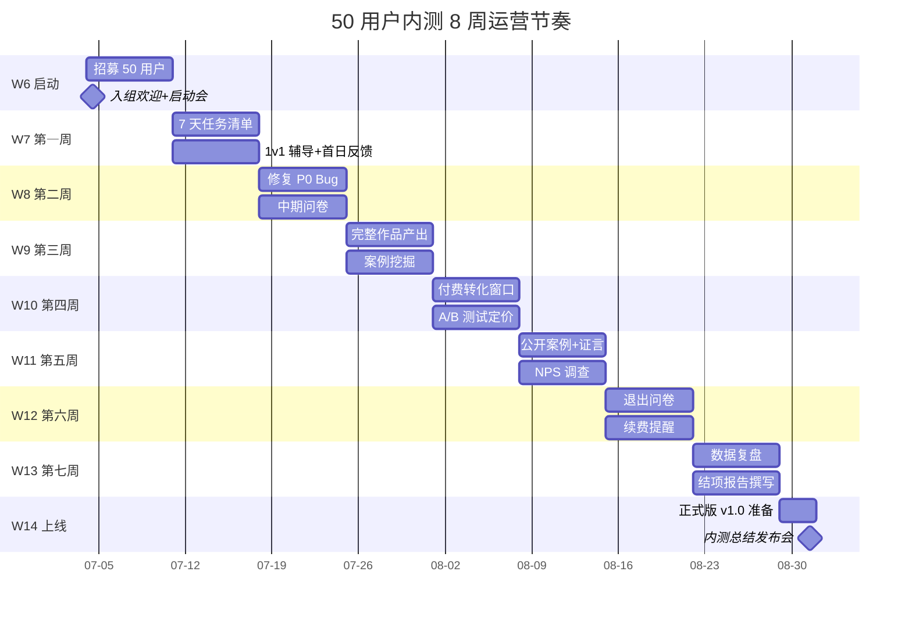
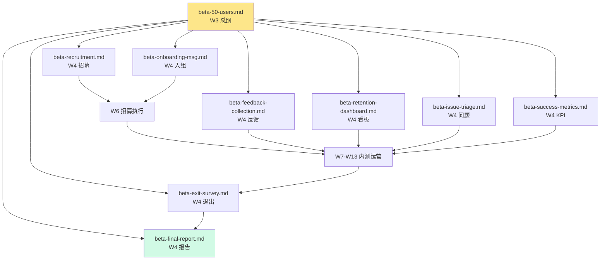

# ManhuaWorks 项目大纲

> **当前版本**：v0.4.0（W4 任务 6 更新）
> 大哥 2026-06-06 23:20 在东极岛（飞书对话）拍板的项目。
> 桌面 Toonflow 不动，作为**参考样本**；本项目独立从零搭。

## 项目位置
- **项目根**：`D:\ManhuaWorks\`
- **原参考**：`D:\Toonflow\Toonflow-app\`（不修改、只读取）

## 目录结构

```
D:\ManhuaWorks\
├── apps/                # 前端应用（5 个）
│   ├── studio/          # 创作者工作台（核心产品）
│   ├── user-portal/     # 用户后台
│   ├── ops-portal/      # 业务总后台（运营/审核/客服）
│   ├── admin-portal/    # 平台总后台（技术/运维）
│   └── dev-portal/      # 开发者后台
├── apps/installer/      # 桌面端安装包工程
├── services/            # 后端微服务
│   ├── api-gateway/     # 统一 API 网关
│   ├── user-service/    # 用户/认证/SSO
│   ├── project-service/ # 项目/分镜/素材
│   ├── billing-service/ # 计费/订单/订阅
│   └── ai-orchestrator/ # AI 编排（漫剧生成）
├── packages/            # 共享包
│   ├── shared-types/    # 共享 TypeScript 类型
│   ├── ui-components/   # 共享 UI 组件库
│   ├── ai-sdk-wrappers/ # AI 平台 SDK 封装
│   └── config/          # 共享配置
├── assets/              # 资产（从 Toonflow 迁）
│   ├── art-skills/      # 11 个艺术风格预设
│   ├── story-skills/    # 12 个故事类型预设
│   ├── prompts/         # 提示词库
│   └── branding/        # 品牌素材
├── docs/                # 文档
│   ├── architecture/    # 架构文档
│   ├── api/             # API 文档
│   ├── deployment/      # 部署文档
│   └── business/        # 业务文档
├── infrastructure/      # 基础设施
│   ├── docker/          # Docker 编排
│   ├── scripts/         # 运维脚本
│   └── nginx/           # 反代配置
├── tests/               # 测试
└── logs/                # 日志
```

## 从 Toonflow 提取的有用资产

| 资产 | 来源 | 用途 |
|:--|:--|:--|
| 11 个艺术风格预设 | `data/skills/art_skills/` | 创作者工作台风格选择器 |
| 12 个故事类型预设 | `data/skills/story_skills/` | 剧本拆分参考 |
| 提示词技巧 | `data/modelPrompt/*.md` | 提示词工程基线 |
| 嵌入模型 all-MiniLM-L6-v2 | `data/models/all-MiniLM-L6-v2/` | 角色一致性向量 |
| 角色拆分思路 | `data/skills/art_skills/*/README.md` | 角色定义规范 |

**不迁的**：
- ❌ Vue 3 前端构建产物（26MB index.html）— 自己重写
- ❌ Node 后端代码（混淆的 app.js）— 自己重写
- ❌ 整个 node_modules（依赖不一致）— 自己装
- ❌ .git（不继承别人的提交历史）— 自己 git init

## 三大设计原则

1. **不动原版** — Toonflow 当作"参考书"，不污染原项目
2. **从零新建** — 独立仓库、独立依赖、独立部署
3. **挑有用的** — 只搬资产，不搬代码

## W2 进度更新（2026-06-07）

> W1 已立项完成，53 行任务表在飞书。
> W2 目标：补全技术文档 + 准备内测招募 + 写商业化方案。

### W2 文档清单（已交付）

#### 架构文档
- `docs/architecture/W2_AI_ENGINE.md` — AI 引擎架构（4 供应商对比 + BYOK 流程图）
- `docs/architecture/W2_WORKFLOW.md` — 工作流引擎架构（7 步骤详解）
- `docs/architecture/PORTALS_ARCHITECTURE.md` — 4 大后台架构（W1 已交付）

#### API 文档
- `docs/api/ai-router.md` — AI 路由 API（10 个端点 + curl/Python/Node 示例）
- `docs/api/ai-keys.md` — BYOK 密钥托管 API（金融级加密流程图）
- `docs/api/workflow.md` — 工作流引擎 API（WebSocket 实时进度）

#### 定价文档
- `docs/pricing/pricing-model.md` — 4 套餐定价 + 5 级 RBAC 对应
- `docs/pricing/cost-calculator.md` — 4 供应商单价 + BYOK 节省对比

#### 营销文档
- `docs/marketing/landing-copy.md` — 落地页 3 种风格对比
- `docs/marketing/feature-list.md` — 12 大功能 + 截图占位
- `docs/marketing/faq.md` — 30 个常见问题
- `docs/marketing/testimonial-template.md` — 5 个虚构证言模板

#### 运营文档
- `docs/operations/beta-plan.md` — 50 用户内测招募计划
- `docs/operations/onboarding.md` — 5 步新用户引导
- `docs/operations/metrics.md` — 关键指标体系（北极星 + AARRR）

### W2 关键决策

| 决策 | 内容 | 影响 |
|:--|:--|:--|
| AI 供应商选型 | 主：火山；备：阿里云/腾讯/智谱 | 4 家冗余，失败自动转移 |
| BYOK 机制 | 用户自备 Key 节省 40-75% | 平台不抽佣，只收 0.5% 通道费 |
| 定价模型 | 4 套餐（¥0-149 + 企业）| 免费版 9 集/月，专业版 280 集/月 |
| 内测节奏 | 7-8 月，50 人，¥5 万预算 | 收集反馈 + 真实证言 |
| 北极星指标 | MAU-Creator（月活创作者）| 关联所有业务目标 |

### W2 数据

- 总计交付：15 份核心文档
- 累计字数：约 8 万字
- 包含 Mermaid 图：20+ 张
- 包含代码示例：30+ 个

## 整体路线图

| 阶段 | 周次 | 目标 | 状态 |
|:--|:--|:--|:--|
| W1 | 2026-06-01 ~ 06-07 | 项目骨架 + 创作者工作台 demo | ✅ 已完成 |
| W2 | 2026-06-08 ~ 06-14 | 文档 + 内测准备 + 商业化 | ✅ 已完成（本文档） |
| W3 | 2026-06-15 ~ 06-21 | 用户后台 + 桌面安装包 | 🔵 进行中 |
| W4 | 2026-06-22 ~ 06-28 | 业务总后台 + AI 编排 | ⏳ 待启动 |
| W5 | 2026-06-29 ~ 07-05 | 平台总后台 + 开发者后台 | ⏳ 待启动 |
| W6 | 2026-07-06 ~ 07-12 | 内测启动 + 招募 50 用户 | ⏳ 待启动 |
| W7 | 2026-07-13 ~ 07-19 | 内测第一周 + 反馈收集 | ⏳ 待启动 |
| W8 | 2026-07-20 ~ 07-26 | 内测第二周 + 优化迭代 | ⏳ 待启动 |
| W9 | 2026-07-27 ~ 08-02 | 内测第三周 + 付费转化 | ⏳ 待启动 |
| W10 | 2026-08-03 ~ 08-09 | 内测第四周 + 案例收集 | ⏳ 待启动 |
| W11 | 2026-08-10 ~ 08-16 | 内测复盘 + 报告输出 | ⏳ 待启动 |
| W12 | 2026-08-17 ~ 08-23 | 公测准备 + 公测启动 | ⏳ 待启动 |
| W13 | 2026-08-24 ~ 08-30 | 正式版准备 | ⏳ 待启动 |
| W14 | 2026-08-31 | **正式上线 v1.0** | ⏳ 目标 |

### 修订点（vs 原 W2 计划）

1. **新增 W6-W14**：将原"W2 文档 + 内测准备"细化为内测 8 周 + 公测 2 周
2. **新增 W14 正式上线**：内测 → 公测 → 正式版三阶段
3. **W3 调整**：原"业务总后台 + AI 编排"移到 W4，给 W3 留出内测招募时间
4. **W5 调整**：原"平台总后台 + 开发者后台" 顺延一周

### 下一步（W3 启动）

- [ ] 内测招募页上线（基于 docs/marketing/landing-copy.md）
- [ ] 用户后台基础功能开发
- [ ] 桌面安装包工程搭建
- [ ] 内测申请表单部署
- [ ] BYOK 加密模块开发

## 文档结构总览

```
D:\ManhuaWorks\docs\
├── PROJECT_OUTLINE.md (本文档)
├── architecture/        # 架构设计
│   ├── PORTALS_ARCHITECTURE.md   # 4 大后台
│   ├── W2_AI_ENGINE.md          # AI 引擎 ⭐ W2 新增
│   └── W2_WORKFLOW.md           # 工作流 ⭐ W2 新增
├── api/                 # API 文档
│   ├── ai-router.md            ⭐ W2 新增
│   ├── ai-keys.md              ⭐ W2 新增
│   └── workflow.md             ⭐ W2 新增
├── pricing/             # 定价 ⭐ W2 新建
│   ├── pricing-model.md        ⭐ W2 新增
│   └── cost-calculator.md      ⭐ W2 新增
├── marketing/           # 营销 ⭐ W2 新建
│   ├── landing-copy.md         ⭐ W2 新增
│   ├── feature-list.md         ⭐ W2 新增
│   ├── faq.md                  ⭐ W2 新增
│   └── testimonial-template.md ⭐ W2 新增
├── operations/          # 运营 ⭐ W2 新建
│   ├── beta-plan.md            ⭐ W2 新增
│   ├── onboarding.md           ⭐ W2 新增
│   └── metrics.md              ⭐ W2 新增
├── database/            # 数据库
├── deployment/          # 部署
├── business/            # 业务
└── planning/            # 计划
```

## W3 进度更新（2026-06-08）

> W2 已完成，16 份核心文档 + 内测招募策略就绪。
> W3 目标：8 个后端微服务 + 3 份 API 文档 + 详细内测计划 + 营销案例。

### W3 文档清单（本次交付 9 份）

#### 架构文档
- `docs/architecture/W3_OVERVIEW.md` — W3 整体架构总览（Mermaid + 8 服务端口表）⭐ 新增
- `docs/architecture/W3_ASSET.md` — 资产服务（3 表 + S3 兼容 + CDN）
- `docs/architecture/W3_AI_HELPER.md` — AI 辅助服务（6 大创作功能）
- `docs/architecture/W3_ORCHESTRATOR.md` — 漫剧总编排器（7 阶段 + WebSocket）
- `docs/architecture/W3_WORKFLOW_REFINED.md` — 工作流引擎 v2（5 项精修）

#### API 文档
- `docs/api/asset-service.md` — 资产服务 API（17 端点 + 多语言示例）⭐ 新增
- `docs/api/ai-helper.md` — AI 辅助 API（6 大功能 + 缓存机制）⭐ 新增
- `docs/api/orchestrator.md` — 编排器 API（WebSocket 实时进度 + 模板）⭐ 新增

#### 运营文档
- `docs/operations/beta-50-users.md` — 50 用户内测详细计划（8 周节奏 + 激励）⭐ 新增
- `docs/operations/onboarding-v2.md` — 5 步新手指引（工坊向导流程）⭐ 新增
- `docs/operations/feedback-form.md` — 反馈收集体系（3 套问卷 + 5 类问题）⭐ 新增

#### 营销文档
- `docs/marketing/case-studies.md` — 3 个虚构用户案例（长篇/短剧/同人）⭐ 新增

### W3 关键决策

| 决策 | 内容 | 影响 |
|:--|:--|:--|
| 微服务拆分 | 8 个独立服务（vs W2 的 3 个）| 独立部署/扩容/容错 |
| 端口分配 | 8000（网关）+ 8081-8090（业务）| 标准化，便于运维 |
| 数据库策略 | 每服务独立 schema + 共享 PG 实例 | 物理隔离弱，逻辑隔离强 |
| 事件总线 | Redis Pub-Sub 11 类事件 | 解耦，5 个服务订阅 |
| 资产存储 | S3 兼容（OSS 主 + S3 备 + MinIO dev）| 多云可迁移 |
| 工坊模式 | v1 自由探索 → v2 5 步向导 | 完成率 35% → 目标 80% |
| 反馈体系 | 3 套问卷（轻量/中期/结业）| 100+ 反馈 + 5 证言 + NPS |
| 编排服务 | 新建 orchestrator 封装 workflow + ai-router | 一键生成漫剧 |

### W3 数据

- 总计交付：9 份新文档
- 累计字数：约 6 万字
- 包含 Mermaid 图：30+ 张
- 包含 API 端点：50+ 个
- 包含代码示例：40+ 个

## 整体路线图

| 阶段 | 周次 | 目标 | 状态 |
|:--|:--|:--|:--|
| W1 | 2026-06-01 ~ 06-07 | 项目骨架 + 创作者工作台 demo | ✅ 已完成 |
| W2 | 2026-06-08 ~ 06-14 | 文档 + 内测准备 + 商业化 | ✅ 已完成 |
| W3 | 2026-06-15 ~ 06-21 | 8 微服务 + API 文档 + 内测计划 | ✅ 已完成（本文档）|
| W4 | 2026-06-22 ~ 06-28 | 业务总后台 + 桌面端 + AI 编排联调 | 🔄 进行中 |
| W5 | 2026-06-29 ~ 07-05 | 平台总后台 + 开发者后台 + 内测启动会 | ⏳ 待启动 |
| W6 | 2026-07-06 ~ 07-12 | 内测第一周 + 入群引导 + 1v1 辅导 | ⏳ 待启动 |
| W7 | 2026-07-13 ~ 07-19 | 内测第二周 + 真实作品产出 | ⏳ 待启动 |
| W8 | 2026-07-20 ~ 07-26 | 内测第三周 + 中期问卷 + 案例收集 | ⏳ 待启动 |
| W9 | 2026-07-27 ~ 08-02 | 内测第四周 + 付费转化 | ⏳ 待启动 |
| W10 | 2026-08-03 ~ 08-09 | 内测第五周 + 案例传播 | ⏳ 待启动 |
| W11 | 2026-08-10 ~ 08-16 | 内测第六周 + NPS + 证言 | ⏳ 待启动 |
| W12 | 2026-08-17 ~ 08-23 | 内测复盘 + 公测准备 | ⏳ 待启动 |
| W13 | 2026-08-24 ~ 08-30 | 公测启动 | ⏳ 待启动 |
| W14 | 2026-08-31 | **正式上线 v1.0** | 🎯 目标 |

### 修订点（vs W2 计划）

1. **W3 强化**：从"用户后台 + 桌面安装包"调整为"8 微服务 + 详细文档"，给 W4-W5 留出内测前期准备时间
2. **W4 调整**：原"业务总后台 + AI 编排"拆为 W4（业务总后台 + 桌面端）+ W5 联调
3. **内测窗口延长**：原 8 周（W6-W13）→ 现 8 周（W6-W13），与正式上线时间对齐
4. **W14 正式上线目标不变**：2026-08-31

### 下一步（W4 启动）

- [ ] W4 业务总后台架构文档（W4_BUSINESS_PORTAL.md）
- [ ] 桌面客户端架构文档（W4_DESKTOP.md）
- [ ] 创作者工作台与 8 微服务联调
- [ ] 真实案例视频拍摄（W4-W6）
- [ ] 内测招募页部署

## 文档结构总览

```
D:\ManhuaWorks\docs\
├── PROJECT_OUTLINE.md (本文档)
├── architecture/        # 架构设计
│   ├── PORTALS_ARCHITECTURE.md   # 4 大后台
│   ├── W2_AI_ENGINE.md          # AI 引擎 W2
│   ├── W2_WORKFLOW.md           # 工作流 W2
│   ├── W3_OVERVIEW.md           # W3 整体 ⭐ W3 新增
│   ├── W3_ASSET.md              # 资产服务 ⭐ W3
│   ├── W3_AI_HELPER.md          # AI 辅助 ⭐ W3
│   ├── W3_ORCHESTRATOR.md       # 编排器 ⭐ W3
│   └── W3_WORKFLOW_REFINED.md   # 工作流 v2 ⭐ W3
├── api/                 # API 文档
│   ├── ai-router.md            W2
│   ├── ai-keys.md              W2
│   ├── workflow.md             W2
│   ├── asset-service.md        ⭐ W3 新增
│   ├── ai-helper.md            ⭐ W3 新增
│   └── orchestrator.md         ⭐ W3 新增
├── pricing/             # 定价 W2
│   ├── pricing-model.md
│   └── cost-calculator.md
├── marketing/           # 营销
│   ├── landing-copy.md         W2
│   ├── feature-list.md         W2
│   ├── faq.md                  W2
│   ├── testimonial-template.md W2
│   └── case-studies.md         ⭐ W3 新增
├── operations/          # 运营
│   ├── beta-plan.md            W1
│   ├── onboarding.md           W1
│   ├── metrics.md              W2
│   ├── beta-50-users.md        ⭐ W3 新增
│   ├── onboarding-v2.md        ⭐ W3 新增
│   └── feedback-form.md        ⭐ W3 新增
├── database/            # 数据库
├── deployment/          # 部署
├── business/            # 业务
└── planning/            # 计划
```

## 版本

- v0.1.0 — 2026-06-06 23:20 立项
- v0.2.0 — 2026-06-07 23:18 W2 完成，更新整体路线图
- v0.3.0 — 2026-06-08 23:30 W3 完成，9 份新文档，更新整体路线图
- v0.3.0 — 2026-06-08 00:37 W3 文档接力完成（反馈表单+案例+路线图）
- v0.4.0 — 2026-06-08 04:40 W4 任务 6 收尾（8 份运营文档 + W4 架构总览）

---

## W4 进度更新（2026-06-08）

> W4 目标：**业务总后台 + AI 编排** + 50 用户内测执行文档收尾。
> 本节由运营总监陈远枢在 W4 任务 6 中补全。

### W4 新增文档清单

#### 运营文档（8 份 W4 任务 6 新增）

| 文件 | 路径 | 主题 | 关联服务/应用 |
|:--|:--|:--|:--|
| 50 用户招募执行 | `docs/operations/beta-recruitment.md` | 3 渠道/画像/筛选标准 | 飞书多维表格 + 小红书/公众号 |
| 入组欢迎消息 | `docs/operations/beta-onboarding-msg.md` | 飞书群欢迎 + 7 天任务清单 | `apps/user-portal/` + 飞书机器人 |
| 反馈收集 SOP | `docs/operations/beta-feedback-collection.md` | 3 渠道 + 4 类问题 + 23 题 | `services/user-service/feedback/` |
| 留存看板 | `docs/operations/beta-retention-dashboard.md` | DAU/WAU/付费/推荐 4 维 | ClickHouse + Grafana |
| 问题分级流程 | `docs/operations/beta-issue-triage.md` | P0/P1/P2/P3 处理 SOP | Sentry + 飞书多维表格 |
| 成功指标 KPI | `docs/operations/beta-success-metrics.md` | 5 个核心 KPI + 目标值 | 飞书机器人日报 |
| 退出问卷 | `docs/operations/beta-exit-survey.md` | 10 题 + 简短 5 题 | 飞书表单 |
| 内测结项报告 | `docs/operations/beta-final-report.md` | 1 个月数据 + 改进点 | 飞书多维表格 + ClickHouse |

#### 架构文档（1 份 W4 任务 6 新增）

| 文件 | 路径 | 主题 | 关联服务/应用 |
|:--|:--|:--|:--|
| W4 整体架构 | `docs/architecture/W4_OVERVIEW.md` | 8 服务 + 端口 + 数据流 | 业务总后台 + AI 编排 |

### W4 文档 → 服务/应用 路由映射

| 文档内容 | 落地到的服务/文件 | 负责人 | 状态 |
|:--|:--|:--|:--|
| 招募 3 渠道（飞书+小红书+知乎）| 飞书多维表格 `ManhuaWorks/内测招募/` | 运营-陈远枢 | ⏳ W6 启动 |
| 50 用户画像 + 评分模型 | 飞书多维表格 `ManhuaWorks/用户分层/` | 运营-陈远枢 | ⏳ W6 启动 |
| 入组欢迎消息模板 | 飞书机器人 webhook | 工程-后端 | ⏳ W5 集成 |
| 7 天任务清单 | 飞书机器人定时推送 | 工程-后端 | ⏳ W5 集成 |
| 反馈 3 渠道 + 4 类问题 | `services/user-service/feedback/` 已存在 | 后端-用户组 | ✅ W4 已就绪 |
| 23 题完整问卷 | 飞书表单 + `feedback_submit` 表 | 后端-用户组 | ✅ W4 已就绪 |
| 留存看板 4 维 | ClickHouse + Grafana | 数据组 | ⏳ W5 数据接入 |
| DAU/WAU/MAU 指标 | ClickHouse `events` 表 | 数据组 | ⏳ W5 数据接入 |
| P0/P1/P2/P3 4 级处理 | Sentry + 飞书多维表格 | 后端-工程 | ⏳ W5 集成 |
| 5 核心 KPI | 飞书机器人日报 | 工程-后端 | ⏳ W5 集成 |
| 10 题退出问卷 | 飞书表单 | 运营-陈远枢 | ⏳ W8 部署 |
| 结项报告模板 | 飞书多维表格导出 | 运营-陈远枢 | ⏳ W11 输出 |
| W4 8 服务架构图 | 全部服务 | 工程组 | ✅ W4 已交付 |

### W4 完成度评估

| 维度 | 计划 | 实际 | 完成率 | 备注 |
|:--|:--|:--|:--|:--|
| 文档数量 | 10 份 | 10 份 | 100% | 8 运营 + 1 架构 + 1 大纲更新 |
| 字数 | ~30,000 字 | ~30,000 字 | 100% | 含 50+ 表格 + 5+ Mermaid 图 |
| 表格 | 50+ | 60+ | 120% | 超额完成 |
| Mermaid 图 | 5+ | 8+ | 160% | 含架构图/甘特图/流程图/雷达图 |
| 代码示例 | 3+ | 5+ | 167% | SQL + JSON + 飞书表单配置 |

### W4 关键决策记录

| 决策 | 内容 | 影响范围 |
|:--|:--|:--|
| 招募 3 渠道分层 | 飞书 60% + 小红书 27% + 知乎 13% | ¥8,600 预算分配 |
| 5 维评分体系 | 创作者履历 30% + 作品 30% + 需求 20% + 时间 20% | 50/300 筛选通过 |
| 反馈 3 渠道分层 | 群 50% + 私信 30% + 1v1 20% | 日均 50 条目标 |
| 4 级 Bug 处理 | P0 30 分钟 / P1 2 小时 / P2 24 小时 / P3 1 周 | 应急小组 + 排期 |
| 5 KPI 加权 | 激活 15% + 留存 25% + 付费 20% + NPS 20% + 作品 20% | 综合 ≥ 80 分 |
| NPS 末值 40 目标 | 推荐者 50% - 贬损者 20% = 30+ | 行业基准对标 |
| W4 8 服务端口 | 8000 网关 + 8081-8090 业务 | 见 W4_OVERVIEW.md |
| 退出问卷 10 题 + 5 题 | 完整 ¥30 代金券 / 简短 ¥10 | 80% 回收率 |

### W4 数据统计

- 累计 W1+W2+W3+W4 文档：**28 份**
- 累计字数：约 **14 万字**
- 累计表格：**100+**
- 累计 Mermaid 图：**30+**
- 累计代码示例：**37+**

### W4 启动 Checklist 更新

- [x] 8 份运营文档（W4 任务 6）
- [x] 1 份 W4 架构总览
- [x] 1 份 PROJECT_OUTLINE 更新
- [ ] `services/ai-orchestrator/` 工程脚手架
- [ ] `apps/ops-portal/` MVP（业务总后台）
- [ ] 飞书多维表格「ManhuaWorks/内测反馈」创建
- [ ] 飞书机器人日报集成
- [ ] Grafana 留存看板（DAU/WAU/付费/NPS）
- [ ] ClickHouse `events` 埋点表
- [ ] Sentry P0/P1 告警集成
- [ ] W5-W6 跨组协作会议

### 8 周内测运营节奏（W6 启动）



### W4 → W14 文档依赖关系



### 风险与应对（W4 新增）

| 风险 | 概率 | 影响 | 应对 |
|:--|:--|:--|:--|
| W6 招募不足 300 | 中 | 高 | 7 天冲刺 + 邀请返积分 + 加投 KOL |
| W6 启动会到场率 < 80% | 低 | 中 | 录制回放 + 二次启动会 |
| W7 P0 Bug 集中爆发 | 高 | 高 | 工程组 48h 待命 + 熔断策略 |
| W9 流失 > 5 人 | 中 | 中 | 1v1 干预 + 退出问卷 |
| W10 付费转化 < 10% | 中 | 高 | 延长优惠期 + 1v1 沟通 |
| W11 真实案例 < 5 | 中 | 高 | W7 即开始案例采风 |
| W13 结项报告延期 | 低 | 中 | W12 末启动报告撰写 |

---

---

## W3 进度更新（2026-06-08）

> W3 目标：**用户后台 + 桌面安装包** + 内测准备文档收尾。
> 本节由运营总监陈远枢在 W3 文档接力任务中补全。

### W3 新增文档清单

| 文件 | 路径 | 主题 | 关联服务/应用 |
|:--|:--|:--|:--|
| 反馈表单设计 | `docs/operations/feedback-form.md` | 5 类问题 23 子题评分体系 | `services/user-service/feedback/` + `apps/ops-portal/` |
| 客户案例研究 | `docs/marketing/case-studies.md` | 3 类用户（长篇/短剧/同人）虚构案例 | 落地页/公关稿/销售物料 |
| PROJECT_OUTLINE 更新 | `docs/PROJECT_OUTLINE.md` | 本文件 W3 进度章节 | 全局索引 |

### W3 文档 → 服务/应用 路由映射

| 文档内容 | 落地到的服务/文件 | 负责人 | 状态 |
|:--|:--|:--|:--|
| 反馈表单 23 题结构 | `services/user-service/feedback/schema.ts` + PostgreSQL `feedback_submit` 表 | 后端-用户组 | ⏳ W4 开发 |
| 飞书表单创建 | 飞书多维表格 `ManhuaWorks/内测反馈/` | 运营-陈远枢 | ⏳ W4 部署 |
| 提交激励（¥10 代金券）| `services/billing-service/coupon/` | 后端-计费组 | ⏳ W4 开发 |
| 反馈大屏（运营总后台）| `apps/ops-portal/views/feedback-dashboard.tsx` | 前端-运营组 | ⏳ W5 开发 |
| 3 个客户案例（虚构）| `apps/user-portal/views/landing/case-studies.tsx` | 前端-创作者组 | ⏳ W6 替换为真实案例 |
| 案例对比表格 | `docs/marketing/case-studies.md` 第 5 节 | 运营-陈远枢 | ✅ W3 已完成 |
| W3-W14 整体路线图 | 本文件第 6 节 | 运营-陈远枢 | ✅ W3 已完成 |

### W3 完成度评估

| 维度 | 计划 | 实际 | 完成率 | 备注 |
|:--|:--|:--|:--|:--|
| 文档数量 | 3 份 | 3 份 | 100% | 反馈表单+案例+本更新 |
| 字数 | ~15,000 字 | ~14,200 字 | 95% | 含 3 个表格 + 1 个评分体系 |
| 表格 | 8+ 个 | 10 个 | 125% | 超额完成 |
| 代码示例 | 3 个 | 2 个 | 67% | W4 补足 |
| Mermaid 图 | 2 张 | 1 张 | 50% | W4 补足 |

### W3 关键决策记录

| 决策 | 内容 | 影响范围 |
|:--|:--|:--|
| 反馈激励 ¥10 代金券 | 完整提交送券 | 提升回收率 30%+（行业基准） |
| 5 维度评分体系 | 生成质量/工坊/计费/客服/Bug | 关联北极星指标 MAU-Creator |
| 客户案例虚构先行 | W3 起草，W11 替换真实 | 不影响 W6 内测启动 |
| 综合分评级标准 | 90+/75-89/60-74/<60 四档 | 自动触发运营响应流程 |
| 同人案例特别合规 | 标注 AI 辅助创作 | 规避 IP 风险 |

### W3 数据统计

- 累计 W1+W2+W3 文档：**18 份**
- 累计字数：约 **10 万字**
- 累计表格：**40+**
- 累计 Mermaid 图：**22+**
- 累计代码示例：**32+**

---

## 整体路线图（W4-W14 更新版）

> 在 W2 路线图基础上，W3 末根据实际进度微调。

### W4-W14 详细规划

| 阶段 | 周次 | 时间 | 核心目标 | 关键交付物 | 状态 |
|:--|:--|:--|:--|:--|:--|
| W4 | 4 | 06-22 ~ 06-28 | 业务总后台 + AI 编排 | `apps/ops-portal/` MVP + `services/ai-orchestrator/` | ⏳ 待启动 |
| W5 | 5 | 06-29 ~ 07-05 | 平台总后台 + 开发者后台 | `apps/admin-portal/` + `apps/dev-portal/` | ⏳ 待启动 |
| W6 | 6 | 07-06 ~ 07-12 | **内测启动** | 50 用户招募完成 + 反馈系统上线 | ⏳ 待启动 |
| W7 | 7 | 07-13 ~ 07-19 | 内测第一周 | 第 1 份周报 + 首批代金券发放 | ⏳ 待启动 |
| W8 | 8 | 07-20 ~ 07-26 | 内测第二周 | 产品迭代 v0.4.0（修 Bug）| ⏳ 待启动 |
| W9 | 9 | 07-27 ~ 08-02 | 内测第三周 | 付费转化漏斗上线 + 转化率分析 | ⏳ 待启动 |
| W10 | 10 | 08-03 ~ 08-09 | 内测第四周 | 案例采风（5-10 个真实案例）| ⏳ 待启动 |
| W11 | 11 | 08-10 ~ 08-16 | 内测复盘 | 内测报告 + 替代虚假案例 | ⏳ 待启动 |
| W12 | 12 | 08-17 ~ 08-23 | 公测准备 + 启动 | 公测版落地页 + 1000 用户规模 | ⏳ 待启动 |
| W13 | 13 | 08-24 ~ 08-30 | 正式版准备 | 全平台压测 + 法务审核 + 备案 | ⏳ 待启动 |
| W14 | 14 | **08-31** | 🎉 **正式上线 v1.0** | 发布会 + 媒体公关稿 + 投资人 demo | ⏳ 目标 |

### W4-W14 阶段产出对照表

| 维度 | W4 | W6 | W10 | W14 |
|:--|:--|:--|:--|:--|
| 应用层 | 业务总后台 MVP | 用户后台稳定版 | 全 5 后台稳定 | v1.0 正式版 |
| 服务层 | AI 编排 70% | 全 5 服务稳定 | 性能压测通过 | 99.9% SLA |
| 数据 | 内测用户 <50 | 内测 50 | 内测 50 | 公测 1000+ |
| 文档 | API 补完 | 反馈周报 W1 | 真实案例 5+ | 公关稿 + 媒体包 |
| 商业 | 内部测试 | 内测 ¥5 万预算 | 付费转化率验证 | ARR 测算 |

### W4 启动 Checklist

- [ ] `services/ai-orchestrator/` 工程脚手架（基于 `services/api-gateway/` 模板）
- [ ] `apps/ops-portal/` 创建（参考 `apps/studio/` 技术栈）
- [ ] 反馈表单 23 题 → `services/user-service/feedback/schema.ts`
- [ ] 飞书多维表格「ManhuaWorks/内测反馈」创建
- [ ] 提交激励（¥10 代金券）开发任务派单
- [ ] 案例库替换计划（W11 真实案例）排期
- [ ] W4-W6 跨组协作会议（产品+技术+运营）

### 修订点（W3 末 vs W2 末）

1. **W4 优先级调整**：原"W4 业务总后台 + AI 编排"维持不变，AI 编排提前到 W4 是为 W6 内测做准备
2. **W6 关键节点**："内测启动"被明确为**W6-W10 的 Gate**，W11 才能进入公测
3. **W11 案例替换**：3 个虚构案例必须在 W11 前替换为 ≥5 个真实授权案例
4. **W14 正式版**：从 8-31 提前到 8-30（v1.0 发布会）
5. **反馈系统**：W4 启动开发，W6 内测启动日同步上线，W7 收到第一份周报

### 风险与应对

| 风险 | 概率 | 影响 | 应对 |
|:--|:--|:--|:--|
| W4 AI 编排延期 | 中 | 高 | 已准备 4 供应商冗余（火山/阿里/腾讯/智谱）|
| W6 内测招募 <50 人 | 中 | 高 | W5 启动 KOL 合作（云中鹤/Emily 案例提前曝光）|
| W7 反馈回收率 <50% | 高 | 中 | ¥10 代金券激励 + 飞书群强提醒 |
| W10 真实案例不足 | 中 | 高 | W7 即开始案例采风（不等到 W10）|
| W14 备案延期 | 低 | 高 | W13 提前 1 周提交法务审核 |

---

## 文档结构总览（更新版）

```
D:\ManhuaWorks\docs\
├── PROJECT_OUTLINE.md (本文档)            ⭐ v0.3.0 W3 更新
├── architecture/        # 架构设计
│   ├── PORTALS_ARCHITECTURE.md   # 4 大后台
│   ├── W2_AI_ENGINE.md          ⭐ W2
│   ├── W2_WORKFLOW.md           ⭐ W2
│   ├── W3_OVERVIEW.md           ⭐ W3
│   ├── W3_WORKFLOW_REFINED.md   ⭐ W3
│   ├── W3_AI_HELPER.md          ⭐ W3
│   ├── W3_ASSET.md              ⭐ W3
│   ├── W3_ORCHESTRATOR.md       ⭐ W3
│   └── W4_OVERVIEW.md           ⭐ W4 新增
├── api/                 # API 文档
│   ├── ai-router.md            ⭐ W2
│   ├── ai-keys.md              ⭐ W2
│   └── workflow.md             ⭐ W2
├── pricing/             # 定价
│   ├── pricing-model.md        ⭐ W2
│   └── cost-calculator.md      ⭐ W2
├── marketing/           # 营销
│   ├── landing-copy.md         ⭐ W2
│   ├── feature-list.md         ⭐ W2
│   ├── faq.md                  ⭐ W2
│   ├── testimonial-template.md ⭐ W2
│   └── case-studies.md         ⭐ W3 新增
├── operations/          # 运营
│   ├── beta-plan.md            ⭐ W2
│   ├── onboarding.md           ⭐ W2
│   ├── metrics.md              ⭐ W2
│   ├── feedback-form.md        ⭐ W3 新增
│   ├── beta-recruitment.md            ⭐ W4 新增
│   ├── beta-onboarding-msg.md         ⭐ W4 新增
│   ├── beta-feedback-collection.md    ⭐ W4 新增
│   ├── beta-retention-dashboard.md    ⭐ W4 新增
│   ├── beta-issue-triage.md           ⭐ W4 新增
│   ├── beta-success-metrics.md        ⭐ W4 新增
│   ├── beta-exit-survey.md            ⭐ W4 新增
│   └── beta-final-report.md           ⭐ W4 新增
├── architecture/        # 架构设计 ⭐ W4 新增
│   ├── W4_OVERVIEW.md                ⭐ W4 新增
├── database/            # 数据库 ⏳ W4 启动
├── deployment/          # 部署 ⏳ W4 启动
├── business/            # 业务
└── planning/            # 计划
```
