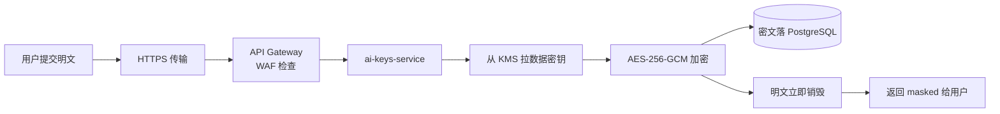
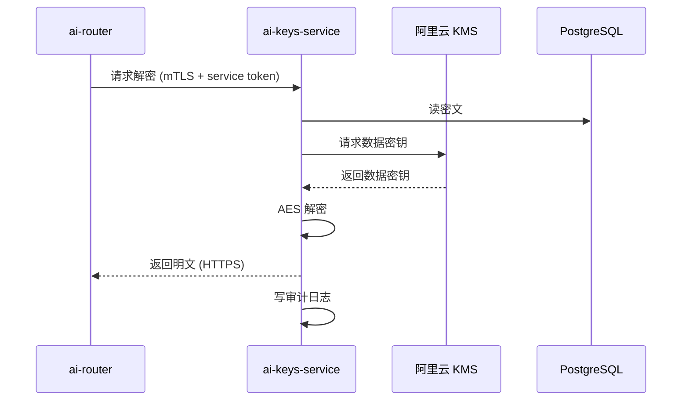

# ai-keys-service API 文档

> **Base URL**：`https://api.manhuaworks.com/v1/keys`
> **作者**：陈远枢
> **更新日期**：2026-06-07

## 概述

ai-keys-service 是 ManhuaWorks 的 **BYOK（Bring Your Own Key）密钥托管服务**。它让用户安全地把第三方 AI 供应商的 API Key 存到我们这里，运行时代理解密供 ai-router 使用，而平台**永远不接触明文**。

**安全等级**：金融级
**加密算法**：AES-256-GCM
**密钥管理**：KMS（阿里云 KMS / AWS KMS）
**审计**：所有使用都记录

---

## 端点列表

| 方法 | 路径 | 权限 | 说明 |
|:--|:--|:--|:--|
| POST | `/v1/keys` | 用户 | 创建 Key 记录 |
| GET | `/v1/keys` | 用户 | 列出我的所有 Key |
| GET | `/v1/keys/:id` | 用户 | 查看 Key 详情（脱敏） |
| PATCH | `/v1/keys/:id` | 用户 | 修改 Key（限元数据） |
| DELETE | `/v1/keys/:id` | 用户 | 删除 Key |
| POST | `/v1/keys/:id/rotate` | 用户 | 轮换 Key |
| POST | `/v1/keys/:id/disable` | 用户 | 临时禁用 |
| POST | `/v1/keys/:id/enable` | 用户 | 启用 |
| POST | `/v1/keys/:id/test` | 用户 | 测试连通性 |
| GET | `/v1/keys/:id/usage` | 用户 | Key 使用统计 |
| POST | `/v1/keys/internal/decrypt` | 内部 | 运行时解密（仅 ai-router） |
| GET | `/v1/keys/admin/all` | 管理员 | 全局查询（脱敏） |

---

## 1. 创建 Key

**端点**：`POST /v1/keys`

### 请求

```http
POST /v1/keys
Authorization: Bearer <jwt>
Content-Type: application/json

{
  "provider": "volcano",
  "api_key": "sk-volcano-abc123def456...",
  "label": "我的火山 Key",
  "monthly_limit": 100.0,
  "alert_threshold": 0.8,
  "scopes": ["image", "video"]
}
```

**参数**：

| 字段 | 类型 | 必填 | 说明 |
|:--|:--|:--|:--|
| `provider` | enum | ✅ | `volcano` / `aliyun` / `tencent` / `zhipu` |
| `api_key` | string | ✅ | 用户提供的明文 API Key |
| `label` | string | ❌ | 别名（最多 50 字） |
| `monthly_limit` | float | ❌ | 月度消费上限（元），默认不限 |
| `alert_threshold` | float | ❌ | 告警阈值 0-1（如 0.8 = 用到 80% 告警） |
| `scopes` | array | ❌ | 限定使用范围，默认全部 |

**provider 字段说明**：
- `volcano`：火山引擎（字节豆包/Seedance）
- `aliyun`：阿里云（通义/Qwen/DashScope）
- `tencent`：腾讯云（混元）
- `zhipu`：智谱（GLM/CogView/CogVideoX）

### 响应

```json
{
  "code": 0,
  "data": {
    "id": "key_abc123def456",
    "provider": "volcano",
    "label": "我的火山 Key",
    "masked_key": "sk-volcano-abc1****",
    "status": "active",
    "monthly_limit": 100.0,
    "scopes": ["image", "video"],
    "created_at": "2026-06-07T15:30:00Z"
  }
}
```

> ⚠️ **重要**：明文 `api_key` 在服务器收到后**立即加密**，永远不落盘、不返回。任何后续 GET 都只能看到 masked 版本。

---

## 2. 列出我的 Key

**端点**：`GET /v1/keys`

### 请求

```http
GET /v1/keys
Authorization: Bearer <jwt>
```

### 响应

```json
{
  "code": 0,
  "data": {
    "keys": [
      {
        "id": "key_abc123def456",
        "provider": "volcano",
        "label": "我的火山 Key",
        "masked_key": "sk-volcano-abc1****",
        "status": "active",
        "monthly_limit": 100.0,
        "monthly_used": 23.5,
        "last_used_at": "2026-06-07T14:20:00Z",
        "created_at": "2026-06-01T10:00:00Z"
      },
      {
        "id": "key_xyz789ghi012",
        "provider": "zhipu",
        "label": "智谱备用",
        "masked_key": "glm-xyz7****",
        "status": "active",
        "monthly_limit": 50.0,
        "monthly_used": 0,
        "last_used_at": null,
        "created_at": "2026-06-05T08:00:00Z"
      }
    ]
  }
}
```

---

## 3. 查看 Key 详情

**端点**：`GET /v1/keys/:id`

### 响应

```json
{
  "code": 0,
  "data": {
    "id": "key_abc123def456",
    "provider": "volcano",
    "label": "我的火山 Key",
    "masked_key": "sk-volcano-abc1****",
    "status": "active",
    "monthly_limit": 100.0,
    "monthly_used": 23.5,
    "alert_threshold": 0.8,
    "scopes": ["image", "video"],
    "stats": {
      "total_calls": 234,
      "success_rate": 0.987,
      "avg_cost": 0.18,
      "last_used_at": "2026-06-07T14:20:00Z"
    },
    "created_at": "2026-06-01T10:00:00Z",
    "updated_at": "2026-06-07T14:20:00Z"
  }
}
```

---

## 4. 修改 Key 元数据

**端点**：`PATCH /v1/keys/:id`

> ⚠️ **不能修改 `api_key` 本身**，要换 Key 请用「轮换」接口

### 请求

```json
{
  "label": "我的火山 Key（生产）",
  "monthly_limit": 200.0,
  "alert_threshold": 0.9,
  "scopes": ["image", "video", "tts"]
}
```

### 响应

```json
{
  "code": 0,
  "data": {
    "id": "key_abc123def456",
    "label": "我的火山 Key（生产）",
    "monthly_limit": 200.0,
    "alert_threshold": 0.9,
    "scopes": ["image", "video", "tts"],
    "updated_at": "2026-06-07T16:00:00Z"
  }
}
```

---

## 5. 删除 Key

**端点**：`DELETE /v1/keys/:id`

### 请求

```http
DELETE /v1/keys/key_abc123def456
Authorization: Bearer <jwt>
```

### 响应

```json
{
  "code": 0,
  "data": {
    "id": "key_abc123def456",
    "deleted": true
  }
}
```

> 删除是软删除，30 天内可恢复。30 天后从 KMS 永久清除。

---

## 6. 轮换 Key

**端点**：`POST /v1/keys/:id/rotate`

**用途**：用户在供应商控制台重新生成了 Key，需要无缝切换。

### 请求

```json
{
  "new_api_key": "sk-volcano-new789xyz..."
}
```

### 响应

```json
{
  "code": 0,
  "data": {
    "id": "key_abc123def456",
    "rotated_at": "2026-06-07T16:30:00Z",
    "status": "active"
  }
}
```

轮换过程：解密旧 Key → 用新 Key 替换密文 → 重新加密 → 平滑过渡（< 1 秒）。

---

## 7. 禁用/启用 Key

**端点**：
- `POST /v1/keys/:id/disable`
- `POST /v1/keys/:id/enable`

### 请求（禁用）

```http
POST /v1/keys/key_abc123def456/disable
{
  "reason": "暂时不用，余额不足"
}
```

### 响应

```json
{
  "code": 0,
  "data": {
    "id": "key_abc123def456",
    "status": "disabled",
    "disabled_at": "2026-06-07T17:00:00Z",
    "disabled_reason": "暂时不用，余额不足"
  }
}
```

禁用后 ai-router 不会再用此 Key，会自动回退到平台代付（如果用户有配额）。

---

## 8. 测试 Key 连通性

**端点**：`POST /v1/keys/:id/test`

### 响应

```json
{
  "code": 0,
  "data": {
    "id": "key_abc123def456",
    "status": "active",
    "test_result": "ok",
    "latency_ms": 234,
    "balance": 89.5,
    "tested_at": "2026-06-07T17:30:00Z"
  }
}
```

如果失败：
```json
{
  "code": 0,
  "data": {
    "test_result": "failed",
    "error": "invalid_api_key",
    "message": "供应商返回 401：API Key 无效或已过期"
  }
}
```

---

## 9. Key 使用统计

**端点**：`GET /v1/keys/:id/usage?period=30d`

### 响应

```json
{
  "code": 0,
  "data": {
    "key_id": "key_abc123def456",
    "period": "30d",
    "summary": {
      "total_calls": 1523,
      "success_calls": 1502,
      "failed_calls": 21,
      "success_rate": 0.986,
      "total_cost": 274.32
    },
    "by_day": [
      {"date": "2026-06-01", "calls": 45, "cost": 8.1},
      {"date": "2026-06-02", "calls": 67, "cost": 12.06}
    ],
    "by_model": [
      {"model": "doubao-seedream-3.0", "calls": 1200, "cost": 216.0},
      {"model": "seedance-1.0", "calls": 45, "cost": 38.25}
    ]
  }
}
```

---

## 10. 内部解密接口（仅 ai-router）

**端点**：`POST /v1/keys/internal/decrypt`

> 🔒 **此接口仅限内部服务调用**。需要 mTLS 双向认证 + 服务身份令牌。

### 请求

```http
POST /v1/keys/internal/decrypt
X-Service-Token: <internal_service_token>
X-MTLS-Fingerprint: <cert_sha256>
Content-Type: application/json

{
  "key_id": "key_abc123def456",
  "purpose": "image_generation",
  "request_id": "req_abc123"
}
```

### 响应

```json
{
  "code": 0,
  "data": {
    "api_key": "sk-volcano-abc123def456...",
    "provider": "volcano",
    "scopes": ["image", "video"]
  }
}
```

**审计记录**（自动写入）：
```json
{
  "log_id": "audit_xyz",
  "key_id": "key_abc123def456",
  "user_id": "user_123",
  "purpose": "image_generation",
  "request_id": "req_abc123",
  "caller_service": "ai-router",
  "timestamp": "2026-06-07T18:00:00Z"
}
```

---

## 11. 管理员全局查询

**端点**：`GET /v1/keys/admin/all?provider=volcano&status=active&page=1&page_size=50`

> 🔒 **需 L5 管理员权限**

### 响应

```json
{
  "code": 0,
  "data": {
    "total": 234,
    "page": 1,
    "page_size": 50,
    "keys": [
      {
        "id": "key_abc123def456",
        "user_id": "user_123",
        "user_email": "user@example.com",
        "provider": "volcano",
        "masked_key": "sk-volcano-abc1****",
        "status": "active",
        "monthly_used": 23.5,
        "created_at": "2026-06-01T10:00:00Z"
      }
    ]
  }
}
```

**注意**：管理员也看不到明文 Key。

---

## 12. 安全机制详解

### 加密流程



### 运行时解密



### 数据保护

| 保护层 | 措施 |
|:--|:--|
| 传输 | HTTPS / TLS 1.3 |
| 存储 | AES-256-GCM + KMS 主密钥 |
| 内存 | 解密后 1 小时过期 |
| 日志 | 永远不打印明文 |
| 备份 | 加密后再备份到 OSS |
| 离职 | 7 天内强制重新认证 |
| 异常登录 | 触发 MFA 二次验证 |

---

## 13. 错误码

| HTTP | 错误码 | 含义 |
|:--|:--|:--|
| 400 | `invalid_provider` | 供应商不支持 |
| 400 | `invalid_key_format` | Key 格式错误 |
| 401 | `unauthorized` | 未登录 |
| 403 | `forbidden` | 不是 Key 拥有者 |
| 404 | `key_not_found` | Key 不存在 |
| 409 | `key_already_exists` | 同一供应商 Key 重复 |
| 429 | `rate_limited` | 触发限流 |
| 500 | `kms_error` | KMS 服务异常 |
| 503 | `service_unavailable` | 服务维护中 |

---

## 14. 合规说明

- 符合《个人信息保护法》（PIPL）
- 符合《数据安全法》
- 通过等保三级认证（计划中）
- 跨境传输：用户 Key 不出中国境内
- GDPR（海外用户）：支持一键删除全部数据

---

## 变更记录

| 版本 | 日期 | 作者 | 变更 |
|:--|:--|:--|:--|
| v0.1 | 2026-06-07 | 陈远枢 | 初稿 |
