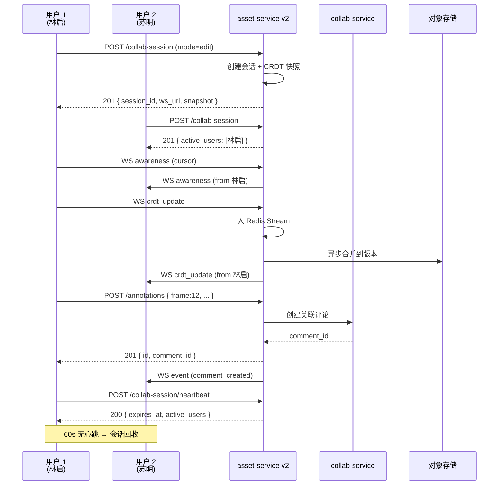

# asset-service v2 API 文档（协作扩展）

> **Base URL**：`https://api.manhuaworks.com/v1/assets/v2`
> **继承自**：[`asset-service.md`](./asset-service.md) v1
> **作者**：陆流光
> **更新日期**：2026-06-08

## 概述

v2 在 v1 基础上**新增协作相关接口**，主要解决：
- 资产**协作会话**（多人同时编辑同一资产时的锁/版本协调）
- 资产**评论批注**（在图片/视频帧上画圈/写文字）
- 资产**协作历史**（谁在什么时间编辑了哪一帧）
- 资产**协作权限**（资产级 owner/editor/viewer 细分）

**与 collab-service 的边界**：
- `collab-service` 管**项目级**协作者
- `asset-service v2` 管**资产级**协作会话和批注
- 评论/活动/通知的**业务逻辑**仍在 `collab-service`

---

## 通用规范

继承 v1 全部规范。**新增**：
- 所有 v2 接口必须带 `X-Asset-Id` 头（除会话初始化）
- 资产级权限与项目级权限**取交集**（如项目级 viewer 不能编辑资产，即便资产 owner 是他本人）

---

## 端点总览（仅 v2 新增）

| 模块 | 方法 | 路径 | 说明 |
|:--|:--|:--|:--|
| **协作会话** | POST | `/v1/assets/v2/:id/collab-session` | 开启协作会话 |
|  | GET | `/v1/assets/v2/:id/collab-session` | 查询当前活跃会话 |
|  | DELETE | `/v1/assets/v2/:id/collab-session` | 关闭会话 |
|  | POST | `/v1/assets/v2/:id/collab-session/heartbeat` | 心跳（30s 续约） |
|  | POST | `/v1/assets/v2/:id/collab-session/acquire-lock` | 申请编辑锁（短时独占） |
|  | POST | `/v1/assets/v2/:id/collab-session/release-lock` | 释放锁 |
| **批注** | GET | `/v1/assets/v2/:id/annotations` | 列出批注 |
|  | POST | `/v1/assets/v2/:id/annotations` | 创建批注 |
|  | PATCH | `/v1/assets/v2/annotations/:ann_id` | 改批注 |
|  | DELETE | `/v1/assets/v2/annotations/:ann_id` | 删批注 |
|  | POST | `/v1/assets/v2/annotations/:ann_id/resolve` | 标记已解决 |
| **协作历史** | GET | `/v1/assets/v2/:id/collab-history` | 协作历史（按时间/用户筛选） |
| **权限** | GET | `/v1/assets/v2/:id/permissions` | 资产级权限矩阵 |
|  | PATCH | `/v1/assets/v2/:id/permissions` | 改权限（仅资产 owner） |
| **CRDT** | GET | `/v1/assets/v2/:id/crdt-snapshot` | 取最新快照 |
|  | POST | `/v1/assets/v2/:id/crdt-update` | 提交 update（异步，落库） |
| **批处理** | POST | `/v1/assets/v2/batch/permissions` | 批量改权限 |

---

## 1. 协作会话

### 1.1 开启会话

**端点**：`POST /v1/assets/v2/:id/collab-session`

**请求**：
```json
{
  "mode": "edit" | "view",
  "client": { "app": "user-portal", "version": "1.4.0", "tab_id": "t_001" }
}
```

**响应 201**：
```json
{
  "session_id": "s_xyz",
  "asset_id": "a_001",
  "mode": "edit",
  "websocket_url": "wss://ws.manhuaworks.com/v1/assets/v2/a_001/collab?session=s_xyz",
  "crdt_state_vector": "<base64>",
  "active_users": [
    { "user_id": "u_456", "display_name": "苏眀", "color": "#FF6B35", "tab_id": "t_002" }
  ],
  "expires_at": "2026-06-08T05:00:00+08:00"
}
```

**约束**：
- 同一 asset 同一时刻最多 5 个活跃 edit 会话
- view 会话不限
- 已存在自己的活跃会话 → 返回 200 + 现有会话

**错误**：
- 409 `session_limit_reached` 5 个 edit 会话已满
- 403 `forbidden` 无权协作此资产
- 423 `asset_locked` 资产被短时锁独占

### 1.2 查询活跃会话

**端点**：`GET /v1/assets/v2/:id/collab-session`

**响应 200**：
```json
{
  "active_sessions": [
    {
      "session_id": "s_xyz",
      "user_id": "u_456",
      "display_name": "苏眀",
      "mode": "edit",
      "started_at": "2026-06-08T04:30:00+08:00",
      "last_heartbeat_at": "2026-06-08T04:35:00+08:00",
      "tab_id": "t_002",
      "color": "#FF6B35"
    }
  ],
  "total": 1
}
```

空响应 `{"active_sessions":[],"total":0}` 表示无人协作。

### 1.3 心跳续约

**端点**：`POST /v1/assets/v2/:id/collab-session/heartbeat`

**请求**：
```json
{ "session_id": "s_xyz", "cursor": { "x": 0.42, "y": 0.68 }, "selection": [...] }
```

**响应 200**：
```json
{
  "expires_at": "2026-06-08T05:00:00+08:00",
  "active_users": [...]  // 当前协作列表
}
```

60s 没心跳 → 会话被回收，CRDT 状态提交为新版本。

### 1.4 申请编辑锁

**端点**：`POST /v1/assets/v2/:id/collab-session/acquire-lock`

**请求**：
```json
{
  "session_id": "s_xyz",
  "lock_type": "exclusive" | "shared",
  "scope": "all" | "layer:42" | "frame:12-24",
  "ttl_sec": 300
}
```

**响应 200**：
```json
{
  "lock_id": "lk_001",
  "scope": "layer:42",
  "expires_at": "2026-06-08T04:45:00+08:00",
  "wait_queue": 0
}
```

**错误**：
- 409 `lock_held_by_other` 别人持有 exclusive 锁
- 202 `lock_queued` 加入等待队列（带 `wait_position`）

**约束**：
- exclusive 锁 ttl 最大 600s（10 分钟）
- shared 锁 ttl 最大 1800s（30 分钟）
- 同一用户同一 scope 重复申请 → 续约现有锁

### 1.5 释放锁

**端点**：`POST /v1/assets/v2/:id/collab-session/release-lock`

**请求**：
```json
{ "lock_id": "lk_001" }
```

**响应 204**

---

## 2. 批注

### 2.1 列出批注

**端点**：`GET /v1/assets/v2/:id/annotations?frame=12&resolved=false`

**响应 200**：
```json
{
  "data": [
    {
      "id": "ann_001",
      "asset_id": "a_001",
      "frame": 12,
      "shape": "rect",
      "coords": { "x": 0.42, "y": 0.68, "w": 0.15, "h": 0.10 },
      "color": "#FF6B35",
      "comment_id": "c_001",  // 关联 collab-service 评论
      "author": { "id": "u_456", "display_name": "苏眀" },
      "is_resolved": false,
      "resolved_by": null,
      "created_at": "2026-06-08T04:30:00+08:00"
    }
  ]
}
```

**shape 枚举**：
- `point` 单点
- `rect` 矩形
- `ellipse` 椭圆
- `arrow` 箭头
- `freehand` 自由曲线（视频帧上）
- `text` 文字标签

**coords 单位**：相对值（0-1），不依赖原始分辨率。

### 2.2 创建批注

**端点**：`POST /v1/assets/v2/:id/annotations`

**请求**：
```json
{
  "frame": 12,
  "shape": "rect",
  "coords": { "x": 0.42, "y": 0.68, "w": 0.15, "h": 0.10 },
  "color": "#FF6B35",
  "comment_body": "这个区域的色彩饱和度再降一档",
  "mentions": ["u_123"]
}
```

**响应 201**：
```json
{
  "id": "ann_001",
  "comment_id": "c_001",
  ...
}
```

**副作用**：
- 自动在 collab-service 创建对应评论
- 给被 @ 用户发通知
- 活动流记 `annotated`

### 2.3 修改批注

**端点**：`PATCH /v1/assets/v2/annotations/:ann_id`

**请求**（任选字段）：
```json
{
  "coords": { "x": 0.40, "y": 0.65, "w": 0.18, "h": 0.12 },
  "color": "#00BFFF"
}
```

**响应 200**：返回更新后的批注。

### 2.4 删批注

**端点**：`DELETE /v1/assets/v2/annotations/:ann_id`

**响应 204**

**副作用**：对应 collab-service 评论也被软删。

### 2.5 标记已解决

**端点**：`POST /v1/assets/v2/annotations/:ann_id/resolve`

**请求**：
```json
{ "note": "已按建议调整" }
```

**响应 200**：
```json
{
  "is_resolved": true,
  "resolved_by": "u_123",
  "resolved_at": "2026-06-08T04:40:00+08:00"
}
```

---

## 3. 协作历史

### 3.1 协作历史列表

**端点**：`GET /v1/assets/v2/:id/collab-history?since=2026-06-01T00:00:00Z&actor=u_456`

**响应 200**：
```json
{
  "data": [
    {
      "id": "h_001",
      "actor": { "id": "u_456", "display_name": "苏眀" },
      "action": "edited",
      "scope": "layer:42",
      "summary": "修改了 12-24 帧的色彩曲线",
      "diff": { "added_ops": 3, "removed_ops": 1, "modified_ops": 5 },
      "created_at": "2026-06-08T04:30:00+08:00"
    },
    {
      "id": "h_002",
      "actor": { "id": "u_123", "display_name": "林启" },
      "action": "annotated",
      "scope": "frame:12",
      "summary": "添加了 1 条批注",
      "created_at": "2026-06-08T04:35:00+08:00"
    }
  ],
  "next_cursor": null
}
```

**action 枚举**：`opened_session` / `closed_session` / `edited` / `acquired_lock` / `released_lock` / `annotated` / `resolved` / `uploaded_version` / `rolled_back`。

---

## 4. 权限矩阵

### 4.1 查询权限

**端点**：`GET /v1/assets/v2/:id/permissions`

**响应 200**：
```json
{
  "owner_id": "u_123",
  "permissions": [
    { "user_id": "u_456", "role": "editor", "granted_at": "...", "granted_by": "u_123" },
    { "user_id": "u_789", "role": "commenter", "granted_at": "..." }
  ],
  "inherit_from_project": "p_456"
}
```

**资产级角色**：
- `owner` 完全控制（含改权限/删资产）
- `editor` 可编辑 + 上传版本
- `commenter` 只能批注/评论
- `viewer` 只读

### 4.2 改权限

**端点**：`PATCH /v1/assets/v2/:id/permissions`

**请求**：
```json
{
  "grants": [
    { "user_id": "u_456", "role": "commenter" },
    { "user_id": "u_999", "role": "editor" }
  ],
  "revokes": ["u_888"]
}
```

**响应 200**：返回最新权限矩阵。

**约束**：
- 资产 owner 不可被降级（必须先转让所有权）
- 资产 owner **必须是项目成员**（防外部所有权）

### 4.3 批量改权限

**端点**：`POST /v1/assets/v2/batch/permissions`

**请求**：
```json
{
  "asset_ids": ["a_001", "a_002", "a_003"],
  "user_id": "u_456",
  "role": "viewer"
}
```

**响应 200**：
```json
{
  "results": [
    { "asset_id": "a_001", "ok": true },
    { "asset_id": "a_002", "ok": false, "error": "forbidden" }
  ]
}
```

---

## 5. CRDT 同步

### 5.1 取快照

**端点**：`GET /v1/assets/v2/:id/crdt-snapshot`

**响应 200**：
```json
{
  "snapshot_id": "snap_001",
  "state_vector": "<base64>",
  "update": "<base64 Yjs update>",
  "version": 42,
  "size_bytes": 102400,
  "created_at": "2026-06-08T04:00:00+08:00"
}
```

### 5.2 提交 update

**端点**：`POST /v1/assets/v2/:id/crdt-update`

**请求**：
```json
{
  "session_id": "s_xyz",
  "update": "<base64>",
  "origin": "t_001"
}
```

**响应 202**：
```json
{
  "accepted": true,
  "new_version": 43,
  "server_ts": 1717845700000
}
```

**约束**：
- 必须有有效 `session_id`（已开启会话 + 心跳活跃）
- update 体积 ≤ 256KB
- 每秒最多 60 次（单 session）
- 异步落库，毫秒级可见

**WebSocket 实时通道**（推荐）：
`wss://ws.manhuaworks.com/v1/assets/v2/:id/collab?session=s_xyz`

帧类型同 collab-service 的 `awareness` / `crdt_update`。

---

## 6. 错误码（v2 新增）

| HTTP | 错误码 | 含义 |
|:--|:--|:--|
| 409 | `session_limit_reached` | 协作会话满（5 个） |
| 409 | `lock_held_by_other` | 锁被他人持有 |
| 409 | `lock_queued` | 加入等待队列（HTTP 202） |
| 423 | `asset_locked` | 资产被短时锁独占 |
| 410 | `snapshot_expired` | 快照已过期，需重新拉取 |
| 413 | `update_too_large` | CRDT update 超 256KB |

---

## 7. 性能预算

| 操作 | P99 目标 | 备注 |
|:--|:--|:--|
| 开/关协作会话 | 100ms | Redis 写 |
| 心跳续约 | 50ms | 内存读 |
| 申请/释放锁 | 30ms | Redis Lua 原子 |
| CRDT update 提交 | 200ms | 异步落库 |
| 批注创建 | 150ms | 跨服务写 |
| 历史查询 | 300ms | 索引扫描 |

---

## 8. 数据流图


