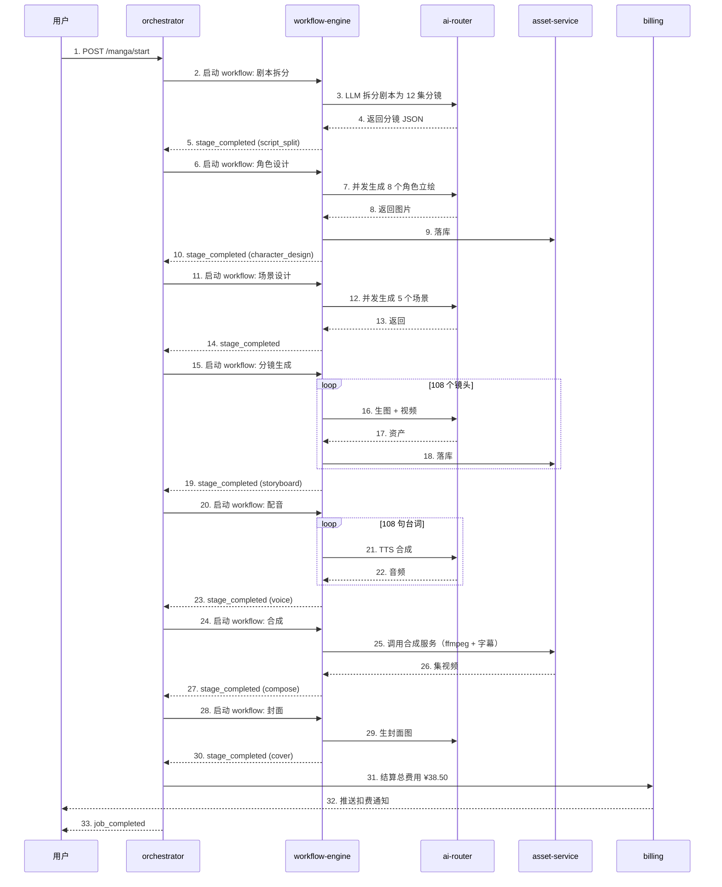

# orchestrator API 文档

> **Base URL**：`https://api.manhuaworks.com/v1/orchestrator`
> **认证**：Bearer Token（用户 JWT / API Key）
> **内容类型**：`application/json`
> **作者**：陈远枢
> **更新日期**：2026-06-08
> **服务**：`orchestrator` (端口 8088)

## 概述

orchestrator 是 ManhuaWorks 的**漫剧生成总编排器**。它把"输入剧本 → 输出完整漫剧"这个端到端流程拆成多个阶段，跨服务调度，并对外提供统一入口。

**核心职责**：
1. **一站式入口**：用户提交一次请求，自动串联 workflow + ai-router + asset-service
2. **进度聚合**：把多个子任务的进度合并为一个总进度（0-100%）
3. **错误恢复**：任意子任务失败，支持断点续做
4. **产物管理**：所有产物（剧本分镜/角色图/场景图/视频/字幕）统一管理

**与 workflow-engine 的区别**：
- `workflow-engine` (8084)：**通用** DAG 编排器，给 Studio 内"自定义工作流"用
- `orchestrator` (8088)：**专用** 漫剧编排器，给"一键生成漫剧"按钮用，封装好默认流程

**配套文档**：`docs/architecture/W3_ORCHESTRATOR.md`

---

## 通用规范

继承 `ai-router.md` 通用规范。**本服务特殊**：

- 所有"漫剧生成"端点都是**异步**——提交后立即返回 `job_id`，通过 WebSocket 或轮询获取进度
- 任务最长 2 小时（30 集漫剧），超时自动失败
- 失败后 24h 内可重试（不重复扣费已完成部分）

---

## 端点列表

| 方法 | 路径 | 说明 |
|:--|:--|:--|
| POST | `/v1/orchestrator/manga/start` | 一键启动漫剧生成（异步）|
| GET | `/v1/orchestrator/manga/:job_id` | 查询任务状态 |
| GET | `/v1/orchestrator/manga/:job_id/progress` | 查询实时进度（WebSocket 也支持）|
| POST | `/v1/orchestrator/manga/:job_id/cancel` | 取消任务 |
| POST | `/v1/orchestrator/manga/:job_id/retry` | 重试失败任务 |
| GET | `/v1/orchestrator/manga/:job_id/stages` | 列出所有阶段 |
| GET | `/v1/orchestrator/manga/:job_id/artifacts` | 列出所有产物 |
| POST | `/v1/orchestrator/shortdrama/start` | 启动短剧生成（5 集以内）|
| POST | `/v1/orchestrator/doujin/start` | 启动同人作品生成 |
| GET | `/v1/orchestrator/templates` | 列出编排模板 |
| GET | `/v1/orchestrator/jobs` | 列出我的所有任务 |
| WS | `/v1/orchestrator/ws` | WebSocket 实时进度推送 |

---

## 1. 启动漫剧生成

**端点**：`POST /v1/orchestrator/manga/start`

**说明**：用户提交剧本 + 配置，编排器自动跑完"分镜→生图→配音→字幕→合成"全流程。

### 请求

```http
POST /v1/orchestrator/manga/start
Authorization: Bearer <token>
Content-Type: application/json

{
  "project_id": "proj_abc",
  "title": "废墟之歌",
  "script_text": "三百年后，地球已是一片废墟...",
  "script_type": "novel_chapter",
  "episode_count": 12,
  "episode_duration_seconds": 180,
  "style": {
    "art_style": "2D_90s_japanese_anime",
    "color_tone": "cinematic_dusk",
    "character_style": "detailed_face",
    "language": "zh-CN"
  },
  "voice": {
    "narrator_voice": "male_narrator_01",
    "character_voices": {
      "林启": "male_young_01",
      "陈雪": "female_young_01"
    }
  },
  "options": {
    "auto_character_consistency": true,
    "auto_voice_assign": true,
    "auto_subtitle": true,
    "auto_bgm": true,
    "auto_cover": true
  },
  "priority": "normal"
}
```

| 字段 | 类型 | 必填 | 说明 |
|:--|:--|:--|:--|
| `project_id` | uuid | ✅ | 项目 ID |
| `title` | string | ✅ | 漫剧名 |
| `script_text` | string | ✅ | 剧本全文（1K-500K 字符）|
| `script_type` | enum | ✅ | `novel_chapter` / `screenplay` / `web_novel` |
| `episode_count` | int | ✅ | 集数（1-30）|
| `episode_duration_seconds` | int | ❌ | 单集目标时长（60-600，默认 180）|
| `style` | object | ✅ | 视觉风格 |
| `voice` | object | ❌ | 配音配置 |
| `options` | object | ❌ | 自动化选项（默认全 true）|
| `priority` | enum | ❌ | `low` / `normal` / `high` |

### 响应

```json
{
  "code": 0,
  "data": {
    "job_id": "job_abc123",
    "project_id": "proj_abc",
    "title": "废墟之歌",
    "status": "queued",
    "estimated_duration_minutes": 90,
    "estimated_cost": 38.50,
    "stages": [
      { "name": "script_split", "label": "剧本拆分", "weight": 10 },
      { "name": "character_design", "label": "角色设计", "weight": 15 },
      { "name": "scene_design", "label": "场景设计", "weight": 15 },
      { "name": "storyboard", "label": "分镜生成", "weight": 30 },
      { "name": "voice", "label": "配音", "weight": 15 },
      { "name": "compose", "label": "合成", "weight": 10 },
      { "name": "cover", "label": "封面", "weight": 5 }
    ],
    "ws_url": "wss://api.manhuaworks.com/v1/orchestrator/ws?job_id=job_abc123",
    "created_at": "2026-06-08T10:00:00Z"
  }
}
```

**预估成本**：根据集数 × 单集镜头数 × AI 单价动态计算，**真实扣费以完成时为准**。

---

## 2. 查询任务状态

**端点**：`GET /v1/orchestrator/manga/:job_id`

### 响应

```json
{
  "code": 0,
  "data": {
    "job_id": "job_abc123",
    "project_id": "proj_abc",
    "title": "废墟之歌",
    "status": "running",
    "current_stage": "storyboard",
    "current_stage_label": "分镜生成",
    "overall_progress": 0.55,
    "stages_progress": {
      "script_split": { "status": "success", "progress": 1.0 },
      "character_design": { "status": "success", "progress": 1.0 },
      "scene_design": { "status": "success", "progress": 1.0 },
      "storyboard": { "status": "running", "progress": 0.43 },
      "voice": { "status": "pending", "progress": 0.0 },
      "compose": { "status": "pending", "progress": 0.0 },
      "cover": { "status": "pending", "progress": 0.0 }
    },
    "stats": {
      "scenes_generated": 47,
      "scenes_total": 108,
      "images_generated": 47,
      "cost_so_far": 21.30,
      "elapsed_seconds": 1832
    },
    "created_at": "2026-06-08T10:00:00Z",
    "started_at": "2026-06-08T10:00:15Z",
    "estimated_finish_at": "2026-06-08T11:30:00Z"
  }
}
```

**status 枚举**：
- `queued`：排队中
- `running`：执行中
- `paused`：已暂停
- `success`：全部成功
- `partial_success`：部分失败，可下载部分产物
- `failed`：整体失败
- `cancelled`：用户取消

---

## 3. 实时进度（WebSocket）

**端点**：`WS /v1/orchestrator/ws?job_id=job_abc123`

**连接**：
```javascript
const ws = new WebSocket(`wss://api.manhuaworks.com/v1/orchestrator/ws?job_id=${jobId}&token=${jwtToken}`);
```

**消息类型**：

```json
{
  "type": "progress",
  "job_id": "job_abc123",
  "stage": "storyboard",
  "stage_label": "分镜生成",
  "stage_progress": 0.65,
  "overall_progress": 0.62,
  "message": "正在生成第 7 集 / 共 12 集"
}
```

```json
{
  "type": "stage_completed",
  "job_id": "job_abc123",
  "stage": "character_design",
  "duration_seconds": 240,
  "artifacts_count": 5
}
```

```json
{
  "type": "stage_failed",
  "job_id": "job_abc123",
  "stage": "voice",
  "error": "TTS 服务所有供应商失败",
  "retryable": true
}
```

```json
{
  "type": "job_completed",
  "job_id": "job_abc123",
  "status": "success",
  "total_cost": 38.50,
  "total_duration_seconds": 5400,
  "artifacts_count": 247
}
```

**轮询备选**：如果 WebSocket 不可用，前端可以每 3 秒 `GET /v1/orchestrator/manga/:job_id/progress`。

---

## 4. 取消任务

**端点**：`POST /v1/orchestrator/manga/:job_id/cancel`

### 响应

```json
{
  "code": 0,
  "data": {
    "job_id": "job_abc123",
    "status": "cancelled",
    "cancelled_at": "2026-06-08T10:30:00Z",
    "refund_amount": 12.50,
    "kept_artifacts": 23
  }
}
```

**退费规则**：未开始的阶段全退，已完成部分不退（已消耗的 AI 资源）。

---

## 5. 重试失败任务

**端点**：`POST /v1/orchestrator/manga/:job_id/retry`

### 请求

```json
{
  "retry_stages": ["voice", "compose"],
  "use_cache": true
}
```

| 字段 | 类型 | 必填 | 说明 |
|:--|:--|:--|:--|
| `retry_stages` | array | ❌ | 指定重试哪些阶段（默认全部失败阶段）|
| `use_cache` | bool | ❌ | 是否复用缓存（默认 true，免费）|

### 响应

```json
{
  "code": 0,
  "data": {
    "job_id": "job_abc123",
    "status": "running",
    "retry_stages": ["voice", "compose"],
    "estimated_duration_minutes": 15
  }
}
```

---

## 6. 列出所有阶段

**端点**：`GET /v1/orchestrator/manga/:job_id/stages`

### 响应

```json
{
  "code": 0,
  "data": {
    "stages": [
      {
        "name": "script_split",
        "label": "剧本拆分",
        "status": "success",
        "progress": 1.0,
        "started_at": "2026-06-08T10:00:15Z",
        "completed_at": "2026-06-08T10:01:30Z",
        "duration_seconds": 75,
        "cost": 0.20,
        "sub_tasks_count": 1
      },
      {
        "name": "storyboard",
        "label": "分镜生成",
        "status": "running",
        "progress": 0.65,
        "started_at": "2026-06-08T10:08:00Z",
        "duration_seconds": 1620,
        "cost": 18.50,
        "sub_tasks_count": 108,
        "sub_tasks_completed": 70
      }
    ]
  }
}
```

---

## 7. 列出所有产物

**端点**：`GET /v1/orchestrator/manga/:job_id/artifacts`

### 查询参数

| 参数 | 类型 | 必填 | 说明 |
|:--|:--|:--|:--|
| `stage` | string | ❌ | 按阶段筛选 |
| `type` | string | ❌ | 按类型筛选（image/video/audio/text）|
| `episode_no` | int | ❌ | 按集数筛选 |

### 响应

```json
{
  "code": 0,
  "data": {
    "artifacts": [
      {
        "id": "art_abc",
        "stage": "character_design",
        "type": "image",
        "name": "主角-林启-正面.png",
        "episode_no": null,
        "url": "https://cdn.mhwork.com/.../v1.png",
        "thumbnail_url": "https://cdn.mhwork.com/thumbs/abc.jpg",
        "size_bytes": 1024000,
        "metadata": {
          "character_name": "林启",
          "style": "anime",
          "prompt": "..."
        },
        "created_at": "2026-06-08T10:05:00Z"
      }
    ],
    "total": 247,
    "by_stage": {
      "script_split": 12,
      "character_design": 8,
      "scene_design": 5,
      "storyboard": 108,
      "voice": 108,
      "compose": 12,
      "cover": 1
    }
  }
}
```

---

## 8. 短剧生成

**端点**：`POST /v1/orchestrator/shortdrama/start`

**说明**：5 集以内的短剧（抖音/B站短剧格式），单集 1-3 分钟。

### 请求

```json
{
  "project_id": "proj_xyz",
  "title": "一句话反转",
  "script_text": "我以为他会说分手，结果...",
  "episode_count": 3,
  "episode_duration_seconds": 90,
  "aspect_ratio": "9:16",
  "platform": "douyin"
}
```

| 字段 | 类型 | 必填 | 说明 |
|:--|:--|:--|:--|
| `aspect_ratio` | enum | ✅ | `9:16` / `16:9` / `1:1` |
| `platform` | enum | ✅ | `douyin` / `kuaishou` / `bilibili` / `xiaohongshu` |
| 其他 | - | - | 同 manga/start |

**响应**：格式同 manga/start，但 `estimated_duration_minutes` 更短（10-30 分钟）。

---

## 9. 同人作品生成

**端点**：`POST /v1/orchestrator/doujin/start`

**说明**：基于已有 IP 角色/场景的二次创作。

### 请求

```json
{
  "project_id": "proj_doujin",
  "title": "原神-钟离现代篇",
  "source_ip": "原神",
  "characters": ["钟离", "胡桃"],
  "scenes": ["往生堂", "璃月港"],
  "script_text": "钟离在现代都市中...",
  "episode_count": 1
}
```

| 字段 | 类型 | 必填 | 说明 |
|:--|:--|:--|:--|
| `source_ip` | string | ✅ | 原 IP 名 |
| `characters` | array | ✅ | 涉及角色 |
| `scenes` | array | ❌ | 涉及场景 |
| `disclaimer` | string | ❌ | 免责声明（自动追加）|

**版权提示**：同人作品发布必须包含 `disclaimer`："本作品为粉丝二创，与原 IP 官方无关"。

---

## 10. 编排模板

**端点**：`GET /v1/orchestrator/templates`

### 响应

```json
{
  "code": 0,
  "data": {
    "templates": [
      {
        "id": "tmpl_standard_manga",
        "name": "标准漫剧（12 集 × 3 分钟）",
        "type": "manga",
        "preset": {
          "episode_count": 12,
          "episode_duration_seconds": 180,
          "style": "2D_90s_japanese_anime",
          "options": { "auto_*": true }
        },
        "estimated_cost": 35.0,
        "estimated_duration_minutes": 90
      },
      {
        "id": "tmpl_short_drama",
        "name": "抖音短剧（3 集 × 90 秒）",
        "type": "shortdrama",
        "preset": {
          "episode_count": 3,
          "episode_duration_seconds": 90,
          "aspect_ratio": "9:16"
        },
        "estimated_cost": 8.0
      }
    ]
  }
}
```

---

## 11. 列出我的所有任务

**端点**：`GET /v1/orchestrator/jobs?status=running&page=1`

### 查询参数

| 参数 | 类型 | 必填 | 说明 |
|:--|:--|:--|:--|
| `status` | enum | ❌ | `queued` / `running` / `success` / `failed` / `cancelled` |
| `type` | enum | ❌ | `manga` / `shortdrama` / `doujin` |
| `from` | ISO8601 | ❌ | 起始时间 |
| `to` | ISO8601 | ❌ | 结束时间 |
| `page` | int | ❌ | 页码 |
| `page_size` | int | ❌ | 每页数量（默认 20）|

### 响应

```json
{
  "code": 0,
  "data": {
    "items": [
      {
        "job_id": "job_abc",
        "title": "废墟之歌",
        "type": "manga",
        "status": "running",
        "overall_progress": 0.55,
        "cost_so_far": 21.30,
        "created_at": "2026-06-08T10:00:00Z"
      }
    ],
    "pagination": { "page": 1, "page_size": 20, "total": 5 }
  }
}
```

---

## 12. 编排流程详解（标准漫剧）



**耗时分布**（12 集漫剧）：
- 剧本拆分：1-2 分钟
- 角色设计：3-5 分钟
- 场景设计：3-5 分钟
- 分镜生成：40-60 分钟（最大头）
- 配音：5-10 分钟
- 合成：5-10 分钟
- 封面：1-2 分钟
- **合计**：60-90 分钟

---

## 13. 成本估算

| 项目 | 单价 | 单集用量 | 单集成本 |
|:--|:--|:--|:--|
| 剧本拆分 (LLM) | ¥0.01/K token | 5K | ¥0.05 |
| 角色立绘 | ¥0.18/张 | 0.7 张（共享）| ¥0.13 |
| 场景图 | ¥0.18/张 | 0.4 张 | ¥0.07 |
| 分镜图 | ¥0.18/张 | 9 张 | ¥1.62 |
| 分镜视频 | ¥0.85/段 | 3 段 | ¥2.55 |
| 配音 | ¥0.006/句 | 12 句 | ¥0.07 |
| **单集合计** | - | - | **¥4.49** |
| **12 集合计** | - | - | **¥53.88** |

**节省技巧**：
- 单集时长缩到 90 秒 → 6 镜 → ¥18/集
- 关闭"自动视频"→ 节省 50% 成本
- BYOK（自备 Key）→ 节省 40-75%

---

## 14. 错误码（本服务特有）

| HTTP | 错误码 | 含义 |
|:--|:--|:--|
| 402 | `insufficient_credit` | 用户余额不足 |
| 409 | `job_already_running` | 该项目已有任务运行中 |
| 422 | `invalid_script` | 剧本格式无法解析 |
| 423 | `script_too_long` | 剧本超过 500K 字符 |

---

## 15. 完整示例

### cURL 一键启动

```bash
curl -X POST https://api.manhuaworks.com/v1/orchestrator/manga/start \
  -H "Authorization: Bearer $JWT" \
  -H "Content-Type: application/json" \
  -d '{
    "project_id": "proj_abc",
    "title": "废墟之歌",
    "script_text": "三百年后...",
    "script_type": "novel_chapter",
    "episode_count": 12,
    "style": {
      "art_style": "2D_90s_japanese_anime",
      "color_tone": "cinematic_dusk"
    }
  }'

# 响应拿到 job_id
# 然后订阅 WebSocket
wscat -c "wss://api.manhuaworks.com/v1/orchestrator/ws?job_id=job_abc123&token=$JWT"
```

### Python + WebSocket 监听进度

```python
import websocket, json, threading

def on_message(ws, message):
    msg = json.loads(message)
    if msg['type'] == 'progress':
        print(f"[{msg['overall_progress']*100:.0f}%] {msg['stage_label']}: {msg['message']}")
    elif msg['type'] == 'job_completed':
        print(f"完成！总成本 ¥{msg['total_cost']}")
        ws.close()

ws = websocket.WebSocketApp(
    f"wss://api.manhuaworks.com/v1/orchestrator/ws?job_id={job_id}&token={token}",
    on_message=on_message
)
ws.run_forever()
```

---

## 16. SDK

- **Node.js**：`@mhwork/orchestrator-sdk`
- **Python**：`mhwork[manga]`（含 WebSocket 异步客户端）
- **Web Component**：`<mhwork-manga-generator>`（一键嵌入前端）

---

## 17. 变更记录

| 版本 | 日期 | 作者 | 变更 |
|:--|:--|:--|:--|
| v0.1 | 2026-06-08 | 陈远枢 | 初稿（W3 任务 6）|
