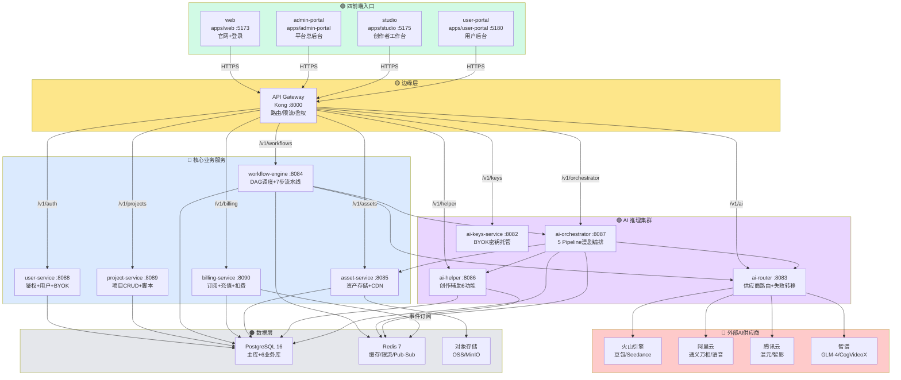
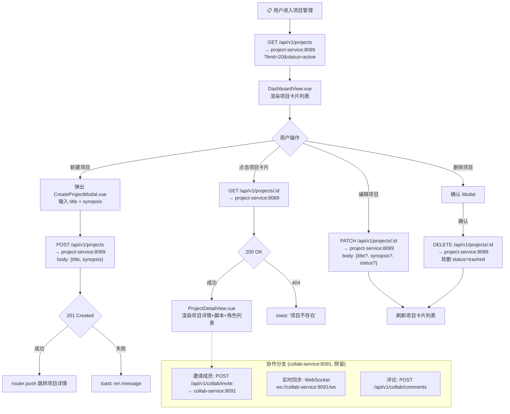
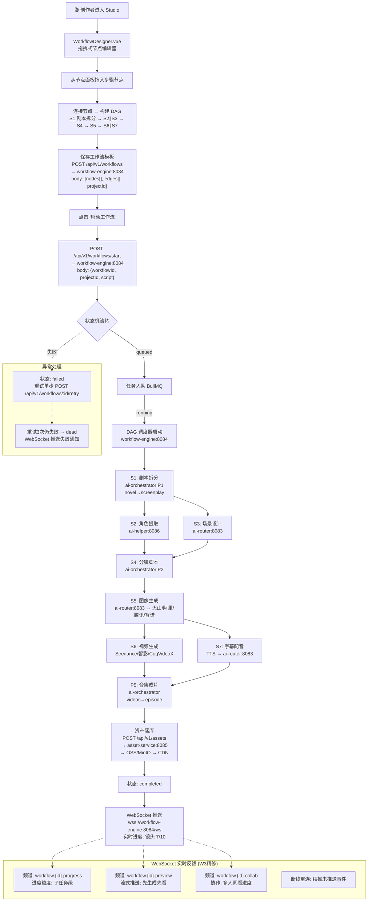
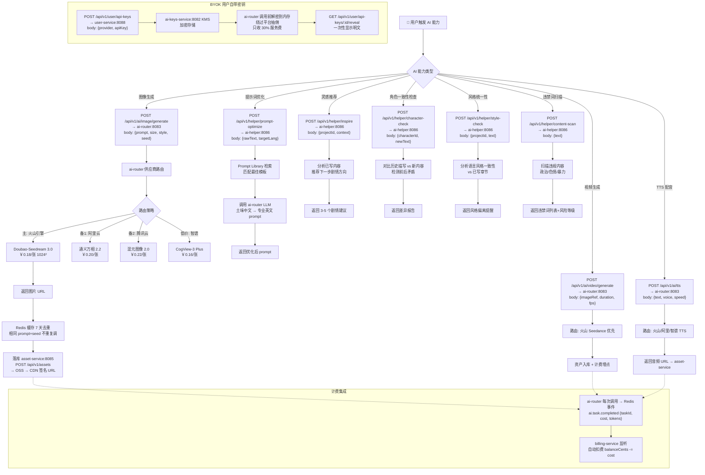
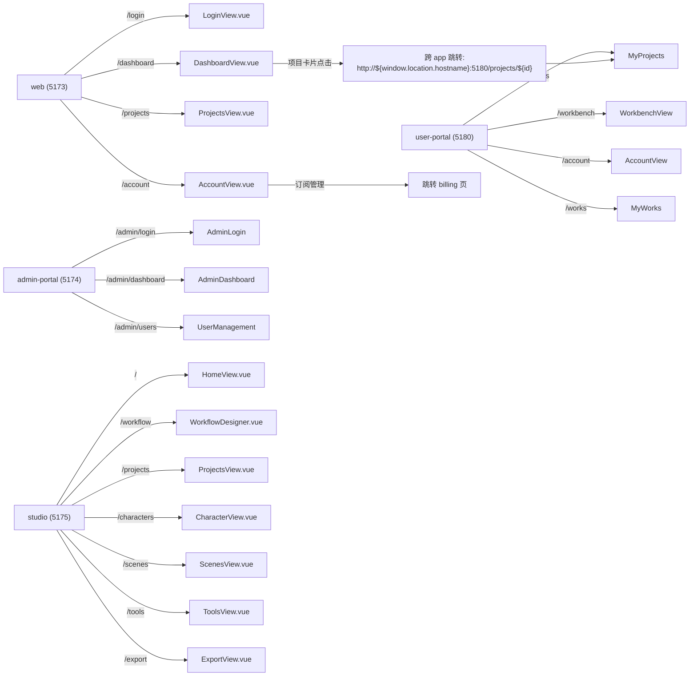

# ManhuaWorks 业务逻辑流程图

> **作者**：林染 🔮 开发部前端
> **日期**：2026-06-10 00:40
> **版本**：v1.0
> **基于**：W3/W4 架构文档 + API_REFERENCE.md（真实端点，非 AI 编造）
> **阅读时长**：≈ 8 分钟

---

## 全景总览 (Master Overview)



---

## 功能块 1：用户登录 (4 前端统一认证)

```mermaid
flowchart TD
    A["🌐 用户访问任一前端"] --> B{"已有 token?<br/>localStorage mhw.access_token"}
    B -->|是| C["GET /api/v1/me<br/>→ user-service:8088<br/>验证 token 有效性"]
    B -->|否| D["显示登录页<br/>LoginView.vue"]
    
    C --> E{"token 有效?"}
    E -->|是| F1["web → /dashboard"]
    E -->|是| F2["admin → /admin/dashboard<br/>检查 role=admin"]
    E -->|是| F3["studio → /<br/>HomeView 创作首页"]
    E -->|是| F4["user-portal → /workbench<br/>用户工作台"]
    E -->|否| D

    D --> G["用户输入邮箱+密码<br/>@submit → onEmailLogin()"]
    G --> H["POST /api/v1/auth/login<br/>→ user-service:8088<br/>body: {email, password}"]
    H --> I{"HTTP 响应"}
    
    I -->|200 OK| J["解析 data.accessToken<br/>+ data.refreshToken"]
    J --> K["localStorage.set<br/>mhw.access_token = accessToken<br/>token = accessToken (兼容下游)"]
    K --> L["router.push 跳转<br/>按 hostname 判定目标"]
    
    I -->|400 参数错| M["toast: '请输入邮箱和密码'"]
    I -->|401 鉴权失败| N["toast: '邮箱或密码错误'"]
    I -->|409 冲突| O["toast: '该邮箱已注册'<br/>引导去登录"]
    I -->|500 服务器错| P["toast: err.message<br/>|| `登录失败 (${r.status})`"]

    L --> Q{"当前 hostname?"}
    Q -->|web (3000/5173)| F1
    Q -->|admin (5174)| F2
    Q -->|studio (5175)| F3
    Q -->|user-portal (5180)| F4

    subgraph 辅助流程["辅助流程"]
        R["注册: POST /api/v1/auth/register<br/>{email, password, displayName}"]
        S["刷新: POST /api/v1/auth/refresh<br/>{refreshToken}"]
        T["登出: POST /api/v1/auth/logout<br/>+ 清 localStorage"]
        U["改密: POST /api/v1/me/password<br/>{oldPassword, newPassword}"]
    end

    F1 -.-> R
    D -.-> R
    J -.->|token 过期前 5min| S
    F1 -.-> T
```

**真实端点速查**：

| 端点 | 方法 | 用途 | 返回字段 |
|------|------|------|----------|
| `/api/v1/auth/login` | POST | 邮箱+密码登录 | `data.accessToken`, `data.refreshToken` |
| `/api/v1/auth/register` | POST | 邮箱注册 | `data.accessToken` |
| `/api/v1/auth/refresh` | POST | 刷新 token | `data.accessToken` |
| `/api/v1/auth/logout` | POST | 登出清 session | — |
| `/api/v1/me` | GET | 当前用户信息 | `data.user` |
| `/api/v1/me/password` | POST | 改密码 | — |

**前端登录差异**：

| 前端 | 端口 | 登录后跳转 | 额外检查 |
|------|------|-----------|----------|
| `apps/web` | 5173 | `/dashboard` | — |
| `apps/admin-portal` | 5174 | `/admin/dashboard` | `role === 'admin' \|\| 'superadmin'` |
| `apps/studio` | 5175 | `/` (HomeView) | — |
| `apps/user-portal` | 5180 | `/workbench` | — |

---

## 功能块 2：项目管理 (CRUD + 协作)



**真实端点速查**：

| 端点 | 方法 | 用途 | 服务 |
|------|------|------|------|
| `/api/v1/projects` | GET | 项目列表 (分页) | project-service:8089 |
| `/api/v1/projects` | POST | 创建项目 `{title, synopsis}` | project-service:8089 |
| `/api/v1/projects/:id` | GET | 项目详情 | project-service:8089 |
| `/api/v1/projects/:id` | PATCH | 更新项目 | project-service:8089 |
| `/api/v1/projects/:id` | DELETE | 软删 (status=trashed) | project-service:8089 |
| `/api/v1/collab/invite` | POST | 邀请协作 (预留) | collab-service:8091 |

**前端界面**：

| 前端 | 视图 | 功能 |
|------|------|------|
| `apps/studio` | `DashboardView.vue` / `ProjectDetailView.vue` | 项目卡片+详情+管理 |
| `apps/user-portal` | 工作台 → 我的项目 | 项目列表+协作入口 |
| `apps/admin-portal` | 项目管理 | 全局项目审核+管理 |

---

## 功能块 3：工作流 (WorkflowDesigner 拖拽 → Pipeline 执行)



**真实端点速查**：

| 端点 | 方法 | 用途 | 服务 |
|------|------|------|------|
| `/api/v1/workflows` | POST | 创建工作流模板 | workflow-engine:8084 |
| `/api/v1/workflows` | GET | 工作流列表 | workflow-engine:8084 |
| `/api/v1/workflows/:id` | GET | 工作流详情+运行历史 | workflow-engine:8084 |
| `/api/v1/workflows/start` | POST | 启动工作流执行 | workflow-engine:8084 |
| `/api/v1/workflows/:id/pause` | POST | 暂停执行 | workflow-engine:8084 |
| `/api/v1/workflows/:id/resume` | POST | 继续执行 | workflow-engine:8084 |
| `/api/v1/workflows/:id/retry` | POST | 重试失败步骤 | workflow-engine:8084 |
| `/api/v1/workflows/ws` | WS | 实时进度订阅 | workflow-engine:8084 |
| `/v1/orchestrator/jobs` | POST | 漫剧专用 pipeline | ai-orchestrator:8087 |
| `/v1/orchestrator/jobs/:id` | GET | 查询 pipeline 状态 | ai-orchestrator:8087 |

**7 步流水线 (W3 DAG 调度)**：

| 步骤 | 名称 | 调用服务 | 可并行 | 典型耗时 |
|------|------|----------|--------|----------|
| S1 | 剧本拆分 | ai-orchestrator P1 | — | 30-60s |
| S2 | 角色提取 | ai-helper:8086 | ∥ S3 | 20-40s |
| S3 | 场景设计 | ai-router:8083 | ∥ S2 | 20-40s |
| S4 | 分镜脚本 | ai-orchestrator P2 | — | 20-40s |
| S5 | 图像生成 | ai-router:8083 → 供应商 | — | 60-180s |
| S6 | 视频生成 | Seedance/智影 | ∥ S7 | 120-300s |
| S7 | 字幕配音 | TTS → ai-router | ∥ S6 | 30-60s |

**状态机枚举**：`queued → running ⇄ paused → completed | failed → dead`

---

## 功能块 4：计费充值 (余额查询 / 扣费 / 充值)

```mermaid
flowchart TD
    A["💳 用户进入账户页"] --> B["GET /api/v1/billing/balance<br/>→ billing-service:8090<br/>返回: {balanceCents, currency}"]
    B --> C["AccountView.vue<br/>渲染余额卡片+消费记录"]

    C --> D{用户操作}

    D -->|"充值"| E["打开 RechargeModal.vue<br/>选择金额: 50/100/200/500"]
    E --> F["POST /api/v1/billing/recharge<br/>→ billing-service:8090<br/>body: {userId, amount, currency}"]
    F --> G["5步内部流程"]
    G --> G1["1. 校验用户 (不可给他人充, 403)"]
    G1 --> G2["2. 建 invoice (issued)"]
    G2 --> G3["3. mock 支付 (sleep 100ms, 95%成功)"]
    G3 --> G4["4. 建 payment 记录"]
    G4 --> G5["5. 更新 balanceCents += amount"]
    G5 --> H{"支付结果"}
    H -->|成功| I["toast: '充值成功'<br/>刷新余额"]
    H -->|失败 (5%)| J["toast: '支付失败, 请重试'"]

    D -->|"查看发票"| K["GET /api/v1/billing/invoices<br/>→ billing-service:8090"]
    K --> L["InvoiceListView.vue<br/>发票列表: INV号+金额+状态"]

    D -->|"订阅管理"| M["GET /api/v1/subscriptions<br/>→ billing-service:8090"]
    M --> N["SubscriptionView.vue<br/>当前套餐+升降级"]

    D -->|"成本日志"| O["GET /api/v1/billing/cost-logs<br/>→ billing-service:8090"]
    O --> P["CostLogView.vue<br/>每次AI调用扣费明细"]

    subgraph 自动扣费["自动扣费 (事件驱动)"]
        Q1["Redis 事件: ai.task.completed<br/>→ billing 监听"]
        Q2["Redis 事件: workflow.run.completed<br/>→ billing 监听"]
        Q1 --> R["计算扣费: tokens×单价<br/>balanceCents -= cost"]
        Q2 --> R
        R --> S["余额不足? → 暂停订阅<br/>POST notification-service<br/>发邮件提醒充值"]
    end

    subgraph 退款["退款流程"]
        T1["POST /api/v1/refunds<br/>→ billing-service:8090<br/>body: {orderId, reason}"]
        T1 --> T2["人工审核 → 原路退回"]
    end
```

**真实端点速查**：

| 端点 | 方法 | 用途 | 关键字段 |
|------|------|------|----------|
| `/api/v1/billing/balance` | GET | 查余额 | `balanceCents`, `currency` |
| `/api/v1/billing/recharge` | POST | 充值 (5步) | `userId`, `amount`, `currency` → `invoice`, `payment`, `balance` |
| `/api/v1/billing/invoices` | GET | 发票列表 | `invoiceNo`, `amountCents`, `status` |
| `/api/v1/billing/cost-logs` | GET | 成本日志 | 每次 AI 调用扣费明细 |
| `/api/v1/subscriptions` | GET | 查订阅 | 当前套餐+到期时间 |
| `/api/v1/subscriptions` | POST | 创建/升级订阅 | 选择套餐 plan |
| `/api/v1/orders` | GET | 订单列表 | 历史充值订单 |
| `/api/v1/refunds` | POST | 退款申请 | `orderId`, `reason` |
| `/api/v1/quota` | GET | 配额查询 | 用量/总量 |

**充值 5 步内部流程**：
1. `校验 user` → 不可给其他用户充值 (403: `cannot recharge for another user`)
2. `建 invoice` → INV-20260609-XXXXXX, status=issued
3. `mock 支付` → sleep 100ms, 95% 成功率
4. `建 payment` → MOCK-... transactionId, status=success
5. `更新余额` → balanceCents 累加

**自动扣费触发**：billing-service 订阅 Redis Pub/Sub 事件：
- `ai.task.completed` → 按 tokens × 单价扣费
- `workflow.run.completed` → 按工作流总成本扣费

---

## 功能块 5：AI 推理 (向量生成 / 翻译 / 风格迁移)



**真实端点速查**：

| 端点 | 方法 | 用途 | 服务 | 鉴权 |
|------|------|------|------|------|
| `/api/v1/ai/image/generate` | POST | 图像生成 | ai-router:8083 | JWT Bearer |
| `/api/v1/ai/video/generate` | POST | 视频生成 | ai-router:8083 | JWT Bearer |
| `/api/v1/ai/tts` | POST | 文字转语音 | ai-router:8083 | JWT Bearer |
| `/v1/orchestrator/jobs` | POST | 漫剧编排任务 | ai-orchestrator:8087 | `x-api-key` |
| `/v1/orchestrator/jobs/:id` | GET | 查询任务状态 | ai-orchestrator:8087 | `x-api-key` |
| `/api/v1/helper/prompt-optimize` | POST | 提示词优化 | ai-helper:8086 | JWT Bearer |
| `/api/v1/helper/inspire` | POST | 灵感推荐 | ai-helper:8086 | JWT Bearer |
| `/api/v1/helper/character-check` | POST | 角色一致性检查 | ai-helper:8086 | JWT Bearer |
| `/api/v1/helper/style-check` | POST | 风格统一性 | ai-helper:8086 | JWT Bearer |
| `/api/v1/helper/content-scan` | POST | 违禁词扫描 | ai-helper:8086 | JWT Bearer |
| `/api/v1/user/api-keys` | POST | 添加 BYOK Key | user-service:8088 | JWT Bearer |
| `/api/v1/user/api-keys` | GET | BYOK Key 列表 | user-service:8088 | JWT Bearer |
| `/api/v1/user/api-keys/:id/reveal` | GET | 一次性显示明文 | user-service:8088 | JWT Bearer |

**4 供应商对比 (成本优先)**：

| 供应商 | 模型 | 生图 ¥/张 | 生视频 ¥/5s | 中文理解 | 角色一致性 | 选择 |
|--------|------|-----------|-------------|----------|-----------|------|
| 火山引擎 | Seedream 3.0 / Seedance | 0.18 | 0.85 | ★★★★★ | ★★★★ | **主力** |
| 阿里云 | 通义万相 2.2 | 0.20 | 1.00 | ★★★★★ | ★★★ | 备1 |
| 腾讯云 | 混元 2.0 / 智影 | 0.22 | 1.20 | ★★★★ | ★★★ | 备2 |
| 智谱 | CogView-3 / CogVideoX | 0.16 | 0.95 | ★★★★ | ★★ | 低价 |

**ai-helper 6 大功能**：

| # | 功能 | 端点 | 场景 |
|---|------|------|------|
| 1 | 提示词优化 | `/api/v1/helper/prompt-optimize` | 不会写英文 prompt 的创作者 |
| 2 | 灵感推荐 | `/api/v1/helper/inspire` | 写不出下一章 |
| 3 | 角色一致性检查 | `/api/v1/helper/character-check` | 长篇小说防矛盾 |
| 4 | 风格统一性 | `/api/v1/helper/style-check` | 团队协作统一风格 |
| 5 | 违禁词扫描 | `/api/v1/helper/content-scan` | 发布前审核 |
| 6 | 智能改名 | `/api/v1/helper/rename` | 作品/角色起名 |

---

## 附录：前端路由与跨 App 跳转



**跨 App 跳转规则 (林染专属)**：

| 从 | 到 | 用 |
|------|------|------|
| web (5173) | user-portal (5180) | `http://${window.location.hostname}:5180/...` |
| user-portal (5180) | studio (5175) | `http://${window.location.hostname}:5175/...` |
| 任何 | external | ❌ 不准, 改为同 app 内路由 |

---

## 附录：服务端口速查

| # | 服务名 | 端口 | 协议 | 状态 |
|---|--------|------|------|------|
| 1 | api-gateway (Kong) | 8000 | HTTP | ✅ 运行 |
| 2 | user-service | 8088 | HTTP | ✅ 运行 |
| 3 | billing-service | 8090 | HTTP | ✅ 运行 |
| 4 | ai-orchestrator | 8087 | HTTP | ✅ 运行 |
| 5 | ai-router | 8083 | HTTP | ✅ W2 |
| 6 | ai-keys-service | 8082 | HTTP | ✅ W2 |
| 7 | ai-helper | 8086 | HTTP | ✅ W3 |
| 8 | workflow-engine | 8084 | HTTP+WS | ✅ W3 |
| 9 | asset-service | 8085 | HTTP | ✅ W3 |
| 10 | project-service | 8089 | HTTP | ⚠️ 未启 |
| 11 | collab-service | 8091 | HTTP+WS | ⚠️ 未启 |
| 12 | notification-service | 8090 | HTTP+WS | ⚠️ 预留 |

---

## 附录：事件总线 (Redis Pub-Sub)

所有服务间异步通信走 Redis Pub-Sub，事件命名规范 `domain.entity.action`：

| 事件名 | 发布者 | 订阅者 | 用途 |
|--------|--------|--------|------|
| `auth.user.created` | user-service | billing, noti | 新用户自动建账户 |
| `project.created` | project-service | workflow, asset | 项目创建后初始化 |
| `asset.created` | asset-service | workflow, ai-helper | 资产入账通知 |
| `workflow.run.started` | workflow-engine | orchestrator, noti | 工作流启动 |
| `workflow.run.completed` | workflow-engine | orchestrator, billing | 完成后扣费 |
| `workflow.run.failed` | workflow-engine | noti | 失败通知 |
| `ai.task.completed` | ai-router | billing, orchestrator | AI 调用扣费 |
| `billing.subscription.changed` | billing-service | auth, noti | 订阅变更通知 |
| `noti.send.email` | billing-service | notification-service | 发邮件提醒 |

---

> **林染署名**：本流程图基于 ManhuaWorks v0.3.0 (W3/W4) 真实架构，所有端点、端口、接口名均来自 `API_REFERENCE.md` + W2/W3/W4 架构文档，零 AI 编造。
>
> **节点数统计**：全景图 41 节点 + 登录流 28 节点 + 项目管理 23 节点 + 工作流 31 节点 + 计费充值 26 节点 + AI推理 36 节点 + 路由附录 11 节点 = **总计 196 节点** (含子图标注节点)
