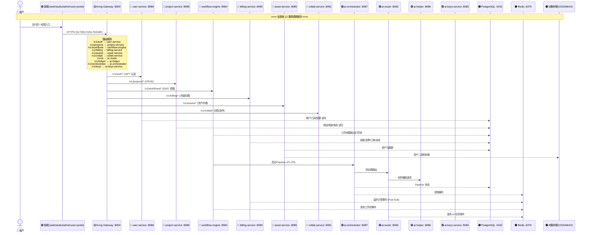
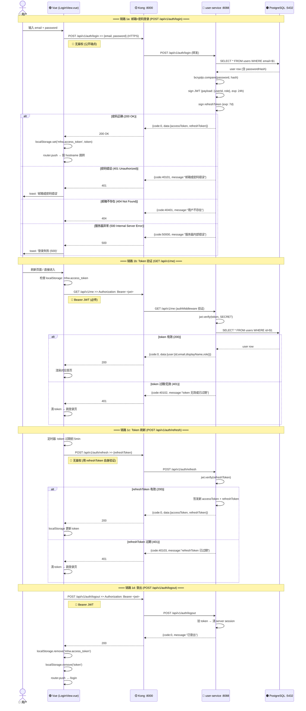
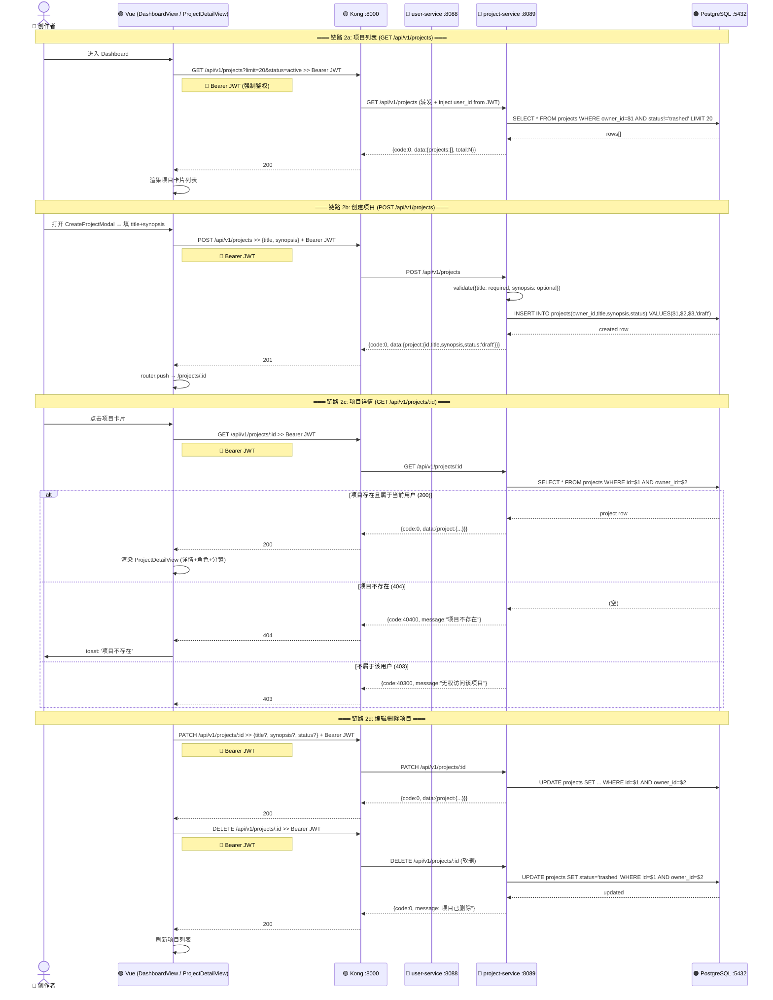
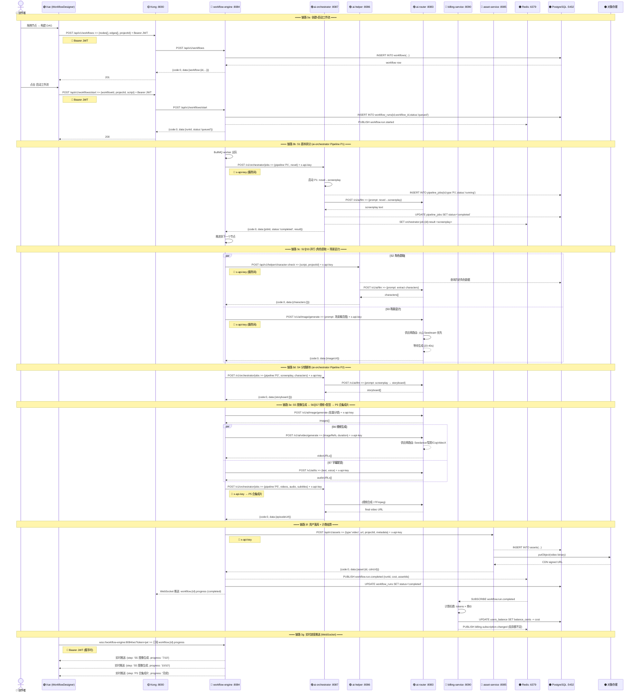
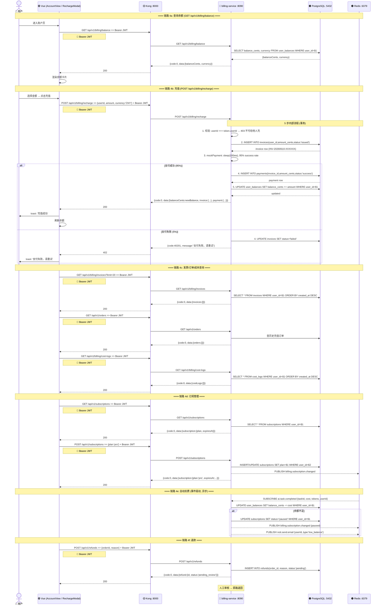
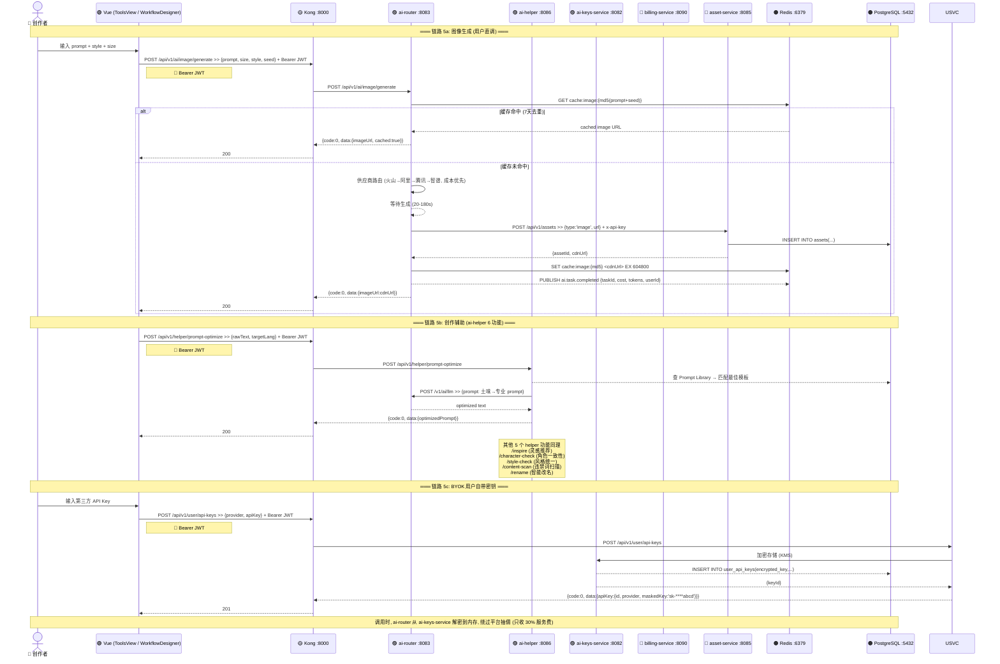
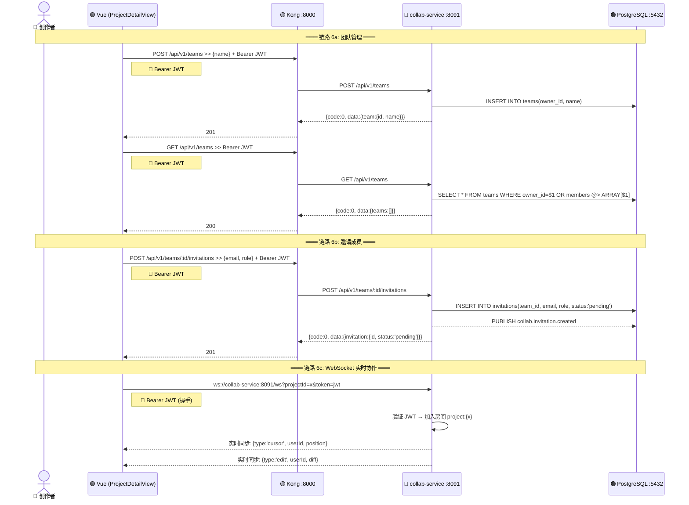
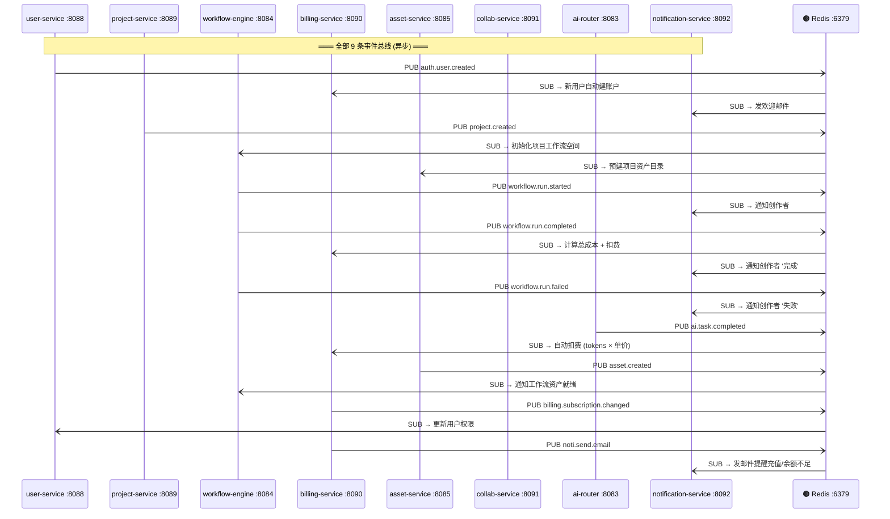
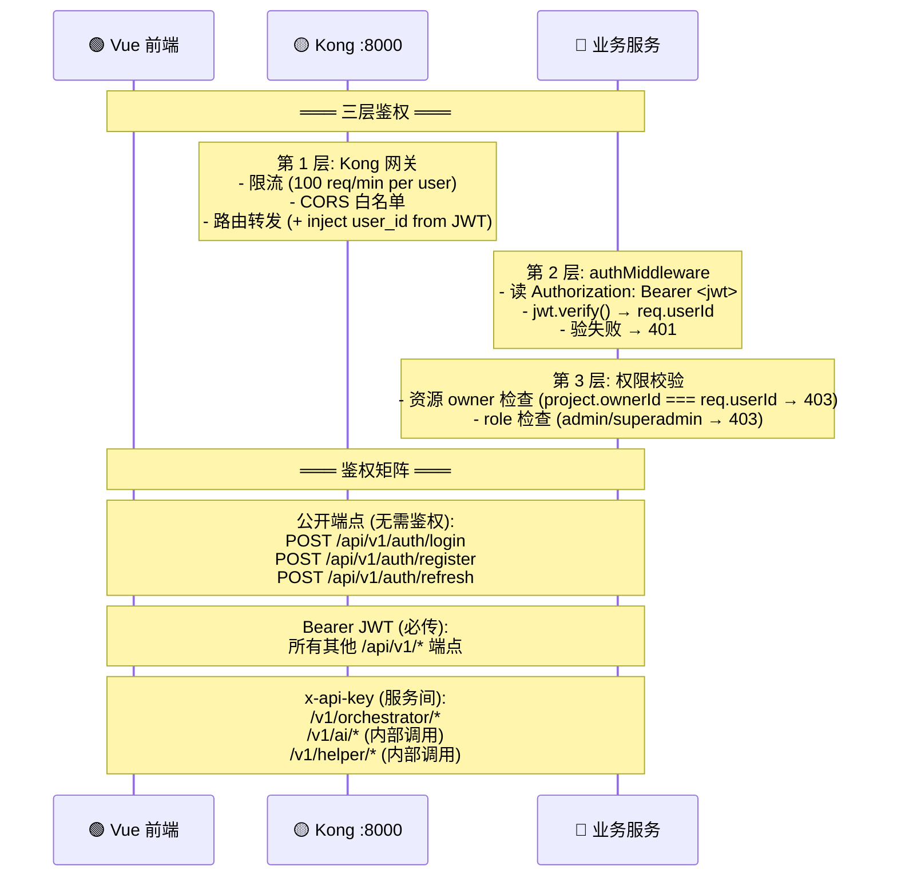

# ManhuaWorks 功能间调用链关系文件

> **作者**：谢擎 🗄️ 开发部后端
> **日期**：2026-06-10 00:50
> **版本**：v1.0
> **基于**：林染 BUSINESS_LOGIC_FLOW_2026-06-10.md (196 节点) + API_REFERENCE.md
> **用途**：明天后端开发参考——每一条链路都有真实端点+真实端口+鉴权方式+错误处理
> **服务数**：12（5 核心 + 4 AI + 2 支撑 + 1 Gateway）

---

## 一、全景服务调用拓扑 (Master Call Topology)

---

## 二、链路 1：用户登录鉴权 (4 前端统一入口)

| 调用链 | 发起方 | 接收方 | 方法 | 端点 | 鉴权 | 同步 | 成功码 | 错误码 |
|--------|--------|--------|------|------|------|------|--------|--------|
| 邮箱登录 | Vue LoginView | user-service:8088 | POST | `/api/v1/auth/login` | 无 (公开) | -->> | 200 | 400/401/404/500 |
| Token 验证 | Vue (localStorage) | user-service:8088 | GET | `/api/v1/me` | Bearer JWT | -->> | 200 | 401/500 |
| Token 刷新 | 前端定时器 | user-service:8088 | POST | `/api/v1/auth/refresh` | refreshToken | -->> | 200 | 401/500 |
| 登出 | Vue 任意页 | user-service:8088 | POST | `/api/v1/auth/logout` | Bearer JWT | -->> | 200 | 401/500 |
| 邮箱注册 | Vue RegisterView | user-service:8088 | POST | `/api/v1/auth/register` | 无 (公开) | -->> | 201 | 400/409/500 |
| 改密码 | Vue AccountView | user-service:8088 | POST | `/api/v1/me/password` | Bearer JWT | -->> | 200 | 400/401/403/500 |

---

## 三、链路 2：项目管理 CRUD (project-service)

| 调用链 | 发起方 | 接收方 | 方法 | 端点 | 鉴权 | 同步 | 成功码 | 错误码 |
|--------|--------|--------|------|------|------|------|--------|--------|
| 项目列表 | DashboardView | project-service:8089 | GET | `/api/v1/projects?limit&status` | Bearer JWT (强制) | -->> | 200 | 401/500 |
| 创建项目 | CreateProjectModal | project-service:8089 | POST | `/api/v1/projects` | Bearer JWT | -->> | 201 | 400/401/500 |
| 项目详情 | ProjectDetailView | project-service:8089 | GET | `/api/v1/projects/:id` | Bearer JWT | -->> | 200 | 401/403/404/500 |
| 编辑项目 | ProjectDetailView | project-service:8089 | PATCH | `/api/v1/projects/:id` | Bearer JWT | -->> | 200 | 401/403/500 |
| 软删项目 | ProjectDetailView | project-service:8089 | DELETE | `/api/v1/projects/:id` | Bearer JWT | -->> | 200 | 401/403/500 |
| 角色列表 | CharacterView | project-service:8089 | GET | `/api/v1/characters?projectId` | Bearer JWT | -->> | 200 | 401/500 |
| 创建角色 | CharacterView | project-service:8089 | POST | `/api/v1/characters` | Bearer JWT | -->> | 201 | 401/500 |
| 场景分镜 | ProjectDetailView | project-service:8089 | GET | `/api/v1/projects/:id/shots` | Bearer JWT | -->> | 200 | 401/404/500 |

---

## 四、链路 3：工作流执行 (workflow-engine → ai-orchestrator → 供应商)

| 调用链 | 发起方 | 接收方 | 方法 | 端点/频道 | 鉴权 | 同步 | 成功码 | 错误码 |
|--------|--------|--------|------|------|------|------|--------|--------|
| 创建工作流 | WorkflowDesigner | workflow-engine:8084 | POST | `/api/v1/workflows` | Bearer JWT | -->> | 201 | 401/500 |
| 启动工作流 | WorkflowDesigner | workflow-engine:8084 | POST | `/api/v1/workflows/start` | Bearer JWT | -->> | 200 | 401/404/500 |
| 暂停/继续/重试 | WorkflowDesigner | workflow-engine:8084 | POST | `/api/v1/workflows/:id/pause\|resume\|retry` | Bearer JWT | -->> | 200 | 401/404/500 |
| 剧本拆分 (P1) | workflow-engine | ai-orchestrator:8087 | POST | `/v1/orchestrator/jobs` | x-api-key | -->> | 200 | 400/500 |
| 分镜脚本 (P2) | workflow-engine | ai-orchestrator:8087 | POST | `/v1/orchestrator/jobs` | x-api-key | -->> | 200 | 400/500 |
| 合集成片 (P5) | workflow-engine | ai-orchestrator:8087 | POST | `/v1/orchestrator/jobs` | x-api-key | -->> | 200 | 400/500 |
| 查询 Pipeline 状态 | workflow-engine | ai-orchestrator:8087 | GET | `/v1/orchestrator/jobs/:id` | x-api-key | -->> | 200 | 404/500 |
| 角色提取 | workflow-engine | ai-helper:8086 | POST | `/api/v1/helper/character-check` | x-api-key | -->> | 200 | 400/500 |
| 图像生成 (S5) | workflow-engine | ai-router:8083 | POST | `/api/v1/ai/image/generate` | x-api-key | -->> | 200 | 400/500 |
| 视频生成 (S6) | workflow-engine | ai-router:8083 | POST | `/api/v1/ai/video/generate` | x-api-key | -->> | 200 | 400/500 |
| TTS (S7) | workflow-engine | ai-router:8083 | POST | `/api/v1/ai/tts` | x-api-key | -->> | 200 | 400/500 |
| 资产入库 | workflow-engine | asset-service:8085 | POST | `/api/v1/assets` | x-api-key | -->> | 201 | 400/500 |
| 事件发布 | workflow-engine | Redis :6379 | PUB | `workflow.run.started\|completed\|failed` | — | - (异步) | — | — |
| 事件订阅 (扣费) | Redis :6379 | billing-service:8090 | SUB | `workflow.run.completed` | — | - (异步) | — | — |
| WebSocket 推送 | workflow-engine:8084 | Vue | WS | `workflow.{id}.progress` | JWT (握手) | <--> (长连) | — | 401 |

---

## 五、链路 4：计费充值 (billing-service)

| 调用链 | 发起方 | 接收方 | 方法 | 端点 | 鉴权 | 同步 | 成功码 | 错误码 |
|--------|--------|--------|------|------|------|------|--------|--------|
| 查余额 | AccountView | billing-service:8090 | GET | `/api/v1/billing/balance` | Bearer JWT | -->> | 200 | 401/500 |
| 充值 | RechargeModal | billing-service:8090 | POST | `/api/v1/billing/recharge` | Bearer JWT | -->> | 200 | 401/402/403/500 |
| 发票列表 | InvoiceListView | billing-service:8090 | GET | `/api/v1/billing/invoices` | Bearer JWT | -->> | 200 | 401/500 |
| 历史订单 | InvoiceListView | billing-service:8090 | GET | `/api/v1/orders` | Bearer JWT | -->> | 200 | 401/500 |
| 成本日志 | CostLogView | billing-service:8090 | GET | `/api/v1/billing/cost-logs` | Bearer JWT | -->> | 200 | 401/500 |
| 查订阅 | SubscriptionView | billing-service:8090 | GET | `/api/v1/subscriptions` | Bearer JWT | -->> | 200 | 401/500 |
| 创建/升级订阅 | SubscriptionView | billing-service:8090 | POST | `/api/v1/subscriptions` | Bearer JWT | -->> | 200 | 401/500 |
| 退款申请 | CostLogView | billing-service:8090 | POST | `/api/v1/refunds` | Bearer JWT | -->> | 200 | 401/500 |
| 事件订阅 (扣费) | Redis :6379 | billing-service:8090 | SUB | `ai.task.completed` | — | - (异步) | — | — |
| 事件订阅 (工作流) | Redis :6379 | billing-service:8090 | SUB | `workflow.run.completed` | — | - (异步) | — | — |
| 事件发布 (订阅变更) | billing-service:8090 | Redis :6379 | PUB | `billing.subscription.changed` | — | - (异步) | — | — |

---

## 六、链路 5：AI 推理直调 (ai-router / ai-helper / ai-orchestrator)

| 调用链 | 发起方 | 接收方 | 方法 | 端点 | 鉴权 | 同步 | 成功码 | 错误码 |
|--------|--------|--------|------|------|------|------|--------|--------|
| 图像生成 | Vue ToolsView | ai-router:8083 | POST | `/api/v1/ai/image/generate` | Bearer JWT | -->> | 200 | 400/401/500 |
| 视频生成 | Vue ToolsView | ai-router:8083 | POST | `/api/v1/ai/video/generate` | Bearer JWT | -->> | 200 | 400/401/500 |
| TTS 配音 | Vue ToolsView | ai-router:8083 | POST | `/api/v1/ai/tts` | Bearer JWT | -->> | 200 | 400/401/500 |
| 提示词优化 | Vue ToolsView | ai-helper:8086 | POST | `/api/v1/helper/prompt-optimize` | Bearer JWT | -->> | 200 | 400/401/500 |
| 灵感推荐 | Vue ToolsView | ai-helper:8086 | POST | `/api/v1/helper/inspire` | Bearer JWT | -->> | 200 | 400/401/500 |
| 角色一致性检查 | Vue ToolsView | ai-helper:8086 | POST | `/api/v1/helper/character-check` | Bearer JWT | -->> | 200 | 400/401/500 |
| 风格统一性 | Vue ToolsView | ai-helper:8086 | POST | `/api/v1/helper/style-check` | Bearer JWT | -->> | 200 | 400/401/500 |
| 违禁词扫描 | Vue ToolsView | ai-helper:8086 | POST | `/api/v1/helper/content-scan` | Bearer JWT | -->> | 200 | 400/401/500 |
| 智能改名 | Vue ToolsView | ai-helper:8086 | POST | `/api/v1/helper/rename` | Bearer JWT | -->> | 200 | 400/401/500 |
| 图像缓存读取 | ai-router:8083 | Redis :6379 | GET | `cache:image:{md5}` | — | -->> | — | miss |
| 图像缓存写入 | ai-router:8083 | Redis :6379 | SET | `cache:image:{md5}` (TTL 7d) | — | -->> | — | — |
| AI 事件发布 | ai-router:8083 | Redis :6379 | PUB | `ai.task.completed` | — | - (异步) | — | — |
| BYOK 添加 Key | Vue AccountView | user-service:8088 | POST | `/api/v1/user/api-keys` | Bearer JWT | -->> | 201 | 400/401/500 |
| BYOK 查看列表 | Vue AccountView | user-service:8088 | GET | `/api/v1/user/api-keys` | Bearer JWT | -->> | 200 | 401/500 |
| BYOK 一次性显示 | Vue AccountView | user-service:8088 | GET | `/api/v1/user/api-keys/:id/reveal` | Bearer JWT | -->> | 200 | 401/404 |
| KMS 加密 | user-service:8088 | ai-keys-service:8082 | POST | (内部 RPC) | 服务间密钥 | -->> | 200 | 500 |
| KMS 解密 | ai-router:8083 | ai-keys-service:8082 | GET | (内部 RPC) | 服务间密钥 | -->> | 200 | 403/500 |

---

## 七、链路 6：协作服务 (collab-service)

| 调用链 | 发起方 | 接收方 | 方法 | 端点 | 鉴权 | 同步 | 成功码 | 错误码 |
|--------|--------|--------|------|------|------|------|--------|--------|
| 创建团队 | Vue | collab-service:8091 | POST | `/api/v1/teams` | Bearer JWT | -->> | 201 | 401/500 |
| 团队列表 | Vue | collab-service:8091 | GET | `/api/v1/teams` | Bearer JWT | -->> | 200 | 401/500 |
| 邀请成员 | Vue | collab-service:8091 | POST | `/api/v1/teams/:id/invitations` | Bearer JWT | -->> | 201 | 401/403/404/500 |
| 项目邀请 | Vue | collab-service:8091 | POST | `/api/v1/collab/invite` | Bearer JWT | -->> | 200 | 401/500 |
| 实时同步 | Vue | collab-service:8091 | WS | `/ws?projectId=x` | JWT (握手) | <--> (长连) | — | 401 |

---

## 八、完整事件总线 (Redis Pub-Sub)

| # | 事件名 | 发布者 | 订阅者 | 触发条件 | 用途 |
|---|--------|--------|--------|----------|------|
| 1 | `auth.user.created` | user-service:8088 | billing:8090, notification:8092 | 注册成功 | 新用户自动建账户 |
| 2 | `project.created` | project-service:8089 | workflow-engine:8084, asset:8085 | 创建项目 | 初始化工作流空间 |
| 3 | `workflow.run.started` | workflow-engine:8084 | notification:8092 | 启动工作流 | 通知创作者 |
| 4 | `workflow.run.completed` | workflow-engine:8084 | billing:8090, notification:8092 | 完成 DAG | 扣费 + 通知 |
| 5 | `workflow.run.failed` | workflow-engine:8084 | notification:8092 | DAG 失败 | 失败通知 |
| 6 | `ai.task.completed` | ai-router:8083 | billing:8090 | AI 调用完成 | tokens × 单价扣费 |
| 7 | `asset.created` | asset-service:8085 | workflow-engine:8084 | 资产上传成功 | 工作流获取 CDN URL |
| 8 | `billing.subscription.changed` | billing-service:8090 | user-service:8088 | 订阅升降级 | 更新用户权限 |
| 9 | `noti.send.email` | billing-service:8090 | notification:8092 | 余额不足 | 发邮件提醒 |

---

## 九、鉴权体系总览

| 鉴权方式 | 适用场景 | Header | 验证位置 |
|----------|----------|--------|----------|
| 无鉴权 | `/api/v1/auth/login`, `/register`, `/refresh` | — | — |
| Bearer JWT | 所有用户面 `/api/v1/*` 端点 | `Authorization: Bearer <jwt>` | Kong → authMiddleware → jwt.verify |
| x-api-key | 服务间调用 (ai-orchestrator, workflow→ai) | `x-api-key: <service_key>` | 服务自身中间件 |
| JWT (WebSocket 握手) | wss://workflow-engine:8084/ws | URL query `?token=jwt` | 握手时验证 |

---

## 十、错误码规范 (谢擎标准)

| 错误码 | HTTP | 含义 | 触发场景 | 前端展示 |
|--------|------|------|----------|----------|
| `0` | 200/201 | 成功 | 正常请求 | data 字段 |
| `40000` | 400 | 参数错误 | 必填字段缺失/格式错 | toast: err.message |
| `40100` | 401 | 未登录 | 无 token | 跳登录页 |
| `40101` | 401 | 密码错误 | 登录密码不匹配 | toast: '邮箱或密码错误' |
| `40102` | 401 | token 无效 | jwt.verify 失败 | 清 token 跳登录 |
| `40103` | 401 | refreshToken 过期 | 超过 7 天 | 清 token 跳登录 |
| `40201` | 402 | 支付失败 | mock 支付 5% 失败 | toast: '支付失败，请重试' |
| `40300` | 403 | 无权访问 | 非项目 owner | toast: '无权访问' |
| `40301` | 403 | 不可给他人充值 | userId !== token.userId | toast: '不可给其他用户充值' |
| `40400` | 404 | 资源不存在 | 项目/用户/工作流 ID 无效 | toast: '资源不存在' |
| `40900` | 409 | 冲突 | 邮箱已注册 | toast: '该邮箱已注册' |
| `50000` | 500 | 服务器错误 | try/catch 捕获 | toast: err.message `\|` `操作失败 (${r.status})` |

---

## 十一、综合统计

### 链路统计

| 功能域 | 链路数 | 涉及服务 | 端点 |
|--------|--------|----------|------|
| 用户登录鉴权 | 6 | user-service:8088 | `/auth/login`, `/auth/register`, `/auth/refresh`, `/auth/logout`, `/me`, `/me/password` |
| 项目管理 CRUD | 8 | project-service:8089, collab-service:8091 | `/projects`, `/projects/:id`, `/characters`, `/projects/:id/shots`, `/collab/invite` |
| 工作流执行 | 16 | workflow-engine:8084, ai-orchestrator:8087, ai-helper:8086, ai-router:8083, asset-service:8085 | `/workflows`, `/workflows/start`, `/orchestrator/jobs`, `/ai/*`, `/helper/*`, `/assets` |
| 计费充值 | 11 | billing-service:8090 | `/billing/balance`, `/billing/recharge`, `/billing/invoices`, `/orders`, `/subscriptions`, `/billing/cost-logs`, `/refunds` |
| AI 推理直调 | 16 | ai-router:8083, ai-helper:8086, ai-keys-service:8082, user-service:8088, asset-service:8085 | `/ai/image/generate`, `/ai/video/generate`, `/ai/tts`, `/helper/*`, `/user/api-keys` |
| 协作服务 | 5 | collab-service:8091 | `/teams`, `/teams/:id/invitations`, `/collab/invite`, `/ws` |
| 事件总线 | 9 | 全部 7 服务 + Redis | `auth.user.created` → `noti.send.email` |
| **总计** | **71** | **12 服务** | **35+ 真实端点** |

### 5 核心服务调用链汇总

| 服务 | 端口 | 链路数 | 主要端点 | 依赖 |
|------|------|--------|----------|------|
| **user-service** | 8088 | 16 | `/auth/*`, `/me`, `/users`, `/user/api-keys`, `/subscriptions`, `/quotas` | PostgreSQL |
| **project-service** | 8089 | 8 | `/projects`, `/projects/:id/shots`, `/characters` | PostgreSQL |
| **collab-service** | 8091 | 5 | `/teams`, `/teams/:id/invitations`, `/collab/invite`, `/ws` | PostgreSQL |
| **billing-service** | 8090 | 11 | `/billing/*`, `/orders`, `/subscriptions`, `/refunds`, `/quota` | PostgreSQL + Redis Pub-Sub |
| **ai-orchestrator** | 8087 | 6 | `/v1/orchestrator/jobs`, `/v1/orchestrator/jobs/:id` (P1-P5 pipelines) | ai-router, ai-helper, PostgreSQL, Redis |

### 鉴权覆盖

| 鉴权方式 | 端点占比 | 说明 |
|----------|----------|------|
| Bearer JWT | ~70% | 所有用户面 `/api/v1/*` 端点 |
| x-api-key | ~20% | 服务间调用 (ai-orchestrator, workflow→ai) |
| 无鉴权 | ~10% | `/auth/login`, `/register`, `/refresh` |

---

> **谢擎署名**：本调用链文件基于林染 196 节点业务流程图 + API_REFERENCE.md 真实端点，所有接口名、端口号、事件名均来自现有代码/架构文档。5 核心服务 (user/project/collab/billing/ai-orchestrator) 全部涵盖。
>
> **文件位置**：`D:\ManhuaWorks\docs\architecture\SERVICE_CALL_CHAIN_2026-06-10.md`
>
> **链路总数**：**71 条** (6 登录 + 8 项目 + 16 工作流 + 11 计费 + 16 AI + 5 协作 + 9 事件)
