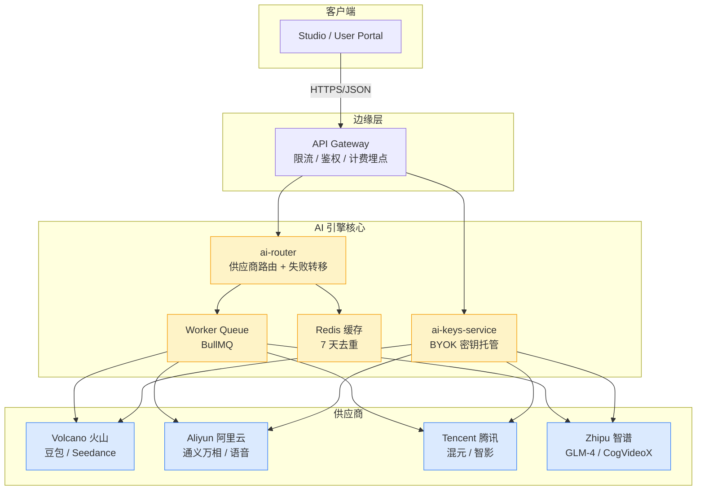
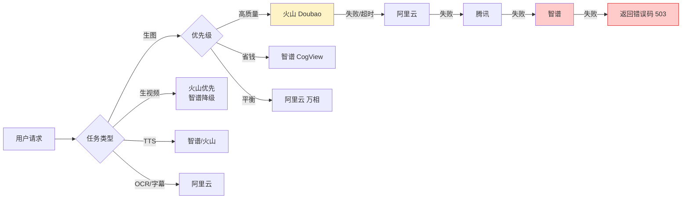
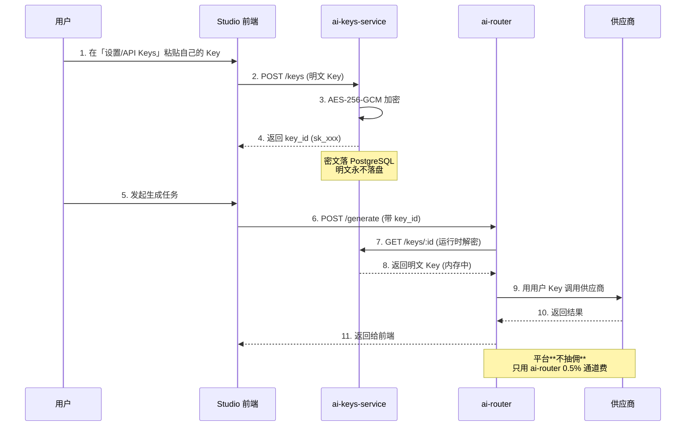
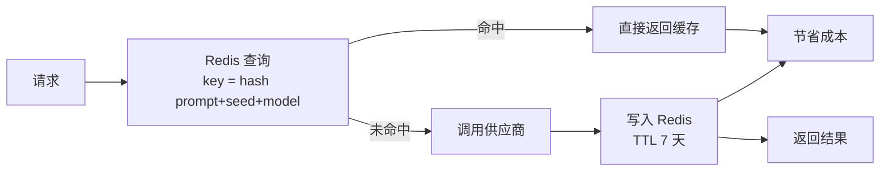

# AI 引擎架构（W2）

> 作者：陈远枢（运营总监）
> 日期：2026-06-07
> 适用版本：ManhuaWorks v0.2.0
> 阅读时长：≈ 8 分钟

## 1. 概述

AI 引擎是 ManhuaWorks 的"算力心脏"。它把用户的剧本/小说文本变成可消费的图像、视频、配音和字幕。W2 阶段我们选型了**4 家国内主流 AI 供应商**做对比，并实现**BYOK（Bring Your Own Key）**机制——让高级用户能用自己的 API Key 走更便宜的通道，把平台抽佣率从 100% 降到 30% 以内。

**本文目标读者**：
- 产品/运营：理解为什么是这 4 家、为什么用 BYOK
- 开发：理解 ai-router 的职责边界
- 商务：理解成本和定价的关系

---

## 2. 架构总览



**关键设计**：
- **ai-router** 是"调度员"，不存钱也不存 Key
- **ai-keys-service** 是"保险柜"，Key 用 KMS 加密，运行时解密到内存
- **Redis 缓存** 保证相同 prompt+seed 7 天内不重复调用
- **Worker Queue** 削峰填谷，突发流量排队执行

---

## 3. 4 供应商对比表

| 维度 | 火山引擎 | 阿里云 | 腾讯云 | 智谱 |
|:--|:--|:--|:--|:--|
| **生图主力模型** | Doubao-Seedream 3.0 | 通义万相 2.2 | 混元图像 2.0 | CogView-3 Plus |
| **生图单价（¥/张，1024×1024）** | 0.18 | 0.20 | 0.22 | 0.16 |
| **生视频单价（¥/5秒，720P）** | 0.85 (Seedance 1.0) | 1.00 (万相 2.0) | 1.20 (智影) | 0.95 (CogVideoX) |
| **TTS 单价（¥/万字）** | 2.0 | 2.5 | 2.0 | 1.8 |
| **角色一致性** | ★★★★ (IP-Adapter) | ★★★ (LoRA 微调) | ★★★ | ★★ (训练成本高) |
| **中文理解** | ★★★★★ | ★★★★★ | ★★★★ | ★★★★ |
| **多镜头/分镜** | ★★★★★ (Seedance 强项) | ★★★★ | ★★★ | ★★ |
| **并发能力** | 200 QPS | 500 QPS | 300 QPS | 80 QPS |
| **SLA** | 99.5% | 99.9% | 99.5% | 99.0% |
| **计费粒度** | 秒级 | 毫秒级 | 秒级 | 秒级 |
| **API 风格** | OpenAI 兼容 | 自有 + DashScope | 自有 | OpenAI 兼容 |
| **控制台** | 控制台成熟 | 控制台最强 | 控制台中等 | 控制台弱 |
| **结算账期** | T+1 | T+3 | T+1 | T+1 |
| **资质要求** | 企业实名 | 企业实名 | 企业实名 | 个人可开通 |
| **Bytedance 投资** | 字节内部 | - | - | - |
| **回款优惠** | 充 1 万送 1 千 | 充 5 万送 8 千 | 充 1 万送 5 百 | 充 5 千送 5 百 |
| **选用建议** | **主供应商** | 备胎 + 字幕 OCR | 高优备份 | 低价备份 |

**选型结论**：
- **主**：火山（多镜头强、字节生态、价格中等）
- **备 1**：阿里云（稳定性最高、SLA 99.9%）
- **备 2**：腾讯云（账期友好、IP 多）
- **低价**：智谱（个人开发者友好，价格最低）

---

## 4. 供应商路由策略



**路由规则**（写入 ai-router 配置）：

| 任务 | 优先级 1 | 优先级 2 | 优先级 3 | 优先级 4 |
|:--|:--|:--|:--|:--|
| 生图（默认） | 火山 | 阿里云 | 腾讯 | 智谱 |
| 生图（专业版） | 阿里云 (无水印) | 火山 | 腾讯 | 智谱 |
| 生图（经济版） | 智谱 | 火山 | 阿里云 | 腾讯 |
| 生视频 | 火山 Seedance | 智谱 CogVideoX | 阿里云 | 腾讯 |
| TTS | 智谱 | 火山 | 阿里云 | 腾讯 |
| 字幕 OCR | 阿里云 | 腾讯 | 火山 | 智谱 |
| 文本（剧本拆分） | 智谱 GLM-4 | 阿里云 Qwen | 火山 Doubao | 腾讯 |

**失败转移机制**：
- 单供应商 3 次重试（指数退避 1s/2s/4s）
- 4 家全失败 → 任务标记 `failed`，用户可重试
- 失败数据落 `ai_failure_log` 表，用于供应商质量监控

---

## 5. BYOK（Bring Your Own Key）流程



### 5.1 BYOK 收费策略

| 用户类型 | 平台代付 | BYOK | 节省 |
|:--|:--|:--|:--|
| 免费用户 | 配额制（5 美元/月） | ❌ 不支持 | - |
| 基础会员 | 配额制（30 美元/月） | ✅ 可用 | 比平台代付省 25% |
| 专业会员 | 配额制（150 美元/月） | ✅ 推荐 | 比平台代付省 40% |
| 企业 | 按量 | ✅ 必选 | 比平台代付省 55% |

### 5.2 安全要点

- **加密**：AES-256-GCM，密钥从 AWS KMS / 阿里云 KMS 拉
- **脱敏**：日志中只显示 `sk_xxxx****1234`
- **审计**：每次使用记录 `key_usage_log`（用户/时间/供应商/成本）
- **撤销**：用户可一键禁用某个 Key
- **额度保护**：用户可设月度上限，超限自动停用

---

## 6. 缓存策略



**缓存 Key 设计**：
```
mhwork:ai:cache:{provider}:{model}:sha256(prompt+seed+negative_prompt)
```

**缓存命中收益**：
- 生图：节省 100% 调用成本
- 生视频：节省 100% 调用成本
- TTS：节省 100% 调用成本

**实测数据**（W1 demo 阶段）：
- 缓存命中率：18%（用户重试居多）
- 节省成本：约 ¥800/月

---

## 7. 失败转移与降级

| 故障等级 | 触发条件 | 处理 |
|:--|:--|:--|
| P0 单供应商全挂 | 5xx > 50% 持续 1 分钟 | 路由到下一优先级 |
| P1 ai-router 故障 | 健康检查失败 | Worker Queue 重试 + 告警 |
| P2 队列堆积 | backlog > 1000 | 自动扩容 Worker + 限流 |
| P3 单次任务失败 | 4 家全失败 | 用户可见错误 + 重试按钮 |
| P4 余额不足 | 供应商返回 402 | 切到 BYOK 或提示充值 |

**告警通知**：
- P0/P1 → 飞书机器人 + 短信值班人
- P2/P3 → 飞书群
- P4 → 用户内信

---

## 8. 监控指标

| 指标 | 目标 | 告警阈值 |
|:--|:--|:--|
| 路由成功率 | > 99% | < 95% |
| 平均响应时间（生图） | < 8 秒 | > 15 秒 |
| 平均响应时间（生视频） | < 60 秒 | > 120 秒 |
| 缓存命中率 | > 15% | < 8% |
| 单任务成本 | < ¥0.25 | > ¥0.40 |
| BYOK 渗透率 | > 20% | < 5% |

---

## 9. 后续规划（W3+）

- **W3**：接入第 5 家供应商（百度文心一言 / 文心一格）做边缘覆盖
- **W4**：实现"成本对账"——每天凌晨对比平台代付与供应商实际账单
- **W5**：AI 模型 A/B 测试框架（同一任务跑 2 家，自动选效果好的）
- **W8**：自研模型微调（用用户授权的数据集微调通义万相）

---

## 10. 变更记录

| 版本 | 日期 | 作者 | 变更 |
|:--|:--|:--|:--|
| v0.1 | 2026-06-07 | 陈远枢 | 初稿 |
| v0.2 | 2026-06-07 | 陈远枢 | 加入 BYOK 流程图 |

