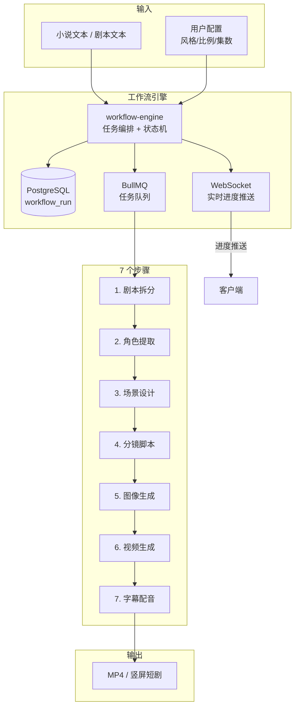
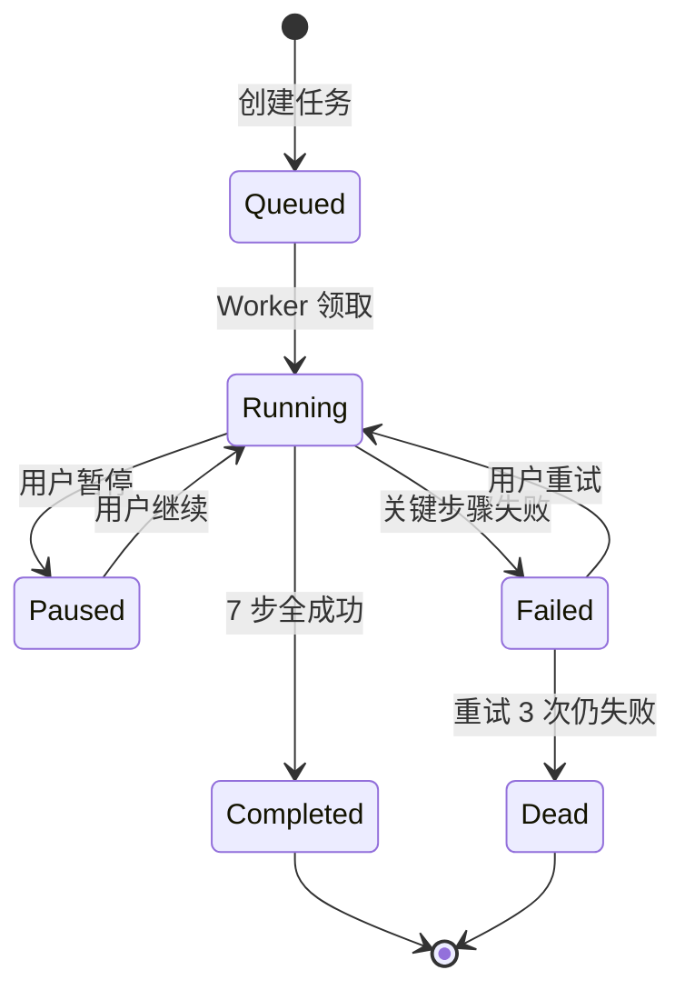
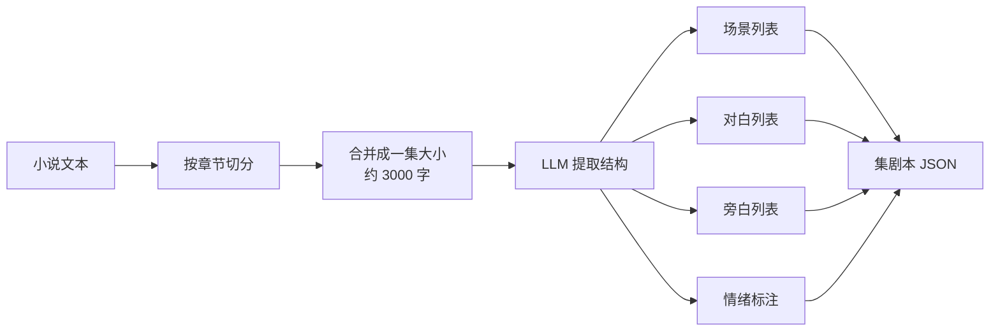
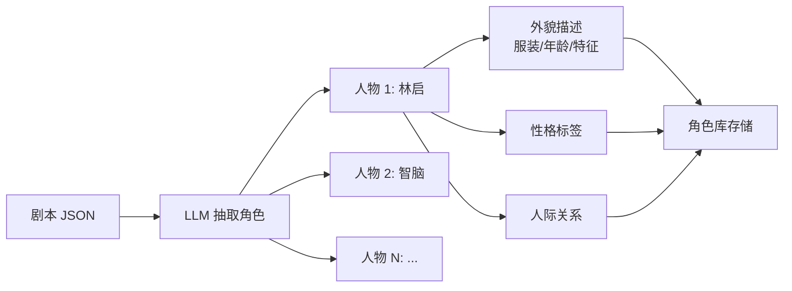
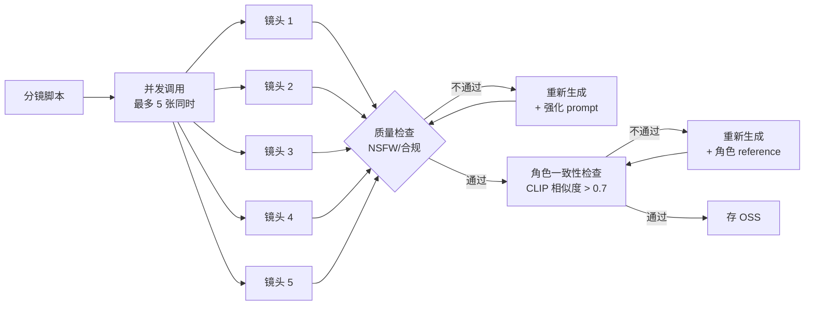
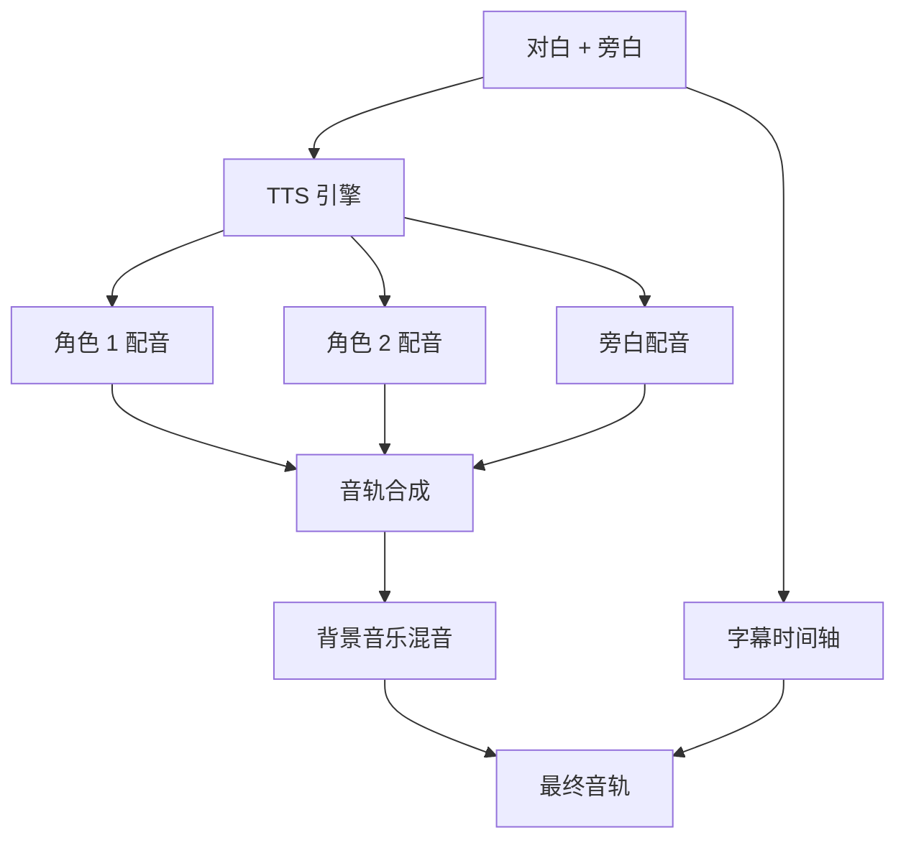
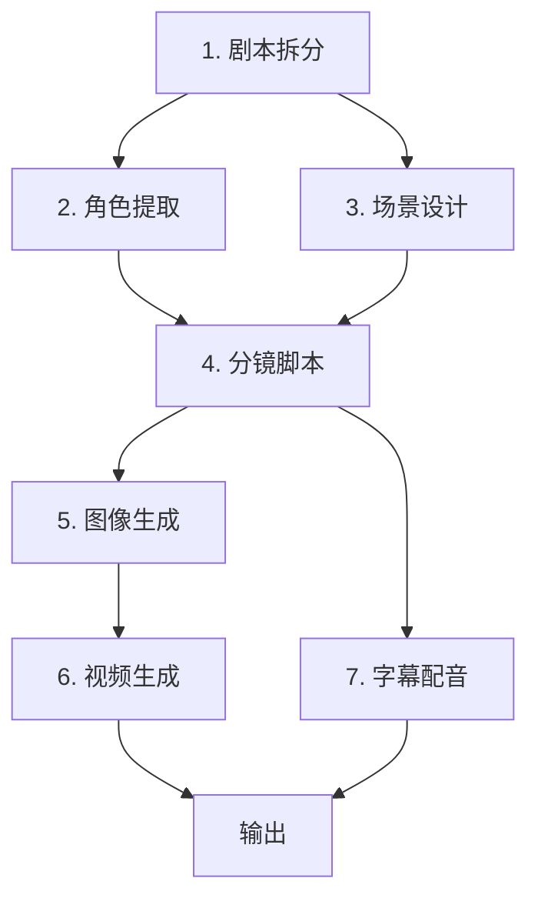

# 工作流引擎架构（W2）

> 作者：陈远枢（运营总监）
> 日期：2026-06-07
> 适用版本：ManhuaWorks v0.2.0
> 阅读时长：≈ 10 分钟

## 1. 概述

工作流引擎是 ManhuaWorks 的"生产线"。它把"小说文本 → 一集漫剧"这个看似简单的需求，拆成 7 个可监控、可重试、可并行执行的步骤。

**本文目标**：
- 产品/运营：理解一集漫剧的"生产流水线"
- 开发：理解 workflow-engine 与 ai-router 的边界
- 用户（在用户文档中会简化版）：知道我们做了什么

---

## 2. 架构总览



---

## 3. 状态机



**状态枚举**（`workflow_run.status`）：
- `queued`（排队中）
- `running`（执行中）
- `paused`（已暂停）
- `completed`（已完成）
- `failed`（失败可重试）
- `dead`（失败不可恢复）

---

## 4. 7 个步骤详解

### 步骤 1：剧本拆分

**输入**：原始小说文本（5000-100000 字）
**输出**：结构化剧本 JSON
**调用模型**：智谱 GLM-4（中文强）/ 阿里云 Qwen
**典型耗时**：30-90 秒
**成本**：约 ¥0.05



**输出示例**：
```json
{
  "episode_no": 1,
  "title": "林启踏入第一个穹顶",
  "scenes": [
    {
      "scene_id": "S01",
      "location": "废墟入口",
      "time": "黄昏",
      "mood": "悬疑"
    }
  ],
  "dialogues": [
    {
      "speaker": "林启",
      "text": "这是什么地方？",
      "emotion": "疑惑"
    }
  ],
  "narration": [
    "三百年后，地球已是一片废墟。"
  ]
}
```

**质量校验**：
- 场景数 ≥ 3
- 对白数 ≥ 5
- JSON 格式合法（schema 校验）
- 失败时降级到「分块拆分」再 LLM 合并

---

### 步骤 2：角色提取

**输入**：剧本 JSON
**输出**：角色列表（含外貌描述、性格、关系图）
**调用模型**：智谱 GLM-4
**典型耗时**：20-40 秒
**成本**：约 ¥0.03



**输出示例**：
```json
{
  "characters": [
    {
      "id": "char_lin_qi",
      "name": "林启",
      "role": "主角",
      "appearance": "28 岁男性，短发，深棕色眼睛",
      "personality": ["冷静", "好奇"],
      "relationships": {
        "智脑": "AI 助手"
      }
    }
  ]
}
```

---

### 步骤 3：场景设计

**输入**：角色列表 + 场景列表
**输出**：每个场景的视觉描述（prompt）
**调用模型**：智谱 GLM-4 + 阿里云 Qwen
**典型耗时**：15-30 秒
**成本**：约 ¥0.04

**工作**：
- 为每个场景写 100-200 字的英文 prompt
- 标注镜头语言（远景/中景/特写）
- 标注光照（黄昏/逆光/暖光）
- 标注情绪色彩

**输出示例**：
```yaml
- scene_id: S01
  location: 废墟入口
  prompt: |
    Ancient ruins entrance, yellow dusk light, 
    cracked stone pillars covered in moss, 
    mysterious fog, cinematic composition, 
    wide angle, sci-fi atmosphere, 8k
  shots:
    - { type: wide, duration: 3s }
    - { type: mid, duration: 2s }
```

---

### 步骤 4：分镜脚本

**输入**：场景 prompt + 角色 prompt
**输出**：分镜卡片列表（每张卡片对应一个镜头）
**调用模型**：纯 LLM，无图像调用
**典型耗时**：20-40 秒
**成本**：约 ¥0.04

**工作**：
- 把每个场景拆成 3-8 个镜头
- 每个镜头包含：编号、画面描述、对白、动作、音效
- 标记镜头间的转场（cut/fade/dissolve）

**输出示例**：
```json
{
  "shots": [
    {
      "shot_id": "L01",
      "scene_id": "S01",
      "type": "wide",
      "duration": 3,
      "image_prompt": "...",
      "dialogue": null,
      "action": "林启踏入废墟",
      "sfx": "脚步回声"
    }
  ]
}
```

---

### 步骤 5：图像生成 ⭐ 核心

**输入**：分镜脚本（含 image_prompt）
**输出**：每张镜头的静态图像
**调用模型**：火山 Doubao-Seedream / 智谱 CogView
**典型耗时**：60-180 秒（取决于并发数）
**成本**：约 ¥0.80-1.50（一集 8-10 张图）



**质量门**：
1. **NSFW 检测**：阿里云内容安全 + 自训模型（双保险）
2. **角色一致性**：CLIP 相似度 ≥ 0.7（与角色参考图比对）
3. **构图检查**：图像不裁切、主体居中
4. **重试上限**：单张图最多重试 3 次

---

### 步骤 6：视频生成 ⭐ 核心

**输入**：静态图像 + 镜头描述
**输出**：5-10 秒动态视频片段
**调用模型**：火山 Seedance / 智谱 CogVideoX
**典型耗时**：120-300 秒（视频最慢）
**成本**：约 ¥4-8（一集 5 个视频）


**关键技术**：
- **首尾帧控制**：用相邻镜头的尾帧/首帧做约束
- **运镜控制**：prompt 写明"slow zoom in" / "pan right"
- **时长控制**：默认 5 秒/镜头，可调 3-10 秒

**降级方案**：
- 视频生成失败 → 静态图 + Ken Burns 效果（推拉摇移）
- 全失败 → 标记任务失败，给用户重试按钮

---

### 步骤 7：字幕配音

**输入**：对白 JSON + 旁白 JSON
**输出**：SRT 字幕 + MP3 配音轨道
**调用模型**：智谱 TTS（便宜）/ 火山 TTS（质量高）
**典型耗时**：30-60 秒
**成本**：约 ¥0.10-0.30



**配音角色映射**：
- 主角：男声/女声（用户选）
- 反派：低音
- 旁白：磁性中音
- 系统：电子音

**字幕样式**：
- 字体：思源黑体（默认）/ 用户可改
- 位置：底部 1/3 处
- 颜色：白字 + 黑色描边
- 动画：淡入淡出

---

## 5. 任务依赖图



**并行优化**：
- S2 和 S3 可以并行（都依赖 S1）
- S5 内部多张图并发
- S7 可以在 S5 进行时就开始（独立轨道）

---

## 6. WebSocket 实时进度

**协议**：`wss://api.mhwork.cn/ws/workflow/:run_id`

**消息格式**：
```json
{
  "type": "progress",
  "run_id": "wf_abc123",
  "step": 5,
  "step_name": "图像生成",
  "percent": 65,
  "current": "镜头 7/10",
  "eta_seconds": 45
}
```

**事件类型**：
- `progress`（进度更新）
- `step_completed`（单步完成）
- `step_failed`（单步失败）
- `completed`（全部完成）
- `failed`（整体失败）

---

## 7. 失败与重试

**重试策略**：
- 单步骤失败 → 自动重试 2 次（指数退避）
- 3 次仍失败 → 标记 `failed`，通知用户
- 用户点击「重试」→ 从失败步骤继续（不必从头跑）

**断点续传**：
- 状态全部存 PostgreSQL
- 重启服务后可从 `running` 状态继续
- 用户取消 → 标记 `paused`，可恢复

---

## 8. 性能目标

| 指标 | 目标 | 备注 |
|:--|:--|:--|
| 一集 5 分钟 | < 8 分钟 | P95 |
| 一集 10 分钟 | < 15 分钟 | P95 |
| 单步超时 | 5 分钟 | 超时强制失败 |
| 并发工作流 | 50 个 | 同时执行 |
| 队列堆积 | < 100 | 堆积告警 |

---

## 9. 监控指标

| 指标 | 目标 | 告警阈值 |
|:--|:--|:--|
| 工作流成功率 | > 95% | < 90% |
| 平均完成时间（5 分钟集） | < 10 分钟 | > 15 分钟 |
| 单集成本 | < ¥6 | > ¥10 |
| 队列堆积数 | < 50 | > 200 |
| 步骤超时率 | < 2% | > 5% |

---

## 10. 后续规划

- **W3**：实现"流式输出"——先生成的镜头先显示，不必等全集
- **W4**：支持「手动重生成单个镜头」而不重跑全集
- **W5**：支持「跳过某些步骤」（用户已有人物参考图时跳过 S2）
- **W6**：支持「多种画风混合」——同一集里不同场景用不同画风

---

## 11. 变更记录

| 版本 | 日期 | 作者 | 变更 |
|:--|:--|:--|:--|
| v0.1 | 2026-06-07 | 陈远枢 | 初稿 |
