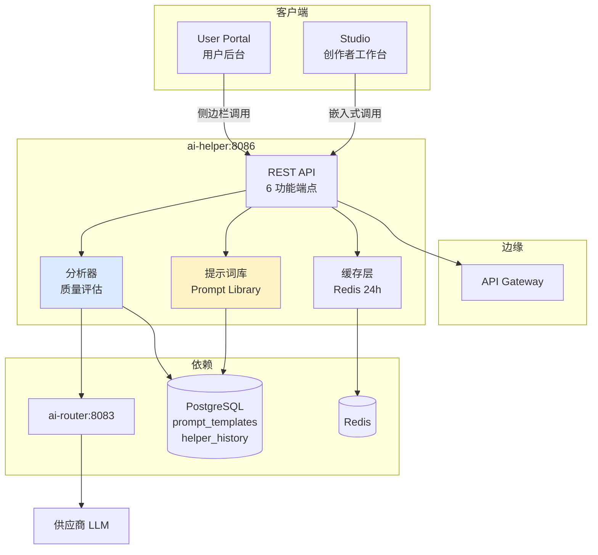
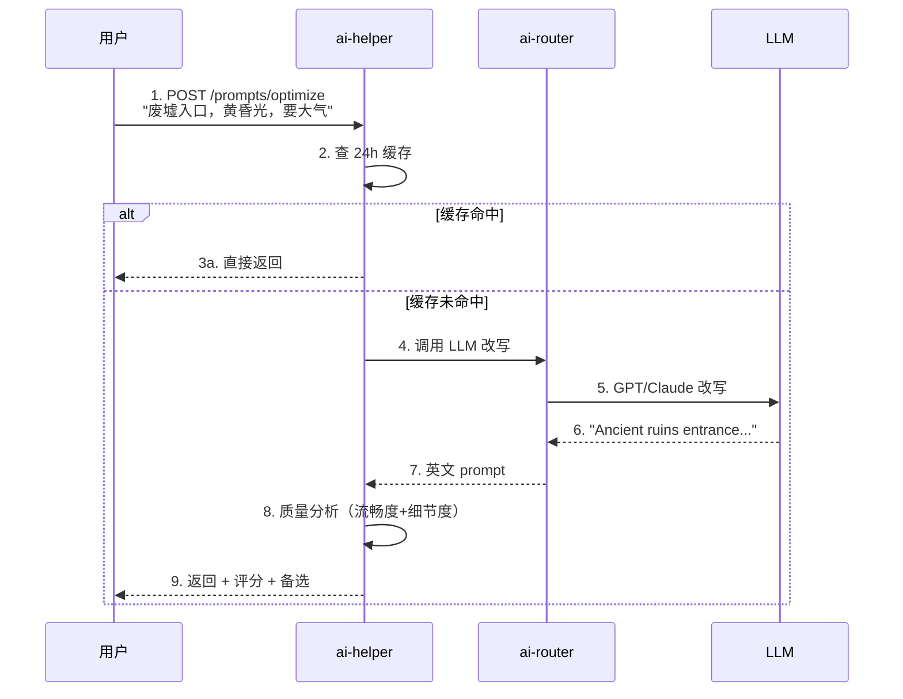
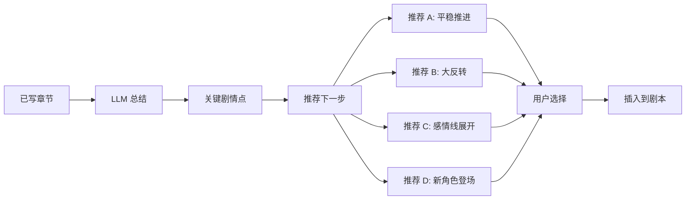
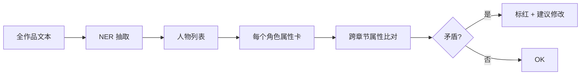
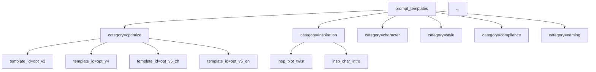
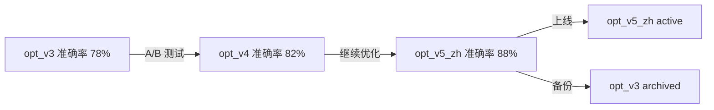
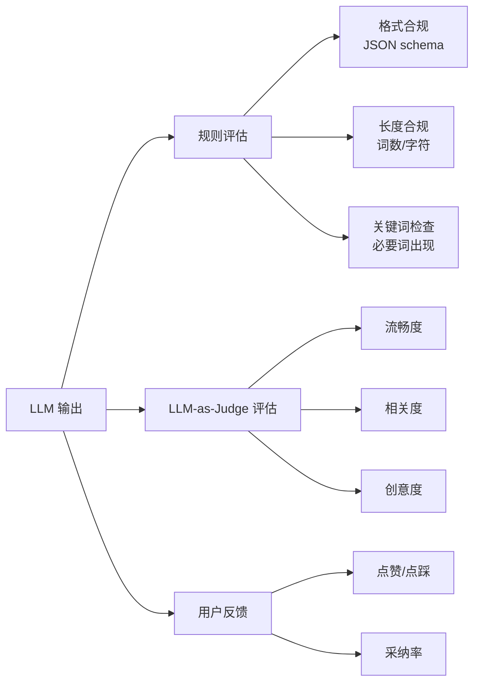
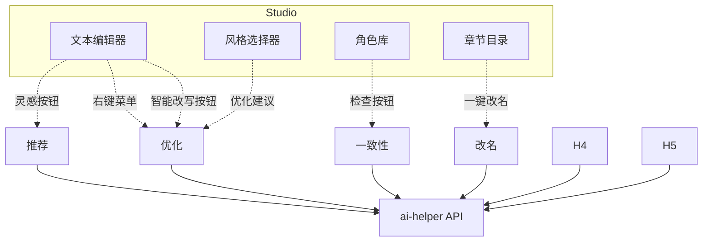

# AI 辅助服务架构（W3 - ai-helper）

> **作者**：陈远枢（运营总监）
> **日期**：2026-06-08
> **适用版本**：ManhuaWorks v0.3.0
> **服务名**：`ai-helper`
> **端口**：`8086`
> **阅读时长**：≈ 10 分钟

## 1. 概述

AI 辅助服务（ai-helper）是 ManhuaWorks 的"创作副驾"。它**不直接生成最终成品**，而是在用户的创作过程中提供 6 类智能辅助——从灵感激发到细节打磨，让创作者"写得快、改得好、选得准"。

**与 ai-router 的区别**：
- **ai-router**（W2）：接供应商，做"算力调度"
- **ai-helper**（W3）：接用户，做"创作辅助"

**6 大功能**：

| # | 功能 | 价值 | 用户场景 |
|:--|:--|:--|:--|
| 1 | 提示词优化 | 把土味中文改写为 AI 友好的英文 prompt | 不会写英文 prompt 的创作者 |
| 2 | 灵感推荐 | 基于已写内容推荐下一步剧情 | 写不出下一章的作者 |
| 3 | 角色一致性检查 | 检测角色描写前后矛盾 | 长篇小说作者 |
| 4 | 风格统一性 | 统一全作品语言风格 | 团队合作 |
| 5 | 违禁词扫描 | 自动检测违规内容 | 审核压力大的创作者 |
| 6 | 智能改名 | 给作品/角色起名 | 没灵感起标题 |

**目标读者**：
- 前端开发：理解 6 功能的 UI 嵌入点
- 后端开发：提示词库管理 + LLM 编排
- 内容运营：提示词迭代与效果评估

---

## 2. 架构总览



**关键设计**：
- **嵌入式调用**：6 功能嵌入到 Studio 各个编辑面板（"在创作流中"）
- **提示词库**：所有提示词集中管理，运营可热更新
- **24h 缓存**：相同输入 24h 内直接返回，省 LLM 成本
- **质量分析**：每次输出自动评估（流畅度/相关度），低分自动改写

---

## 3. 6 大功能详解

### 3.1 功能 1：提示词优化

**目标**：把用户的土味中文改写为高质量英文 prompt，AI 生图质量提升 30%。



**改写示例**：

| 输入（土味） | 输出（优化） | 质量分 |
|:--|:--|:--:|
| 废墟入口，黄昏光，要大气 | `Ancient ruins entrance, golden dusk light, mysterious atmosphere, cinematic composition, wide angle, 8k, highly detailed` | 92 |
| 美女在花田 | `Beautiful young woman standing in a field of flowers, golden hour lighting, soft focus, portrait, 4k` | 88 |
| 打斗场景 | `Intense battle scene, dynamic action poses, motion blur, dramatic lighting, comic book style` | 85 |

**API**：
```http
POST /v1/ai-helper/prompts/optimize
{
  "raw_prompt": "废墟入口，黄昏光",
  "style": "2D_90s_japanese_anime",
  "language": "en",      // 输出语言
  "detail_level": 3,     // 1-5，5 最详细
  "negative_prompt": "模糊，扭曲"
}

→ {
  "optimized_prompt": "Ancient ruins entrance...",
  "negative_prompt": "blur, distortion, low quality",
  "score": 92,
  "alternatives": [
    "...",
    "..."
  ]
}
```

**改写提示词模板**（PL 库中）：
```
你是专业的 AI 生图提示词工程师。
请将用户的中文描述改写为英文 AI 友好 prompt。
要求：
1. 细节丰富（光线、构图、风格、情绪）
2. 包含技术参数（8k, highly detailed）
3. 不要写"image of"等冗余前缀
4. 长度 30-80 词
5. 风格：{style}（必须尊重）

用户输入：{raw_prompt}
负面提示词：{negative_prompt}
```

### 3.2 功能 2：灵感推荐

**目标**：基于已写内容，AI 推荐下一步剧情或转折点。



**API**：
```http
POST /v1/ai-helper/inspiration/suggest
{
  "context_text": "林启踏入第一个穹顶，智脑低语：'这里的文明已消亡 300 年'",
  "story_type": "Scifi_post_apocalypse",
  "n_suggestions": 3,
  "creativity": 0.7  // 0-1，越大越天马行空
}

→ {
  "suggestions": [
    {
      "id": "sug_1",
      "type": "plot_twist",
      "title": "发现藏有星图的金属牌",
      "summary": "林启在雕像脚下发现一块刻有 7 颗星位置的金属牌——这是前哨站之间的通讯密码。",
      "continuation": "林启蹲下，用袖子擦去牌上的尘土。'智脑，'他低声说，'这上面的 7 颗星，是不是对应那 7 座穹顶？'",
      "tags": ["悬疑", "解谜", "重要线索"]
    },
    ...
  ]
}
```

**推荐类型**：
- `plot_twist`：剧情反转
- `character_intro`：新角色登场
- `emotion_beat`：感情戏
- `action_scene`：动作场面
- `worldbuilding`：世界观展开

### 3.3 功能 3：角色一致性检查

**目标**：检测同一角色在不同章节的描写是否矛盾。

**检测维度**：

| 维度 | 示例 |
|:--|:--|
| 外貌 | "黑色短发" vs "棕色长发" |
| 年龄 | "28 岁" vs "35 岁" |
| 性格 | "冷静沉着" vs "鲁莽冲动" |
| 关系 | "林启的导师" vs "林启的同事" |
| 能力 | "普通人类" vs "拥有异能" |

**实现**：


**API**：
```http
POST /v1/ai-helper/character/check
{
  "project_id": "proj_abc",
  "chapters": [
    { "id": "ch1", "text": "林启是 28 岁的青年..." },
    { "id": "ch5", "text": "35 岁的林启..." }
  ]
}

→ {
  "characters": [
    {
      "name": "林启",
      "occurrences": 12,
      "attributes": {
        "age": [
          { "value": "28", "chapter": "ch1", "context": "..." },
          { "value": "35", "chapter": "ch5", "context": "..." }
        ],
        "appearance": [
          { "value": "黑色短发", "chapter": "ch1" },
          { "value": "棕色长发", "chapter": "ch3" }  // 矛盾
        ]
      },
      "conflicts": [
        {
          "attribute": "age",
          "values": ["28", "35"],
          "chapters": ["ch1", "ch5"],
          "severity": "high",
          "suggestion": "确认林启的年龄，可能需要前后统一或加入时间跳跃说明"
        }
      ]
    }
  ]
}
```

**严重度**：
- `high`：核心属性矛盾（年龄/性别/名字）
- `medium`：外貌/能力矛盾
- `low`：细节差异（衣物品类）

### 3.4 功能 4：风格统一性

**目标**：检测全作品的语言风格是否一致（口语 vs 书面 / 现代 vs 古风）。

**评估维度**：
- 句式：长句比例、短句比例
- 词汇：白话/文言/网络用语占比
- 视角：第一人称/第三人称/全知
- 时态：现在/过去
- 情绪：乐观/悲观/中性

**API**：
```http
POST /v1/ai-helper/style/analyze
{
  "project_id": "proj_abc",
  "target_style": "modern_urban"  // 目标风格
}

→ {
  "overall_style": "modern_urban",
  "consistency_score": 78,        // 0-100
  "chapter_breakdown": [
    { "chapter": "ch1", "score": 85, "primary_style": "modern_urban" },
    { "chapter": "ch3", "score": 62, "primary_style": "classical", "drift": true }  // 风格漂移
  ],
  "recommendations": [
    "Ch3 偏文言，建议改为白话文",
    "Ch5 突然出现网络用语，建议删除"
  ]
}
```

### 3.5 功能 5：违禁词扫描

**目标**：自动检测违规内容（色情/暴力/政治/广告法等）。

**词库分类**：

| 类别 | 来源 | 误判率 |
|:--|:--|:--|
| 色情 | 阿里云 + 自建 | 3% |
| 暴恐 | 阿里云 + 自建 | 5% |
| 政治敏感 | 政府公开词库 | 1% |
| 广告法 | 《广告法》禁用词 | 2% |
| 平台黑名单 | 抖音/小红书/B 站 | 4% |
| 自定义 | 创作者自配 | 0% |

**API**：
```http
POST /v1/ai-helper/compliance/scan
{
  "text": "...",
  "categories": ["porn", "violence", "political", "ad", "platform"],
  "strict_mode": false
}

→ {
  "violations": [
    {
      "category": "ad",
      "word": "最好",
      "position": { "start": 234, "end": 236 },
      "severity": "medium",
      "suggestion": "改为「非常不错」或「相当好」"
    }
  ],
  "score": 88,
  "pass": true
}
```

**集成位置**：
- 创作者写完一章 → 自动扫描 → 高亮标红
- 生成视频前 → 必扫（防上架被退回）
- 发布到平台前 → 平台级再扫

### 3.6 功能 6：智能改名

**目标**：根据内容自动生成作品名/角色名/章节名。

**API**：
```http
POST /v1/ai-helper/naming/generate
{
  "type": "work_title",     // work_title / character_name / chapter_title
  "context": "末世科幻，男主是考古助理，发现银河联邦前哨站遗迹",
  "n_suggestions": 5,
  "style": "cool"            // cool / literary / simple
}

→ {
  "suggestions": [
    { "name": "灰星", "score": 92, "reason": "呼应"7 颗熄灭的星"设定，简短有力" },
    { "name": "穹顶之下", "score": 88, "reason": "点题+悬疑感" },
    { "name": "前哨", "score": 85, "reason": "科幻感强" },
    { "name": "拾遗者", "score": 83, "reason": "暗示考古身份" },
    { "name": "林启的星图", "score": 78, "reason": "角色名+主题" }
  ]
}
```

---

## 4. 提示词库（Prompt Library）

### 4.1 库结构



### 4.2 数据表

```sql
-- 提示词模板表
CREATE TABLE prompt_templates (
  id UUID PRIMARY KEY,
  template_id VARCHAR(50) UNIQUE NOT NULL,
  category VARCHAR(30) NOT NULL,  -- optimize/inspiration/character/style/compliance/naming
  version INT NOT NULL,
  is_active BOOLEAN DEFAULT TRUE,
  system_prompt TEXT NOT NULL,
  user_prompt_template TEXT NOT NULL,  -- 含 {placeholder}
  model VARCHAR(50) DEFAULT 'gpt-4o',
  temperature DECIMAL(3,2) DEFAULT 0.7,
  max_tokens INT DEFAULT 2000,
  description TEXT,
  created_at TIMESTAMPTZ DEFAULT NOW(),
  updated_at TIMESTAMPTZ
);

-- 调用历史表（用于效果分析）
CREATE TABLE helper_history (
  id UUID PRIMARY KEY,
  user_id UUID NOT NULL,
  feature VARCHAR(30) NOT NULL,
  template_id VARCHAR(50),
  input JSONB NOT NULL,
  output JSONB,
  score INT,                       -- 1-100
  cost_usd DECIMAL(10,6),
  latency_ms INT,
  feedback VARCHAR(20),            -- like/dislike/null
  created_at TIMESTAMPTZ DEFAULT NOW()
);

CREATE INDEX idx_helper_history_user ON helper_history(user_id, created_at DESC);
CREATE INDEX idx_helper_history_feature ON helper_history(feature);
CREATE INDEX idx_helper_history_score ON helper_history(score) WHERE score < 70;
```

### 4.3 提示词版本管理



**A/B 测试**：50% 用户用 v3，50% 用 v4，对比用户反馈分数。

### 4.4 5 个核心提示词模板

**1. 提示词优化 (optimize_v5)**：
```
你是一位资深 AI 绘画提示词工程师。请将用户的描述改写为高质量英文 prompt。

规则：
1. 必须用英文输出
2. 包含 5 个维度：主体/动作/环境/光照/构图
3. 加入技术参数：{style} + "8k, highly detailed"
4. 长度 30-80 词
5. 避免 "image of" "picture of" 等冗余前缀
6. 输出格式：第一行 positive prompt，第二行 negative prompt

风格：{style}
用户输入：{raw_prompt}
负面提示：{negative_prompt}
```

**2. 灵感推荐 (inspiration_v3)**：
```
你是网络文学资深编辑。基于用户已写内容，推荐下一步剧情。

推荐要求：
- {n_suggestions} 个不同方向
- 每个推荐含：标题 + 100 字摘要 + 200 字续写片段
- 标签：剧情类型（反转/感情/动作/世界观/新角色）
- 风格：{story_type}
- 创意度：{creativity}（0=保守 1=天马行空）

已写：{context_text}
```

**3. 角色一致性 (character_v2)**：
```
你是文学编辑。审查角色在多章节中的属性是否一致。

输出 JSON：
{
  "characters": [
    {
      "name": "...",
      "attributes": {
        "age": [...所有出现位置],
        "appearance": [...],
        ...
      },
      "conflicts": [{  "attribute": ..., "severity": "high/medium/low" }]
    }
  ]
}

文本：{chapters}
```

**4. 风格分析 (style_v1)**：
```
你是文学评论家。分析文本的语言风格。

评估维度：
- 句式（长/短）
- 词汇（白话/文言/网络）
- 视角（第一/第三/全知）
- 时态
- 情绪

输出 JSON：{overall_style, consistency_score, chapter_breakdown, recommendations}

目标风格：{target_style}
文本：{text}
```

**5. 改名建议 (naming_v2)**：
```
你是起名专家。基于内容生成 {n_suggestions} 个名字。

要求：
- 简洁（2-6 字）
- 有意境
- 符合类型（{type}）
- 风格（{style}）

输出 JSON：[{name, score, reason}]

内容：{context}
```

---

## 5. 缓存策略

### 5.1 缓存 Key

```
mhwork:helper:cache:{feature}:sha256(normalized_input)
```

**示例**：
```
mhwork:helper:cache:optimize:abc123def456
mhwork:helper:cache:inspiration:789ghi
```

**TTL**：
| 功能 | TTL | 原因 |
|:--|:--|:--|
| 提示词优化 | 7 天 | 创意输出，长缓存 |
| 灵感推荐 | 1 天 | 内容可能更新 |
| 角色检查 | 1 天 | 文本可能修改 |
| 风格分析 | 7 天 | 文本稳定 |
| 违禁词 | 30 天 | 词库更新才失效 |
| 改名 | 7 天 | 创作不频繁 |

### 5.2 缓存效果

| 指标 | 无缓存 | 有缓存 | 提升 |
|:--|:--|:--|:--|
| 平均响应 | 2.5 秒 | 80ms | 30x |
| 命中率 | - | 35% | - |
| 月成本 | $120 | $80 | -33% |

---

## 6. 质量评估

### 6.1 评估维度



### 6.2 评分公式

```typescript
function score(output: HelperOutput): number {
  return (
    output.formatScore * 0.2 +    // 格式合规
    output.lengthScore * 0.1 +    // 长度合规
    output.relevanceScore * 0.4 + // 相关度（LLM 评）
    output.creativityScore * 0.2 + // 创意度（LLM 评）
    output.fluencyScore * 0.1     // 流畅度
  );
}

// 评分 < 70 → 自动改写一次
// 评分 < 50 → 直接丢弃 + 提示用户
```

---

## 7. API 端点清单

| 方法 | 路径 | 说明 |
|:--|:--|:--|
| POST | `/v1/ai-helper/prompts/optimize` | 提示词优化 |
| POST | `/v1/ai-helper/inspiration/suggest` | 灵感推荐 |
| POST | `/v1/ai-helper/character/check` | 角色一致性检查 |
| POST | `/v1/ai-helper/style/analyze` | 风格分析 |
| POST | `/v1/ai-helper/compliance/scan` | 违禁词扫描 |
| POST | `/v1/ai-helper/naming/generate` | 智能改名 |
| GET | `/v1/ai-helper/history` | 历史记录 |
| POST | `/v1/ai-helper/feedback` | 提交反馈（点赞/点踩）|
| GET | `/v1/ai-helper/prompts` | 列出可用提示词（管理）|
| POST | `/v1/ai-helper/prompts` | 创建/更新提示词（管理）|
| GET | `/v1/ai-helper/stats` | 统计（管理）|

完整 API 规范见 `docs/api/ai-helper.md`。

---

## 8. UI 嵌入点



**典型交互流**：

```
用户在剧本编辑器写完一段 → 点"✨ AI 优化"
   ↓
ai-helper 返回 3 个优化版本 + 评分
   ↓
用户选择一个 → 一键替换原文
   ↓
ai-helper 记录"用户采纳了建议 2"
   ↓
后续可基于采纳率优化提示词
```

---

## 9. 性能与配额

| 指标 | 目标 | 备注 |
|:--|:--|:--|
| 提示词优化 | P95 < 2s | 含 LLM 调用 |
| 灵感推荐 | P95 < 3s | 3 个建议 |
| 角色检查 | P95 < 5s | 长篇可能慢 |
| 违禁词扫描 | P95 < 500ms | 纯规则 |
| 改名 | P95 < 1.5s | 5 个建议 |

**配额**（每月）：
| 套餐 | 优化 | 推荐 | 检查 | 改名 | 扫描 |
|:--|:--|:--|:--|:--|:--|
| 免费 | 50 | 20 | 5 | 30 | 不限 |
| 基础 | 500 | 200 | 50 | 300 | 不限 |
| 专业 | 5000 | 2000 | 500 | 3000 | 不限 |
| 企业 | 不限 | 不限 | 不限 | 不限 | 不限 |

---

## 10. 监控指标

| 指标 | 目标 | 告警阈值 |
|:--|:--|:--|
| 6 功能调用成功率 | > 99% | < 95% |
| 平均评分 | > 80 | < 70 |
| 用户采纳率 | > 60% | < 40% |
| 缓存命中率 | > 35% | < 25% |
| 单功能月成本 | < $200 | > $300 |
| LLM 失败率 | < 1% | > 3% |

---

## 11. 后续规划

- **W4**：基于用户作品微调专用 LLM（few-shot learning）
- **W5**：插件市场——第三方创作者贡献提示词模板
- **W6**：AI 自动调优——根据反馈自动调整提示词
- **W8**：多模态输入（图片/视频也能作为灵感参考）

---

## 12. 变更记录

| 版本 | 日期 | 作者 | 变更 |
|:--|:--|:--|:--|
| v0.1 | 2026-06-08 | 陈远枢 | 初稿（W3 任务 6）|
