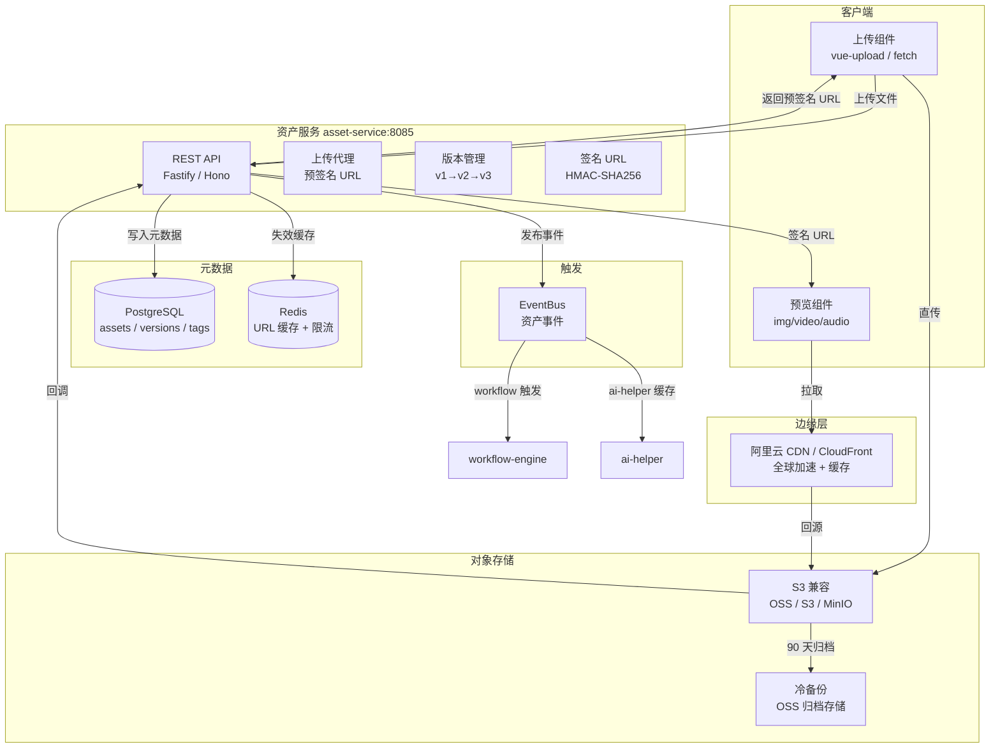
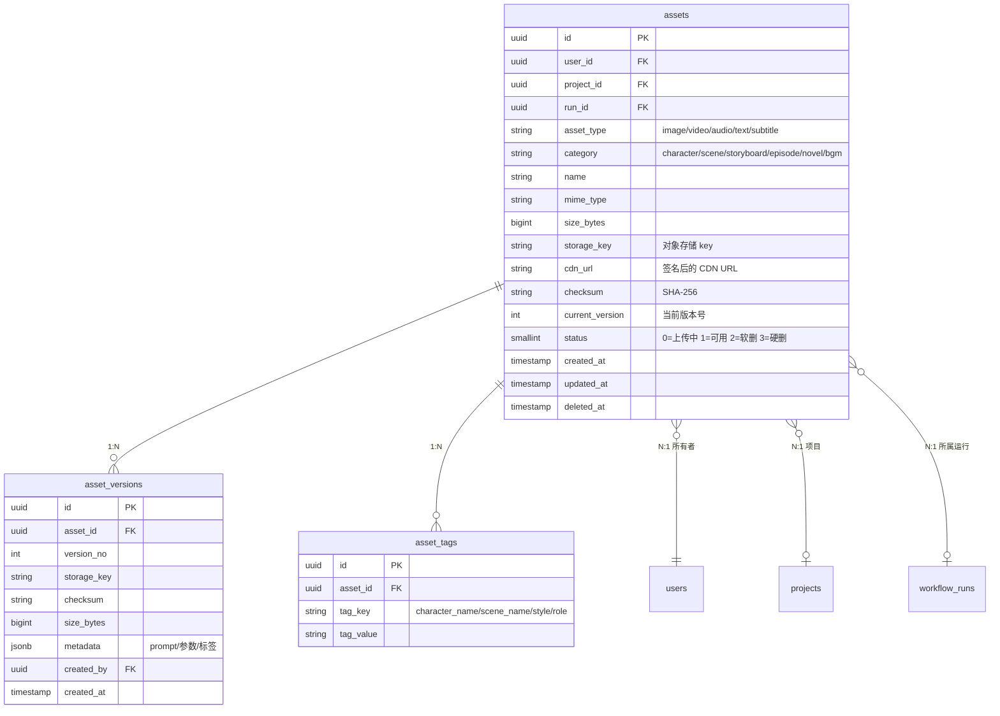
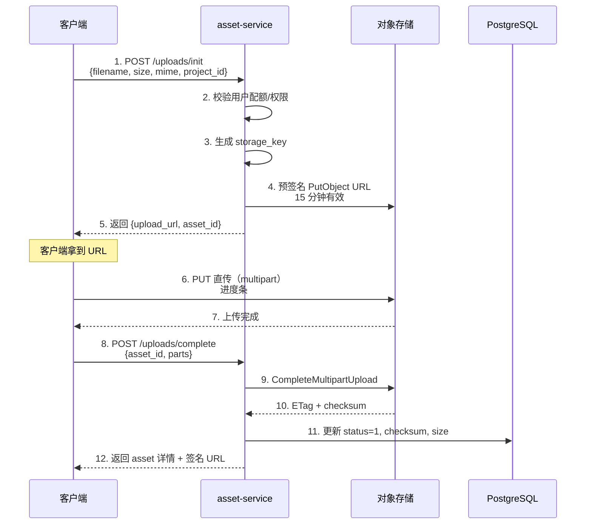
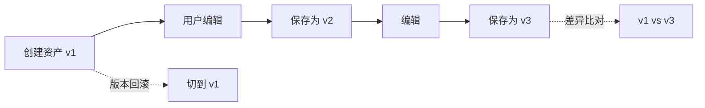
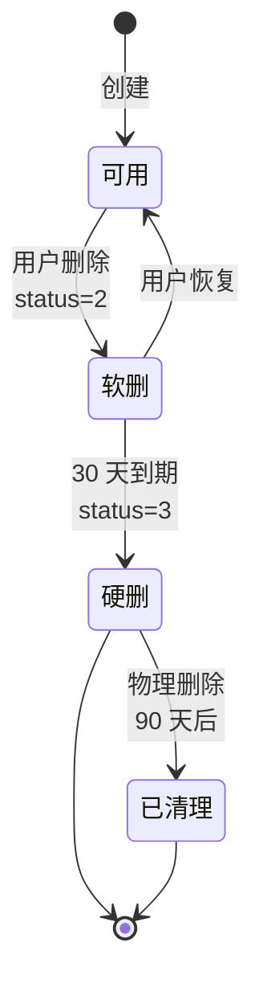

# 资产服务架构（W3 - asset-service）

> **作者**：陈远枢（运营总监）
> **日期**：2026-06-08
> **适用版本**：ManhuaWorks v0.3.0
> **服务名**：`asset-service`
> **端口**：`8085`
> **阅读时长**：≈ 10 分钟

## 1. 概述

资产服务（asset-service）是 ManhuaWorks 的"数字仓库"。它统一管理**所有用户上传和 AI 生成的内容资产**——小说原文、角色立绘、场景图、分镜卡片、视频片段、音频轨道、字幕文件——并提供**版本管理 + CDN 分发 + 软删除**三大能力。

**核心职责**：
1. **存储**：3 张主表 + S3 兼容对象存储（OSS / S3 / MinIO）
2. **版本**：每次更新都生成新版本号，支持回滚与差异比对
3. **分发**：全球 CDN 加速 + 签名 URL 防盗链
4. **清理**：30 天软删除 + 90 天硬删除回收

**目标读者**：
- 后端开发：理解资产表设计、上传协议、版本管理 API
- 前端开发：理解上传 SDK、预览 URL 生成规则
- 运维：理解 CDN 配置、对象存储容量规划

---

## 2. 架构总览



**关键设计**：
- **客户端直传**：服务端只签发预签名 URL，文件不经过 asset-service（节省带宽）
- **元数据与文件分离**：DB 存元数据，对象存储存文件本身
- **CDN 兜底**：所有公开 URL 走 CDN，热文件命中率目标 85%
- **事件驱动**：资产创建/删除事件通过 EventBus 广播，workflow 和 ai-helper 监听

---

## 3. 数据模型（3 张核心表）

### 3.1 ER 关系图



### 3.2 表 1：assets（资产主表）

| 字段 | 类型 | 必填 | 说明 |
|:--|:--|:--|:--|
| `id` | UUID | ✅ | 主键 |
| `user_id` | UUID | ✅ | 所有者 FK→users |
| `project_id` | UUID | ❌ | 所属项目 FK→projects |
| `run_id` | UUID | ❌ | 所属工作流运行 |
| `asset_type` | VARCHAR(20) | ✅ | `image` / `video` / `audio` / `text` / `subtitle` |
| `category` | VARCHAR(30) | ✅ | `character` / `scene` / `storyboard` / `episode` / `novel` / `bgm` / `srt` |
| `name` | VARCHAR(200) | ✅ | 资产名（用户可改）|
| `mime_type` | VARCHAR(50) | ✅ | `image/png` / `video/mp4` 等 |
| `size_bytes` | BIGINT | ✅ | 文件大小 |
| `storage_key` | VARCHAR(500) | ✅ | 对象存储 key |
| `cdn_url` | VARCHAR(1000) | ❌ | 缓存的签名 URL（短期）|
| `checksum` | VARCHAR(64) | ✅ | SHA-256 校验和 |
| `current_version` | INT | ✅ | 当前版本号，默认 1 |
| `status` | SMALLINT | ✅ | 0=上传中 1=可用 2=软删 3=硬删 |
| `created_at` | TIMESTAMPTZ | ✅ | 创建时间 |
| `updated_at` | TIMESTAMPTZ | ✅ | 更新时间 |
| `deleted_at` | TIMESTAMPTZ | ❌ | 软删时间 |

**索引**：
```sql
CREATE INDEX idx_assets_user_id ON assets(user_id);
CREATE INDEX idx_assets_project_id ON assets(project_id);
CREATE INDEX idx_assets_run_id ON assets(run_id);
CREATE INDEX idx_assets_type_category ON assets(asset_type, category);
CREATE INDEX idx_assets_status ON assets(status) WHERE status = 1;
CREATE INDEX idx_assets_user_created ON assets(user_id, created_at DESC);
```

### 3.3 表 2：asset_versions（版本表）

| 字段 | 类型 | 必填 | 说明 |
|:--|:--|:--|:--|
| `id` | UUID | ✅ | 主键 |
| `asset_id` | UUID | ✅ | 所属资产 FK→assets |
| `version_no` | INT | ✅ | 版本号（1, 2, 3...）|
| `storage_key` | VARCHAR(500) | ✅ | 该版本的文件 key |
| `checksum` | VARCHAR(64) | ✅ | SHA-256 |
| `size_bytes` | BIGINT | ✅ | 该版本文件大小 |
| `metadata` | JSONB | ❌ | 附加元数据：prompt/参数/标签 |
| `created_by` | UUID | ✅ | 创建者 FK→users |
| `created_at` | TIMESTAMPTZ | ✅ | 创建时间 |

**索引**：
```sql
CREATE UNIQUE INDEX idx_asset_versions_unique ON asset_versions(asset_id, version_no);
CREATE INDEX idx_asset_versions_created ON asset_versions(created_at DESC);
```

**metadata JSONB 示例**：
```json
{
  "prompt": "Ancient ruins entrance, yellow dusk light, 8k",
  "negative_prompt": "blur, distortion",
  "model": "doubao-seedream-3.0",
  "provider": "volcengine",
  "seed": 12345,
  "parameters": { "width": 1024, "height": 1024, "steps": 30 },
  "tags": ["scene", "wide-shot", "dusk"]
}
```

### 3.4 表 3：asset_tags（标签表）

| 字段 | 类型 | 必填 | 说明 |
|:--|:--|:--|:--|
| `id` | UUID | ✅ | 主键 |
| `asset_id` | UUID | ✅ | 所属资产 FK→assets |
| `tag_key` | VARCHAR(50) | ✅ | `character_name` / `scene_name` / `style` / `role` / `episode_no` |
| `tag_value` | VARCHAR(200) | ✅ | 标签值 |

**索引**：
```sql
CREATE INDEX idx_asset_tags_lookup ON asset_tags(tag_key, tag_value);
CREATE INDEX idx_asset_tags_asset ON asset_tags(asset_id);
```

**典型用途**：
- `character_name:林启` → 按角色查找所有出现的画面
- `scene_name:废墟入口` → 按场景查找
- `style:2D_90s_japanese_anime` → 按风格筛选
- `role:hero` → 主角/配角/反派
- `episode_no:1` → 按集数查找

### 3.5 表关系说明

```
assets 1:N asset_versions  →  一次资产，多个版本（更新换版本）
assets 1:N asset_tags      →  一次资产，多个标签（多维分类）
users 1:N assets          →  用户的资产库
projects 1:N assets       →  项目的素材
workflow_runs 1:N assets  →  工作流的产出
```

---

## 4. 对象存储（S3 兼容）

### 4.1 存储选型

| 存储 | 用途 | 容量预算 | 月成本 |
|:--|:--|:--|:--|
| **阿里云 OSS** | 生产环境主存储 | 100 GB / 100 万文件 | ~¥150 |
| **AWS S3** | 海外备份（多 AZ）| 100 GB | ~¥80 |
| **MinIO**（本地）| 开发/测试 | 50 GB | ¥0（自建）|
| **OSS 归档存储** | 90 天前文件 | 500 GB | ~¥30 |

**S3 兼容协议**：所有存储都走 S3 SDK（`@aws-sdk/client-s3`），切换零成本。

### 4.2 Bucket 结构

```
mhwork-prod
├── users/
│   └── {user_id}/
│       └── uploads/
│           └── {yyyy}/
│               └── {mm}/
│                   └── {asset_id}/
│                       └── v{version_no}.{ext}
├── projects/
│   └── {project_id}/
│       └── episodes/
│           └── ep{episode_no}/
│               ├── storyboard/   # 分镜
│               ├── images/        # 静态图
│               ├── videos/        # 视频片段
│               ├── audio/         # 配音 + BGM
│               └── subtitles/     # 字幕
├── public/
│   ├── templates/       # 公开模板
│   ├── samples/         # 示例作品
│   └── branding/        # 品牌素材
└── archive/
    └── {yyyy}/{mm}/     # 90 天归档
```

**Key 命名规则**：
```
{scope}/{id}/{date_path}/{asset_id}/v{version_no}.{ext}
```

### 4.3 上传流程（预签名直传）



**优点**：
- 客户端 → asset-service 不传文件，节省带宽
- asset-service → S3 也不传文件，进一步省
- 大文件（>5MB）自动 multipart

### 4.4 CDN 与签名 URL

```typescript
// 签名 URL 生成（HMAC-SHA256）
function signCdnUrl(storageKey: string, expiresIn = 3600): string {
  const expires = Math.floor(Date.now() / 1000) + expiresIn;
  const signature = crypto
    .createHmac('sha256', CDN_SECRET)
    .update(`${storageKey}:${expires}`)
    .digest('hex');
  return `https://cdn.mhwork.com/${storageKey}?expires=${expires}&sig=${signature}`;
}
```

**缓存策略**：
| 文件类型 | CDN TTL | 浏览器 TTL |
|:--|:--|:--|
| 图片（PNG/JPG/WebP）| 30 天 | 7 天 |
| 视频（MP4）| 90 天 | 30 天 |
| 音频（MP3）| 90 天 | 30 天 |
| 字幕（SRT/JSON）| 1 天 | 1 小时 |
| 私有文件 | 不缓存 | 不缓存 |

**防盗链**：
- Referer 白名单：`*.manhuaworks.com` / `*.mhwork.cn`
- 签名 URL 1 小时有效（用户临时分享可调至 7 天）
- 防盗下载（视频）：m3u8 + AES-128 加密（v2 实现）

---

## 5. 版本管理

### 5.1 版本规则



**规则**：
- 每次"保存新版本"→ `current_version += 1`，原版本保留
- **保留策略**：默认保留最近 20 个版本
- **回滚**：把 `current_version` 改回旧版本号即可（不删旧数据）
- **差异比对**：返回两个版本的 metadata diff

### 5.2 版本表自动清理

```sql
-- 每月 1 号凌晨 3 点清理 20 版本前的旧版本
DELETE FROM asset_versions av
WHERE av.asset_id IN (
  SELECT asset_id
  FROM asset_versions
  WHERE asset_id = av.asset_id
  GROUP BY asset_id
  HAVING COUNT(*) > 20
  AND version_no < (
    SELECT MAX(version_no) - 20
    FROM asset_versions av2
    WHERE av2.asset_id = av.asset_id
  )
);
```

### 5.3 版本对比 API

```json
{
  "code": 0,
  "data": {
    "asset_id": "asset_abc",
    "from_version": 1,
    "to_version": 3,
    "diff": {
      "metadata": {
        "prompt": {
          "from": "Ancient ruins, dusk",
          "to": "Ancient ruins, dusk, fog, cinematic"
        },
        "seed": { "from": 12345, "to": 67890 }
      },
      "size_bytes": { "from": 1024000, "to": 1152000, "delta": 128000 },
      "checksum_changed": true
    }
  }
}
```

---

## 6. 软删除与回收

### 6.1 删除生命周期



**规则**：
1. **软删**（30 天）：用户删除后，DB 标记 `status=2`，S3 文件保留，前端列表不显示
2. **硬删**（30 天后）：后台任务清理 S3 文件，DB 标记 `status=3`
3. **物理清理**（硬删 90 天后）：DB 行彻底删除，释放存储
4. **可恢复**：30 天内用户可在"回收站"恢复任意资产

### 6.2 回收站 API

```http
GET    /v1/assets/trash              # 列出已软删资产
POST   /v1/assets/:id/restore        # 恢复
DELETE /v1/assets/:id                # 立即硬删（管理员）
```

### 6.3 容量监控

| 指标 | 告警阈值 |
|:--|:--|
| 单用户总占用 > 10 GB | 通知 + 限速上传 |
| 平台总占用 > 1 TB | 扩容对象存储 |
| 软删文件 > 100 GB | 触发清理任务 |
| 月上传量 > 500 GB | 议价供应商 |

---

## 7. 上传 SDK 设计

### 7.1 浏览器端（TypeScript）

```typescript
// mhwork-asset-sdk
import { AssetClient } from '@mhwork/asset-sdk';

const client = new AssetClient({ baseURL: 'https://api.mhwork.cn' });

// 简单上传（< 5MB）
const asset = await client.upload(file, {
  category: 'character',
  projectId: 'proj_abc',
  onProgress: (e) => console.log(`${e.percent}%`)
});

// 大文件分片（> 5MB）
const asset = await client.uploadLarge(file, {
  category: 'episode',
  partSize: 5 * 1024 * 1024,
  parallel: 4,
  onProgress: (e) => console.log(`${e.percent}%`)
});
```

### 7.2 服务端（Node.js）

```typescript
// AI 生成结果落库
import { AssetService } from '@mhwork/asset-service';

const asset = await AssetService.create({
  userId, projectId, runId,
  assetType: 'image',
  category: 'storyboard',
  name: '镜头 L01',
  storageKey: 'projects/.../L01.png',
  mimeType: 'image/png',
  sizeBytes: 1024000,
  checksum: 'sha256:...',
  metadata: { prompt, model, provider, seed }
});
```

### 7.3 支持的文件类型

| 类型 | 格式 | 单文件上限 |
|:--|:--|:--|
| 图片 | PNG / JPG / WebP | 20 MB |
| 视频 | MP4 / MOV / WebM | 500 MB |
| 音频 | MP3 / WAV / M4A | 50 MB |
| 文档 | TXT / DOCX / PDF | 20 MB |
| 字幕 | SRT / VTT / JSON | 5 MB |
| 3D 模型（v2）| GLB / FBX | 100 MB |

---

## 8. API 端点清单

| 方法 | 路径 | 权限 | 说明 |
|:--|:--|:--|:--|
| POST | `/v1/assets/uploads/init` | 用户 | 初始化上传，返回预签名 URL |
| POST | `/v1/assets/uploads/complete` | 用户 | 完成上传，落库 |
| GET | `/v1/assets` | 用户 | 列出我的资产（分页/筛选）|
| GET | `/v1/assets/:id` | 用户 | 资产详情 |
| PATCH | `/v1/assets/:id` | 用户 | 改名/打标签/移到项目 |
| GET | `/v1/assets/:id/versions` | 用户 | 列出所有版本 |
| POST | `/v1/assets/:id/versions` | 用户 | 上传新版本 |
| POST | `/v1/assets/:id/rollback` | 用户 | 回滚到指定版本 |
| GET | `/v1/assets/:id/diff` | 用户 | 对比两个版本 |
| POST | `/v1/assets/:id/restore` | 用户 | 从回收站恢复 |
| DELETE | `/v1/assets/:id` | 用户 | 软删（30 天回收）|
| DELETE | `/v1/assets/:id/permanent` | 管理员 | 立即硬删 |
| GET | `/v1/assets/trash` | 用户 | 列出回收站 |
| GET | `/v1/assets/:id/url` | 用户 | 获取签名 URL（短期）|
| POST | `/v1/assets/batch` | 用户 | 批量操作（删/移/打标）|
| GET | `/v1/assets/search` | 用户 | 全文搜索资产 |
| GET | `/v1/assets/stats` | 用户 | 资产统计（容量/分类）|

完整 API 规范见 `docs/api/asset-service.md`。

---

## 9. 性能与配额

| 指标 | 目标 | 备注 |
|:--|:--|:--|
| 上传吞吐 | 100 MB/s | 单用户 |
| 并发上传 | 5 个/用户 | 防刷 |
| 元数据查询 | P95 < 50ms | 含权限校验 |
| 签名 URL 生成 | P95 < 10ms | Redis 缓存 |
| 列表分页 | 1000 条/页 | 游标分页 |
| 版本回滚 | < 2s | 仅改 DB |
| 软删恢复 | < 3s | 异步重写 S3 头 |

**配额**：
| 套餐 | 总容量 | 单文件 | 月上传次数 |
|:--|:--|:--|:--|
| 免费 | 1 GB | 20 MB | 50 |
| 基础 | 10 GB | 100 MB | 500 |
| 专业 | 100 GB | 500 MB | 5,000 |
| 企业 | 不限 | 不限 | 不限 |

---

## 10. 事件总线（EventBus）

```typescript
// 事件类型
type AssetEvent =
  | { type: 'asset.created', asset: Asset }
  | { type: 'asset.updated', asset: Asset, version: number }
  | { type: 'asset.deleted', assetId: string, soft: boolean }
  | { type: 'asset.restored', asset: Asset }
  | { type: 'asset.rolled_back', assetId: string, toVersion: number };

// 发布（asset-service）
eventBus.emit('asset.created', { type: 'asset.created', asset });

// 订阅（workflow-engine）
eventBus.on('asset.created', async ({ asset }) => {
  if (asset.runId) {
    await workflowEngine.onAssetReady(asset);
  }
});
```

**订阅者**：
- `workflow-engine`：监听 `asset.created` 推进工作流
- `ai-helper`：监听 `asset.deleted` 清缓存
- `billing-service`：监听 `asset.created` 计算存储费用
- `analytics-service`：监听全部事件，更新指标

---

## 11. 监控指标

| 指标 | 目标 | 告警阈值 |
|:--|:--|:--|
| 上传成功率 | > 99% | < 95% |
| 平均上传延迟 | < 2s（5MB 内）| > 5s |
| 签名 URL 缓存命中率 | > 80% | < 60% |
| CDN 命中率 | > 85% | < 70% |
| 软删文件清理及时率 | 100% | < 95% |
| 单用户日上传量 | < 5 GB | > 10 GB |
| 存储总容量 | < 1 TB | > 2 TB |

---

## 12. 后续规划

- **W4**：实现视频切片（m3u8 + AES-128 加密）防录屏
- **W5**：接入百度云/腾讯云 COS 多云备份
- **W6**：AI 自动打标签（识别图片人物/场景/风格）
- **W8**：实现"相似图搜索"（CLIP embedding 检索）
- **W10**：支持协作锁（多人同时编辑同一资产）

---

## 13. 变更记录

| 版本 | 日期 | 作者 | 变更 |
|:--|:--|:--|:--|
| v0.1 | 2026-06-08 | 陈远枢 | 初稿（W3 任务 6）|
