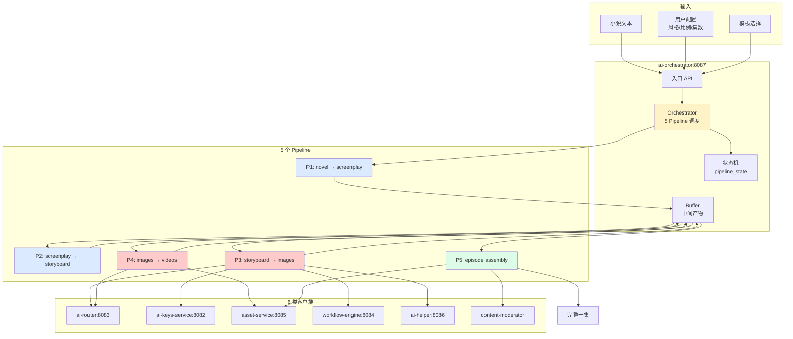
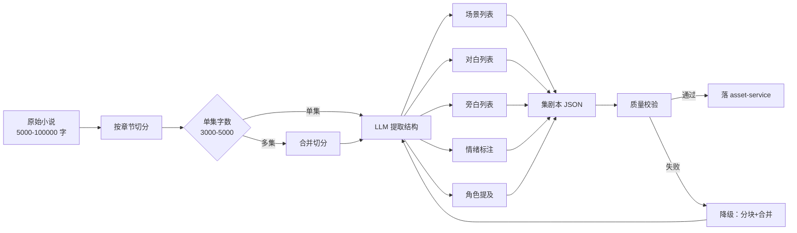
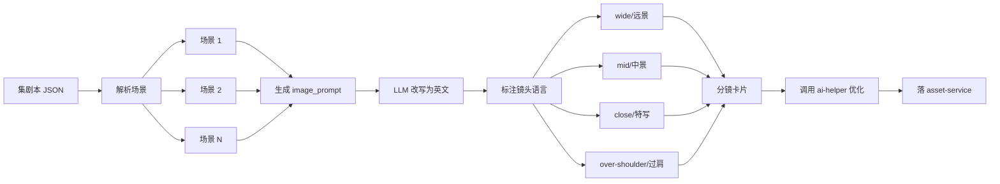
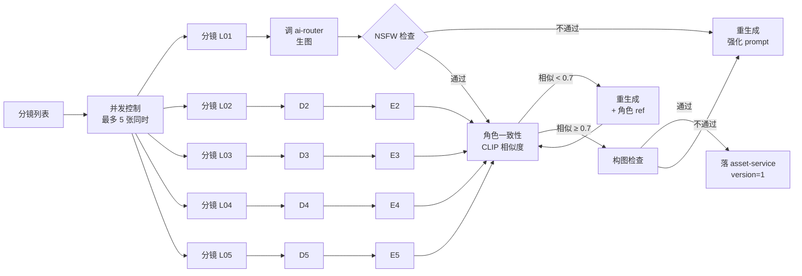
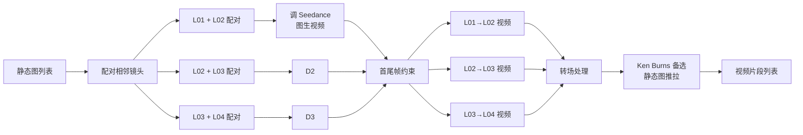
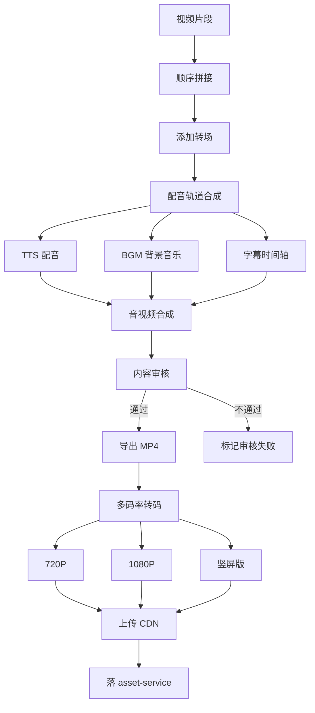
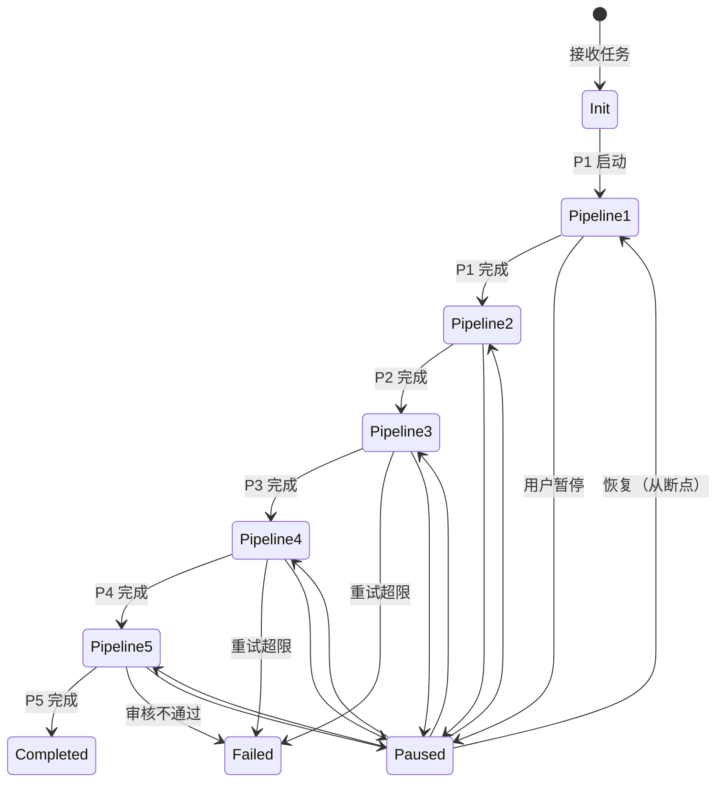
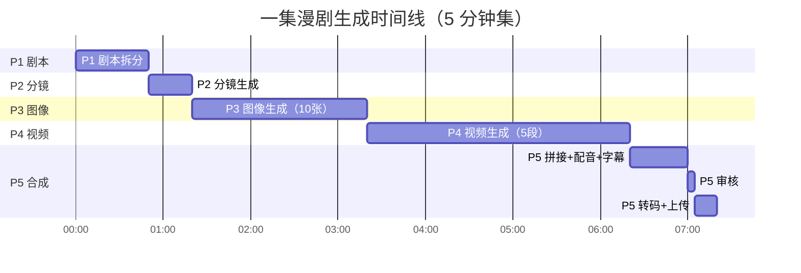

# AI 编排服务架构（W3 - ai-orchestrator）

> **作者**：陈远枢（运营总监）
> **日期**：2026-06-08
> **适用版本**：ManhuaWorks v0.3.0
> **服务名**：`ai-orchestrator`
> **端口**：`8087`
> **阅读时长**：≈ 11 分钟

## 1. 概述

AI 编排服务（ai-orchestrator）是 ManhuaWorks 的"漫剧生成总指挥"。它把**复杂的漫剧生成任务**拆成 5 个核心 pipeline，调度 6 类客户端协同工作，最终输出一集完整的漫剧。

**与 workflow-engine 的关系**：
- **workflow-engine**（W2）：通用任务编排（任何工作流）
- **ai-orchestrator**（W3）：漫剧专用编排（pipeline 写死 + 高度优化）

**5 个核心 pipeline**：

| # | Pipeline | 输入 | 输出 | 耗时 |
|:--|:--|:--|:--|:--|
| 1 | novel-to-screenplay | 小说文本 | 结构化剧本 | 30-60s |
| 2 | screenplay-to-storyboard | 剧本 | 分镜卡片 | 20-40s |
| 3 | storyboard-to-images | 分镜 | 静态图 | 60-180s |
| 4 | images-to-videos | 静态图 | 视频片段 | 120-300s |
| 5 | videos-to-episode | 视频+音频+字幕 | 完整一集 | 30-60s |

**6 类客户端**：
1. ai-router（W2）— 算力供应商
2. ai-keys-service（W2）— BYOK 密钥
3. asset-service（W3）— 资产存储
4. workflow-engine（W3）— 任务调度
5. ai-helper（W3）— 智能辅助
6. content-moderator（v2）— 内容审核

**目标读者**：
- 后端开发：理解 pipeline 之间如何衔接
- 产品/运营：理解 5 个 pipeline 的输入输出和时间
- 客户支持：理解失败时如何定位问题

---

## 2. 架构总览



---

## 3. 5 个 Pipeline 详解

### 3.1 Pipeline 1: novel-to-screenplay（小说 → 剧本）



**输入**：
```json
{
  "novel_text": "第一章 灰星\n\n三百年前...",
  "episode_no": 1,
  "target_word_count": 3500,
  "story_type": "Scifi_post_apocalypse"
}
```

**输出**（落 asset-service）：
```json
{
  "asset_id": "asset_screen_xyz",
  "type": "text",
  "category": "episode",
  "content": {
    "episode_no": 1,
    "title": "林启踏入第一个穹顶",
    "scenes": [...],
    "dialogues": [...],
    "narration": [...],
    "characters_mentioned": ["林启", "智脑"]
  }
}
```

**关键参数**：
- 调 ai-router 的 text 接口
- 用智谱 GLM-4（中文强）
- 典型耗时：30-60s
- 典型成本：¥0.05

**降级策略**：
- 文本 < 500 字 → 报错"文本过短"
- 文本 > 100,000 字 → 切分成多集
- LLM 输出不合规 → 重试 1 次 → 改用 Qwen
- 二次失败 → 标记 failed，让用户重试

### 3.2 Pipeline 2: screenplay-to-storyboard（剧本 → 分镜）



**输入**：Pipeline 1 的输出 + 用户选定的艺术风格

**输出**（每个分镜一张卡片）：
```json
{
  "asset_id": "asset_shot_xyz",
  "type": "text",
  "category": "storyboard",
  "shots": [
    {
      "shot_id": "L01",
      "scene_id": "S01",
      "type": "wide",
      "duration_seconds": 3,
      "image_prompt": "Ancient ruins entrance, golden dusk light, mysterious fog, cinematic wide shot, 8k",
      "negative_prompt": "blur, distortion, low quality",
      "dialogue": null,
      "action": "林启踏入废墟入口",
      "sfx": "脚步回声",
      "transition": "fade-in"
    }
  ]
}
```

**关键参数**：
- 一集 8-15 个分镜
- 每个 prompt 50-80 词
- 用 ai-helper 的 optimize 功能
- 典型耗时：20-40s
- 典型成本：¥0.04 + ¥0.02（ai-helper）

### 3.3 Pipeline 3: storyboard-to-images（分镜 → 图像）⭐ 核心



**输入**：Pipeline 2 的输出

**输出**：每张分镜对应一张图（落 asset-service）

**质量门**（4 道）：

| 门 | 检查 | 工具 | 不通过动作 |
|:--|:--|:--|:--|
| 1 | NSFW / 合规 | 阿里云内容安全 + 自训 | 重生成 + 强化 negative prompt |
| 2 | 角色一致性 | CLIP 相似度 ≥ 0.7 | 加角色 reference 重生成 |
| 3 | 构图合规 | 自训（主体居中/不裁切）| 重生成 + 改 prompt |
| 4 | 美学分 | LAION 美学评分 ≥ 5.0 | 重生成 + 提升细节 |

**关键参数**：
- 单供应商调用：火山 Doubao-Seedream
- 备用：智谱 CogView（失败时转移）
- 典型耗时：60-180s（10 张图 5 并发）
- 典型成本：¥0.80-1.50

**重试上限**：
- 单张图最多重试 3 次
- 3 次仍失败 → 标记该分镜失败，让用户手动重试
- 整集失败率 > 30% → 整集失败

### 3.4 Pipeline 4: images-to-videos（图像 → 视频）⭐ 核心



**输入**：Pipeline 3 的输出

**输出**：每对相邻镜头生成一段 3-5 秒视频

**关键技术**：

1. **首尾帧控制**：用 L01 的尾帧 + L02 的首帧做约束，保证连贯
2. **运镜控制**：prompt 写明"slow zoom in" / "pan right"
3. **时长控制**：默认 5 秒/段，可调 3-10 秒
4. **降级方案**：视频生成失败 → 静态图 + Ken Burns 推拉效果

**关键参数**：
- 视频供应商：火山 Seedance（主）/ 智谱 CogVideoX
- 一集 5-8 段视频
- 典型耗时：120-300s
- 典型成本：¥4-8

**失败处理**：
- 单段失败 → Ken Burns 替代
- 整集 > 50% 失败 → 整集失败
- 整集失败 → 退还 100% 配额

### 3.5 Pipeline 5: videos-to-episode（视频 → 完整一集）



**输入**：Pipeline 4 的输出 + 字幕配音

**输出**：完整一集 MP4（含多分辨率版本）

**关键工作**：
1. 视频拼接 + 转场
2. 配音合成（TTS + BGM 混音）
3. 字幕烧录（硬字幕 / 软字幕可切换）
4. 内容审核（content-moderator）
5. 多码率转码（720P / 1080P / 竖屏）
6. CDN 上传 + 签名 URL

**关键参数**：
- 视频拼接：FFmpeg
- TTS：智谱（便宜）/ 火山（质量高）
- 转码：FFmpeg + GPU 加速
- 审核：阿里云 + 自训
- 典型耗时：30-60s
- 典型成本：¥0.20

**审核规则**：
- NSFW（色情/暴恐）
- 政治敏感
- 平台黑名单词
- 自定义词库

**不通过处理**：
- 标红 + 自动尝试替换
- 仍不通过 → 标记 failed，让用户修改

---

## 4. 编排器核心

### 4.1 状态机



### 4.2 中间产物 Buffer

```typescript
interface PipelineBuffer {
  episode_id: string;
  // P1 输出
  screenplay?: ScreenplayOutput;
  // P2 输出
  storyboard?: StoryboardOutput;
  // P3 输出
  images?: ImageOutput[];
  // P4 输出
  videos?: VideoOutput[];
  // P5 输出
  episode?: EpisodeOutput;
  
  // 元数据
  metadata: {
    started_at: string;
    current_pipeline: number;
    retry_counts: Record<number, number>;
    cost_breakdown: Record<string, number>;
  };
}
```

**Buffer 持久化**：
- 落 PostgreSQL 表 `orchestrator_buffer`
- 每个 pipeline 完成 → 立即写入
- 崩溃恢复 → 从中断的 pipeline 继续

### 4.3 编排器主循环

```typescript
class Orchestrator {
  async run(episode: EpisodeJob): Promise<EpisodeOutput> {
    const buffer = await this.loadOrInitBuffer(episode);
    
    // P1: novel → screenplay
    if (!buffer.screenplay) {
      buffer.screenplay = await this.pipeline1(episode);
      await this.saveBuffer(buffer);
      this.emit('pipeline.completed', { pipeline: 1, buffer });
    }
    
    // P2: screenplay → storyboard
    if (!buffer.storyboard) {
      buffer.storyboard = await this.pipeline2(buffer.screenplay, episode);
      await this.saveBuffer(buffer);
      this.emit('pipeline.completed', { pipeline: 2, buffer });
    }
    
    // P3-P5 类似...
    
    return buffer.episode;
  }
}
```

### 4.4 与 workflow-engine 的分工

| 维度 | workflow-engine | ai-orchestrator |
|:--|:--|:--|
| 通用性 | 通用（任何工作流）| 专用（漫剧）|
| 调度方式 | DAG（灵活）| 5 Pipeline 写死（快速）|
| 用户可见 | 通用任务列表 | "我的漫剧"专属 UI |
| 重试策略 | 通用（指数退避）| 漫剧定制（图像 3 次，视频 1 次）|
| 优化深度 | 浅（7 步通用）| 深（每个 pipeline 高度优化）|
| 状态 | 步骤级 | pipeline + 子任务级 |

**协作方式**：
- ai-orchestrator 内部用 workflow-engine 做任务调度
- ai-orchestrator 是"产品"，workflow-engine 是"引擎"

---

## 5. 6 类客户端集成

### 5.1 ai-router（算力）

```typescript
// 调用示例
const imageResult = await aiRouter.image.generate({
  prompt: shot.image_prompt,
  model: 'doubao-seedream-3.0',
  width: 1024,
  height: 1024,
  reference_images: characterRefs,  // 角色一致性
  user_id: episode.userId,
  run_id: episode.runId
});
```

**集成点**：P3 / P4 / P5 的 TTS / 文本生成

### 5.2 ai-keys-service（BYOK）

```typescript
// 优先用 BYOK，否则用平台配额
const keyInfo = await aiKeysService.getActiveKey(userId, 'volcengine');
if (keyInfo) {
  // 用用户 Key
  await aiRouter.image.generate({ ..., use_user_key: true });
} else {
  // 扣用户配额
  await quota.consume(userId, 'image', 1);
}
```

### 5.3 asset-service（存储）

```typescript
// P3 完成 → 落图
await assetService.create({
  userId, projectId, runId,
  assetType: 'image',
  category: 'storyboard',
  name: `分镜 ${shot.shot_id}`,
  storageKey: imageResult.storage_key,
  mimeType: 'image/png',
  sizeBytes: imageResult.size,
  checksum: imageResult.checksum
});
```

### 5.4 workflow-engine（任务调度）

```typescript
// 异步 pipeline 用 workflow-engine 调度
await workflowEngine.scheduleTask({
  run_id: episode.runId,
  task: 'pipeline3-image',
  payload: { shots: buffer.storyboard.shots },
  parallelism: 5
});
```

### 5.5 ai-helper（智能辅助）

```typescript
// P2 之前先优化 prompt
const optimized = await aiHelper.prompts.optimize({
  raw_prompt: shot.image_prompt,
  style: episode.config.style
});
shot.image_prompt = optimized.optimized_prompt;
```

### 5.6 content-moderator（v2 内容审核）

```typescript
// P5 完成前必须审核
const modResult = await contentModerator.scan({
  video_url: episode.video_url,
  text_content: screenplay.all_text,
  strict_mode: true
});

if (modResult.score < 80) {
  throw new ModerationFailedError(modResult.violations);
}
```

---

## 6. 完整一集生成流程



**总耗时**：约 7 分钟（含审核和转码）

---

## 7. 错误处理与重试

### 7.1 错误分类

| 错误类型 | 示例 | 处理 |
|:--|:--|:--|
| 输入错误 | 文本为空 | 立即报错，扣 0 配额 |
| 限流错误 | 供应商 QPS 超限 | 等待 1s 重试 |
| 供应商失败 | 4 家全挂 | 降级到 Ken Burns |
| 内容违规 | NSFW | 替换/标红/失败 |
| 系统错误 | 数据库挂了 | 重试 3 次 → 标记 failed |
| 用户操作 | 取消/暂停 | 保存状态 |

### 7.2 重试策略

```typescript
const retryPolicy = {
  p1: { max: 2, backoff: 'exp' },
  p2: { max: 2, backoff: 'exp' },
  p3: { max: 3, backoff: 'exp', per_shot: true },
  p4: { max: 1, backoff: 'none', per_segment: true },
  p5: { max: 1, backoff: 'none' }
};
```

### 7.3 用户可见错误

```json
{
  "code": 500,
  "error": {
    "type": "pipeline_failed",
    "pipeline": 3,
    "step": "image-generation",
    "subtask": "L07",
    "message": "图像生成失败 3 次，请手动重试或跳过该镜头",
    "actions": [
      { "label": "重试", "endpoint": "POST /v1/episode/:id/retry?from=p3&subtask=L07" },
      { "label": "跳过该镜头", "endpoint": "POST /v1/episode/:id/skip?subtask=L07" }
    ]
  }
}
```

---

## 8. 性能与配额

### 8.1 性能指标

| Pipeline | 目标耗时 | P95 告警 |
|:--|:--|:--|
| P1 剧本 | < 60s | > 90s |
| P2 分镜 | < 40s | > 60s |
| P3 图像 | < 180s | > 300s |
| P4 视频 | < 300s | > 450s |
| P5 合成 | < 60s | > 90s |
| **总计** | **< 8 分钟** | **> 12 分钟** |

### 8.2 配额消耗

| Pipeline | 配额消耗（积分）|
|:--|:--:|
| P1 | 5 |
| P2 | 4 |
| P3 | 100（10 张 × 10 积分）|
| P4 | 500（5 段 × 100 积分）|
| P5 | 10 |
| **总计** | **619**（约 ¥6.19）|

### 8.3 退款规则

| 失败位置 | 退款比例 |
|:--|:--:|
| P1 失败 | 100% |
| P2 失败 | 80% |
| P3 失败（部分镜头成功）| 按成功比例 |
| P4 失败 | 50% |
| P5 失败 | 30% |
| 用户主动取消 | 按未发生部分退 |

---

## 9. API 端点清单

| 方法 | 路径 | 说明 |
|:--|:--|:--|
| POST | `/v1/orchestrator/episodes` | 创建漫剧生成任务 |
| GET | `/v1/orchestrator/episodes/:id` | 查询任务详情 |
| POST | `/v1/orchestrator/episodes/:id/pause` | 暂停 |
| POST | `/v1/orchestrator/episodes/:id/resume` | 恢复 |
| POST | `/v1/orchestrator/episodes/:id/cancel` | 取消 |
| POST | `/v1/orchestrator/episodes/:id/retry` | 重试（指定 pipeline）|
| GET | `/v1/orchestrator/episodes/:id/buffer` | 查看中间产物 |
| GET | `/v1/orchestrator/episodes/:id/asset/:type` | 获取产物（图片/视频）|
| POST | `/v1/orchestrator/episodes/:id/skip` | 跳过某子任务 |
| WS | `/v1/orchestrator/ws/:id` | 实时进度 |
| GET | `/v1/orchestrator/templates` | 列出可用模板 |
| GET | `/v1/orchestrator/usage` | 用量统计 |

完整 API 规范见 `docs/api/orchestrator.md`。

---

## 10. 监控指标

| 指标 | 目标 | 告警阈值 |
|:--|:--|:--|
| 端到端成功率 | > 92% | < 85% |
| P95 总耗时 | < 8 分钟 | > 12 分钟 |
| 平均成本 | < ¥6.5 | > ¥8 |
| 退款率 | < 5% | > 10% |
| 审核拦截率 | < 3% | > 8% |
| 用户取消率 | < 8% | > 15% |

---

## 11. 后续规划

- **W4**：增加"半自动模式"——AI 卡住时请求用户确认（如风格选择）
- **W5**：支持多语言剧本（英文/日文/韩文小说 → 中文漫剧）
- **W6**：实时协作——多人同时编辑一集
- **W8**：AI 自动优化模板——根据历史数据调整 pipeline 参数
- **W10**：跨集一致性——保证长剧集角色 100% 一致

---

## 12. 变更记录

| 版本 | 日期 | 作者 | 变更 |
|:--|:--|:--|:--|
| v0.1 | 2026-06-08 | 陈远枢 | 初稿（W3 任务 6）|
