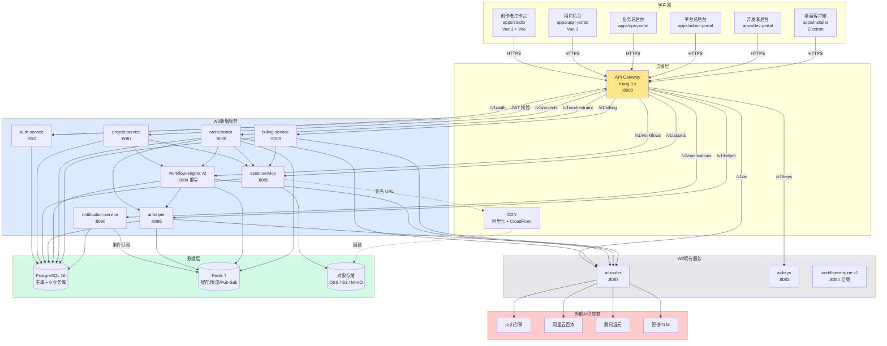
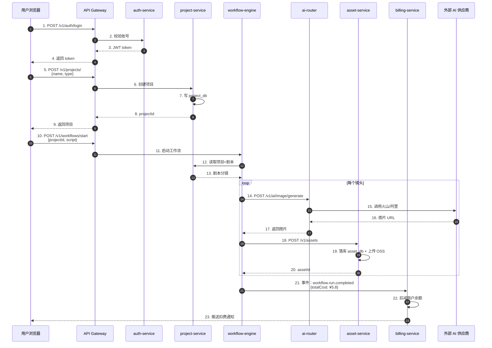
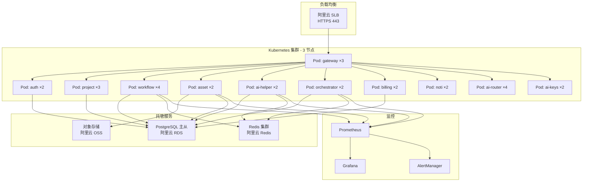

# W3 整体架构总览

> **作者**：陈远枢（运营总监）
> **日期**：2026-06-08
> **适用版本**：ManhuaWorks v0.3.0
> **覆盖范围**：W3 三周内交付的所有微服务
> **阅读时长**：≈ 8 分钟

## 1. 概述

W3 阶段（2026-06-08 ~ 2026-28）共交付 **8 个后端微服务** + **2 个独立子模块**，构成本次内测所需的核心后端集群。本文档用一张 Mermaid 图把全部服务、依赖、端口、数据流画清楚，并给出端口分配表。

**与 W2 的关系**：
- W2 已交付：`ai-router` (8083)、`ai-keys` (8082)、`workflow-engine` v1 (8084)
- W3 新增/重写：`asset-service`、`ai-helper`、`workflow-engine v2`、`orchestrator`、`auth-service`、`project-service`、`billing-service`、`notification-service`

---

## 2. 整体架构图

---

## 3. 端口分配表

| # | 服务名 | 端口 | 协议 | 数据库 | 状态 | 负责人 | 文档 |
|:--|:--|:--|:--|:--|:--|:--|:--|
| 1 | `api-gateway` | **8000** | HTTP | - | 既有 | 后端组 | W1 文档 |
| 2 | `auth-service` | **8081** | HTTP | `auth_db` | W3 新建 | 沈书白 | W3_AUTH |
| 3 | `ai-keys` | **8082** | HTTP | `keys_db` | W2 完成 | 陈远枢 | `api/ai-keys.md` |
| 4 | `ai-router` | **8083** | HTTP | - | W2 完成 | 陈远枢 | `api/ai-router.md` |
| 5 | `workflow-engine` | **8084** | HTTP+WS | `workflow_db` | W3 重写 | 陈远枢 | `W3_WORKFLOW_REFINED.md` |
| 6 | `asset-service` | **8085** | HTTP | `asset_db` | W3 新建 | 陈远枢 | `W3_ASSET.md` |
| 7 | `ai-helper` | **8086** | HTTP | `helper_db` | W3 新建 | 陈远枢 | `W3_AI_HELPER.md` |
| 8 | `project-service` | **8087** | HTTP | `project_db` | W3 新建 | 沈书白 | W3_PROJECT |
| 9 | `orchestrator` | **8088** | HTTP+WS | `orchestrator_db` | W3 新建 | 陈远枢 | `W3_ORCHESTRATOR.md` |
| 10 | `billing-service` | **8089** | HTTP | `billing_db` | W3 新建 | 林若涵 | W3_BILLING |
| 11 | `notification-service` | **8090** | HTTP+WS | `noti_db` | W3 新建 | 林若涵 | W3_NOTIFICATION |
| - | `ai-router` metrics | 9103 | HTTP | - | 既有 | - | Prometheus |
| - | `workflow` metrics | 9104 | HTTP | - | W3 | - | Prometheus |
| - | `asset` metrics | 9105 | HTTP | - | W3 | - | Prometheus |
| - | `ai-helper` metrics | 9106 | HTTP | - | W3 | - | Prometheus |
| - | `orchestrator` metrics | 9108 | HTTP | - | W3 | - | Prometheus |
| - | `PostgreSQL` 主库 | 5432 | TCP | - | 既有 | 运维 | - |
| - | `Redis` 7 | 6379 | TCP | - | 既有 | 运维 | - |
| - | `MinIO` (dev) | 9000/9001 | HTTP | - | 既有 | 运维 | - |
| - | `Kong` Admin | 8001 | HTTP | - | 既有 | 运维 | - |
| - | `Prometheus` | 9090 | HTTP | - | 既有 | 运维 | - |
| - | `Grafana` | 3000 | HTTP | - | 既有 | 运维 | - |

---

## 4. 服务依赖矩阵

> ✅ = 直接 HTTP 调用 | 📡 = 事件订阅 | ➖ = 无依赖

| 服务 \ 依赖 | auth | ai-keys | ai-router | workflow | asset | ai-helper | project | orchestrator | billing | noti |
|:--|:--|:--|:--|:--|:--|:--|:--|:--|:--|:--|
| **auth-service** | ➖ | ➖ | ➖ | ➖ | ➖ | ➖ | ➖ | ➖ | ➖ | ➖ |
| **ai-keys** | ✅ | ➖ | ➖ | ➖ | ➖ | ➖ | ➖ | ➖ | ➖ | ➖ |
| **ai-router** | ✅ | ✅ | ➖ | ➖ | ➖ | ➖ | ➖ | ➖ | 📡 | ➖ |
| **workflow-engine** | ✅ | ➖ | ✅ | ➖ | 📡 | 📡 | 📡 | ➖ | 📡 | 📡 |
| **asset-service** | ✅ | ➖ | ➖ | 📡 | ➖ | 📡 | 📡 | 📡 | 📡 | ➖ |
| **ai-helper** | ✅ | ➖ | ✅ | 📡 | 📡 | ➖ | 📡 | ➖ | 📡 | ➖ |
| **project-service** | ✅ | ➖ | ➖ | ✅ | ✅ | ➖ | ➖ | 📡 | ➖ | 📡 |
| **orchestrator** | ✅ | ➖ | ✅ | ✅ | ✅ | ✅ | ✅ | ➖ | 📡 | 📡 |
| **billing-service** | ✅ | ✅ | ✅ | 📡 | 📡 | 📡 | 📡 | 📡 | ➖ | 📡 |
| **notification-service** | ✅ | ➖ | ➖ | 📡 | 📡 | 📡 | 📡 | 📡 | 📡 | ➖ |

**循环依赖检查**：✅ 无循环（billing 监听事件，不主动调用其他服务）

---

## 5. 事件总线（EventBus 协议）

所有服务通过 **Redis Pub-Sub** 共享事件总线，事件命名规范 `domain.entity.action`：

| 事件名 | 发布者 | 订阅者 | 载荷示例 |
|:--|:--|:--|:--|
| `auth.user.created` | auth-service | billing, noti | `{userId, email, plan}` |
| `auth.user.deleted` | auth-service | 全部 | `{userId}` |
| `project.created` | project-service | workflow, asset | `{projectId, userId, type}` |
| `asset.created` | asset-service | workflow, ai-helper, billing | `{assetId, userId, size}` |
| `asset.deleted` | asset-service | workflow, ai-helper | `{assetId, soft}` |
| `workflow.run.started` | workflow-engine | orchestrator, noti | `{runId, projectId}` |
| `workflow.run.completed` | workflow-engine | orchestrator, billing, noti | `{runId, totalCost}` |
| `workflow.run.failed` | workflow-engine | noti | `{runId, error}` |
| `ai.task.completed` | ai-router | billing, orchestrator | `{taskId, cost, tokens}` |
| `billing.subscription.changed` | billing-service | auth, noti | `{userId, plan, status}` |
| `noti.send.email` | billing-service | notification-service | `{to, template, data}` |

---

## 6. 数据流主路径（端到端）

---

## 7. 部署拓扑（生产环境）

**副本数原则**：
- 计算密集（ai-router、workflow）：4 副本
- 业务读写（project、auth）：2-3 副本
- IO 密集（asset、billing）：2 副本

---

## 8. SLO 目标（Service Level Objective）

| 服务 | 可用性 | P95 延迟 | 错误率 | 备注 |
|:--|:--|:--|:--|:--|
| api-gateway | 99.95% | < 50ms | < 0.1% | 入口核心 |
| auth-service | 99.9% | < 200ms | < 0.5% | 登录注册 |
| project-service | 99.5% | < 300ms | < 1% | 读写均衡 |
| workflow-engine | 99.5% | < 500ms | < 1% | WS 长连接 |
| asset-service | 99.5% | < 500ms | < 0.5% | 上传下载 |
| ai-helper | 99% | < 1s | < 2% | LLM 依赖 |
| orchestrator | 99.5% | < 1s | < 1% | 复杂编排 |
| billing-service | 99.99% | < 200ms | < 0.01% | 计费不能错 |
| notification-service | 99% | < 2s | < 2% | 异步容忍高 |
| ai-router | 99.5% | < 800ms | < 1% | 4 家冗余 |

---

## 9. 启动顺序与健康检查

**健康检查端点**：每个服务都暴露 `GET /health`，返回 `{status, db, redis, version}`

---

## 10. 监控与告警

| 指标 | 阈值 | 告警级别 |
|:--|:--|:--|
| 服务 P99 延迟 > 2s | 持续 5 分钟 | P2 |
| 错误率 > 5% | 持续 3 分钟 | P1 |
| 服务 down | 1 分钟内 | P0 |
| CPU > 80% | 持续 10 分钟 | P3 |
| 内存 > 85% | 持续 5 分钟 | P3 |
| DB 连接数 > 80% | 立即 | P2 |
| 磁盘 > 90% | 立即 | P1 |

告警通道：飞书机器人 + 短信（仅 P0/P1）。

---

## 11. 后续规划（W4+）

- **W4**：完善 billing-service 真实支付（支付宝/微信），加入对账模块
- **W5**：抽离 ai-router 的熔断器为独立 `resilience` 中间件
- **W6**：引入 `service-mesh`（Istio）做细粒度流量管理
- **W7**：拆分 `project-service` 为读（query）/ 写（command）两个服务
- **W8**：增加 `analytics-service`（埋点 + 漏斗 + 留存）

---

## 12. 变更记录

| 版本 | 日期 | 作者 | 变更 |
|:--|:--|:--|:--|
| v0.1 | 2026-06-08 | 陈远枢 | 初稿（W3 任务 6）|
