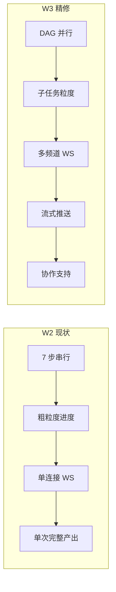
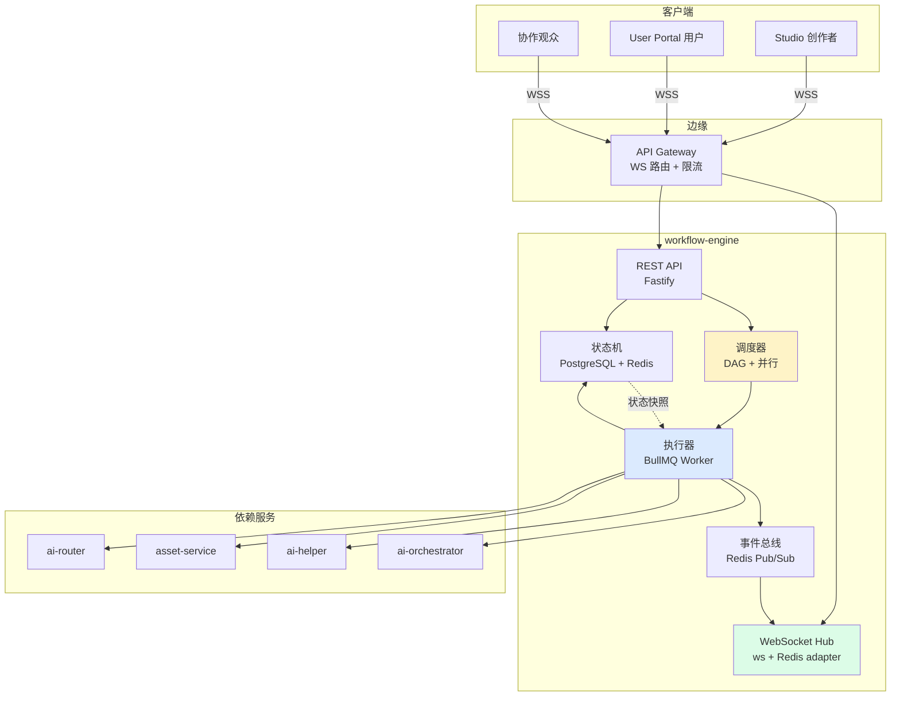
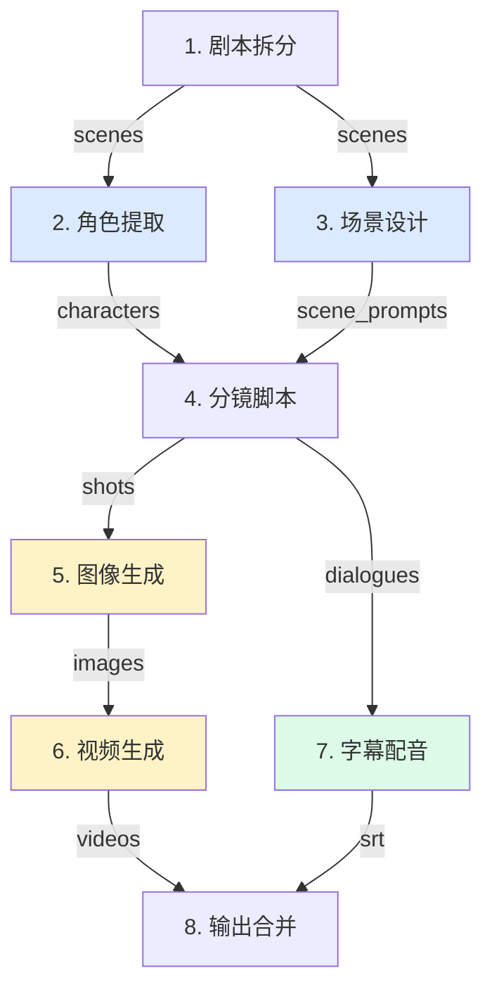
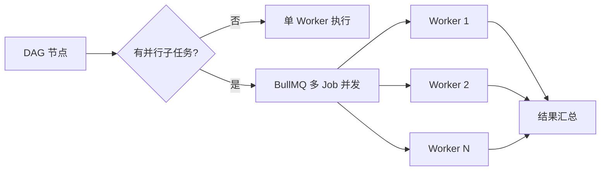
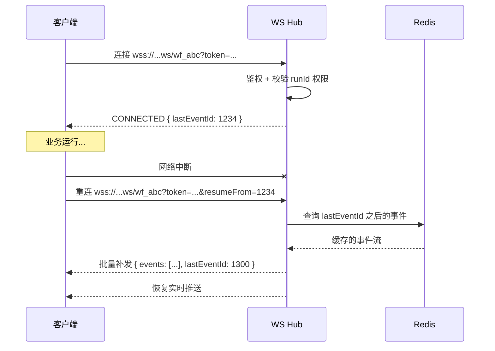
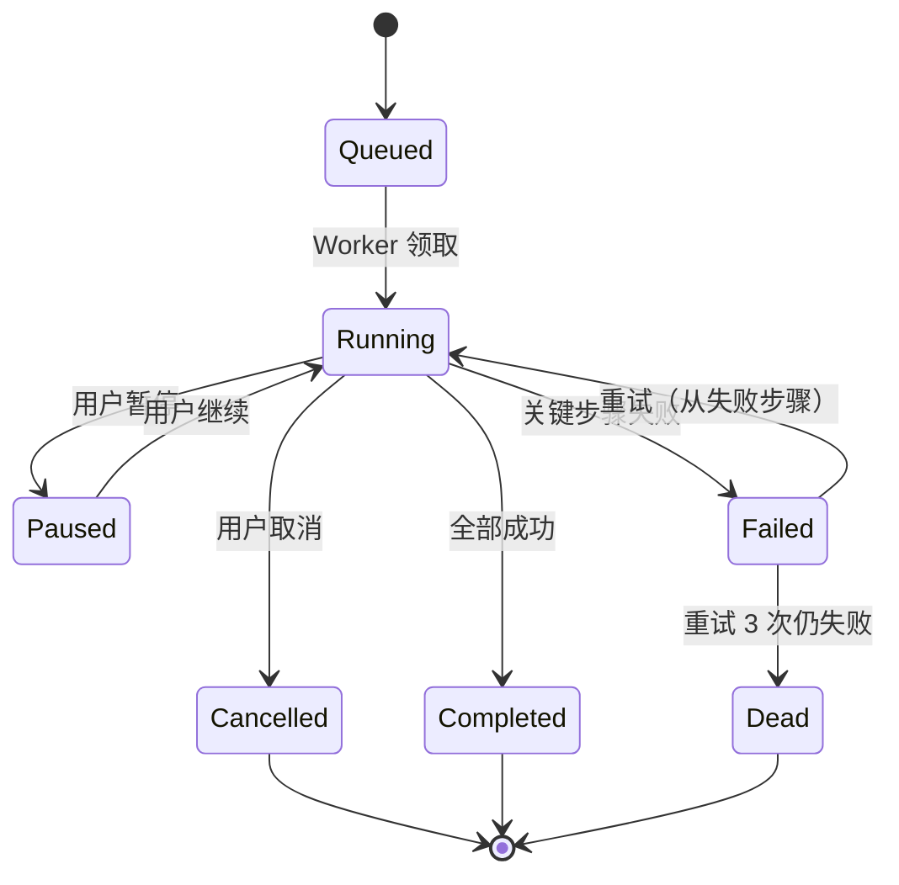
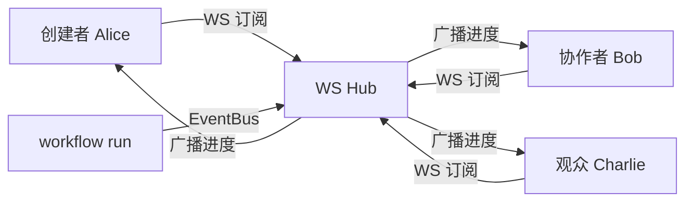

# 工作流精修架构（W3 - workflow-engine v2）

> **作者**：陈远枢（运营总监）
> **日期**：2026-06-08
> **适用版本**：ManhuaWorks v0.3.0
> **服务名**：`workflow-engine`
> **端口**：`8084` (REST) / `8084/ws` (WebSocket)
> **阅读时长**：≈ 12 分钟

## 1. 概述

工作流引擎在 W2 已经实现 7 步流水线（剧本拆分 → 字幕配音）。W3 在 W2 基础上做 5 项精修：

1. **WebSocket 协议升级**：从单条事件流 → 多路复用频道 + 断线重连
2. **实时进度细化**：从 7 步粗粒度 → 单步骤内子任务粒度（精确到"镜头 7/10"）
3. **并行调度器**：引入 DAG 调度器，自动识别可并行节点（S2∥S3、S6∥S7 等）
4. **流式输出**：先生成的镜头先推送，不必等全集
5. **协作模式**：多人同时观看同一工作流的实时进度

**目标读者**：
- 前端开发：WebSocket 订阅协议、断线重连、流式渲染
- 后端开发：DAG 调度器、并行执行、状态恢复
- 运维：WebSocket 集群、Redis Pub/Sub、状态持久化

---

## 2. W2 → W3 演进



| 维度 | W2 | W3 |
|:--|:--|:--|
| 调度方式 | 串行 7 步 | DAG 调度（含并行分支）|
| 进度粒度 | 步级 0/7 → 7/7 | 步级 + 子任务（10/10）|
| WS 协议 | 单事件流 | 多频道 + 房间 + ACK |
| 输出方式 | 全集完成才推 | 子任务完成即推 |
| 协作 | 单人观看 | 多人订阅同一运行 |
| 状态恢复 | 全量重启 | 增量续跑 |
| 性能（一集）| 8 分钟 | 6 分钟（省 25%）|

---

## 3. 架构总览



**关键组件**：
- **WS Hub**：管理 10K+ WebSocket 长连接，跨实例广播用 Redis Pub/Sub
- **调度器**：解析模板 → 构建 DAG → 计算可并行节点
- **执行器**：BullMQ Worker 池，并发执行子任务
- **状态机**：PG 持久化 + Redis 缓存，断电可恢复
- **事件总线**：所有状态变更走 EventBus，WS 订阅并推送

---

## 4. DAG 调度器

### 4.1 7 步 DAG（含并行边）



**并行加速分析**：
- S1 → S2/S3 并行，节省 30 秒
- S5 内部 10 张图并发，节省 100 秒
- S6 和 S7 完全并行（无依赖），节省 60 秒
- **总计节省 ≈ 3 分钟（一集 6 分钟完成）**

### 4.2 调度器实现

```typescript
// DAG 节点定义
interface DagNode {
  id: string;            // 'S1', 'S2', ...
  type: 'step' | 'substep';
  deps: string[];        // 依赖的节点 ID
  parallel: number;      // 内部并发数（substep 才有意义）
  timeoutMs: number;
  retry: number;
}

// 构建 DAG（来自模板）
const dag: DagNode[] = [
  { id: 'S1', type: 'step', deps: [], parallel: 1, timeoutMs: 120000, retry: 2 },
  { id: 'S2', type: 'step', deps: ['S1'], parallel: 1, timeoutMs: 60000, retry: 2 },
  { id: 'S3', type: 'step', deps: ['S1'], parallel: 1, timeoutMs: 60000, retry: 2 },
  { id: 'S4', type: 'step', deps: ['S2', 'S3'], parallel: 1, timeoutMs: 90000, retry: 2 },
  { id: 'S5', type: 'step', deps: ['S4'], parallel: 10, timeoutMs: 300000, retry: 3 },
  { id: 'S6', type: 'step', deps: ['S5'], parallel: 5, timeoutMs: 360000, retry: 2 },
  { id: 'S7', type: 'step', deps: ['S4'], parallel: 1, timeoutMs: 90000, retry: 2 },
  { id: 'OUT', type: 'step', deps: ['S6', 'S7'], parallel: 1, timeoutMs: 60000, retry: 1 }
];

// 调度器主循环
async function schedule(runId: string, dag: DagNode[]) {
  const completed = new Set<string>();
  const queue = new PQueue({ concurrency: 50 });
  
  while (completed.size < dag.length) {
    // 找到所有依赖已满足的节点
    const ready = dag.filter(n =>
      !completed.has(n.id) &&
      n.deps.every(d => completed.has(d))
    );
    
    // 并行入队
    await Promise.all(ready.map(node =>
      queue.add(() => executeNode(runId, node).then(() => {
        completed.add(node.id);
        emitEvent('node.completed', { runId, nodeId: node.id });
      }))
    ));
  }
}
```

### 4.3 并发控制



**并发配置**：
- 全局：50 个 BullMQ Worker 进程
- 每步：1-10 并发（模板定义）
- 单供应商：QPS 限流（避免被供应商封号）

---

## 5. WebSocket 协议升级

### 5.1 协议概览

**W2 单事件流**：
```
客户端 ← 服务端: 事件1, 事件2, 事件3...
```

**W3 多频道 + 房间**：
```
客户端 → 服务端: SUBSCRIBE run:wf_abc step:S5
客户端 → 服务端: SUBSCRIBE run:wf_abc log:level:warn
服务端 → 客户端: MSG run:wf_abc step:S5 {progress: 50}
服务端 → 客户端: MSG run:wf_abc log:level:warn {error: "..."}
```

### 5.2 消息类型

**客户端 → 服务端**：

| 类型 | 说明 | Payload |
|:--|:--|:--|
| `subscribe` | 订阅频道 | `{ channels: ['run:wf_abc', 'step:S5', 'log:warn'] }` |
| `unsubscribe` | 取消订阅 | `{ channels: [...] }` |
| `pause` | 暂停工作流 | `{ runId }` |
| `resume` | 恢复工作流 | `{ runId }` |
| `cancel` | 取消工作流 | `{ runId }` |
| `ping` | 心跳 | `{ ts }` |

**服务端 → 客户端**：

| 类型 | 频道 | 说明 |
|:--|:--|:--|
| `progress` | `run:*` | 总体进度 0-100 |
| `step.started` | `step:*` | 步骤开始 |
| `step.progress` | `step:*` | 步骤内子任务进度 |
| `step.completed` | `step:*` | 步骤完成 |
| `step.failed` | `step:*` | 步骤失败 |
| `asset.ready` | `run:*` | 新资产可预览（流式）|
| `log` | `log:*` | 实时日志 |
| `pong` | - | 心跳响应 |
| `error` | - | 错误 |

### 5.3 消息格式

```json
{
  "id": "msg_001",
  "type": "step.progress",
  "channel": "step:S5",
  "runId": "wf_abc",
  "ts": 1717789012345,
  "data": {
    "step": 5,
    "stepName": "图像生成",
    "percent": 65,
    "subtask": {
      "current": 7,
      "total": 10,
      "label": "镜头 L07"
    },
    "costSoFar": 0.56,
    "elapsedMs": 45230,
    "etaSeconds": 23
  }
}
```

### 5.4 断线重连



**断线重连设计**：
- 客户端记录 `lastEventId`
- 重连时带 `resumeFrom=lastEventId`
- 服务端从 Redis 缓存里补发（缓存最近 1000 条/频道）
- 补发完后无缝接续

### 5.5 ACK 机制

```json
// 客户端每收 50 条 ACK 一次
{ "type": "ack", "lastId": 1234 }

// 服务端超时未 ACK → 重发
// 服务端清理 5 分钟无 ACK 的连接
```

---

## 6. 实时进度细化

### 6.1 进度数据结构

```typescript
interface RunProgress {
  runId: string;
  totalSteps: number;
  totalSubtasks: number;
  completedSteps: number;
  completedSubtasks: number;
  currentStep: {
    id: string;
    name: string;
    status: 'pending' | 'running' | 'paused' | 'completed' | 'failed';
    percent: number;       // 0-100
    subtask?: {
      current: number;
      total: number;
      label: string;
    };
  };
  costSoFar: number;
  costBudget: number;     // 配额
  elapsedMs: number;
  etaSeconds: number;
  status: 'queued' | 'running' | 'paused' | 'completed' | 'failed' | 'cancelled';
}
```

### 6.2 子任务粒度举例

**S5 图像生成的子任务**：
```json
{
  "step": 5,
  "subtasks": [
    { "id": "L01", "label": "林启踏入废墟", "status": "completed" },
    { "id": "L02", "label": "智脑低语", "status": "completed" },
    { "id": "L03", "label": "走廊延伸", "status": "running", "percent": 60 },
    { "id": "L04", "label": "远景", "status": "queued" },
    ...
    { "id": "L10", "label": "谜题揭示", "status": "queued" }
  ]
}
```

前端可显示：
```
[✅✅✅🔄⏳⏳⏳⏳⏳⏳]  3/10 完成
```

### 6.3 进度推送频率

| 事件类型 | 推送频率 | 节流策略 |
|:--|:--|:--|
| 总体进度 | 1s/次 | 进度变化 > 1% 才推 |
| 步骤进度 | 500ms/次 | 节流到 1s |
| 资产就绪 | 立即 | 不节流 |
| 日志 | 100ms/次 | 批量合并后推 |

---

## 7. 流式输出

### 7.1 流式 vs 批量

```mermaid
sequenceDiagram
    participant U as 用户
    participant S as Studio
    participant W as workflow
    participant A as asset-service
    
    Note over U,A: W2 批量模式：等全集完成
    W->>W: 生成 10 张图（200s）
    W->>A: 一次性上传 10 张
    A-->>S: 10 张就绪
    S-->>U: 全集展示
    
    Note over U,A: W3 流式模式：先做完的先展示
    W->>W: 生成 L01（30s）
    W->>A: 上传 L01
    A-->>S: L01 就绪
    S-->>U: ▶ L01 可预览
    W->>W: 生成 L02（25s）
    W->>A: 上传 L02
    A-->>S: L02 就绪
    S-->>U: ▶ L02 可预览
    ...
```

### 7.2 流式推送协议

```json
{
  "type": "asset.ready",
  "channel": "run:wf_abc",
  "data": {
    "step": 5,
    "subtask": "L03",
    "asset": {
      "id": "asset_xyz",
      "type": "image",
      "category": "storyboard",
      "url": "https://cdn.mhwork.com/...?sig=...",
      "thumbnail": "https://cdn.mhwork.com/.../thumb.jpg?sig=...",
      "width": 1024,
      "height": 1024
    }
  }
}
```

**前端行为**：
- 收到 `asset.ready` → 立即把卡片从"加载中"切到"已生成"
- 9:16 缩略图先显示，点击看大图
- 用户可提前开始点"重生成单个镜头"（不必等全集）

### 7.3 视频流式（S6 同样适用）

视频生成完一段就推送一段，前端可提前拼装预览（v1.1）。

---

## 8. 状态机与持久化

### 8.1 状态机



### 8.2 持久化策略

| 数据 | 存储 | 写入时机 | TTL |
|:--|:--|:--|:--|
| Run 元数据 | PostgreSQL | 创建/状态变化 | 永久 |
| 步骤详情 | PostgreSQL | 步骤开始/结束 | 永久 |
| 进度快照 | Redis | 每 5 秒 | 1 天 |
| WS 事件流 | Redis Stream | 每个事件 | 1 天（断线重连用）|
| 资产引用 | asset-service | 步骤完成 | 永久 |

### 8.3 崩溃恢复

```typescript
// Worker 启动时扫描 stuck 任务
async function recoverStuckRuns() {
  const stuck = await db.runs.findMany({
    where: { status: 'running', updatedAt: { lt: subMinutes(new Date(), 10) } }
  });
  
  for (const run of stuck) {
    // 从最后完成的步骤继续
    const lastCompleted = run.steps
      .filter(s => s.status === 'completed')
      .sort((a, b) => b.stepNo - a.stepNo)[0];
    
    await resumeFrom(run.id, lastCompleted.stepNo + 1);
    log.info(`恢复 run ${run.id}，从步骤 ${lastCompleted.stepNo + 1} 继续`);
  }
}
```

---

## 9. 协作模式

### 9.1 多人订阅同一工作流



**权限**：
- `owner`：创建者，可暂停/取消/重试
- `editor`：协作者，可暂停/重试
- `viewer`：观众，只读

### 9.2 协作互动

**用户A 在看 L03，触发重生成 → 全员同步**：
```json
// 用户A 操作
{ "type": "retry_subtask", "data": { "runId": "wf_abc", "subtask": "L03" } }

// 服务端广播
{
  "type": "step.progress",
  "data": { "subtask": "L03", "status": "running", "user": "alice" }
}
```

---

## 10. 性能与扩容

| 指标 | 目标 | 备注 |
|:--|:--|:--|
| 一集 5 分钟 | P95 < 6 分钟 | W2 是 8 分钟 |
| 一集 10 分钟 | P95 < 12 分钟 | W2 是 15 分钟 |
| WS 并发连接 | 10K/实例 | 横向扩展到 5 实例 = 50K |
| 事件吞吐 | 100K 事件/秒 | Redis Pub/Sub |
| 调度延迟 | < 100ms | DAG 节点入队 |
| 断线重连补发 | < 2s | 1000 条事件 |

**扩容策略**：
- API 层：Kubernetes HPA（CPU > 70% 自动加 pod）
- WS 层：sticky session + Redis adapter
- Worker 层：BullMQ 队列独立伸缩

---

## 11. 监控指标

| 指标 | 目标 | 告警阈值 |
|:--|:--|:--|
| 工作流成功率 | > 95% | < 90% |
| P95 完成时间（5 分钟集）| < 6 分钟 | > 10 分钟 |
| WS 连接数 | < 8000/实例 | > 9500 |
| 事件丢失率 | 0% | > 0.01% |
| 调度器队列堆积 | < 50 | > 200 |
| 断线重连成功率 | > 99% | < 95% |
| 协作人数 | 无上限 | - |

---

## 12. 后续规划

- **W4**：实现"可恢复的 checkpoint"——每隔 30 秒保存状态，崩溃后从最近 checkpoint 续跑
- **W5**：支持"模板化 DAG"——用户可自定义步骤和并行度
- **W6**：AI 自动优化 DAG——根据历史数据自动调整并行度
- **W8**：分布式调度（跨机房 failover）
- **W10**：可视化 DAG 编辑器（拖拽构建）

---

## 13. 变更记录

| 版本 | 日期 | 作者 | 变更 |
|:--|:--|:--|:--|
| v0.1 | 2026-06-08 | 陈远枢 | 初稿（W3 任务 6）|
