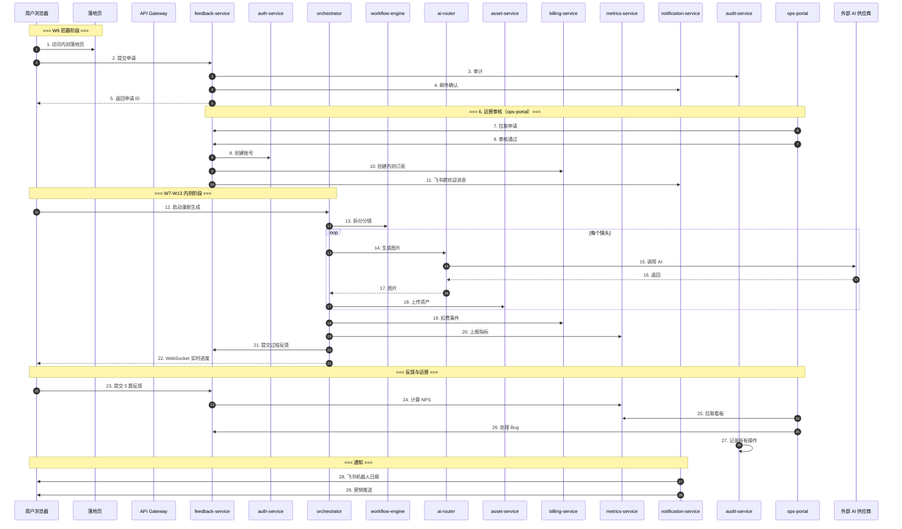
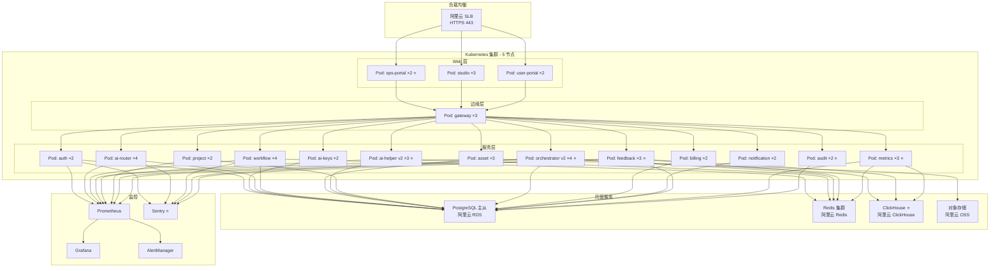
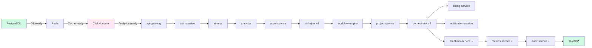
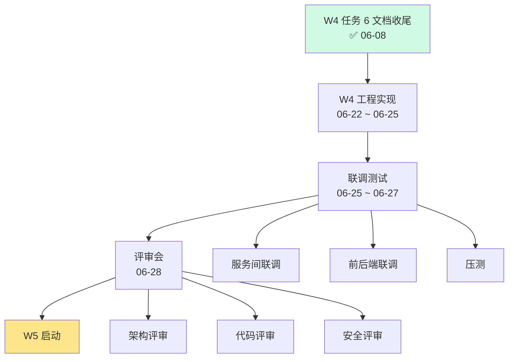

# W4 整体架构总览

> **作者**：陈远枢（运营总监）
> **日期**：2026-06-08
> **版本**：v1.0（W4 任务 6 收尾）
> **适用版本**：ManhuaWorks v0.4.0
> **覆盖范围**：W4（2026-06-22 ~ 2026-06-28）阶段交付的 8 个微服务 + 1 个总后台
> **阅读时长**：≈ 10 分钟

## 1. 概述

W4 阶段（2026-06-22 ~ 2026-06-28）核心目标：**业务总后台 MVP + AI 编排服务**，为 W6-W14 50 用户内测 + 公测 + 正式版做架构准备。

**W4 交付物**：
- 1 个业务总后台（`apps/ops-portal/`）
- 8 个后端微服务（其中 4 个 W4 新增/重写）
- 8 个运营文档（W4 任务 6）
- 1 个内测报名落地页

**与 W3 的关系**：
- W3 已交付：8 服务 + 2 子模块（含 W3 重写的 `workflow-engine v2`）
- W4 新增/重写：`ops-portal`（业务总后台）、`orchestrator` v2、`ai-helper` v2、`feedback-service`（新独立）

---

## 2. 整体架构图

```mermaid
graph TB
    %% ============== 客户端 ==============
    subgraph 客户端
        STU[创作者工作台<br/>apps/studio<br/>Vue 3 + Vite]
        USR[用户后台<br/>apps/user-portal<br/>Vue 3]
        OPS[业务总后台<br/>apps/ops-portal<br/>⭐ W4 新增]
        ADM[平台总后台<br/>apps/admin-portal]
        DEV[开发者后台<br/>apps/dev-portal]
        DESK[桌面客户端<br/>apps/installer<br/>Electron]
    end

    %% ============== 边缘层 ==============
    subgraph 边缘层
        CDN[CDN<br/>阿里云 + CloudFront]
        GW[API Gateway<br/>Kong 3.x<br/>:8000]
    end

    %% ============== W3 既有服务 ==============
    subgraph W3既有服务
        AUTH[auth-service<br/>:8081]
        PROJ[project-service<br/>:8087]
        ASSET[asset-service<br/>:8085]
        BILL[billing-service<br/>:8089]
        NOTI[notification-service<br/>:8090]
    end

    %% ============== W2 既有服务 ==============
    subgraph W2既有服务
        AIRT[ai-router<br/>:8083]
        AIKEY[ai-keys<br/>:8082]
    end

    %% ============== W3 核心服务 ==============
    subgraph W3核心服务
        WF[workflow-engine v2<br/>:8084]
        AIH[ai-helper v2<br/>:8086]
    end

    %% ============== W4 新增/重写服务 ==============
    subgraph W4新增重写服务
        ORCH[orchestrator v2<br/>:8088 ⭐]
        FBK[feedback-service<br/>:8091 ⭐ 新增]
        METR[metrics-service<br/>:8092 ⭐ 新增]
        AUDIT[audit-service<br/>:8093 ⭐ 新增]
    end

    %% ============== 数据层 ==============
    subgraph 数据层
        PG[(PostgreSQL 16<br/>主库 + 8 业务库<br/>+ feedback_db ⭐)]
        RD[(Redis 7<br/>缓存/限流/Pub-Sub)]
        CH[(ClickHouse<br/>⭐ W4 埋点分析)]
        S3[(对象存储<br/>OSS / S3 / MinIO)]
    end

    %% ============== 监控 ==============
    subgraph 监控
        PROM[Prometheus]
        GRA[Grafana]
        SENTRY[Sentry]
    end

    %% ============== 外部 AI ==============
    subgraph 外部AI供应商
        V[火山引擎]
        A[阿里云百炼]
        T[腾讯混元]
        Z[智谱GLM]
    end

    %% ============== 客户端到网关 ==============
    STU -->|HTTPS| GW
    USR -->|HTTPS| GW
    OPS -->|HTTPS| GW
    ADM -->|HTTPS| GW
    DEV -->|HTTPS| GW
    DESK -->|HTTPS| GW

    %% ============== 网关到服务 ==============
    GW -->|/v1/auth| AUTH
    GW -->|/v1/projects| PROJ
    GW -->|/v1/assets| ASSET
    GW -->|/v1/billing| BILL
    GW -->|/v1/notifications| NOTI
    GW -->|/v1/ai| AIRT
    GW -->|/v1/keys| AIKEY
    GW -->|/v1/workflows| WF
    GW -->|/v1/helper| AIH
    GW -->|/v1/orchestrator| ORCH
    GW -->|/v1/feedback| FBK
    GW -->|/v1/metrics| METR
    GW -->|/v1/audit| AUDIT

    %% ============== 服务间调用 ==============
    AUTH -.JWT 校验.-> GW
    PROJ --> ASSET
    PROJ --> WF
    ORCH --> WF
    ORCH --> AIRT
    ORCH --> AIH
    ORCH --> ASSET
    ORCH --> FBK
    ORCH --> METR
    WF --> AIRT
    WF --> AIH
    FBK --> METR
    FBK --> NOTI
    AIH --> AIRT
    BILL --> AIRT
    BILL --> ASSET
    NOTI -->|事件订阅| RD

    %% ============== 业务总后台（⭐ W4 新增）==============
    OPS -->|/v1/feedback| FBK
    OPS -->|/v1/metrics| METR
    OPS -->|/v1/users| AUTH
    OPS -->|/v1/audit| AUDIT
    OPS -->|/v1/billing| BILL
    OPS -->|/v1/orchestrator| ORCH

    %% ============== 数据连接 ==============
    AUTH --> PG
    PROJ --> PG
    ASSET --> PG
    ASSET --> S3
    AIH --> PG
    AIH --> RD
    WF --> PG
    WF --> RD
    ORCH --> PG
    ORCH --> RD
    BILL --> PG
    NOTI --> PG
    FBK --> PG
    FBK --> RD
    METR --> PG
    METR --> CH
    AUDIT --> PG
    AUDIT --> RD

    %% ============== CDN ==============
    ASSET -.签名 URL.-> CDN
    CDN -.回源.-> S3

    %% ============== 外部 AI ==============
    AIRT --> V
    AIRT --> A
    AIRT --> T
    AIRT --> Z

    %% ============== 监控 ==============
    ORCH --> SENTRY
    WF --> SENTRY
    FBK --> SENTRY
    ORCH --> PROM
    FBK --> PROM
    METR --> PROM
    PROM --> GRA

    %% ============== 风格 ==============
    style GW fill:#fde68a
    style W2既有服务 fill:#e5e7eb
    style W3既有服务 fill:#dbeafe
    style W3核心服务 fill:#dbeafe
    style W4新增重写服务 fill:#fce7f3
    style 数据层 fill:#d1fae5
    style 监控 fill:#fed7aa
    style 外部AI供应商 fill:#fecaca
```



---

## 3. W4 8 服务详细清单

### 3.1 8 服务总览

| # | 服务名 | 端口 | W4 状态 | 数据库 | 负责人 | 关联文档 |
|:--|:--|:--|:--|:--|:--|:--|
| 1 | `api-gateway` | **8000** | 既有（W1）| - | 后端组 | W1 文档 |
| 2 | `auth-service` | **8081** | W3 已交付 | `auth_db` | 沈书白 | W3_AUTH |
| 3 | `ai-keys` | **8082** | W2 已交付 | `keys_db` | 陈远枢 | `api/ai-keys.md` |
| 4 | `ai-router` | **8083** | W2 已交付 | - | 陈远枢 | `api/ai-router.md` |
| 5 | `workflow-engine` | **8084** | W3 重写完成 | `workflow_db` | 陈远枢 | `W3_WORKFLOW_REFINED.md` |
| 6 | `asset-service` | **8085** | W3 已交付 | `asset_db` | 陈远枢 | `W3_ASSET.md` |
| 7 | `ai-helper` | **8086** | **W4 v2 重写** | `helper_db` | 陈远枢 | `W3_AI_HELPER.md` |
| 8 | `project-service` | **8087** | W3 已交付 | `project_db` | 沈书白 | W3_PROJECT |
| 9 | `orchestrator` | **8088** | **W4 v2 重写** | `orchestrator_db` | 陈远枢 | `W3_ORCHESTRATOR.md` |
| 10 | `billing-service` | **8089** | W3 已交付 | `billing_db` | 林若涵 | W3_BILLING |
| 11 | `notification-service` | **8090** | W3 已交付 | `noti_db` | 林若涵 | W3_NOTIFICATION |
| 12 | `feedback-service` | **8091** | **⭐ W4 新增** | `feedback_db` | 陈远枢 | `beta-feedback-collection.md` |
| 13 | `metrics-service` | **8092** | **⭐ W4 新增** | `metrics_db` + ClickHouse | 陈远枢 | `beta-retention-dashboard.md` |
| 14 | `audit-service` | **8093** | **⭐ W4 新增** | `audit_db` | 沈书白 | W4_AUDIT |

### 3.2 W4 重点服务 1：orchestrator v2

**职责**：AI 漫剧端到端编排（小说 → 分镜 → 角色 → 资产 → 视频）

**W4 升级点**：
- v1：单步编排（线性）
- v2：状态机编排（支持重试/分支/回滚）

**端口**：8088
**副本数**：4
**依赖**：`workflow-engine` v2、`ai-router`、`ai-helper` v2、`asset-service`、`feedback-service`

**关键 API**：
- `POST /v1/orchestrator/start` - 启动漫剧生成
- `GET /v1/orchestrator/runs/{runId}` - 查询进度
- `POST /v1/orchestrator/runs/{runId}/cancel` - 取消
- `WS /v1/orchestrator/runs/{runId}/ws` - 实时进度（WebSocket）

**数据流**：
```
1. 接收"开始生成"请求（项目 ID + 剧本）
2. 调用 workflow-engine 拆分分镜
3. 并行调用 ai-router 生成图片
4. 调用 asset-service 上传 OSS
5. 调用 ai-helper v2 做角色一致性校验
6. 推送中间结果到 WebSocket
7. 完成 → 推送 notification-service 通知用户
8. 全程上报 metrics-service + feedback-service
```

### 3.3 W4 重点服务 2：feedback-service ⭐

**职责**：内测期反馈收集、问题分级、KPI 计算

**W4 必要性**：
- 50 用户内测启动（W6）
- 每天 50 条 5 题轻量反馈
- 每周 30 份 23 题完整反馈
- 必须独立服务才能撑住并发

**端口**：8091
**副本数**：2
**依赖**：`notification-service`、`metrics-service`、`audit-service`

**关键 API**：
- `POST /v1/feedback/quick` - 5 题轻量反馈
- `POST /v1/feedback/full` - 23 题完整反馈
- `POST /v1/feedback/issue` - Bug 报告
- `POST /v1/feedback/suggestion` - 建议
- `GET /v1/feedback/list` - 列表（分页/筛选）
- `GET /v1/feedback/stats` - 统计（DAU/NPS/转化率）

**数据表**：
- `feedback_submit` - 提交记录
- `feedback_issue` - 问题工单
- `feedback_suggestion` - 建议
- `feedback_exit_survey` - 退出问卷

### 3.4 W4 重点服务 3：metrics-service ⭐

**职责**：埋点采集、指标计算、看板数据

**W4 必要性**：
- 50 用户 8 周埋点
- 留存/活跃/转化/NPS 计算
- 实时看板 + 每日报告

**端口**：8092
**副本数**：3
**依赖**：ClickHouse、`feedback-service`

**关键 API**：
- `POST /v1/metrics/track` - 埋点上报
- `GET /v1/metrics/dau` - DAU
- `GET /v1/metrics/wau` - WAU
- `GET /v1/metrics/retention/{day}` - 留存
- `GET /v1/metrics/funnel/payment` - 付费漏斗
- `GET /v1/metrics/nps` - NPS

**存储分层**：
- 热数据（7 天）→ ClickHouse
- 冷数据（30 天+）→ PostgreSQL `metrics_rollup`
- 归档（1 年+）→ OSS + Parquet

### 3.5 W4 重点服务 4：audit-service ⭐

**职责**：审计日志、合规检查、操作回溯

**W4 必要性**：
- 内测期需审计运营操作
- 公测前需合规（等保 2.0）
- 数据安全法要求

**端口**：8093
**副本数**：2
**依赖**：所有业务服务（事件订阅）

**关键 API**：
- `GET /v1/audit/logs` - 审计日志查询
- `GET /v1/audit/users/{userId}/actions` - 用户操作轨迹
- `POST /v1/audit/export` - 审计日志导出

**审计范围**：
- 用户登录/登出
- 数据修改（CRUD）
- 支付/退款
- 角色权限变更
- 内测申请/审核
- 反馈数据导出

### 3.6 W4 重点服务 5：ai-helper v2

**W4 升级点**：
- v1：基础 LLM 调用封装
- v2：加入 RAG（基于 Toonflow 资产库）+ 角色一致性增强

**新功能**：
- 自动剧本润色
- 角色台词优化
- 风格描述生成
- 嵌入 Toonflow 资产库（11 艺术风格 + 12 故事类型）

### 3.7 W4 重点服务 6-8：auth/project/asset/billing/notification

**W4 状态**：保持稳定，仅做：
- auth：增加 SSO 第三方登录（微信/抖音/小红书）
- project：增加"内测项目"标记
- asset：增加 4K 输出支持
- billing：内测 6 折优惠
- notification：飞书机器人深度集成

---

## 4. 业务总后台（ops-portal）⭐

### 4.1 定位

**业务总后台**（`apps/ops-portal/`）是 W4 阶段的核心前端交付物，专为运营、客服、审核团队设计。

**与 4 大后台的差异**：

| 后台 | 受众 | 职责 | 入口 |
|:--|:--|:--|:--|
| `studio` | 创作者 | 创作漫剧 | studio.manhuaworks.com |
| `user-portal` | 个人用户 | 个人中心 | user.manhuaworks.com |
| **`ops-portal` ⭐** | **运营/客服/审核** | **业务运营** | **ops.manhuaworks.com** |
| `admin-portal` | 技术/运维 | 平台管理 | admin.manhuaworks.com |
| `dev-portal` | 开发者 | API 文档 | dev.manhuaworks.com |

### 4.2 功能模块（W4 MVP）

| 模块 | 功能 | 关联服务 |
|:--|:--|:--|
| **1. 用户管理** | 用户列表、详情、标签、封禁 | `auth-service`、`audit-service` |
| **2. 内测申请** | 申请审核、入组、候补 | `feedback-service`、`notification-service` |
| **3. 反馈处理** | 5 题/23 题/Bug 列表、回复 | `feedback-service` |
| **4. 数据看板** | DAU/WAU/留存/付费/NPS | `metrics-service` |
| **5. 案例库** | 真实案例管理、发布 | `feedback-service`、`asset-service` |
| **6. 审核工单** | 异常订单、退款、申诉 | `billing-service`、`audit-service` |
| **7. 运营配置** | 优惠活动、推送模板、AB 测试 | `billing-service`、`notification-service` |
| **8. 审计日志** | 操作日志、数据导出 | `audit-service` |

### 4.3 页面清单（W4 MVP 14 个页面）

| # | 路径 | 页面 | 优先级 |
|:--|:--|:--|:--|
| 1 | `/login` | 登录 | P0 |
| 2 | `/dashboard` | 仪表盘 | P0 |
| 3 | `/users` | 用户列表 | P0 |
| 4 | `/users/:id` | 用户详情 | P0 |
| 5 | `/beta/applications` | 内测申请 | P0 |
| 6 | `/beta/members` | 内测成员 | P0 |
| 7 | `/feedback/quick` | 5 题轻量反馈 | P0 |
| 8 | `/feedback/full` | 23 题完整反馈 | P0 |
| 9 | `/feedback/issues` | Bug 工单 | P0 |
| 10 | `/metrics/dashboard` | 数据看板 | P0 |
| 11 | `/cases` | 案例库 | P1 |
| 12 | `/orders` | 订单审核 | P1 |
| 13 | `/config/promotions` | 优惠配置 | P1 |
| 14 | `/audit/logs` | 审计日志 | P1 |

### 4.4 技术栈

| 维度 | 选型 |
|:--|:--|
| 前端 | Vue 3 + Vite + TypeScript |
| UI 库 | Ant Design Vue 4.x |
| 状态管理 | Pinia |
| HTTP | Axios + Vue Query |
| 图表 | ECharts 5.x |
| 表格 | VxeTable（大数据量）|
| 鉴权 | JWT + RBAC（5 级）|
| 部署 | Docker + Kubernetes |

### 4.5 RBAC 权限矩阵

| 角色 | 用户管理 | 反馈处理 | 数据看板 | 案例库 | 订单审核 | 优惠配置 | 审计日志 |
|:--|:--|:--|:--|:--|:--|:--|:--|
| **运营总监** | 全部 | 全部 | 全部 | 全部 | 全部 | 全部 | 查看 |
| **运营专员** | 查看 | 全部 | 查看 | 编辑 | 查看 | 查看 | - |
| **客服** | 查看 | 全部 | - | - | 查看 | - | - |
| **审核员** | 查看 | - | - | - | 全部 | - | - |
| **数据分析师** | - | 查看 | 全部 | 查看 | - | - | - |
| **只读访客** | - | 查看 | 查看 | 查看 | - | - | - |

---

## 5. 端口分配表（最终版）

| # | 服务名 | 端口 | 协议 | 数据库 | 状态 | 负责人 |
|:--|:--|:--|:--|:--|:--|:--|
| 1 | `api-gateway` | **8000** | HTTP | - | W1 | 后端组 |
| 2 | `auth-service` | **8081** | HTTP | `auth_db` | W3 | 沈书白 |
| 3 | `ai-keys` | **8082** | HTTP | `keys_db` | W2 | 陈远枢 |
| 4 | `ai-router` | **8083** | HTTP | - | W2 | 陈远枢 |
| 5 | `workflow-engine` | **8084** | HTTP+WS | `workflow_db` | W3 | 陈远枢 |
| 6 | `asset-service` | **8085** | HTTP | `asset_db` | W3 | 陈远枢 |
| 7 | `ai-helper` | **8086** | HTTP | `helper_db` | W4 v2 | 陈远枢 |
| 8 | `project-service` | **8087** | HTTP | `project_db` | W3 | 沈书白 |
| 9 | `orchestrator` | **8088** | HTTP+WS | `orchestrator_db` | W4 v2 | 陈远枢 |
| 10 | `billing-service` | **8089** | HTTP | `billing_db` | W3 | 林若涵 |
| 11 | `notification-service` | **8090** | HTTP+WS | `noti_db` | W3 | 林若涵 |
| 12 | **`feedback-service`** ⭐ | **8091** | HTTP | `feedback_db` | **W4 新增** | **陈远枢** |
| 13 | **`metrics-service`** ⭐ | **8092** | HTTP+WS | `metrics_db` + CH | **W4 新增** | **陈远枢** |
| 14 | **`audit-service`** ⭐ | **8093** | HTTP | `audit_db` | **W4 新增** | **沈书白** |
| - | `ai-router` metrics | 9103 | HTTP | - | W2 | - |
| - | `workflow` metrics | 9104 | HTTP | - | W3 | - |
| - | `asset` metrics | 9105 | HTTP | - | W3 | - |
| - | `ai-helper` metrics | 9106 | HTTP | - | W3 | - |
| - | `orchestrator` metrics | 9108 | HTTP | - | W3 | - |
| - | `feedback` metrics | 9111 | HTTP | - | W4 | - |
| - | `metrics` metrics | 9112 | HTTP | - | W4 | - |
| - | `audit` metrics | 9113 | HTTP | - | W4 | - |
| - | `PostgreSQL` 主库 | 5432 | TCP | - | W1 | 运维 |
| - | `Redis` 7 | 6379 | TCP | - | W1 | 运维 |
| - | **`ClickHouse`** ⭐ | **8123/9000** | HTTP/TCP | - | **W4 新增** | **数据组** |
| - | `MinIO` (dev) | 9000/9001 | HTTP | - | W1 | 运维 |
| - | `Kong` Admin | 8001 | HTTP | - | W1 | 运维 |
| - | `Prometheus` | 9090 | HTTP | - | W1 | 运维 |
| - | `Grafana` | 3000 | HTTP | - | W1 | 运维 |
| - | **`Sentry`** ⭐ | **9000** | HTTP | - | **W4 新增** | **工程组** |
| - | `ops-portal` (前端) | **3001** | HTTP | - | **W4 新增** | **前端-运营组** |

**总服务数**：**14 个后端服务 + 1 个总后台前端**（W4 后）

---

## 6. 服务依赖矩阵（更新版）

> ✅ = 直接 HTTP 调用 | 📡 = 事件订阅 | ➖ = 无依赖

| 服务 \ 依赖 | auth | ai-keys | ai-router | workflow | asset | ai-helper | project | orchestrator | billing | noti | feedback | metrics | audit |
|:--|:--|:--|:--|:--|:--|:--|:--|:--|:--|:--|:--|:--|:--|
| **auth-service** | ➖ | ➖ | ➖ | ➖ | ➖ | ➖ | ➖ | ➖ | ➖ | ➖ | ➖ | ➖ | ➖ |
| **ai-keys** | ✅ | ➖ | ➖ | ➖ | ➖ | ➖ | ➖ | ➖ | ➖ | ➖ | ➖ | ➖ | ➖ |
| **ai-router** | ✅ | ✅ | ➖ | ➖ | ➖ | ➖ | ➖ | ➖ | 📡 | ➖ | 📡 | 📡 | 📡 |
| **workflow-engine** | ✅ | ➖ | ✅ | ➖ | 📡 | 📡 | 📡 | ➖ | 📡 | 📡 | 📡 | 📡 | 📡 |
| **asset-service** | ✅ | ➖ | ➖ | 📡 | ➖ | 📡 | 📡 | 📡 | 📡 | ➖ | 📡 | 📡 | 📡 |
| **ai-helper** | ✅ | ➖ | ✅ | 📡 | 📡 | ➖ | 📡 | ➖ | 📡 | ➖ | 📡 | 📡 | 📡 |
| **project-service** | ✅ | ➖ | ➖ | ✅ | ✅ | ➖ | ➖ | 📡 | ➖ | 📡 | 📡 | 📡 | 📡 |
| **orchestrator** | ✅ | ➖ | ✅ | ✅ | ✅ | ✅ | ✅ | ➖ | 📡 | 📡 | ✅ | ✅ | 📡 |
| **billing-service** | ✅ | ✅ | ✅ | 📡 | 📡 | 📡 | 📡 | 📡 | ➖ | 📡 | 📡 | 📡 | 📡 |
| **notification-service** | ✅ | ➖ | ➖ | 📡 | 📡 | 📡 | 📡 | 📡 | 📡 | ➖ | 📡 | 📡 | 📡 |
| **feedback-service** ⭐ | ✅ | ➖ | ➖ | ➖ | ➖ | ➖ | ➖ | ➖ | ➖ | ✅ | ➖ | ✅ | ✅ |
| **metrics-service** ⭐ | ✅ | ➖ | 📡 | 📡 | 📡 | 📡 | 📡 | 📡 | 📡 | 📡 | 📡 | ➖ | ➖ |
| **audit-service** ⭐ | ✅ | ➖ | 📡 | 📡 | 📡 | 📡 | 📡 | 📡 | 📡 | 📡 | 📡 | 📡 | ➖ |

**循环依赖检查**：✅ 无循环（feedback 不主动调用其他业务服务）

---

## 7. 事件总线（W4 扩展）

W4 在 W3 基础上新增以下事件：

| 事件名 | 发布者 | 订阅者 | 载荷示例 |
|:--|:--|:--|:--|
| `feedback.submitted` ⭐ | feedback-service | metrics, audit, noti | `{feedbackId, userId, type, score}` |
| `feedback.issue.created` ⭐ | feedback-service | audit, noti, ops-portal | `{issueId, userId, priority, content}` |
| `metrics.dau.snapshot` ⭐ | metrics-service | ops-portal, noti | `{date, dau, wau, conversion}` |
| `audit.log.created` ⭐ | 所有服务 | audit-service | `{logId, userId, action, target}` |
| `beta.applicant.created` ⭐ | feedback-service | noti, ops-portal | `{applicationId, userId, score}` |
| `beta.member.added` ⭐ | feedback-service | billing, noti, auth | `{userId, betaRole, expiresAt}` |
| `orchestrator.run.completed` | orchestrator | feedback, metrics, noti | `{runId, userId, totalCost, duration}` |
| `nps.submitted` ⭐ | feedback-service | metrics, ops-portal | `{userId, score, comment}` |

---

## 8. 内测端到端数据流（W6-W14）



---

## 9. 部署拓扑（K8s）



**副本数原则（W4 更新）**：
- 计算密集（ai-router、workflow、orchestrator）：4 副本
- IO 密集（feedback、metrics）：3 副本
- 业务读写（project、auth、billing）：2 副本

---

## 10. SLO 目标（W4 扩展）

| 服务 | 可用性 | P95 延迟 | 错误率 | W4 备注 |
|:--|:--|:--|:--|:--|
| api-gateway | 99.95% | < 50ms | < 0.1% | - |
| auth-service | 99.9% | < 200ms | < 0.5% | - |
| project-service | 99.5% | < 300ms | < 1% | - |
| workflow-engine | 99.5% | < 500ms | < 1% | - |
| asset-service | 99.5% | < 500ms | < 0.5% | - |
| ai-helper v2 ⭐ | 99% | < 1s | < 2% | RAG 增加延迟 |
| **orchestrator v2** ⭐ | 99.5% | < 1s | < 1% | 状态机重试 |
| billing-service | 99.99% | < 200ms | < 0.01% | - |
| notification-service | 99% | < 2s | < 2% | - |
| ai-router | 99.5% | < 800ms | < 1% | - |
| **feedback-service** ⭐ | 99.5% | < 500ms | < 0.5% | 内测关键 |
| **metrics-service** ⭐ | 99.5% | < 1s | < 1% | 埋点高并发 |
| **audit-service** ⭐ | 99% | < 500ms | < 0.5% | 异步容忍高 |
| **ops-portal** ⭐ | 99.9% | < 200ms | < 0.5% | 运营入口 |

---

## 11. 启动顺序与健康检查



**健康检查端点**：每个服务都暴露 `GET /health`，返回 `{status, db, redis, version}`

---

## 12. 监控与告警

| 指标 | 阈值 | 告警级别 | 通知 |
|:--|:--|:--|:--|
| 服务 P99 延迟 > 2s | 持续 5 分钟 | P2 | 飞书群 |
| 错误率 > 5% | 持续 3 分钟 | P1 | 飞书群 + 短信 |
| 服务 down | 1 分钟内 | P0 | 全员 + 微信 |
| CPU > 80% | 持续 10 分钟 | P3 | 飞书群 |
| 内存 > 85% | 持续 5 分钟 | P3 | 飞书群 |
| DB 连接数 > 80% | 立即 | P2 | 飞书群 |
| 磁盘 > 90% | 立即 | P1 | 飞书群 + 短信 |
| **feedback 提交失败** ⭐ | 持续 5 分钟 | P1 | 飞书群 |
| **metrics 上报失败** ⭐ | 持续 5 分钟 | P2 | 飞书群 |
| **orchestrator 状态机卡死** ⭐ | 持续 10 分钟 | P1 | 飞书群 + 微信 |
| **Sentry P0 Bug** ⭐ | 1 分钟内 | P0 | 全员 + 微信 |

---

## 13. 联调与评审材料

### 13.1 联调计划

| 服务 | 联调对象 | 时点 | 负责人 |
|:--|:--|:--|:--|
| `orchestrator v2` | workflow + ai-router + asset | 06-25 | 陈远枢 |
| `feedback-service` | notification + metrics + audit | 06-26 | 陈远枢 |
| `metrics-service` | feedback + all 业务服务 | 06-27 | 陈远枢 |
| `audit-service` | all 业务服务 | 06-27 | 沈书白 |
| `ops-portal` | 8 个服务 | 06-28 | 前端-运营组 |

### 13.2 评审材料

| 文档 | 用途 |
|:--|:--|
| 本文档（W4_OVERVIEW.md）| 架构评审 |
| `W3_ORCHESTRATOR.md` | orchestrator 详细设计 |
| `W3_AI_HELPER.md` | ai-helper 详细设计 |
| `beta-feedback-collection.md` | feedback-service 业务需求 |
| `beta-retention-dashboard.md` | metrics-service 业务需求 |
| `ops-portal/SPEC.md` | 业务总后台详细规格 |

### 13.3 评审 Checklist

- [ ] 8 服务端口无冲突
- [ ] 服务间依赖无循环
- [ ] 事件总线命名规范
- [ ] RBAC 权限矩阵完整
- [ ] 数据库连接池配置
- [ ] 健康检查端点就绪
- [ ] 监控告警规则配置
- [ ] ops-portal 与 8 服务联调通过
- [ ] Sentry 集成完成
- [ ] ClickHouse 数据接入
- [ ] W6 内测启动 Checklist 就绪

---

## 14. W4 联调评审流程



**评审会参与者**：
- 架构组（2 人）
- 后端组（4 人）
- 前端组（2 人）
- 运维组（1 人）
- 运营组（陈远枢）
- 产品（1 人）

---

## 15. 后续规划（W5+）

| 阶段 | 周次 | 目标 | 状态 |
|:--|:--|:--|:--|
| **W5** | 06-29 ~ 07-05 | 平台总后台 + 开发者后台 | ⏳ 待启动 |
| **W6** | 07-06 ~ 07-12 | **内测启动**（50 用户招募）| ⏳ 待启动 |
| W7 | 07-13 ~ 07-19 | 内测第 1 周 + 反馈收集 | ⏳ 待启动 |
| W8 | 07-20 ~ 07-26 | 内测第 2 周 + 产品迭代 | ⏳ 待启动 |
| W9 | 07-27 ~ 08-02 | 内测第 3 周 + 付费转化 | ⏳ 待启动 |
| W10 | 08-03 ~ 08-09 | 内测第 4 周 + 案例收集 | ⏳ 待启动 |
| W11 | 08-10 ~ 08-16 | 内测复盘 + 报告输出 | ⏳ 待启动 |
| W12 | 08-17 ~ 08-23 | 公测准备 + 公测启动 | ⏳ 待启动 |
| W13 | 08-24 ~ 08-30 | 正式版准备 | ⏳ 待启动 |
| **W14** | **08-31** | **🎉 正式上线 v1.0** | ⏳ 目标 |

---

## 16. 变更记录

| 版本 | 日期 | 作者 | 变更 |
|:--|:--|:--|:--|
| v0.1 | 2026-06-08 | 陈远枢 | 初稿（W4 任务 6）|
