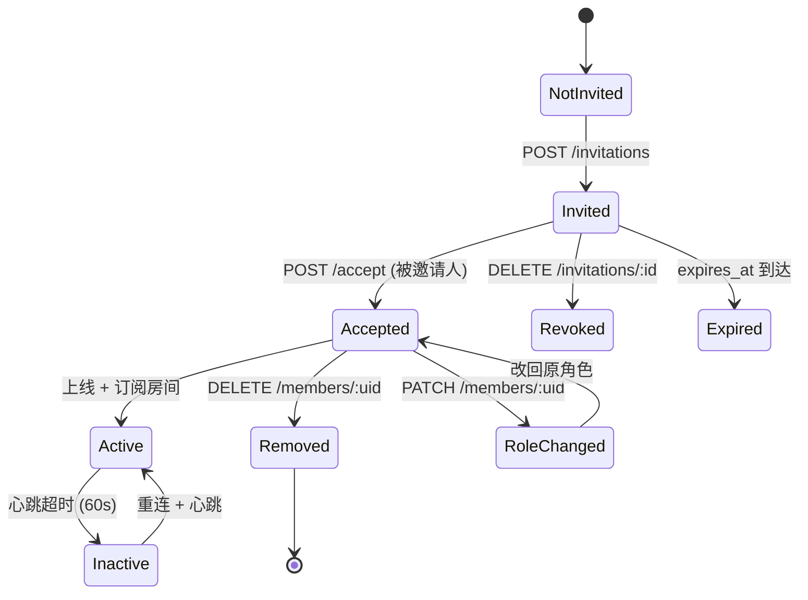
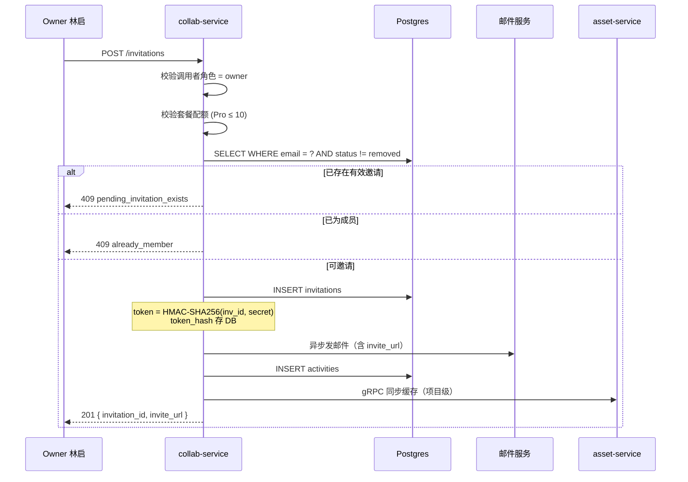
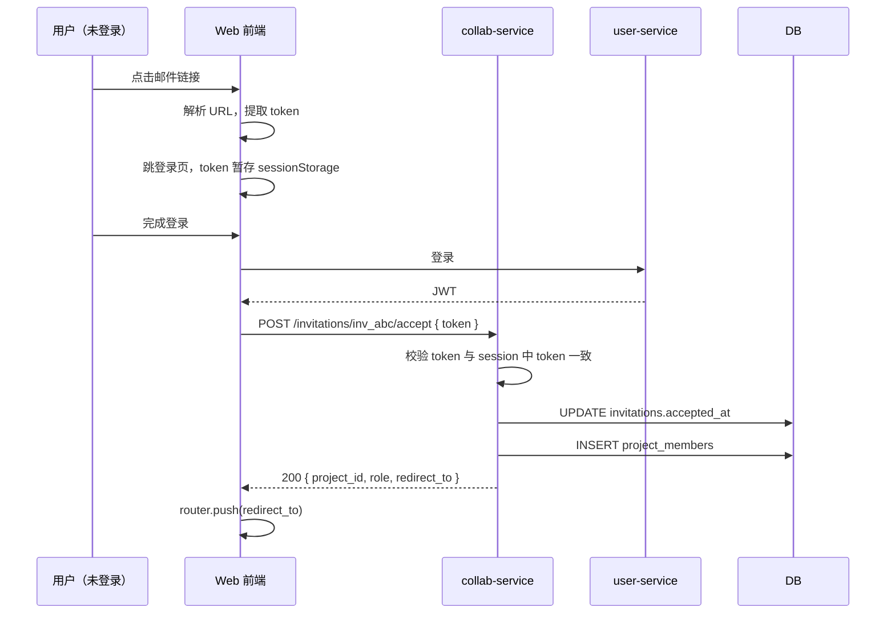
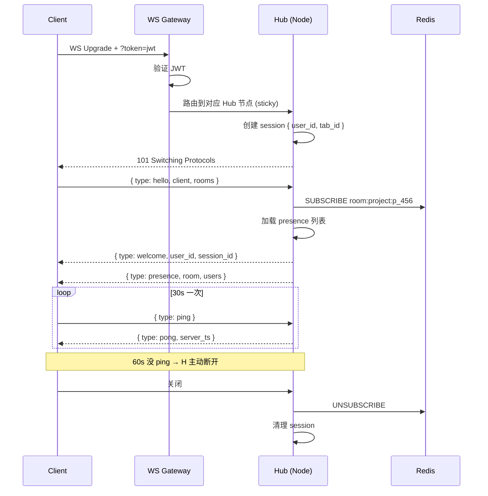
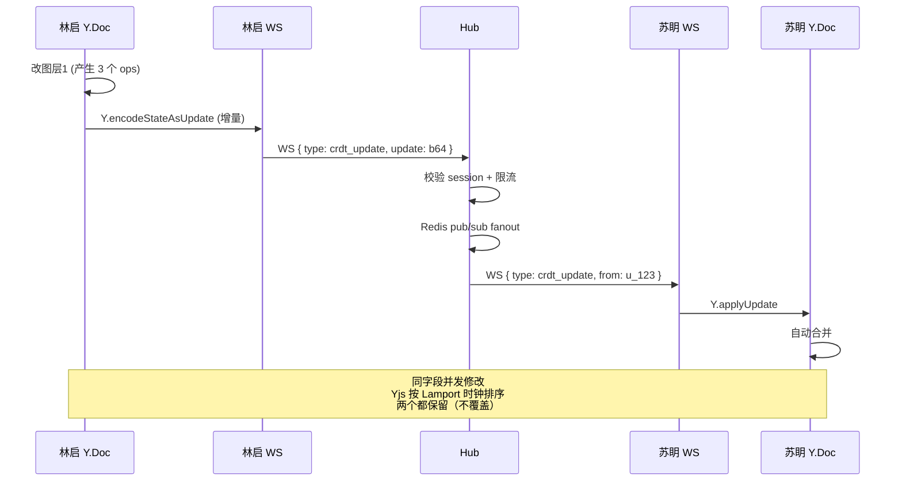
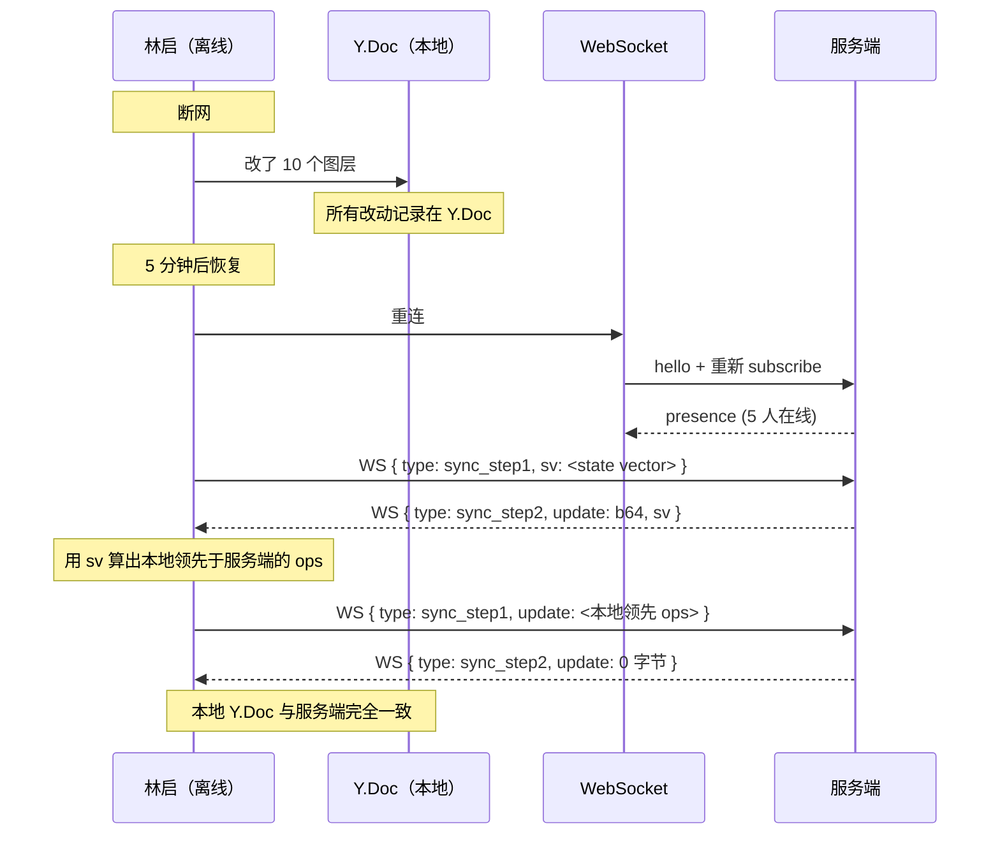
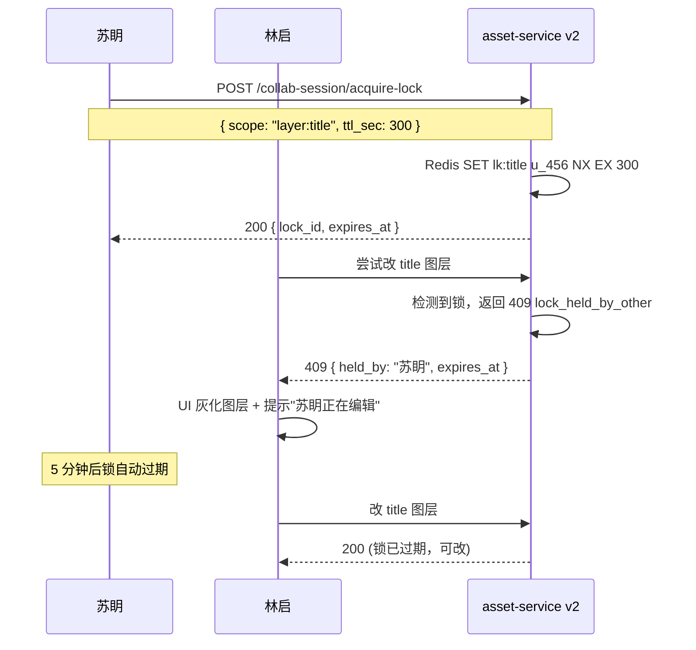

# 协作流详解（邀请 → 接受 → 在线 → CRDT 同步 → 离线 → 冲突解决）

> **目的**：把协作的**每一步时序、状态、边界**讲清楚，作为 collab-service 开发/测试/排障的权威参考。
> **作者**：陆流光
> **更新日期**：2026-06-08

## 1. 状态机总览



---

## 2. 邀请（Owner 视角）

### 2.1 API 调用

```http
POST /v1/collab/projects/p_456/invitations
Authorization: Bearer <owner_jwt>
Content-Type: application/json

{
  "email": "suming@example.com",
  "role": "editor",
  "message": "一起把灰星搞成漫剧"
}
```

### 2.2 内部流程



### 2.3 邮件模板

```html
<div>
  <h2>林启 邀请你协作「灰星 1500 章」</h2>
  <p>一起把灰星搞成漫剧</p>
  <a href="https://manhuaworks.com/invitations/inv_abc?token=xyz">
    接受邀请
  </a>
  <small>7 天内有效</small>
</div>
```

---

## 3. 接受邀请（被邀请人视角）

### 3.1 三种入口

| 入口 | 鉴权 | 场景 |
|:--|:--|:--|
| 邮件链接（已登录） | JWT | 主流场景 |
| 邮件链接（未登录） | 邀请 token | 引导注册/登录后再接受 |
| 站内通知（已登录） | JWT | 偶尔看到 |

### 3.2 未登录场景



### 3.3 幂等性

- 重复点击"接受" → 返回 200 + 现有 member（不报错）
- 已撤销的邀请 → 410 `invitation_revoked`
- 已过期的邀请 → 410 `invitation_expired`
- token 不匹配（伪造） → 401 `invalid_token`

---

## 4. 在线（建立 WebSocket）

### 4.1 连接生命周期



### 4.2 多 Tab 复用

同一浏览器多 Tab 时：

```ts
// 在 Pinia 中用 BroadcastChannel 协调
const bc = new BroadcastChannel('collab')

if (!hasPrimaryTab()) {
  // 选一个 tab 作为 primary
  bc.postMessage({ type: 'elect_primary' })
}

bc.onmessage = (e) => {
  if (e.data.type === 'crdt_update') {
    ws.send(e.data)  // 转发到 WS
  }
}
```

后端 `tab_id` 区分每个 tab，`presence` 列表会显示所有 tab。

### 4.3 房间订阅

```ts
// 加入项目
ws.send(JSON.stringify({ type: 'subscribe', room: 'project:p_456' }))

// 加入资产协作
ws.send(JSON.stringify({ type: 'subscribe', room: 'asset:a_001' }))

// 个人通知（自动，连接时已含）
// 房间: user:u_123
```

---

## 5. CRDT 同步（核心）

### 5.1 为什么用 CRDT

| 方案 | 优点 | 缺点 |
|:--|:--|:--|
| **OT（Operational Transform）** | 成熟（Google Docs） | 中心化，需服务端协调 |
| **CRDT（Yjs）** | 离线优先，去中心化 | 内存占用略大 |
| **Last-Write-Wins** | 简单 | 丢更新 |

ManhuaWorks 选 **Yjs**（Y.Array + Y.Map + Y.Text）的原因：
- 离线编辑后重连不丢更新
- 多人并发**无需**服务端合并逻辑
- 二进制 update 体积小

### 5.2 同步协议



### 5.3 同步流程细节

```ts
// 客户端代码（Yjs + WebSocket）
import * as Y from 'yjs'
import { WebsocketProvider } from 'y-websocket'

const ydoc = new Y.Doc()
const provider = new WebsocketProvider(
  'wss://ws.manhuaworks.com/v1/assets/v2/a_001/collab',
  'a_001',
  ydoc,
  {
    params: { session: sessionId, token: accessToken },
  }
)

const layers = ydoc.getArray<Layer>('layers')

// 监听远端更新
layers.observeDeep((events) => {
  // 重新渲染画布
  renderer.render(layers.toArray())
})

// 本地修改
ydoc.transact(() => {
  layers.push([{ id: 'l_99', name: '背景', visible: true }])
})
```

### 5.4 Awareness（光标/选区）

```ts
// 自己
provider.awareness.setLocalStateField('cursor', { x: 0.42, y: 0.68 })
provider.awareness.setLocalStateField('selection', ['l_42', 'l_43'])

// 监听他人
provider.awareness.on('change', ({ added, updated, removed }) => {
  const states = provider.awareness.getStates()
  // 渲染其他人的彩色光标
})
```

服务端在 awareness 变化时**只广播**，不持久化（高频）。

---

## 6. 离线

### 6.1 离线场景

| 场景 | 持续时间 | 策略 |
|:--|:--|:--|
| 网络抖动 | < 5s | 客户端缓冲，不重连 |
| 短暂断网 | 5s - 5min | 重连 + 同步 state vector |
| 长时间断网 | > 5min | 提示用户"+3 人正在编辑" |
| 主动离线 | 用户切后台 | 30s 后暂停 ws，停止 awareness |

### 6.2 离线 → 重连合并



**关键**：Yjs 的 state vector 让两端**只传差异**，不传全量。

### 6.3 离线时长阈值

- `< 30s` 自动重连（用户无感）
- `30s - 5min` 弹 Toast "正在重连..."
- `> 5min` 弹 Modal "断线 8 分钟，是否继续？"
  - 「继续」→ 重新加入，强制 merge
  - 「放弃」→ 本地修改保存为"未同步草稿"

---

## 7. 冲突解决

### 7.1 Yjs 怎么解决冲突

| 场景 | 例子 | Yjs 行为 |
|:--|:--|:--|
| 同字段同时改 | 林启改图层名"A"，苏眀改"B" | 两版本保留为**冲突标记**，前端决定保留哪个 |
| 列表顺序 | 林启在 [a,b,c] 头插 x，苏眀在 [a,b,c] 尾插 y | → [x,a,b,c,y]（CRDT 数学保证） |
| 删除 vs 编辑 | 林启删图层5，苏眀改图层5名 | 苏眀的改动记在"墓碑"上，UI 显示已删 |
| 文本同位置 | 都在"灰星\|纪元"插入 | 保留两版本，标 conflict |

### 7.2 冲突 UI

```vue
<!-- ConflictResolver.vue -->
<template>
  <div v-for="conflict in conflicts" :key="conflict.id" class="conflict">
    <h4>图层 {{ conflict.layerId }} 名称冲突</h4>
    <div class="options">
      <button @click="resolve(conflict.id, 'mine')">
        保留我的: "{{ conflict.mine }}"
      </button>
      <button @click="resolve(conflict.id, 'theirs')">
        保留苏眀的: "{{ conflict.theirs }}"
      </button>
      <button @click="resolve(conflict.id, 'merge')">
        合并: "{{ conflict.mine }} / {{ conflict.theirs }}"
      </button>
    </div>
  </div>
</template>
```

### 7.3 解决策略持久化

```ts
async function resolve(conflictId: string, choice: 'mine' | 'theirs' | 'merge') {
  const { data } = await api.post(`/v1/assets/v2/annotations/_conflicts/${conflictId}/resolve`, {
    choice,
  })
  // Yjs 应用服务端下发的"权威 update"
  ydoc.transact(() => {
    Y.applyUpdate(ydoc, base64ToUint8Array(data.update))
  })
}
```

---

## 8. 锁（短时独占）

### 8.1 用例

- 关键参数（标题文字、品牌色）—— 避免多人同时改
- 导出前 —— 锁定防止渲染时还在改

### 8.2 锁协议



### 8.3 等待队列

锁被占时，调用方可加入等待：

```ts
const { data } = await api.post(`/v1/assets/v2/a_001/collab-session/acquire-lock`, {
  scope: 'layer:title',
  wait: true,
})
// HTTP 202 { wait_position: 1 }
// 当前持有人 release 时，自动通知
```

---

## 9. 性能与一致性

### 9.1 一致性边界

| 资源 | 一致性级别 | 实现 |
|:--|:--|:--|
| 项目元数据 | 强一致 | 写后读通过 api-gateway cache invalidation |
| CRDT 文档 | 最终一致（< 200ms） | Yjs + WS pub/sub |
| 评论/批注 | 强一致（写后立刻可见） | DB 主从同步 |
| 通知 | 最终一致（< 1s） | 异步队列 |
| 活动流 | 最终一致（< 1s） | 异步 + 缓存 |

### 9.2 性能目标

| 操作 | P50 | P99 |
|:--|:--|:--|
| 邀请 | 100ms | 500ms |
| 接受 | 150ms | 600ms |
| WS 连接 | 50ms | 200ms |
| CRDT update 端到端 | 30ms | 200ms |
| 评论发表 | 100ms | 400ms |
| 通知推送 | 200ms | 1s |

---

## 10. 排障清单

| 症状 | 排查点 |
|:--|:--|
| 邀请邮件没收到 | 1) 邮件服务日志 2) spam 3) 域名 SPF/DKIM |
| 接受邀请 401 | 1) token 是否过期 2) sessionStorage 是否清空 |
| WS 连不上 | 1) 防火墙 2) 代理（看 Upgrade 头）3) token 鉴权 |
| CRDT 同步丢更新 | 1) state vector 是否带全 2) 客户端是否在事务中 |
| 锁拿不到 | 1) 锁 TTL 2) Redis 连接 3) 锁名（scope）是否一致 |
| 通知收不到 | 1) WebSocket 是否在线 2) 通知 channels 配置 3) quiet hours |
| 评论编辑失败 | 1) 5 分钟窗口 2) 作者校验 3) 软删状态 |
