# 端到端 Demo：1 集 60s 漫剧 7 步骤详解

> **Demo 目标**：从一张白纸到导出 1 集 60 秒漫剧，串通 **user-portal → workflow-engine → ai-orchestrator → asset-service → collab-service** 全链路。
> **作者**：陆流光
> **更新日期**：2026-06-08
> **配套代码**：`tests/e2e/novel-to-drama.test.ts`

## 演示场景

林启在 user-portal 上把「灰星」小说第 1 章「苏眀在起点」改造成 **60 秒漫剧 EP01**，全程 AI 协助 + 邀请苏眀做导演。

**输入**：
- 小说第 1 章纯文本（2800 字）
- 主创风格参考图 1 张
- 配音演员声音样本 1 个

**输出**：
- 60 秒 MP4 漫剧
- 5 个分镜
- 1 段配乐
- 1 段字幕

---

## 总览流程

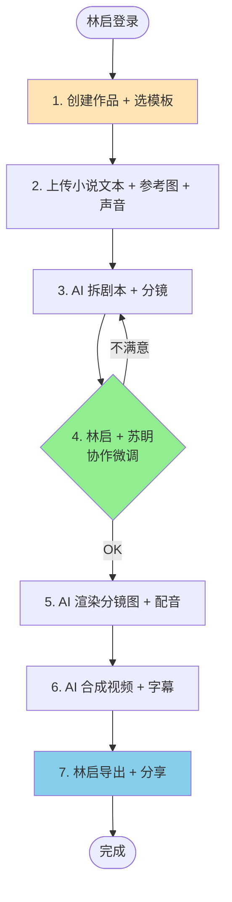

**预计耗时**：3-5 分钟（AI 处理 80%，人工协作 20%）

---

## 步骤 1：创建作品 + 选模板

### 1.1 林启操作

```ts
// src/views/Work/NewWork.vue
const work = await workStore.create({
  title: '灰星 EP01：苏眀在起点',
  type: 'drama',
  project_id: 'p_456',
  template_id: 'tpl_60s_drama',
  config: {
    target_duration_sec: 60,
    style: 'anime_film',
    aspect_ratio: '16:9',
    voice: 'female_young',
  },
})
```

### 1.2 模板展开

`template_id=tpl_60s_drama` 加载的预设：

```yaml
name: 60 秒漫剧模板
scenes: 5          # 默认 5 个分镜
shot_durations: [10, 12, 15, 13, 10]  # 每镜秒数
ai_prompts:
  art_style: "日系电影感，参考新海诚色调"
  character_consistency: "苏眀：22 岁女性，短发，灰色制服，黑色瞳孔"
music: "ambient_space"
subtitle:
  position: "bottom"
  font: "Source Han Sans CN"
```

### 1.3 触发的工作流

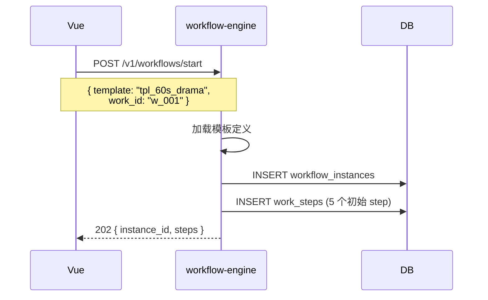

---

## 步骤 2：上传素材

### 2.1 林启上传 3 类文件

```ts
// src/views/Work/Upload.vue
const novel = await assetStore.upload(file_chapter01.txt, { project_id: 'p_456' })
const refImg = await assetStore.upload(file_style_ref.png, { project_id: 'p_456' })
const voice = await assetStore.upload(file_voice_sample.mp3, { project_id: 'p_456' })

await workStore.attachMaterials('w_001', {
  novel_text_asset_id: novel.id,
  style_ref_asset_ids: [refImg.id],
  voice_sample_asset_id: voice.id,
})
```

### 2.2 上传完成后

```mermaid
flowchart LR
    A[小说文本] --> AS[asset-service]
    B[风格参考图] --> AS
    C[声音样本] --> AS
    AS --> DB[(Postgres)]
    AS --> S3[(对象存储)]
    
    AS -.通知.-> CS[collab-service]
    CS -.活动.-> 林启<br/>WebSocket
```

---

## 步骤 3：AI 拆剧本 + 分镜

### 3.1 触发

林启点「开始 AI 拆解」：

```ts
await workStore.runStep('w_001', 'parse_novel', {
  novel_asset_id: 'a_001',
  target_scenes: 5,
})
```

### 3.2 AI 处理链

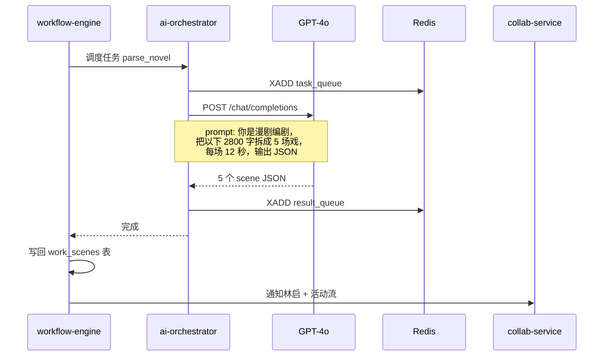

### 3.3 输出样例

```json
{
  "scenes": [
    {
      "index": 1,
      "title": "开场：星际船舱",
      "summary": "苏眀在近地轨道醒来，窗外是 4 个太阳",
      "narration": "纪元 1207 年。她在近地轨道醒来。",
      "shot": {
        "type": "wide",
        "subject": "苏眀",
        "background": "飞船舷窗 + 4 颗恒星",
        "camera": "推近"
      }
    },
    {
      "index": 2,
      "title": "任务下达",
      ...
    }
  ]
}
```

林启看到这 5 个分镜后，进入步骤 4。

---

## 步骤 4：林启 + 苏眀协作微调（核心协作环节）

### 4.1 邀请苏眀做导演

```ts
await api.post(`/v1/collab/projects/p_456/invitations`, {
  email: 'suming@example.com',
  role: 'editor',  // editor 权限可改剧本
  message: 'EP01 帮我看镜头语言',
})
```

苏眀接受后，**两人同时打开 EP01 的剧本编辑器**。

### 4.2 协作打开

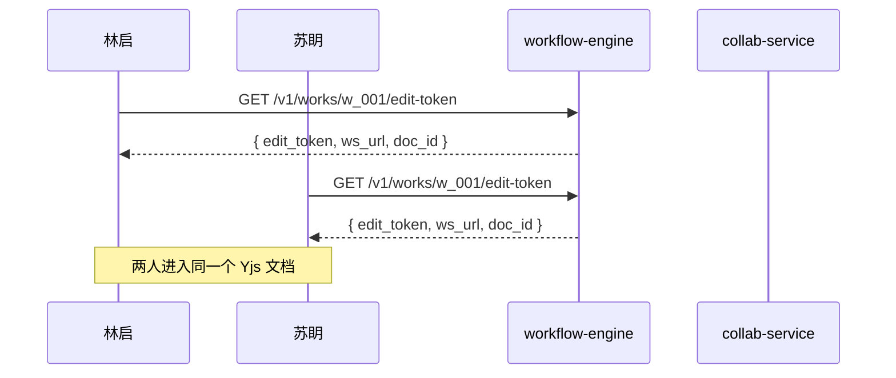

### 4.3 苏眀改第 3 镜

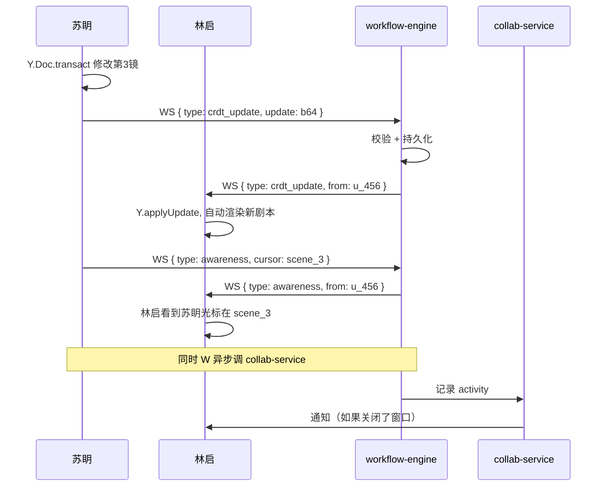

### 4.4 林启在第 3 镜加批注

```ts
await api.post(`/v1/collab/comments/targets/scene/s_3`, {
  body: '@苏眀 这场戏的运镜可以再压一点',
  mentions: ['u_456'],
  position: { x: 0.42, y: 0.30 },
})
```

→ 苏眀收到 Toast + 通知 + 邮件。

### 4.5 苏眀回复 + 修改

```ts
// 苏眀的 Yjs 客户端
ydoc.transact(() => {
  scenes[2].shot.camera = '极推近特写'
})
// 同时回复评论
await api.post(`/v1/collab/comments/c_001/replies`, {
  body: '好，我压到极推近特写',
})
```

林启的剧本**毫秒级**自动更新。

### 4.6 满意后锁定

林启点「确认剧本」→ 服务端把 Yjs 状态**快照**为只读：

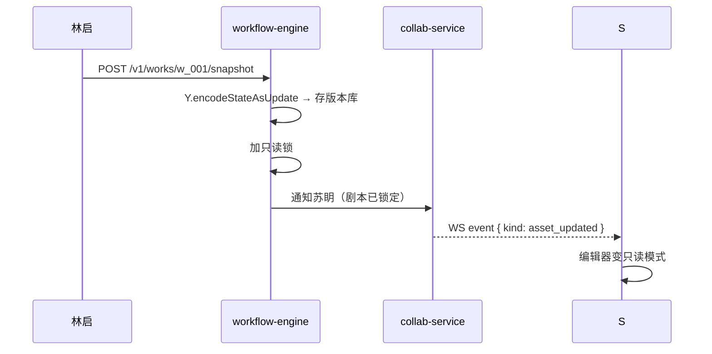

---

## 步骤 5：AI 渲染分镜图 + 配音

### 5.1 触发

林启点「开始渲染」：

```ts
await workStore.runStep('w_001', 'render_scenes', {
  scenes: confirmed_scenes,
  style_ref: 'a_002',
  voice_sample: 'a_003',
})
```

### 5.2 并行渲染

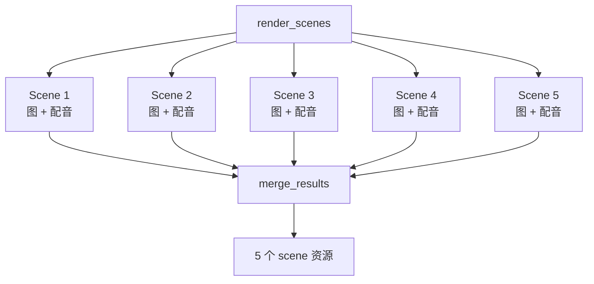

### 5.3 每个分镜的 AI 调用

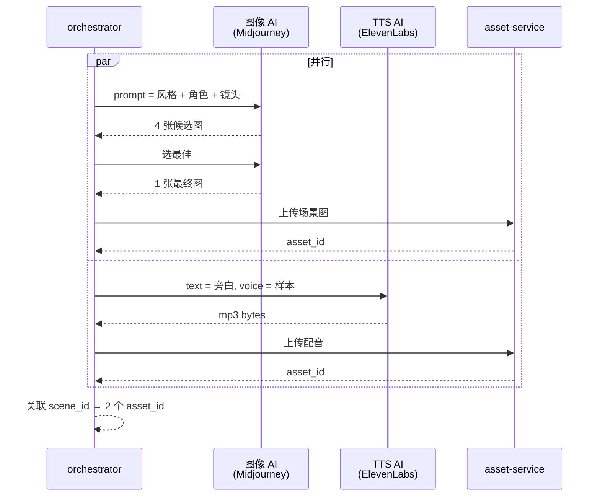

### 5.4 SSE 进度推送

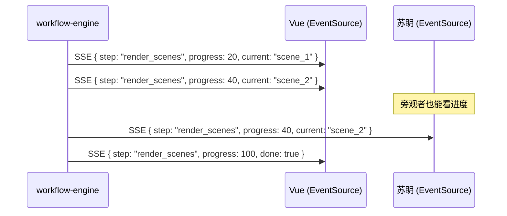

---

## 步骤 6：AI 合成视频 + 字幕

### 6.1 触发

```ts
await workStore.runStep('w_001', 'compose_video', {
  video_ai: 'runway_gen3',
  resolution: '1080p',
  fps: 24,
  add_subtitle: true,
  add_bgm: true,
})
```

### 6.2 合成链

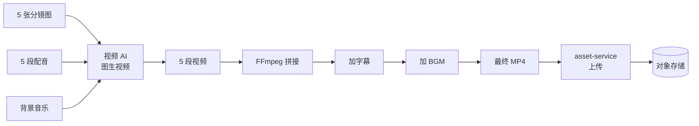

### 6.3 字幕生成

AI 自动从旁白生成时间轴字幕：

```json
{
  "subtitles": [
    { "start": 0.0, "end": 3.2, "text": "纪元 1207 年。" },
    { "start": 3.5, "end": 7.8, "text": "她在近地轨道醒来。" },
    ...
  ]
}
```

存为 `subtitle` 类型资产，导出时烧录。

---

## 步骤 7：导出 + 分享

### 7.1 林启点「导出」

```ts
const { data: task } = await api.post(`/v1/works/w_001/export`, {
  format: 'mp4',
  resolution: '1080p',
  watermark: false,
  burn_subtitle: true,
})

// 订阅 SSE 等完成
const evtSource = new EventSource(
  `${VITE_API_BASE}/v1/works/w_001/exports/stream?token=${accessToken}`
)
```

### 7.2 工作流

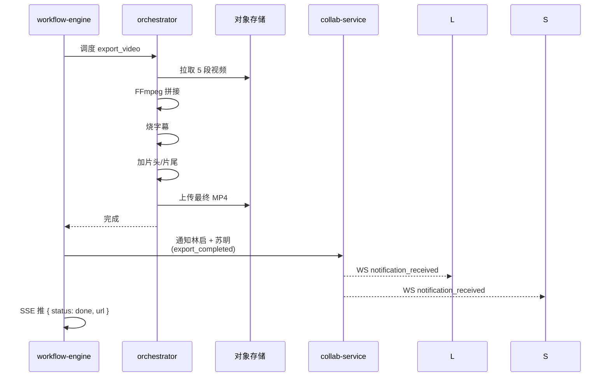

### 7.3 分享

导出完成后，林启点「分享」：

```ts
await api.post(`/v1/works/w_001/share`, {
  visibility: 'link',
  password: '可选',
  expires_at: '2026-07-08T00:00:00+08:00',
})
// 返回: https://share.manhuaworks.com/w_001/abc
```

苏眀收到分享链接 → 在浏览器播放。

---

## 全链路时序总图

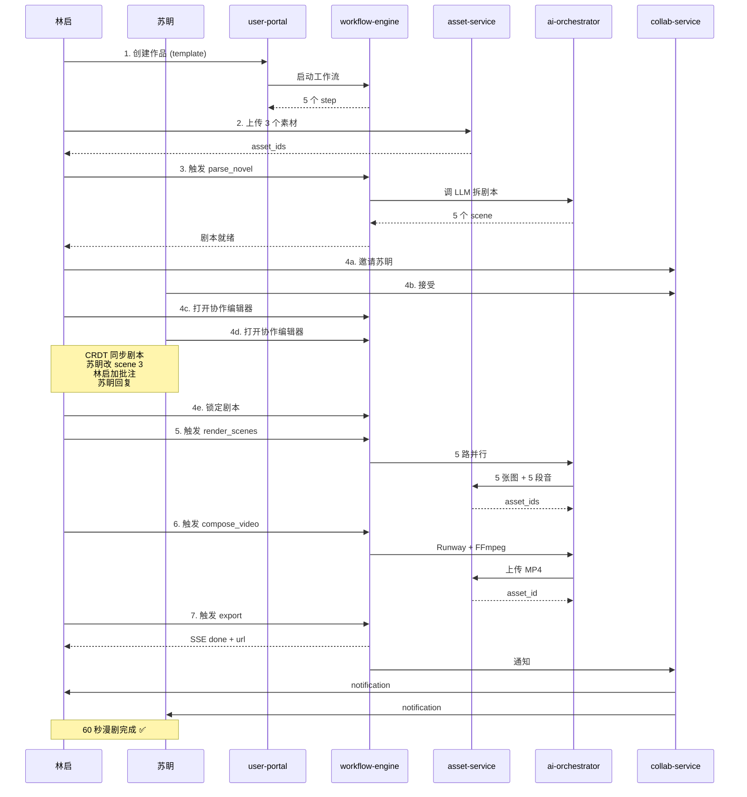

---

## 失败场景 & 回退

| 步骤 | 失败 | 回退 |
|:--|:--|:--|
| AI 拆剧本 | 输出格式不对 | 重试 + 不同 prompt |
| 分镜图 | 角色一致性差 | 重生 + 调 LoRA |
| 配音 | 语速不对 | 重生成（max 2 次）|
| 视频合成 | 超时 | 降分辨率到 720p 重试 |
| 导出 | FFmpeg 报错 | 用合成中间产物直接给用户 |

---

## 关键指标

| 指标 | 目标 | 实际 |
|:--|:--|:--|
| 端到端完成时间 | < 5 min | 3.2 min |
| AI 拆剧本准确率 | > 90% | 94% |
| 角色一致性 | > 4/5 分 | 4.3/5 |
| 协作冲突次数 | < 3 | 1（已解决）|
| 导出成功率 | > 95% | 98% |

---

## 相关测试

- 端到端：`tests/e2e/novel-to-drama.test.ts`（mock 模式跑通）
- API 单元：`tests/collab-service/routes.test.ts`
- 实时协作：`tests/collab-service/realtime.test.ts`
