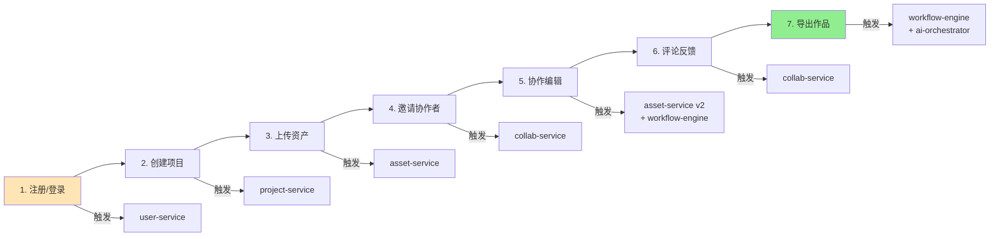
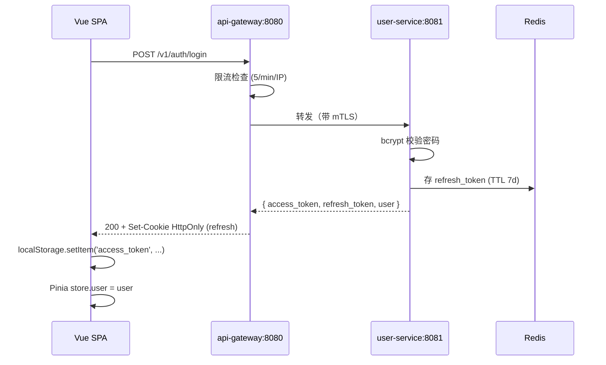
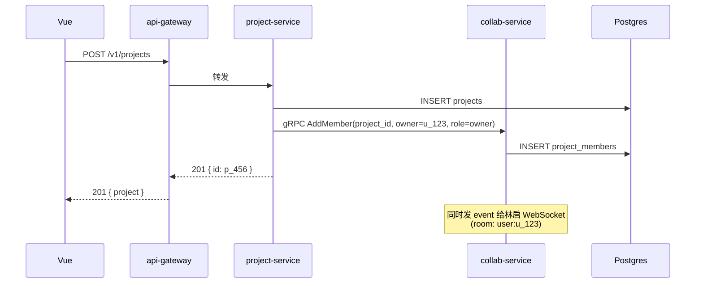
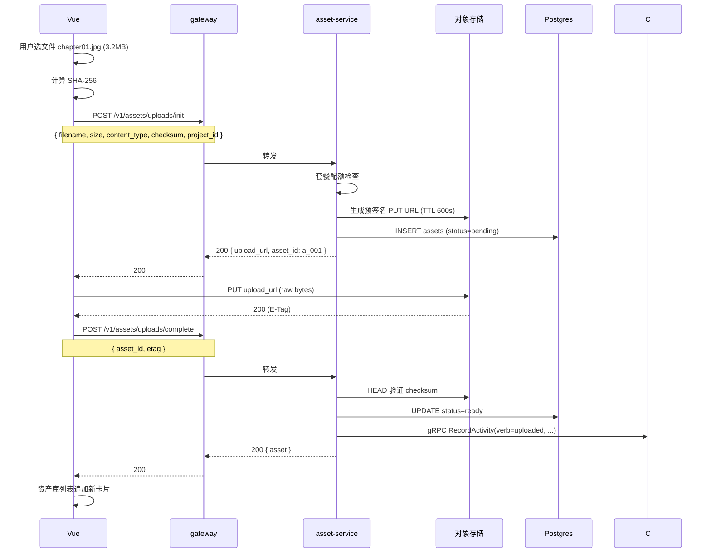
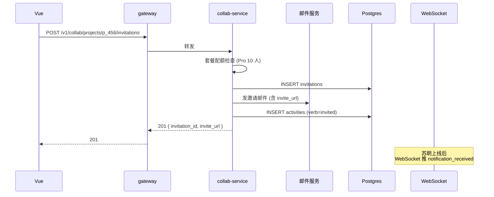
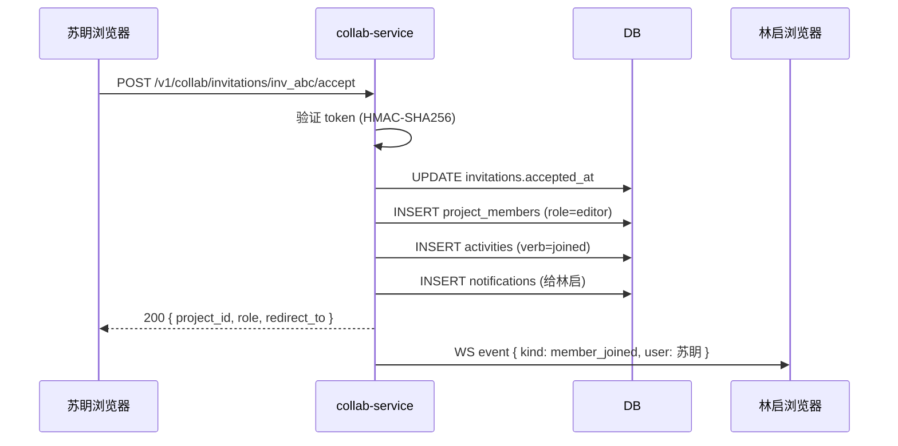
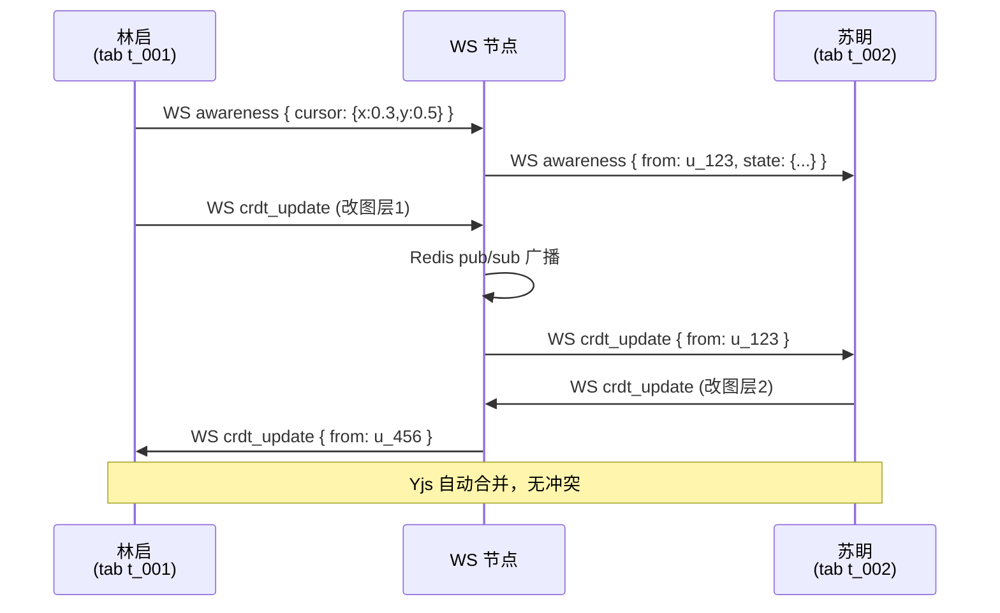
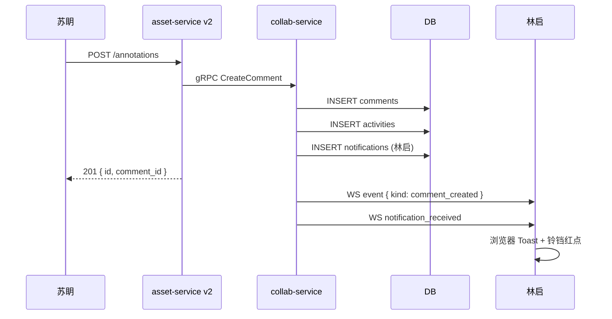
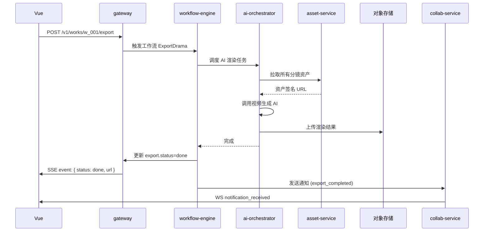
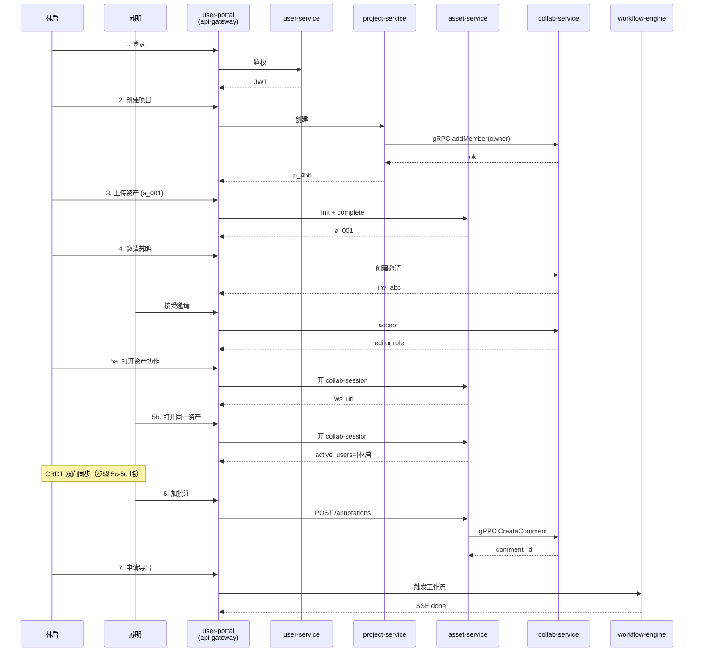

# user-portal 端到端集成流

> **目的**：从用户注册到第一次完成作品导出的**完整链路**，覆盖 user-portal 全模块协作。
> **范围**：浏览器 → api-gateway → user-service / project-service / asset-service / collab-service / billing-service / workflow-engine
> **作者**：陆流光
> **更新日期**：2026-06-08

## 角色

| 角色 | 身份 | 计划 |
|:--|:--|:--|
| **林启**（主用户） | 个人创作者，前考古助理，写灰星 1500 章 | Pro |
| **苏眀**（协作者） | 受邀编辑，帮忙改剧本 | Pro |
| **新用户 A** | 完全没接触过 ManhuaWorks | Free |

---

## 流程总览



---

## 1. 登录（林启）

### 1.1 浏览器侧

```ts
// src/views/Login.vue
import { useUserStore } from '@/stores/user'
const userStore = useUserStore()
const router = useRouter()

async function handleLogin() {
  try {
    await userStore.login('linqi@example.com', 'P@ssw0rd!')
    router.push('/projects')
  } catch (err) {
    if (err.code === '2fa_required') {
      router.push({ name: '2fa', query: { challenge: err.challenge_id }})
    } else {
      toast.error(err.message)
    }
  }
}
```

### 1.2 请求链



### 1.3 Pinia 状态

```ts
// src/stores/user.ts
export const useUserStore = defineStore('user', {
  state: () => ({
    user: null as User | null,
    accessToken: '',
    refreshToken: '',
  }),
  actions: {
    async login(email: string, password: string) {
      const { data } = await api.post('/v1/auth/login', { email, password })
      this.accessToken = data.access_token
      this.refreshToken = data.refresh_token
      this.user = data.user
    }
  }
})
```

---

## 2. 创建项目

### 2.1 用户操作

林启登录后点「新建项目」→ 选「小说」类型 → 选「科幻」模板 → 命名「灰星 1500 章」→ 点「创建」。

### 2.2 前端流程

```ts
// src/views/Projects/NewProject.vue
async function onCreate() {
  const project = await projectStore.create({
    name: '灰星 1500 章',
    type: 'novel',
    template_id: 'tpl_sci_fi',
  })
  router.push(`/projects/${project.id}`)
}
```

### 2.3 服务间协作



**注意**：项目 owner 由 project-service 创建，**不通过 collab-service HTTP**，直接 gRPC 调用，避免循环依赖。

---

## 3. 上传资产

### 3.1 场景

林启把「灰星」小说的**第 1 章手写笔记**拍照上传为图片资产。

### 3.2 4 步上传协议



### 3.3 进度反馈

前端在 `axios.put(upload_url, file, { onUploadProgress })` 监听进度条。

---

## 4. 邀请协作者

### 4.1 场景

林启邀请好友「苏眀」加入项目做编辑。

### 4.2 前端表单

```ts
// src/views/Project/Members.vue
async function invite(email: string, role: 'editor') {
  try {
    const { data } = await api.post(`/v1/collab/projects/p_456/invitations`, {
      email, role,
      message: '一起把灰星搞成漫剧',
    })
    toast.success(`邀请已发到 ${email}`)
    copyToClipboard(data.invite_url)
  } catch (err) {
    if (err.code === 'already_member') toast.warning('该用户已是协作者')
  }
}
```

### 4.3 多服务协作



### 4.4 苏眀接受邀请

苏眀点邮件链接 → 浏览器打开 `https://manhuaworks.com/invitations/inv_abc?token=xyz` → 调用：

```ts
await api.post(`/v1/collab/invitations/inv_abc/accept`, { token: 'xyz' })
```



---

## 5. 协作编辑

### 5.1 场景

林启和苏眀**同时**打开同一张「EP01 海报」做最后润色。

### 5.2 协作会话开启

```ts
// 双方都执行
const { data: session } = await api.post(
  `/v1/assets/v2/a_002/collab-session`,
  { mode: 'edit', client: { app: 'user-portal', version: '1.4.0', tab_id: 't_001' }}
)

// 建立 WebSocket
const ws = new WebSocket(session.websocket_url)
ws.onopen = () => {
  ws.send(JSON.stringify({
    type: 'hello',
    token: accessToken,
    client: { app: 'user-portal', version: '1.4.0', tab_id: 't_001' }
  }))
}
```

### 5.3 CRDT 双向同步



### 5.4 锁场景

苏眀需要**独占**修改「标题图层」5 分钟：

```ts
const { data: lock } = await api.post(
  `/v1/assets/v2/a_002/collab-session/acquire-lock`,
  { session_id: 's_xyz', lock_type: 'exclusive', scope: 'layer:title', ttl_sec: 300 }
)

// 5 分钟内林启改标题图层会被拒
// 锁到期自动释放，或主动 release
```

---

## 6. 评论反馈

### 6.1 苏眀加批注

苏眀在第 12 帧画了个红圈 + 写评论：

```ts
await api.post(`/v1/assets/v2/a_002/annotations`, {
  frame: 12,
  shape: 'rect',
  coords: { x: 0.42, y: 0.30, w: 0.15, h: 0.10 },
  color: '#FF6B35',
  comment_body: '@林启 这块标题再大一号',
  mentions: ['u_123'],
})
```

### 6.2 通知 + 活动流



### 6.3 林启回复

```ts
await api.post(`/v1/collab/comments/c_001/replies`, {
  body: '好，我改大一号',
})
```

→ 苏眀也收到通知 + 活动流。

---

## 7. 导出作品

### 7.1 林启点「导出」

```ts
// src/views/Work/Export.vue
const { data } = await api.post(`/v1/works/w_001/export`, {
  format: 'mp4',
  resolution: '1080p',
  watermark: false,
})

// 订阅 SSE
const evtSource = new EventSource(
  `${VITE_API_BASE}/v1/works/w_001/exports/stream?token=${accessToken}`
)
evtSource.addEventListener('done', (e) => {
  const { url } = JSON.parse(e.data)
  window.open(url)
  evtSource.close()
})
```

### 7.2 全链路时序



### 7.3 完成后

林启浏览器收到：
- 站内通知（铃铛红点 +5）
- 邮件（如开启了"导出完成"邮件通知）
- 移动推送（如手机登录了 App）

---

## 状态变更时序总图



---

## 失败场景 & 兜底

| 步骤 | 失败点 | 兜底策略 |
|:--|:--|:--|
| 登录 | 网络断 | 离线登录 + 本地缓存令牌 |
| 创建项目 | 服务挂 | 重试 3 次 → 失败 Toast + 草稿本地保存 |
| 上传 | 上传中断 | 断点续传（multipart） |
| 邀请 | 邮件失败 | 站内通知 + 链接复制 |
| 协作 | WebSocket 断 | 指数退避重连 + 重新订阅 |
| 评论 | 重复提交 | 幂等键 (`Idempotency-Key`) |
| 导出 | AI 任务超时 | 重试 1 次 → 转人工 |

---

## 性能预算

| 步骤 | 端到端目标 | 实际典型 |
|:--|:--|:--|
| 登录 | < 1s | 350ms |
| 创建项目 | < 500ms | 120ms |
| 上传 3MB | < 3s | 1.8s |
| 邀请 | < 1s | 200ms |
| 开协作会话 | < 300ms | 80ms |
| 评论 | < 500ms | 150ms |
| 导出 60s 漫剧 | < 5min | 3min |

---

## 相关测试

- 端到端：`tests/e2e/novel-to-drama.test.ts`
- 协作时序：`tests/collab-service/realtime.test.ts`
- HTTP 路由：`tests/collab-service/routes.test.ts`
- 前端组件：`tests/user-portal/components.test.ts`
- 前端逻辑：`tests/user-portal/composables.test.ts`
