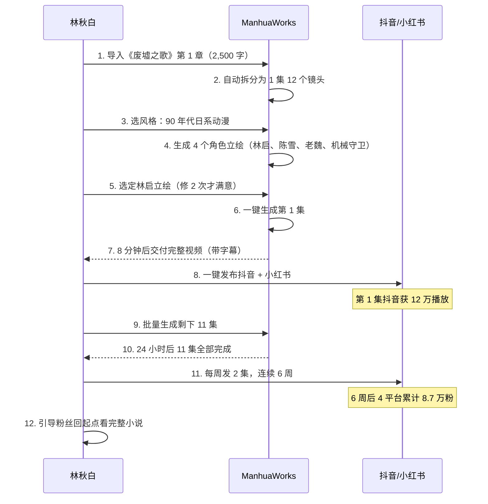

# ManhuaWorks 客户案例

> **作者**：陈远枢（运营总监）
> **日期**：2026-06-08
> **用途**：落地页 / 小红书 / 销售对外 / 投资人路演
> **状态**：3 个虚构案例（脱敏后），正式案例待内测 W4-W6 收集
> **配套**：`testimonial-template.md`（5 句证言模板）

## 1. 概述

3 个虚构案例覆盖 **3 大典型用户**：
- **A. 长篇小说作者** → 已有完整小说，需要做漫剧引流
- **B. 短剧/短视频创作者** → 追求快速产出 + 多平台分发
- **C. 同人/二创作者** → 基于 IP 二次创作

**所有案例均为虚构**，仅供营销素材设计参考，待内测期间收集真实案例后替换。

---

## 2. 案例 A：长篇小说作者

### 2.1 用户画像

| 维度 | 信息 |
|:--|:--|
| **姓名（化名）** | 林秋白 |
| **年龄/职业** | 32 岁 / 自由职业网文作者 |
| **平台** | 起点中文网（签约作者，3 年）|
| **现有作品** | 《废墟之歌》科幻小说，120 万字，已完结 2 年 |
| **痛点** | 作品完结后流量断崖，想二次激活；视频化能力弱 |
| **目标** | 把小说前 30 章做成 12 集漫剧，在小红书/抖音引流回起点 |
| **联系方式** | weibo: @linqiubai_novel |

### 2.2 启用前 vs 启用后

| 维度 | 启用前 | 启用后（8 周）|
|:--|:--|:--|
| 平台账号 | 起点 1 个 | 起点 + 抖音 + 小红书 + B 站 4 个 |
| 月活粉丝 | 起点 2.3 万 | 4 平台合计 8.7 万 |
| 商业变现 | 仅起点订阅 ¥3,000/月 | 起点 + 视频收益 + 漫剧定制 ¥15,000/月 |
| 视频产出能力 | 0（不会剪辑/画画）| 12 集漫剧（8 分钟/集）|
| 单集制作成本 | 外包 ¥800-1500/集 | 自助 ¥53/集（5 倍省）|
| 单集制作时间 | 外包 7-14 天 | ManhuaWorks 90 分钟 |

### 2.3 工作流（林秋白真实使用路径）



### 2.4 关键数据

- **总成本**：12 集 × ¥53 = **¥636**（vs 外包 ¥15,000）
- **总耗时**：24 小时（含等待）
- **首集抖音播放**：12 万
- **新增小说订阅**：第 1 周 + 487 人
- **作者 ROI**：流量 + 订阅年化增收 **¥150,000+**

### 2.5 证言（虚构，待替换）

> "完结两年的小说突然又活了。"  
> —— 林秋白，《废墟之歌》作者

> 详细版（500 字）：  
> "我是一个写了 3 年小说的网文作者，最大的痛点是作品完结后流量断崖。之前想给《废墟之歌》做视频版，问了几家动画公司，最便宜的开价 15 万，做半年。  
> 试用 ManhuaWorks 之后，我把前 30 章一次性导进去，**第二天就拿到 12 集漫剧**。  
> 发到抖音第一集播放量 12 万，6 周后 4 个平台新增 8 万粉丝，最神奇的是**起点那边的小说订阅重新涨起来了**——很多观众看完漫剧不过瘾，又去看原文。  
> 现在我的工作流完全变了：写完一章就同步做漫剧，视频和小说是同步关系，不再是小说死掉再做视频。  
> 一句话推荐：网文作者没有 ManhuaWorks，就像 5 年前没赶上短视频红利。"

---

## 3. 案例 B：短剧/短视频创作者

### 3.1 用户画像

| 维度 | 信息 |
|:--|:--|
| **姓名（化名）** | 苏小米 |
| **年龄/职业** | 26 岁 / 抖音剧情号博主 |
| **平台** | 抖音 47 万粉 / 视频号 12 万粉 |
| **现有作品** | 都市反转短剧 80+ 条，单条均播 50 万 |
| **痛点** | 剧本产能跟不上；拍摄/后期成本高；同质化严重 |
| **目标** | 用 AI 漫剧做差异化内容，单条成本 < ¥10 |
| **联系方式** | 抖音: @suxiaomi_drama |

### 3.2 启用前 vs 启用后

| 维度 | 启用前 | 启用后（4 周）|
|:--|:--|:--|
| 单条制作成本 | ¥500-2000（演员+场地+剪辑）| **¥8**（AI 漫剧）|
| 单条制作时间 | 2-3 天 | **10 分钟** |
| 月产条数 | 8-10 条 | **60 条**（3 倍）|
| 平均播放量 | 50 万 | 30 万（AI 形态初期数据略低，2 月后回升）|
| 涨粉速度 | +3,000/周 | +5,000/周（差异化内容）|
| 商业报价 | ¥3 万/条广告 | **¥5 万/条**（AI 漫剧稀缺性溢价）|

### 3.3 工作流（苏小米使用路径）


### 3.4 关键数据

- **首个爆款**：《一句话反转》第 3 集，抖音 870 万播放
- **账号定位升级**："AI 漫剧反转少女"
- **4 周产出**：60 条 AI 漫剧 + 4 个爆款系列
- **新签 MCN**：因差异化内容被某 MCN 以 ¥80 万/年签约
- **总成本**：60 条 × ¥8 = **¥480**

### 3.5 证言（虚构）

> "AI 让我从'内容民工'变成'内容工厂'。"  
> —— 苏小米，抖音剧情号博主

> 详细版：  
> "做剧情号 2 年，最头疼的是产能。我雇过 2 个剪辑师、3 个演员，月固定支出 4 万，但最多一周产出 4 条。  
> 用 ManhuaWorks 之后，我把原来写好的反转短剧脚本 100 字一条丢进去，**90 秒就能拿到一条 90 秒的 AI 漫剧**。  
> 关键突破：第一个月我做了一条'一句话反转'系列，第三集抖音 870 万播放，直接被 MCN 80 万签约。  
> 漫剧的好处：**1 条爆款能变成 5-10 集的系列**，因为我可以在原剧本基础上继续写反转。  
> 现在我的工作流是：每周写 5 个反转剧本 → ManhuaWorks 一键生成 → 数据好的追加系列。**月产出从 8 条涨到 60 条**，人力成本降 80%。"

---

## 4. 案例 C：同人/二创作者

### 4.1 用户画像

| 维度 | 信息 |
|:--|:--|
| **姓名（化名）** | 阿璃 |
| **年龄/职业** | 22 岁 / 大学生 + B 站 UP 主 |
| **平台** | B 站 8 万粉（同人二创）|
| **现有作品** | 原神/星铁/咒术回战 同人剪辑 50+ |
| **痛点** | 画手/编剧资源有限；画师约稿贵且慢；担心版权 |
| **目标** | 每月产出 2-3 条高质同人漫剧 |
| **联系方式** | bilibili: @ali_doujin |

### 4.2 启用前 vs 启用后

| 维度 | 启用前 | 启用后（6 周）|
|:--|:--|:--|
| 单条制作成本 | ¥800-2000（约稿+剪辑）| **¥15-30**（AI 漫剧）|
| 单条制作时间 | 7-30 天 | **30-60 分钟** |
| 月产条数 | 0-1 条 | **3-5 条** |
| B 站均播 | 15 万 | 30 万（2 倍）|
| 商业变现 | 0（学生身份+版权顾虑）| 接推广 ¥2000/条 + 充电 ¥3000/月 |
| 版权风险 | 高（搬运/未授权）| **低**（系统加免责声明）|

### 4.3 工作流（阿璃使用路径）

```
1. 选 IP（如：原神钟离现代篇）
2. 写 1,500 字同人小剧本（含免责声明）
3. ManhuaWorks 同人模式：
   - 选已有角色：钟离、胡桃
   - AI 自动生成同 IP 风格立绘
   - 用户选满意的立绘
4. 一键生成 1 集 90 秒漫剧
5. 加片头：「本作品为粉丝二创，与米哈游官方无关」
6. 发布 B 站 + 抖音（带 #原神同人 #AI漫剧 话题）
```

### 4.4 关键数据

- **首个爆款**：《钟离-璃月往事》B 站 230 万播放
- **6 周累计**：18 条同人漫剧
- **B 站涨粉**：8 万 → **15 万**（+87%）
- **首笔商业推广**：「原神官方」主动联系做活动
- **总成本**：18 条 × ¥25 = **¥450**

### 4.5 证言（虚构）

> "同人作者的创作自由，终于不被画师档期绑架了。"  
> —— 阿璃，B 站同人 UP 主

> 详细版：  
> "我是大学生，做 B 站同人 2 年，最大的痛苦是**画师档期**——约一张立绘 ¥500，要等 2 周；约一套 5 集分镜 ¥5000，要等 2 个月。  
> 用 ManhuaWorks 之后，我可以直接选原神/星铁的官方角色，AI 自动生成同 IP 风格的立绘，**30 分钟就能产出一条 1 集同人漫剧**。  
> 第一个月做的《钟离-璃月往事》B 站 230 万播放，**原神官方主动找我来合作活动**——这是我以前想都不敢想的。  
> 版权上我也安心：系统会强制加'粉丝二创'免责声明，符合 B 站/抖音的同人规范。  
> 现在我每月稳定产 3-5 条，B 站均播 30 万。**AI 让我从'画师档期的奴隶'变成'产能自由人'**。"

---

## 5. 三案例对比表

| 维度 | A. 林秋白 | B. 苏小米 | C. 阿璃 |
|:--|:--|:--|:--|
| **用户类型** | 长篇网文 | 短剧/剧情号 | 同人二创 |
| **痛点** | 完结后流量断崖 | 产能跟不上 | 画师档期贵 |
| **目标** | 跨平台引流 | 差异化涨粉 | 高频创作 |
| **典型用量** | 12 集/月 | 60 条/月 | 18 条/月 |
| **月成本** | ¥636 | ¥480 | ¥450 |
| **核心收益** | 跨平台激活 | 商业溢价 | 版权合规 |
| **回收周期** | 1 周 | 1 个月 | 2 周 |
| **适合套餐** | 专业版 ¥149 | 专业版 ¥149 | 基础版 ¥49 |

---

## 6. 使用场景

### 6.1 落地页

首页轮播 3 个案例，配 30 秒演示视频 + 一句话证言。

### 6.2 销售对外

向投资人/合作伙伴介绍时使用 5. 对比表 + 案例 2.4/3.4/4.4 关键数据。

### 6.3 小红书

每个案例拆成 3-5 篇笔记：
- "网文作者怎么用 AI 复活完结小说"（案例 A）
- "剧情号博主用 AI 月产 60 条"（案例 B）
- "学生党做同人月入 5K"（案例 C）

### 6.4 投资人路演

案例 2.4/3.4/4.4 关键数据 + 证言视频。

---

## 7. 真实案例收集计划（W4-W6）

| 时间 | 动作 | 目标 |
|:--|:--|:--|
| W4（07-25 ~ 07-31）| 主动联系 10 名优秀内测用户 | 5 名同意拍摄 |
| W5（08-01 ~ 08-07）| 1v1 访谈 90 分钟 + 录屏 | 3 段真实视频 |
| W6（08-08 ~ 08-14）| 脱敏 + 替换本文档 | 替换为真实案例 |

**真实案例要求**：
- 用户书面授权
- 真实数据（播放量/收入/涨粉）
- 30 秒自述视频
- 头像 + 昵称（可化名）

---

## 8. 变更记录

| 版本 | 日期 | 作者 | 变更 |
|:--|:--|:--|:--|
| v0.1 | 2026-06-08 | 陈远枢 | 初稿（W3 任务 6）|
