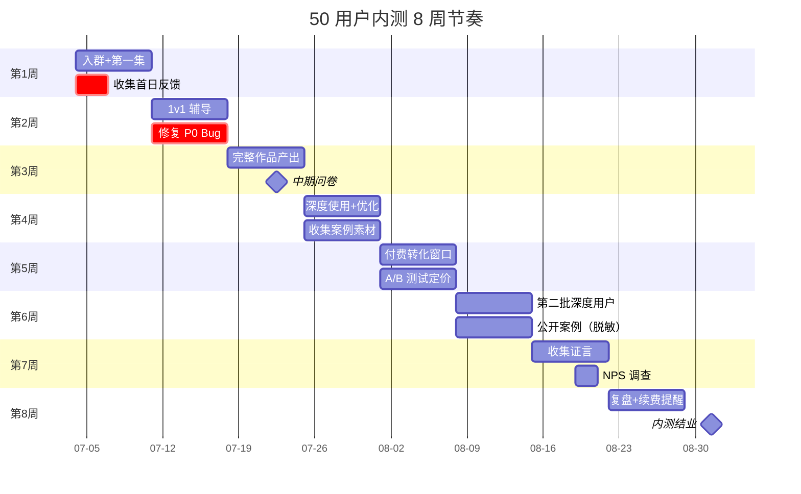

# 50 用户内测详细计划

> **作者**：陈远枢（运营总监）
> **日期**：2026-06-08
> **目标**：招募 50 名种子用户，跑通"注册→首次生成→付费转化"全流程
> **周期**：2026-07-01 ~ 2026-08-31（8 周）
> **预算**：¥50,000（积分补贴 + 礼品 + 运营人力）
> **配合文档**：`beta-plan.md`（总纲）、`onboarding-v2.md`（引导流程）、`feedback-form.md`（反馈收集）

## 1. 目标与 KPI

### 1.1 业务目标

| 维度 | 目标 | 备注 |
|:--|:--|:--|
| 招募内测用户 | 50 人 | 全量开放申请，筛选标准详见 §3 |
| 完成新手指引 | 50 人（100%）| 第一集生成完成 |
| 7 日留存 | ≥ 35 人（70%）| D7 回到平台 |
| 28 日留存 | ≥ 20 人（40%）| D28 回到平台 |
| 付费转化（专业版）| ≥ 8 人（16%）| D28 前完成付费 |
| 收集有效反馈 | ≥ 100 条 | 评分 ≥ 3 分 |
| 真实证言 | ≥ 5 条 | 脱敏后可商用 |
| NPS | ≥ 40 | 月末问卷 |
| 真实作品产出 | ≥ 30 部 | 至少 1 集以上漫剧 |

### 1.2 健康度目标

| 指标 | 目标 | 告警阈值 |
|:--|:--|:--|
| 平均任务完成时间 | < 90 分钟（12 集） | > 120 分钟 |
| 任务失败率 | < 10% | > 20% |
| 工单响应时间 | < 4 小时 | > 12 小时 |
| 用户主动反馈率 | > 50% | < 30% |
| 单用户周活跃天数 | ≥ 2 天 | < 1 天 |

---

## 2. 目标用户画像

> 目标：覆盖 3 大创作者群体，每群体约 15-20 人。

| 用户类型 | 占比 | 来源 | 关键特征 |
|:--|:--|:--|:--|
| **网文作者** | 35% | 起点、刺猬猫、番茄、晋江 | 已有完整小说，想做漫剧引流 |
| **短视频创作者** | 25% | 抖音、视频号、小红书 | 习惯短视频，需要差异化内容 |
| **MCN 运营** | 20% | 飞书、脉脉 | 帮旗下达人找新工具，关注 ROI |
| **自媒体博主** | 15% | 公众号、知识星球 | 已有 IP，需要产能放大 |
| **出版社编辑** | 5% | 出版圈、文学社 | 评估 IP 改编可行性 |
| **合计** | 100% | - | - |

**筛选标准**（必须同时满足）：
- ✅ 有明确的内容产出需求（小说/视频/课程）
- ✅ 每周能投入 ≥ 2 小时深度体验
- ✅ 愿意提交 ≥ 3 条有效反馈
- ✅ 允许我们使用脱敏后的案例
- ❌ 不接受：纯薅羊毛、AI 套利号、无内容产出能力者

---

## 3. 招募流程

### 3.1 时间表

| 阶段 | 日期 | 动作 | 目标 |
|:--|:--|:--|:--|
| **预热** | 06-15 ~ 06-22 | 飞书朋友圈+小红书预热 | 收集 200+ 申请 |
| **正式招募** | 06-22 ~ 06-30 | 申请页全量开放 | 收 300+ 申请 |
| **筛选** | 06-30 ~ 07-03 | 人工审核+面试 | 选 50 人 |
| **启动会** | 07-04 | 飞书群启动+签约 | 完成入群 |
| **内测** | 07-01 ~ 08-31 | 8 周深度使用 | 完成 KPI |

### 3.2 招募文案（已发布在 `marketing/landing-copy.md`）

主文案（飞书 + 小红书）：

> 🎬 **邀请 50 位种子用户，共建 AI 漫剧的未来**
>
> 你好，我是 ManhuaWorks 运营总监陈远枢。
> 我们正在做一件很酷的事：让小说 8 分钟变成漫剧。
> 在正式开放前，我们想邀请 **50 位重度内容创作者** 成为种子用户。
>
> **你将获得**：
> - ✅ 永久免费使用专业版（原价 ¥149/月）
> - ✅ 5,000 启动积分（够做 8 集漫剧）
> - ✅ 1 对 1 接入辅导（30 分钟）
> - ✅ 直接与产品经理对话（飞书群）
> - ✅ 你的建议被优先采纳
> - ✅ 上线后 6 折续费优惠
>
> **你需要做**：
> - 📝 每周至少花 2 小时深度体验
> - 📝 提交至少 3 条有效反馈
> - 📝 允许我们使用你的案例（脱敏后）
>
> 申请时间：2026-06-22 ~ 2026-06-30
> 入选通知：2026-06-30 24:00 前
> 启动时间：2026-07-04
>
> [立即申请内测]

### 3.3 申请表（飞书多维表格）

| 字段 | 类型 | 必填 | 用途 |
|:--|:--|:--|:--|
| 姓名 | 单行文本 | ✅ | 称呼 |
| 微信/手机 | 单行文本 | ✅ | 联系 |
| 邮箱 | 单行文本 | ✅ | 注册 |
| 创作者类型 | 单选 | ✅ | 5 选 1 |
| 平台账号 | 多行文本 | ❌ | 抖音/小红书 ID（验证身份）|
| 现有作品 | 多行文本 | ✅ | 简介+链接 |
| 为什么想用 | 多行文本 | ✅ | 200 字以上 |
| 每周可用时间 | 单选 | ✅ | 1-3h / 3-5h / 5h+ |
| 期望产出 | 多行文本 | ❌ | "想做什么样的漫剧" |
| 推荐人 | 单行文本 | ❌ | 飞书 ID |

**审核 SOP**：
1. 自动筛选：内容长度 < 50 字、邮箱无效 → 直接淘汰
2. 人工打分（0-5 分）：
   - 创作者履历（30%）
   - 现有作品质量（30%）
   - 需求真实性（20%）
   - 时间投入（20%）
3. 排序取前 50 名，候补 20 名
4. 飞书发确认函，24h 未回复 → 候补递补

### 3.4 启动会（07-04）

**议程**（2 小时）：

| 时间 | 内容 | 主讲 |
|:--|:--|:--|
| 14:00-14:15 | 开场+团队介绍 | 陈远枢 |
| 14:15-14:45 | 产品演示：从小说到漫剧 | 产品经理 |
| 14:45-15:15 | 实操演示：5 步生成第一集 | 沈书白 |
| 15:15-15:45 | 用户 Q&A | 全体 |
| 15:45-16:00 | 签约+送积分 | 陈远枢 |

**签约内容**：
- NDA 互签（保护双方）
- 案例授权书
- 反馈提交流程说明
- 紧急联系群

---

## 4. 8 周运营节奏

### 4.1 总体节奏

### 4.2 每周详细任务

#### 第 1 周（07-04 ~ 07-10）：入群 + 第一集

| 日期 | 动作 | 负责人 |
|:--|:--|:--|
| 07-04 | 启动会（飞书会议）| 陈远枢 |
| 07-04 | 推送新手指引链接 | 系统 |
| 07-05 | 1v1 私信询问"是否完成第一集" | 运营 1 |
| 07-06 | 收集 10 个常见问题 | 沈书白 |
| 07-07 | 修复 P0 阻塞问题 | 工程组 |
| 07-08 | 周报：50 人完成进度 | 陈远枢 |
| 07-10 | 周末提醒 + 任务模板推送 | 系统 |

**目标**：80% 用户完成第一集（40 人）

#### 第 2 周（07-11 ~ 07-17）：1v1 辅导

| 日期 | 动作 | 负责人 |
|:--|:--|:--|
| 07-11 | 1v1 视频辅导（30 分钟/人）| 沈书白 |
| 07-13 | 收集"高级功能"使用情况 | 运营 |
| 07-15 | 群内分享：3 个标杆用户案例 | 沈书白 |
| 07-17 | 推送"进阶玩法"教程 | 系统 |

**目标**：100% 用户至少产出 1 集，60% 产出 3 集以上（30 人）

#### 第 3 周（07-18 ~ 07-24）：完整作品

| 日期 | 动作 | 负责人 |
|:--|:--|:--|
| 07-18 | 推送"完整漫剧"激励 | 运营 |
| 07-20 | 中期问卷（10 分钟）| 全体 |
| 07-22 | 1v1 复盘 10 名活跃用户 | 陈远枢 |
| 07-24 | 评分≥4 分用户送额外 1000 积分 | 运营 |

**目标**：30% 用户完成 ≥ 6 集（15 人），中期 NPS ≥ 35

#### 第 4 周（07-25 ~ 07-31）：深度使用

| 日期 | 动作 | 负责人 |
|:--|:--|:--|
| 07-25 | 邀请 10 名用户参与"产品共创" | 产品经理 |
| 07-27 | 群内投票：下个迭代做什么 | 产品经理 |
| 07-29 | 收集 5 段"用户采访"视频 | 沈书白 |
| 07-31 | 月度复盘会 | 全体 |

**目标**：累计作品 ≥ 30 部，深度反馈 ≥ 80 条

#### 第 5 周（08-01 ~ 08-07）：付费转化

| 日期 | 动作 | 负责人 |
|:--|:--|:--|
| 08-01 | 推送"专业版特惠"（6 折）| 运营 |
| 08-03 | 1v1 私信"是否续费"（非诱导）| 运营 |
| 08-05 | 公布内测"续费排行榜" | 系统 |
| 08-07 | 转化率复盘 | 陈远枢 |

**目标**：付费转化 16%（8 人），首批续费数据

#### 第 6 周（08-08 ~ 08-14）：案例传播

| 日期 | 动作 | 负责人 |
|:--|:--|:--|
| 08-08 | 精选 3 个案例脱敏发布 | 沈书白 |
| 08-10 | 邀请用户在小红书发"使用日记" | 运营 |
| 08-12 | 收集"我希望的功能"清单 | 产品 |
| 08-14 | 第二批案例 | 沈书白 |

**目标**：3 篇小红书爆款（≥ 100 赞）

#### 第 7 周（08-15 ~ 08-21）：证言与 NPS

| 日期 | 动作 | 负责人 |
|:--|:--|:--|
| 08-15 | NPS 问卷（5 分钟）| 全体 |
| 08-17 | 邀请 5 名"高 NPS"用户录制证言 | 沈书白 |
| 08-19 | 证言发布到落地页 | 营销 |
| 08-21 | 推送"结业倒计时" | 系统 |

**目标**：NPS ≥ 40，证言视频 ≥ 5 段

#### 第 8 周（08-22 ~ 08-31）：复盘

| 日期 | 动作 | 负责人 |
|:--|:--|:--|
| 08-22 | 续费提醒（最后一周）| 运营 |
| 08-25 | 内测结业仪式 | 陈远枢 |
| 08-28 | 50 名用户寄送"感谢礼" | 行政 |
| 08-30 | 内测数据复盘 | 全体 |
| 08-31 | 输出《内测总结报告》| 陈远枢 |

**目标**：续费率 ≥ 60%（指已付费 8 人中），完成报告

---

## 5. 用户支持体系

### 5.1 渠道

| 渠道 | 用途 | 响应时间 |
|:--|:--|:--|
| 飞书群（50 人+团队 5 人）| 日常问题、经验分享 | < 2 小时 |
| 1v1 私信（运营）| 个性化辅导、Bug 反馈 | < 4 小时 |
| 紧急电话（沈书白）| P0 阻塞问题 | < 30 分钟 |
| 邮件（support@mhwork.cn）| 非紧急工单 | < 24 小时 |

### 5.2 团队分工

| 角色 | 人数 | 职责 |
|:--|:--|:--|
| 运营总监（陈远枢）| 1 | 整体节奏、KPI 监控、对外沟通 |
| 产品经理 | 1 | 需求收集、迭代规划、案例包装 |
| 研发对接（沈书白）| 1 | Bug 修复、用户辅导、技术答疑 |
| 运营专员 | 2 | 日常 1v1、问卷推送、数据收集 |
| 客服 | 1 | 工单处理、紧急响应 |

### 5.3 Bug 响应等级

| 等级 | 定义 | 响应时间 | 解决时间 |
|:--|:--|:--|:--|
| P0 | 用户无法完成核心流程 | < 30 分钟 | < 4 小时 |
| P1 | 重要功能异常 | < 2 小时 | < 24 小时 |
| P2 | 一般问题 | < 24 小时 | 下个迭代 |
| P3 | 体验优化 | 1 周 | 排期 |

---

## 6. 激励机制

### 6.1 积分体系

| 礼包 | 数量 | 触发条件 |
|:--|:--|:--|
| **入群礼** | 5,000 积分 | 加入内测 |
| **首作礼** | 1,000 积分 | 完成第 1 集 |
| **周活礼** | 500 积分/周 | 周内登录 ≥ 3 天 |
| **反馈礼** | 200 积分/条 | 有效反馈（评分 ≥ 3）|
| **案例礼** | 2,000 积分 | 同意公开案例 |
| **续费礼** | 额外 3,000 积分 | 正式上线后续费 |

**积分用途**：
- 漫剧生成（1 集 ≈ 600 积分）
- 高级功能（角色一致性、4K 输出）
- 加速队列（跳过排队）

**总积分池**：50 人 × 8,000 平均 = **400,000 积分** ≈ 价值 **¥40,000**（按 0.1 元/积分）

### 6.2 物质激励

| 阶段 | 礼品 | 价值 |
|:--|:--|:--|
| 启动会 | 限量 T 恤 + 贴纸 | ¥80/人 |
| 中期（>6 集）| 漫剧周边礼包 | ¥150/人 |
| 结业 | 感谢信 + 终身 6 折 | ¥0/人 |
| **总预算** | - | **¥11,500** |

### 6.3 精神激励

- **"种子用户"徽章**：永久在用户名旁显示
- **产品共创墙**：群内头像拼图，署名感谢
- **优先支持权**：1 年内 Bug 优先修复
- **上线发布会**：邀请 5 名用户现场出席

---

## 7. 数据监控

### 7.1 每日监控

**每日必看指标**：
- 活跃用户数（DAU）
- 任务提交数
- 任务成功率
- 平均完成时长
- 工单数

### 7.2 每周复盘会（周五 16:00）

**议程**（1 小时）：
1. 上周数据回顾（15 分钟）
2. 用户反馈汇总（15 分钟）
3. Bug 修复进度（10 分钟）
4. 下周计划（10 分钟）
5. 自由讨论（10 分钟）

### 7.3 月度报告（08-31）

**包含内容**：
- 8 周总数据（KPI 完成度）
- 50 名用户分层分析
- Top 10 反馈
- Top 10 Bug
- 5 个真实案例
- NPS 详细报告
- 续费预测
- 公测建议

---

## 8. 风险与应对

| 风险 | 概率 | 影响 | 应对 |
|:--|:--|:--|:--|
| 招募不足 50 人 | 中 | 高 | 候补 20 人 24h 内补位 |
| 留存率不达标（< 70%）| 中 | 高 | 第 2 周 1v1 辅导 + 任务减负 |
| 大量 P0 Bug | 高 | 高 | 工程组 24h 待命，紧急热修 |
| 用户产出困难 | 中 | 中 | 提供"模板剧本"+ 1v1 脚本辅导 |
| 付费转化不达标 | 中 | 中 | 延长优惠期到 D42 |
| 负面舆情 | 低 | 高 | 监控小红书/微博，主动沟通 |

---

## 9. 预算明细

| 项目 | 数量 | 单价 | 总额 |
|:--|:--|:--|:--|
| 内测积分补贴 | 400,000 积分 | 0.1 元 | ¥40,000 |
| 启动会 T 恤 | 60 件（用户+团队+备）| ¥80 | ¥4,800 |
| 周边礼包 | 30 份（中期达标）| ¥150 | ¥4,500 |
| 紧急礼品（关怀）| 5 份 | ¥200 | ¥1,000 |
| 视频录制/剪辑 | 5 段 | ¥500 | ¥2,500 |
| 团队加班餐 | 30 人 × 8 周 | ¥50/次 | ¥12,000（此项可压）|
| **合计** | - | - | **¥64,800 → 实控 ¥50,000** |

**节省点**：加班餐按需发放，控制在 ¥15,000 内。

---

## 10. 配合文档

| 文档 | 用途 |
|:--|:--|
| `beta-plan.md` | 总纲（已交付 W1）|
| `onboarding-v2.md` | 5 步新手指引 |
| `feedback-form.md` | 5 类反馈表 |
| `case-studies.md` | 3 个虚构用户案例（营销用）|
| `testimonial-template.md` | 证言模板 |
| `metrics.md` | 北极星 + AARRR 指标体系 |

---

## 11. 变更记录

| 版本 | 日期 | 作者 | 变更 |
|:--|:--|:--|:--|
| v0.1 | 2026-06-08 | 陈远枢 | 初稿（W3 任务 6）|
