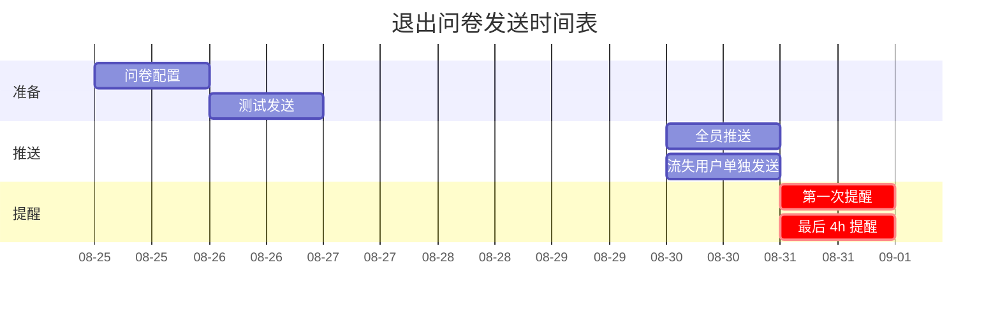
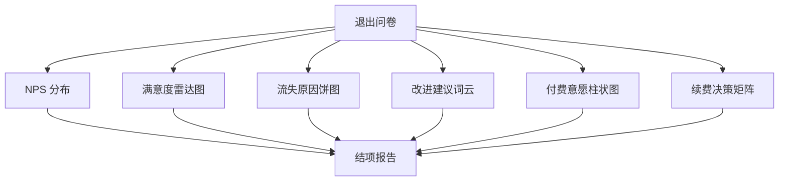

# 退出问卷（10 题 + 评分）

> **作者**：陈远枢（运营总监）
> **日期**：2026-06-08
> **版本**：v1.0（W4 任务 6）
> **目标**：内测结束日（D56）收集所有用户反馈
> **执行时间**：2026-08-30 ~ 2026-08-31
> **配合文档**：`feedback-form.md`、`beta-final-report.md`

## 1. 概述

### 1.1 退出问卷目的

| 维度 | 说明 |
|:--|:--|
| **产品改进** | 收集真实用户声音，迭代产品 |
| **流失分析** | 了解流失用户的真实原因 |
| **续费决策** | 评估付费/不付费的影响因素 |
| **公测准备** | 为公测提供数据支撑 |
| **案例素材** | 收集证言 + 改进点 |

### 1.2 问卷时长

- 完整问卷：15 分钟
- 简短问卷：5 分钟（流失用户使用）

### 1.3 激励

| 完成度 | 激励 |
|:--|:--|
| 完整 10 题 | ¥30 代金券 + 2,000 积分 |
| 简短 5 题 | ¥10 代金券 + 500 积分 |

---

## 2. 退出问卷（10 题完整版）

### Q1：整体推荐分（NPS）

**题目**：
> 你有多大可能向朋友/同事推荐 ManhuaWorks？（0-10 分）

**选项**：

| 分数 | 类型 | 占比预期 |
|:--|:--|:--|
| 0-6 | 贬损者 | ≤ 20% |
| 7-8 | 被动者 | 30% |
| 9-10 | 推荐者 | ≥ 50% |
| **NPS** | 推荐者% - 贬损者% | **≥ 40** |

**追问**（选填）：> 请用一句话说明你给这个分数的原因。

---

### Q2：最满意的功能

**题目**：
> 整个内测期间，你最满意 ManhuaWorks 的哪一点？

**选项**（多选，最多 3 项）：

| 选项 | 占比预期 |
|:--|:--|
| AI 拆分剧本 | 60% |
| 角色一致性 | 70% |
| 艺术风格丰富 | 50% |
| 生成速度 | 30% |
| 视频导出 | 40% |
| 1v1 辅导 | 80% |
| 飞书群支持 | 60% |
| 积分激励 | 40% |
| 其他 | 10% |

**追问**：> 能否详细描述一下让你满意的具体场景？

---

### Q3：最不满意的环节

**题目**：
> 整个内测期间，你最不喜欢 ManhuaWorks 的哪一点？

**选项**（多选，最多 3 项）：

| 选项 | 占比预期 |
|:--|:--|
| 生成失败率高 | 30% |
| 生成速度慢 | 40% |
| 角色一致性问题 | 35% |
| 计费不清晰 | 20% |
| 1v1 辅导不足 | 10% |
| 文档不全 | 25% |
| UI 不友好 | 15% |
| 其他 | 10% |

**追问**：> 能否详细描述让你最不满意的场景？

---

### Q4：功能完整性评分

**题目**：
> 请对 ManhuaWorks 的功能完整性进行评分（1-5 分）

**评分标准**：

| 分数 | 标准 |
|:--|:--|
| 5 | 完全满足需求，无需改进 |
| 4 | 基本满足，有小改进点 |
| 3 | 部分满足，有明显缺口 |
| 2 | 较少满足，需要大改 |
| 1 | 完全不满足 |

**预期均值**：≥ 4.0

---

### Q5：付费意愿

**题目**：
> 你愿意为 ManhuaWorks 付费吗？

**选项**：

| 选项 | 占比预期 |
|:--|:--|
| 愿意，已付费 | 16% |
| 愿意，准备付费 | 20% |
| 不确定，取决于功能 | 30% |
| 不愿意 | 34% |

**追问**（针对"愿意"的）：
> 你愿意接受的价位是？
> - ¥89/月（6 折）
> - ¥149/月（原价）
> - ¥1,490/年（年付）
> - ¥999/月（企业版）
> - 其他：____

**追问**（针对"不愿意"的）：
> 不愿意付费的主要原因是？
> - 功能不足
> - 价格太高
> - 使用频率低
> - 有免费替代
> - 其他：____

---

### Q6：使用频率与场景

**题目**：
> 你平均每周使用 ManhuaWorks 几次？

**选项**：

| 选项 | 占比预期 |
|:--|:--|
| 每天（≥ 5 次/周）| 20% |
| 经常（3-4 次/周）| 30% |
| 偶尔（1-2 次/周）| 30% |
| 很少（< 1 次/周）| 15% |
| 从未使用 | 5% |

**追问**：> 主要使用场景是？
> - 工作
> - 副业
> - 个人兴趣
> - 学习探索
> - 其他

---

### Q7：竞品对比

**题目**：
> 你之前或现在是否使用过其他 AI 漫剧/AI 视频工具？

**选项**：

| 选项 | 占比预期 |
|:--|:--|
| 未使用过 | 30% |
| Runway | 15% |
| Pika | 20% |
| Stable Video | 10% |
| 国内其他 | 25% |

**追问**：> 与同类工具相比，ManhuaWorks 的优势是？劣势是？

---

### Q8：续费决策

**题目**：
> 假设 ManhuaWorks 正式上线（¥149/月），你是否愿意续费？

**选项**：

| 选项 | 占比预期 |
|:--|:--|
| 一定续费 | 25% |
| 6 折续费 | 30% |
| 看功能更新 | 25% |
| 不续费 | 20% |

**追问**：> 影响你续费决策的 Top 3 因素是？
> 1. ____
> 2. ____
> 3. ____

---

### Q9：改进建议（开放题）

**题目**：
> 如果你可以让 ManhuaWorks 团队改进 1-3 件事，你会选择什么？

**作答方式**：3 段文本，每段 50-200 字

**示例回答**：
1. 加字幕生成功能
2. 提升生成速度
3. 优化角色一致性的稳定性

**预期回收**：≥ 3 个有效建议/人

---

### Q10：愿意推荐/参与

**题目**：
> 你是否愿意在以下方面继续支持 ManhuaWorks？（多选）

**选项**：

| 选项 | 占比预期 |
|:--|:--|
| 推荐给朋友 | 60% |
| 公开使用案例 | 30% |
| 录制证言视频 | 15% |
| 加入产品委员会 | 10% |
| 长期付费使用 | 25% |
| 不愿意继续 | 10% |

**追问**：> 感谢你的支持！我们会在公测启动时第一时间通知你。

---

## 3. 简短问卷（5 题流失用户版）

> 适用于 D7 后未活跃的用户

### Q1：NPS（0-10 分）
> 你有多大可能向朋友推荐 ManhuaWorks？（0-10 分）

### Q2：离开原因
> 你离开的主要原因是？（单选）
- 时间不足
- 功能不满足
- 价格不符
- 有更好选择
- 个人原因
- 其他

### Q3：最想吐槽
> 你最想吐槽的一个点是？

### Q4：是否会回来
> 未来如果 ManhuaWorks 改进这些问题，你还会回来吗？
- 一定会
- 可能会
- 不一定
- 不会

### Q5：联系方式
> 愿意留下你的微信吗？我们会在重大更新时通知你。
- 愿意
- 不愿意

---

## 4. 问卷发送 SOP

### 4.1 时间表



### 4.2 推送方式

| 渠道 | 对象 | 推送内容 |
|:--|:--|:--|
| **飞书群 @ 全体** | 50 启动用户 | 问卷链接 + 激励 |
| **飞书 1v1** | 活跃用户 | 详细问卷 + 1v1 感谢 |
| **微信** | 流失用户 | 简短问卷 + 关怀 |
| **邮件** | 全员 | 完整问卷 + 感谢信 |

### 4.3 推送文案

**飞书群全员推送**：

> @所有人 🎉 ManhuaWorks 50 用户内测即将结束！
>
> 8 周陪伴，感谢有你 ❤️
>
> 在结束前，想邀请你填写一份**退出问卷**（15 分钟）。
> 你的真实反馈将直接影响公测版的产品方向。
>
> 📋 [完整问卷 10 题] [链接]
> 🎁 完成奖励：¥30 代金券 + 2,000 积分
>
> 截止时间：**08-31 24:00**
> 完成后请回复"已完成"，我们会立即发放奖励。
>
> 再次感谢，期待公测再见！
>
> 陈远枢
> ManhuaWorks 运营总监

**流失用户 1v1 私信**：

> 你好 [姓名]，我是陈远枢。
>
> 内测即将结束，无论你是否深度参与，都非常感谢你的支持 ❤️
>
> 方便的话，填写一份**简短问卷**（5 分钟）？
> 你的离开原因对我们非常重要。
>
> 📋 [简短问卷 5 题] [链接]
> 🎁 完成奖励：¥10 代金券 + 500 积分
>
> 未来如果 ManhuaWorks 改进这些问题，希望你还会回来。
>
> 祝好！

---

## 5. 数据回收与脱敏

### 5.1 飞书多维表格

| 字段 | 类型 | 必填 |
|:--|:--|:--|
| 用户 ID | 文本 | ✅ |
| 提交时间 | 日期时间 | ✅ |
| 问卷版本 | 单选（完整/简短）| ✅ |
| Q1 NPS | 数字 | ✅ |
| Q2 最满意 | 多选 + 文本 | ✅ |
| Q3 最不满意 | 多选 + 文本 | ✅ |
| Q4 功能完整性 | 1-5 分 | ✅ |
| Q5 付费意愿 | 单选 | ✅ |
| Q5 价位 | 单选（条件）| ❌ |
| Q5 不愿原因 | 单选（条件）| ❌ |
| Q6 使用频率 | 单选 | ✅ |
| Q6 场景 | 单选 | ❌ |
| Q7 竞品 | 多选 + 文本 | ✅ |
| Q8 续费 | 单选 | ✅ |
| Q8 因素 | 3 段文本 | ❌ |
| Q9 改进建议 | 3 段文本 | ✅ |
| Q10 推荐参与 | 多选 | ✅ |

### 5.2 数据脱敏

| 字段 | 脱敏方式 | 示例 |
|:--|:--|:--|
| 用户名 | "用户 A/B/C" | 张三 → 用户 A |
| 手机号 | 中间 4 位 **** | 138****1234 |
| 微信 | 替换为脱敏 ID | wx_*** |
| 邮箱 | 前缀替换 | zhang***@***.com |

### 5.3 数据存储

- 飞书多维表格（运营查阅）
- ClickHouse（数据分析）
- 保留 2 年后归档

---

## 6. 数据分析维度

### 6.1 必看指标

| 指标 | 目标 | 告警 |
|:--|:--|:--|
| 问卷回收率 | ≥ 80%（40/50）| < 60%（30/50）|
| NPS 末值 | ≥ 40 | < 30 |
| 功能完整性均分 | ≥ 4.0 | < 3.5 |
| 付费意愿 | ≥ 60% | < 50% |
| 续费意愿 | ≥ 50% | < 40% |

### 6.2 分析输出

**自动生成报告**：
- 用户分层分析（高/中/低 NPS）
- Top 10 改进建议
- Top 10 最满意功能
- Top 10 流失原因
- 5 个真实案例
- 续费预测模型
- 公测产品建议清单

### 6.3 数据可视化



---

## 7. 案例挖掘

### 7.1 案例挖掘 SOP

```
退出问卷回收
    ↓
筛选"愿意公开案例"（Q10 = 是）
    ↓
1v1 邀请深度访谈（30 分钟）
    ↓
签订案例授权书
    ↓
撰写案例（脱敏 + 故事化）
    ↓
发布到落地页 + 小红书
```

### 7.2 案例模板

| 字段 | 内容 |
|:--|:--|
| 用户画像 | 行业、规模、痛点 |
| 解决方案 | 如何使用 ManhuaWorks |
| 量化结果 | 节省时间 / 提升效率 / 增加收入 |
| 用户证言 | 30 秒视频 + 文字 |
| 联系方式 | 脱敏后展示 |

### 7.3 案例目标

| 指标 | 目标 |
|:--|:--|
| 公开案例数 | ≥ 5 个 |
| 真实证言视频 | ≥ 5 段 |
| 案例文章 | ≥ 3 篇 |

---

## 8. 跟进与感谢

### 8.1 问卷完成后

| 动作 | 时点 | 内容 |
|:--|:--|:--|
| 1v1 感谢 | 24h 内 | 飞书 + 微信双发 |
| 激励发放 | 48h 内 | 积分 + 代金券 |
| 邀请加入校友群 | 48h 内 | 长期社群 |
| 寄送感谢礼 | 1 周内 | 周边 + 感谢信 |

### 8.2 感谢信模板

> 亲爱的 [姓名]：
>
> 感谢你完成 ManhuaWorks 50 用户内测退出问卷！
>
> 你的真实反馈将被产品团队认真分析，影响公测版的产品方向。
>
> 8 周的陪伴，我们一起见证了从 0 到 30+ 部作品的诞生。
> 你不仅是用户，更是我们最宝贵的"产品共创伙伴"。
>
> **【专属福利】**
> - 🎁 2,000 积分 + ¥30 代金券（已发放）
> - 🎁 终身 6 折续费权益
> - 🎁 校友群永久席位
> - 🎁 公测版优先体验权
>
> 未来 ManhuaWorks 正式上线时，希望你还会回来。
>
> 祝创作顺利，期待再见！
>
> 陈远枢
> ManhuaWorks 运营总监
> 2026-08-31

### 8.3 感谢礼清单

| 物品 | 价值 | 数量 |
|:--|:--|:--|
| 感谢信（手写）| ¥0 | 50 封 |
| ManhuaWorks 联名 T 恤 | ¥80 | 50 件 |
| 漫剧周边（贴纸 + 帆布袋）| ¥50 | 50 套 |
| **总价值** | **¥130/人** | **¥6,500** |

---

## 9. 配合文档

| 文档 | 用途 |
|:--|:--|
| `feedback-form.md` | 23 题模板 |
| `beta-final-report.md` | 结项报告 |
| `beta-retention-dashboard.md` | 看板 |
| `beta-success-metrics.md` | KPI |
| `testimonial-template.md` | 证言模板 |

---

## 10. 变更记录

| 版本 | 日期 | 作者 | 变更 |
|:--|:--|:--|:----|
| v0.1 | 2026-06-08 | 陈远枢 | 初稿（W4 任务 6）|
