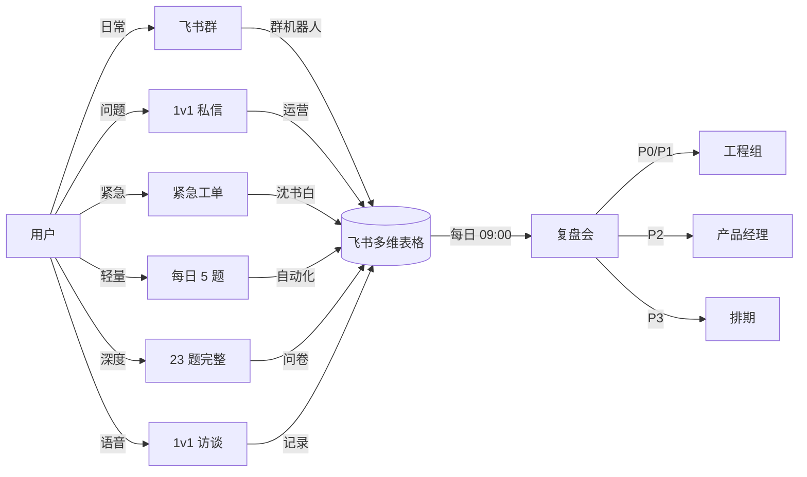

# 每日反馈收集 SOP

> **作者**：陈远枢（运营总监）
> **日期**：2026-06-08
> **版本**：v1.0（W4 任务 6）
> **目标**：8 周内收集 ≥ 100 条有效反馈，评分 ≥ 3 分
> **执行周期**：2026-07-04 ~ 2026-08-31
> **配合文档**：`feedback-form.md`（23 题模板）、`beta-issue-triage.md`（问题分级）

## 1. 反馈收集目标

| 维度 | 目标 | 验收标准 |
|:--|:--|:--|
| 总反馈数 | ≥ 100 条 | 8 周累计 |
| 23 题完整问卷 | ≥ 30 份 | 高质量 |
| 5 题轻量反馈 | ≥ 100 条 | 每日推送 |
| 1v1 深度访谈 | ≥ 20 场 | 30 分钟/场 |
| NPS 推荐分 | ≥ 40 | 末周问卷 |
| 紧急 Bug 反馈 | < 30 分钟响应 | 实时 |

---

## 2. 三大反馈渠道

### 2.1 渠道总览



### 2.2 渠道对比

| 渠道 | 形式 | 时长 | 频次 | 适用场景 | 激励 |
|:--|:--|:--|:--|:--|:--|
| **飞书群** | 群内消息 | 即时 | 实时 | 日常问题、经验分享 | 100 积分/条 |
| **1v1 私信** | 飞书 + 微信 | 5 分钟 | 按需 | 个性化问题、Bug 报告 | 200 积分/条 |
| **紧急工单** | 飞书 @ 沈书白 | 即时 | 紧急 | P0 阻塞问题 | 500 积分/条 |
| **每日 5 题** | 群机器人推送 | 2 分钟 | 每日 | 轻量反馈 | 50 积分/日 |
| **23 题完整** | 飞书表单 | 15 分钟 | 每周 1 次 | 深度反馈 | ¥10 代金券 |
| **1v1 访谈** | 飞书视频 | 30 分钟 | 每周 2 场 | 深度挖掘 | 1,000 积分 + 周边 |

### 2.3 渠道 1：飞书群（日常）

**群规则**：
- ✅ 鼓励：提问、分享、互帮互助
- ❌ 禁止：广告、灌水、政治敏感

**机器人自动收集**：
```
# 触发关键词
- "Bug" / "bug" / "BUG" → 自动 @沈书白
- "建议" / "想要" → 自动记录到建议表
- "卡了" / "失败" → 自动 @工程组
- 包含"@陈远枢" → 1v1 私信
```

**运营每日 09:00 整理**：
1. 提取昨日群内消息
2. 分类：Bug / 建议 / 体验 / 闲聊
3. 录入飞书多维表格
4. 09:30 周报推送

### 2.4 渠道 2：1v1 私信（个性化）

**触发场景**：
- 用户主动私信
- 1v1 辅导时收集
- 群内发现用户情绪低落

**私信模板**：
> 你好 [姓名]，我是 [运营昵称]。
> 想了解一下你今天使用 ManhuaWorks 的体验怎么样？
>
> 1. 哪个功能让你最满意？[开放]
> 2. 哪个环节让你最想吐槽？[开放]
> 3. 有没有遇到 Bug？[开放]
> 4. 你最希望增加的 1 个功能？[开放]
>
> 任何反馈对我们都超级重要，感谢！🙏

**响应时间**：
- 工作时间（09:00-21:00）：< 30 分钟
- 非工作时间：< 2 小时
- P0 紧急：< 15 分钟（电话）

### 2.5 渠道 3：每日 5 题（轻量）

**推送时间**：每日 21:00（群机器人）

**5 题内容**：

| # | 题目 | 类型 |
|:--|:--|:--|
| 1 | 今日整体满意度 | 1-5 分 |
| 2 | 今日生成几集 | 0 / 1 / 2 / 3+ |
| 3 | 今日遇到的最大问题 | 多选 + 文本 |
| 4 | 今日最满意的功能 | 单选 |
| 5 | 明日你最想做什么 | 单选 |

**完成激励**：
- 完成 5 题：50 积分
- 连续 7 天：额外 200 积分

**飞书表单配置**：

| 字段 | 类型 | 必填 |
|:--|:--|:--|
| 用户 ID | 自动 | ✅ |
| 提交时间 | 自动 | ✅ |
| Q1 整体满意度 | 1-5 分 | ✅ |
| Q2 今日生成集数 | 单选 | ✅ |
| Q3 最大问题 | 多选 + 文本 | ✅ |
| Q4 最满意功能 | 单选 | ✅ |
| Q5 明日想做什么 | 单选 | ✅ |

### 2.6 渠道 4：23 题完整问卷（深度）

**推送时间**：每周日 20:00

**23 题结构**（基于 `feedback-form.md`）：

| 维度 | 题数 | 题型 |
|:--|:--|:--|
| 1. 生成质量 | 5 题 | 评分 + 文本 |
| 2. 工作台体验 | 5 题 | 评分 + 文本 |
| 3. 计费透明度 | 3 题 | 评分 + 文本 |
| 4. 客服响应 | 3 题 | 评分 + 文本 |
| 5. Bug 报告 | 4 题 | 评分 + 多选 |
| 6. NPS | 1 题 | 0-10 分 |
| 7. 改进建议 | 2 题 | 开放文本 |
| **合计** | **23 题** | - |

**完成激励**：
- 完成 23 题：¥10 代金券
- 评分 ≥ 4 分：额外 500 积分

### 2.7 渠道 5：1v1 深度访谈

**频次**：每周 2 场（周二 14:00 + 周四 20:00）

**访谈对象筛选**：
- 高 NPS 用户（≥ 9 分）
- 高活跃用户（周活 ≥ 5 天）
- 高反馈用户（已提交 ≥ 5 条）
- 关键意见消费者（KOC）
- 流失风险用户（D7 未回来）

**访谈提纲**（30 分钟）：

| 时间 | 内容 |
|:--|:--|
| 0-5 分钟 | 自我介绍 + 暖场 |
| 5-15 分钟 | 深度使用旅程（"你最近在做什么漫剧？遇到什么挑战？"）|
| 15-25 分钟 | 功能优先级排序（"如果只能加 1 个功能，你加什么？"）|
| 25-30 分钟 | 收尾 + 激励发放 |

**访谈记录表**：

| 字段 | 内容 |
|:--|:--|
| 用户姓名 + ID | - |
| 访谈时间 | - |
| 用户类型 | - |
| 当前使用阶段 | - |
| Top 3 痛点 | - |
| Top 3 建议 | - |
| 推荐意愿（NPS）| - |
| 跟进事项 | - |

---

## 3. 四类核心问题

### 3.1 问题分类矩阵

| 类型 | 定义 | 占比 | 响应 | 解决 | 负责 |
|:--|:--|:--|:--|:--|:--|
| **Bug 类** | 功能异常、崩溃、错误 | 40% | < 30 分钟 | < 24 小时 | 工程组 |
| **体验类** | 不流畅、不直观、卡顿 | 30% | < 4 小时 | < 1 周 | 产品+研发 |
| **建议类** | 新功能、改进点 | 20% | < 24 小时 | 排期 | 产品经理 |
| **咨询类** | 怎么用、计费规则 | 10% | < 2 小时 | 即时 | 运营 |

### 3.2 类型 1：Bug 类

**子分类**：

| 子类 | 占比 | 示例 | 优先级 |
|:--|:--|:--|:--|
| P0 阻塞 | 5% | 无法登录、无法生成、支付失败 | P0 |
| P1 严重 | 15% | 生成失败但可重试、文件丢失 | P1 |
| P2 一般 | 50% | 偶发卡顿、提示文案错误 | P2 |
| P3 体验 | 30% | 颜色不协调、动画卡顿 | P3 |

**收集流程**：
```
用户报告 Bug
    ↓
群机器人/1v1 私信
    ↓
运营录入飞书多维表格
    ↓
打标签：P0/P1/P2/P3
    ↓
P0/P1：@沈书白（立即）
P2/P3：加入排期（每日复盘）
    ↓
24h 内反馈用户处理进度
```

**飞书多维表格字段**：

| 字段 | 类型 | 必填 |
|:--|:--|:--|
| Bug ID | 自动生成 | ✅ |
| 用户 ID | 文本 | ✅ |
| 报告时间 | 日期 | ✅ |
| Bug 描述 | 文本 | ✅ |
| 复现步骤 | 文本 | ✅ |
| 截图 | 附件 | ❌ |
| 优先级 | 单选 P0/P1/P2/P3 | ✅ |
| 处理状态 | 单选 待处理/处理中/已修复/已关闭 | ✅ |
| 处理人 | 人员 | ✅ |
| 解决时间 | 日期 | ❌ |

### 3.3 类型 2：体验类

**子分类**：

| 子类 | 占比 | 示例 |
|:--|:--|:--|
| 流程复杂 | 30% | "上传小说步骤太多" |
| 提示不清 | 25% | "错误提示看不懂" |
| 加载慢 | 20% | "生成等了 10 分钟" |
| 视觉问题 | 15% | "按钮颜色看不清" |
| 交互卡顿 | 10% | "切换镜头时卡住" |

**处理流程**：
```
用户提出体验问题
    ↓
运营记录（飞书多维表格）
    ↓
打标签：流程/提示/性能/视觉/交互
    ↓
每周复盘会汇总（周五 16:00）
    ↓
产品经理决定：立即改 / 排期 / 不采纳
    ↓
用户回访（72h 内）
```

### 3.4 类型 3：建议类

**子分类**：

| 子类 | 占比 | 示例 |
|:--|:--|:--|
| 新功能 | 60% | "希望加字幕生成" |
| 现有功能增强 | 25% | "希望分镜能拖拽排序" |
| 内容相关 | 10% | "希望加 4K 输出" |
| 集成相关 | 5% | "希望对接剪映" |

**处理流程**：
```
用户提建议
    ↓
运营记录（建议表）
    ↓
每周三产品评审会排序
    ↓
按"用户数 × 频次 × 实现成本"打分
    ↓
高优先级 → 排期
低优先级 → 文档化（"已记录，暂不实现"）
    ↓
用户回访："已收到，XX 排期"
```

**建议评分模型**：

| 维度 | 权重 | 评分（0-5）|
|:--|:--|:--|
| 用户数（提到该建议的人数）| 40% | 0=0 人，5=≥ 20 人 |
| 频次（同一人提到的次数）| 20% | 0=1 次，5=≥ 5 次 |
| 实现成本 | 20% | 0=3 月+，5=< 1 周 |
| 战略契合 | 20% | 0=无关，5=核心 |
| **综合分** | **100%** | **≥ 4.0 立即排期** |

### 3.5 类型 4：咨询类

**子分类**：

| 子类 | 占比 | 示例 |
|:--|:--|:--|
| 计费 | 30% | "专业版多少钱？" |
| 怎么用 | 50% | "怎么生成第 2 集？" |
| 积分 | 15% | "积分怎么充值？" |
| 其他 | 5% | - |

**处理方式**：
- 计费类：发链接 `pricing/pricing-model.md`
- 怎么用：发教程视频 + 1v1 辅导
- 积分类：发链接 `operations/积分规则.md`
- 复杂问题：1v1 私信

**目标**：90% 咨询类问题在群内由其他用户或 FAQ 自动回答

---

## 4. 反馈数据看板

### 4.1 每日看板（09:00 更新）

| 指标 | 昨日 | 本周累计 | 目标 | 状态 |
|:--|:--|:--|:--|:--|
| 反馈总数 | 50 条 | 280 条 | 100/周 | 🟢 |
| 5 题轻量 | 35 条 | 200 条 | 50/天 | 🟢 |
| 23 题完整 | 3 份 | 18 份 | 5/周 | 🟡 |
| Bug 数 | 8 个 | 45 个 | - | - |
| P0/P1 | 1 个 | 5 个 | < 3/周 | 🟡 |
| 建议数 | 5 条 | 30 条 | - | - |
| NPS | - | 42 | ≥ 40 | 🟢 |

### 4.2 反馈漏斗

```
50 活跃用户
    ↓
每日 5 题（目标 80% 提交）= 40 条/日
    ↓
23 题完整（目标 10% 提交）= 4 份/日
    ↓
1v1 访谈（目标 2 场/周）= 0.3 场/日
    ↓
高价值反馈（评分 ≥ 4）= 60% × 100 条 = 60 条/8 周
    ↓
可商用证言（脱敏后）= 5+ 条
```

---

## 5. 反馈响应 SOP

### 5.1 响应时效承诺

| 类型 | 首次响应 | 解决时间 |
|:--|:--|:--|
| P0 Bug | < 15 分钟 | < 4 小时 |
| P1 Bug | < 30 分钟 | < 24 小时 |
| P2 Bug | < 2 小时 | < 1 周 |
| 体验问题 | < 4 小时 | < 1 周 |
| 建议 | < 24 小时 | 排期决定 |
| 咨询 | < 2 小时 | 即时 |

### 5.2 标准响应话术

**P0 Bug**：
> 收到！紧急问题我们立即处理。沈书白已经介入，预计 [X] 小时内修复。期间你可以 [临时方案]。感谢反馈 🙏

**P1 Bug**：
> 收到！我们已记录，[X] 小时内修复。修复后会第一时间在群里通知你。临时可以 [临时方案]。

**体验问题**：
> 收到反馈！我们会评估是否在近期迭代中改进。[如果是]→ 已加入产品 backlog，预计 [X] 周内优化。[如果否]→ 感谢建议，我们会在文档中记录，作为未来参考。

**建议**：
> 收到建议！「[建议内容]」我们已记录到产品需求池，每周评审会讨论。后续排期会第一时间同步给你。

**咨询**：
> 你好！「[问题]」的答案是 [答案]。详细可以看 [链接]。如有其他问题随时戳我～

### 5.3 升级机制

| 场景 | 升级路径 |
|:--|:--|
| 用户对 P0 处理不满 | 陈远枢 1v1 介入 |
| 同一 Bug 反复出现 | 沈书白 1v1 复盘 |
| 用户情绪激动 | 陈远枢 1v1 心理疏导 |
| 群内负面舆情扩散 | 私下沟通 + 群规提醒 |
| 紧急 P0 修复失败 | 启动"全工程组 24h 待命" |

---

## 6. 反馈激励体系

### 6.1 积分激励

| 反馈类型 | 积分 | 上限 |
|:--|:--|:--|
| 群内反馈 | 100 | 5 条/日 |
| 1v1 私信 | 200 | 5 条/日 |
| Bug 报告 | 300-500 | 10 条/周 |
| 每日 5 题 | 50 | 1 份/日 |
| 23 题完整 | 500 + ¥10 | 1 份/周 |
| 1v1 访谈 | 1,000 | 1 场/周 |
| 公开案例 | 2,000 | 不限 |

**总积分池**：50 人 × 平均 5,000 积分 = **250,000 积分** ≈ 价值 **¥25,000**

### 6.2 现金激励

| 反馈类型 | 现金 | 触发 |
|:--|:--|:--|
| 23 题完整 | ¥10 代金券 | 提交即得 |
| 公开案例 | ¥100 红包 | 同意商用 |
| 推荐新用户 | ¥30/位 | 新用户入组 |
| 最佳反馈周冠军 | ¥200 | 每周 1 名 |
| 最佳反馈月冠军 | ¥1,000 | 每月 1 名 |

### 6.3 荣誉激励

| 称号 | 条件 | 权益 |
|:--|:--|:--|
| 推广大使 | 推荐 ≥ 3 人 | 永久 5 折 + 联名周边 |
| 反馈之星 | 周反馈 ≥ 10 条 | 群内公示 + 1,000 积分 |
| 案例之王 | 公开案例 ≥ 3 个 | 终身 6 折 + 邀请发布会 |
| 产品共创 | 加入产品委员会 | 投票权 + 联名署名 |

---

## 7. 数据脱敏与隐私

### 7.1 脱敏规则

| 字段 | 脱敏方式 | 示例 |
|:--|:--|:--|
| 用户名 | 替换为"用户 A/B/C" | 张三 → 用户 A |
| 手机号 | 中间 4 位 **** | 138****1234 |
| 邮箱 | 前缀保留 @ 后替换 | zhang***@***.com |
| 公司名 | 替换为"某出版社" | 人民邮电 → 某出版社 |
| 作品名 | 保留（用户授权）| 《斗破苍穹》|

### 7.2 隐私承诺

- 内部数据加密存储（飞书多维表格权限分级）
- 外部宣传需用户书面授权
- 用户随时要求删除数据（GDPR/个保法）
- 不向第三方共享用户数据
- 数据保留 2 年后自动归档

---

## 8. 反馈复盘机制

### 8.1 每日复盘（09:00，15 分钟）

**议程**：
1. 昨日反馈数 + 类型分布（5 分钟）
2. P0/P1 Bug 进度（5 分钟）
3. 当日重点跟进（5 分钟）

### 8.2 每周复盘（周五 16:00，1 小时）

**议程**：
1. 上周反馈汇总（15 分钟）
2. Top 10 Bug 修复进度（10 分钟）
3. Top 10 建议评审（15 分钟）
4. NPS 趋势（5 分钟）
5. 下周改进（15 分钟）

### 8.3 每月复盘（月末，2 小时）

**议程**：
1. 全月反馈分析（30 分钟）
2. 用户分层（高/中/低 NPS）（20 分钟）
3. 产品改进清单（30 分钟）
4. 下月运营计划（20 分钟）
5. 团队表彰（20 分钟）

---

## 9. 飞书多维表格结构

### 9.1 反馈表（每日提交）

| 字段 | 类型 | 必填 |
|:--|:--|:--|
| 反馈 ID | 自动 | ✅ |
| 用户 ID | 文本 | ✅ |
| 提交时间 | 日期时间 | ✅ |
| 反馈类型 | 单选（Bug/体验/建议/咨询）| ✅ |
| 标题 | 文本 | ✅ |
| 描述 | 文本 | ✅ |
| 截图/录屏 | 附件 | ❌ |
| 紧急度 | 单选（P0/P1/P2/P3）| ✅ |
| 处理状态 | 单选 | ✅ |
| 处理人 | 人员 | ✅ |
| 解决时间 | 日期 | ❌ |
| 用户评分 | 1-5 分 | ❌ |

### 9.2 建议表

| 字段 | 类型 | 必填 |
|:--|:--|:--|
| 建议 ID | 自动 | ✅ |
| 用户 ID | 文本 | ✅ |
| 提交时间 | 日期 | ✅ |
| 建议内容 | 文本 | ✅ |
| 类别 | 单选（新功能/增强/集成/其他）| ✅ |
| 评分 | 计算（用户数×频次×成本×战略）| - |
| 排期 | 单选 | ✅ |
| 跟进人 | 人员 | ✅ |

### 9.3 Bug 表

| 字段 | 类型 | 必填 |
|:--|:--|:--|
| Bug ID | 自动 | ✅ |
| 用户 ID | 文本 | ✅ |
| 报告时间 | 日期 | ✅ |
| Bug 描述 | 文本 | ✅ |
| 复现步骤 | 文本 | ✅ |
| 截图 | 附件 | ❌ |
| 设备 | 文本 | ✅ |
| 浏览器 | 文本 | ✅ |
| 优先级 | 单选 | ✅ |
| 状态 | 单选 | ✅ |
| 处理人 | 人员 | ✅ |
| 解决时间 | 日期 | ❌ |
| 修复版本 | 文本 | ❌ |

---

## 10. 配合文档

| 文档 | 用途 |
|:--|:--|
| `feedback-form.md` | 23 题模板 |
| `beta-issue-triage.md` | Bug 分级 |
| `beta-retention-dashboard.md` | 留存看板 |
| `beta-success-metrics.md` | KPI 体系 |
| `beta-exit-survey.md` | 退出问卷 |

---

## 11. 变更记录

| 版本 | 日期 | 作者 | 变更 |
|:--|:--|:--|:--|
| v0.1 | 2026-06-08 | 陈远枢 | 初稿（W4 任务 6）|
