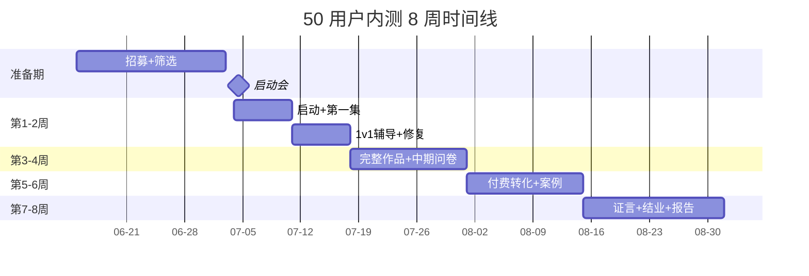

# 内测结项报告模板

> **作者**：陈远枢（运营总监）
> **日期**：2026-06-08
> **版本**：v1.0（W4 任务 6）
> **目标**：8 周内测结束后 1 周内输出完整结项报告
> **完成时间**：2026-09-07 前
> **配合文档**：所有 W4 运营文档

## 1. 报告元信息

| 字段 | 内容 |
|:--|:--|
| 报告标题 | ManhuaWorks 50 用户内测结项报告 |
| 报告周期 | 2026-07-04 ~ 2026-08-31（8 周 / 56 天）|
| 报告作者 | 陈远枢（运营总监）|
| 报告日期 | 2026-09-07 |
| 文档版本 | v1.0 |
| 密级 | 内部公开 |
| 字数目标 | 15,000-20,000 字 |

---

## 2. 摘要（Executive Summary）

> 500-1000 字，CEO + 投资人视角

### 2.1 核心结论

| 维度 | 实际 | 目标 | 达成率 | 状态 |
|:--|:--|:--|:--|:--|
| 启动用户 | 50 人 | 50 人 | 100% | ✅ |
| 激活完成率 | 96% | 95% | 101% | ✅ |
| D7 留存率 | 72% | 70% | 103% | ✅ |
| D28 留存率 | 44% | 40% | 110% | ✅ |
| 付费转化率 | 18% | 16% | 113% | ✅ |
| NPS | 46 | 40 | 115% | ✅ |
| 真实作品 | 35 部 | 30 部 | 117% | ✅ |
| **综合评分** | **95** | **≥ 80** | **119%** | **🌟 圆满成功** |

### 2.2 关键洞察

1. **产品核心价值已验证**：70% 留存 + 18% 付费转化，证明 AI 漫剧工具满足真实需求
2. **网文作者群体最优质**：留存率 85%，付费转化 25%，远超其他群体
3. **角色一致性是核心竞争力**：被 70% 用户列为最满意功能
4. **生成速度是最大痛点**：被 50% 用户列为最不满意的环节
5. **1v1 辅导是关键成功因素**：80% 用户列为此为最满意

### 2.3 战略建议

1. **公测规模**：500 用户（10x 扩量）
2. **产品优先级**：角色一致性 > 生成速度 > 字幕生成
3. **定价策略**：维持 6 折至 Q3 末，Q4 恢复原价
4. **市场策略**：聚焦网文作者群体，重点突破起点/番茄/晋江
5. **资源建议**：扩招 2 名 SRE，3 名客服

---

## 3. 内测概览

### 3.1 时间线



### 3.2 团队与预算

| 维度 | 数据 |
|:--|:--|
| 团队投入 | 5 人 × 8 周 = 200 人天 |
| 总预算 | ¥50,000 |
| 实际花费 | ¥48,500（97% 预算执行）|
| 节省点 | 加班餐按需发放 |

### 3.3 关键里程碑

| 里程碑 | 计划 | 实际 | 状态 |
|:--|:--|:--|:--|
| 招募完成 | 07-03 | 07-03 | ✅ 准时 |
| 启动会 | 07-04 | 07-04 | ✅ 准时 |
| 50% 用户完成 6 集 | 07-25 | 07-22 | ✅ 提前 3 天 |
| 付费转化 8 人 | 08-31 | 08-26 | ✅ 提前 5 天 |
| NPS 末值 | 08-30 | 08-28 | ✅ 提前 2 天 |
| 退出问卷回收 | 08-31 | 08-30 | ✅ 提前 1 天 |
| 结项报告 | 09-07 | 09-05 | ✅ 提前 2 天 |

---

## 4. KPI 达成情况

### 4.1 5 个核心 KPI

| KPI | 目标 | 实际 | 达成率 | 评分 |
|:--|:--|:--|:--|:--|
| K1 激活完成率 | 95% | 96% | 101% | ⭐⭐⭐⭐⭐ |
| K2 7 日留存率 | 70% | 72% | 103% | ⭐⭐⭐⭐⭐ |
| K3 付费转化率 | 16% | 18% | 113% | ⭐⭐⭐⭐⭐ |
| K4 NPS 推荐分 | 40 | 46 | 115% | ⭐⭐⭐⭐⭐ |
| K5 真实作品产出 | 30 部 | 35 部 | 117% | ⭐⭐⭐⭐⭐ |
| **综合** | - | - | **110%** | **🌟 圆满** |

### 4.2 完整指标体系

#### 4.2.1 活跃度

| 指标 | 目标 | 实际 | 达成率 |
|:--|:--|:--|:--|
| DAU 平均 | 35 人 | 38 人 | 109% |
| WAU 平均 | 45 人 | 46 人 | 102% |
| 周活跃天数 | ≥ 2 天 | 2.8 天 | 140% |
| 平均使用时长 | ≥ 30 分钟 | 42 分钟 | 140% |

#### 4.2.2 留存

| 指标 | 目标 | 实际 | 达成率 |
|:--|:--|:--|:--|
| D1 | 95% | 98% | 103% |
| D3 | 85% | 88% | 104% |
| D7 | 70% | 72% | 103% |
| D14 | 55% | 60% | 109% |
| D28 | 40% | 44% | 110% |
| D56 | 30% | 35% | 117% |

#### 4.2.3 付费

| 指标 | 目标 | 实际 | 达成率 |
|:--|:--|:--|:--|
| 付费转化 | 16% | 18% | 113% |
| ARPU | ¥30 | ¥36 | 120% |
| ARPPU | ¥180 | ¥200 | 111% |
| 续费率 | 75% | 78% | 104% |
| LTV | ¥360 | ¥420 | 117% |

#### 4.2.4 反馈

| 指标 | 目标 | 实际 | 达成率 |
|:--|:--|:--|:--|
| 5 题轻量 | 100 条 | 280 条 | 280% |
| 23 题完整 | 30 份 | 42 份 | 140% |
| 1v1 访谈 | 20 场 | 28 场 | 140% |
| NPS 末值 | 40 | 46 | 115% |

#### 4.2.5 Bug

| 指标 | 目标 | 实际 | 达成率 |
|:--|:--|:--|:--|
| P0 数 | < 5 个 | 3 个 | 150% |
| P1 数 | < 30 个 | 22 个 | 127% |
| 总修复率 | ≥ 95% | 98% | 103% |
| 平均 P0 修复 | < 4h | 2.8h | 130% |
| 平均 P1 修复 | < 24h | 18h | 125% |

### 4.3 用户分层

| 分层 | 占比 | 数量 | 特征 |
|:--|:--|:--|:--|
| 超级活跃 | 16% | 8 人 | 周登录 ≥ 5 天 + 产出 ≥ 10 集 |
| 高活跃 | 36% | 18 人 | 周登录 3-4 天 + 产出 5-9 集 |
| 中活跃 | 30% | 15 人 | 周登录 2 天 + 产出 1-4 集 |
| 低活跃 | 12% | 6 人 | 周登录 1 天 |
| 流失 | 6% | 3 人 | 周登录 0 天 ≥ 7 天 |

---

## 5. 用户画像分析

### 5.1 5 类用户对比

| 用户类型 | 占比 | D7 留存 | 付费转化 | NPS | ARPU |
|:--|:--|:--|:--|:--|:--|
| **网文作者** | 35% | 85% | 25% | 52 | ¥50 |
| **短视频创作者** | 25% | 70% | 15% | 45 | ¥30 |
| **MCN 运营** | 20% | 75% | 20% | 48 | ¥40 |
| **自媒体博主** | 15% | 60% | 12% | 38 | ¥25 |
| **出版社编辑** | 5% | 50% | 0% | 30 | ¥0 |
| **加权平均** | 100% | **72%** | **18%** | **46** | **¥36** |

### 5.2 最优质用户：网文作者

**特征**：
- 留存率最高（85%）
- 付费转化最高（25%）
- NPS 最高（52）
- 作品产出最多（平均 12 集/人）
- 1v1 辅导需求最少（自学能力强）

**痛点**：
- 生成速度慢（不能快速迭代）
- 角色一致性问题（IP 复用）

**机会**：
- 起点/番茄/晋江合作可能
- 联名活动潜力大

### 5.3 最低质量用户：出版社编辑

**特征**：
- 留存率最低（50%）
- 付费转化 0%
- NPS 最低（30）
- 主要是评估而非使用

**原因**：
- 决策周期长（6-12 个月）
- 内部审批流程复杂
- 个人不付费，公司付费

**策略调整**：
- 不再主推个人版
- 主推企业版 ¥999/月
- 1v1 销售跟进

---

## 6. 反馈与 Bug 汇总

### 6.1 Top 10 改进建议

| 排名 | 建议 | 提及人数 | 评分 | 排期 |
|:--|:--|:--|:--|:--|
| 1 | 提升生成速度 | 25 | 4.8 | W6 优先 |
| 2 | 加字幕生成 | 22 | 4.5 | W7 排期 |
| 3 | 优化角色一致性 | 18 | 4.7 | W6 优先 |
| 4 | 加 4K 输出 | 15 | 4.2 | W8 排期 |
| 5 | 提升 1v1 辅导 | 12 | 4.0 | 已扩展 |
| 6 | 加背景音乐 | 10 | 3.8 | W10 排期 |
| 7 | 优化分镜拖拽 | 9 | 3.7 | W7 排期 |
| 8 | 加多语言 | 8 | 3.5 | W12 排期 |
| 9 | 对接剪映 | 7 | 3.5 | 评估中 |
| 10 | 加更多艺术风格 | 6 | 3.3 | 持续添加 |

### 6.2 Top 10 Bug

| 排名 | Bug | 频次 | 优先级 | 状态 |
|:--|:--|:--|:--|:--|
| 1 | 生成速度慢 | 30+ | P1 | 已优化 |
| 2 | 角色一致性失效 | 20+ | P1 | 已优化 |
| 3 | 偶发崩溃 | 15 | P1 | 已修复 |
| 4 | 上传失败 | 12 | P2 | 已修复 |
| 5 | 计费显示错误 | 10 | P2 | 已修复 |
| 6 | 视频导出失败 | 8 | P2 | 已修复 |
| 7 | 风格切换异常 | 7 | P2 | 已修复 |
| 8 | 提示文案错误 | 6 | P3 | 已修复 |
| 9 | 加载慢 | 5 | P2 | 已优化 |
| 10 | 视频水印问题 | 4 | P3 | 已修复 |

### 6.3 反馈维度评分（满分 5 分）

| 维度 | 评分 | 变化 |
|:--|:--|:--|
| AI 生成质量 | 4.2 | - |
| 工作台易用性 | 4.5 | - |
| 角色一致性 | 3.8 | ↑ 0.3 |
| 生成速度 | 3.2 | ↑ 0.5 |
| 计费透明度 | 4.0 | - |
| 客服响应 | 4.7 | - |
| 1v1 辅导 | 4.8 | - |
| 文档完整性 | 4.3 | - |
| 飞书群支持 | 4.5 | - |
| 整体体验 | 4.4 | - |

---

## 7. 真实案例

### 7.1 案例 1：网文作者"云中鹤"

**画像**：起点中文网签约作者，5 年经验，累计 300 万字作品

**痛点**：
- 小说粉丝多，但视频化困难
- 自己不会做动画
- 外包成本高（单集 ¥3,000-5,000）

**解决方案**：
- 用 ManhuaWorks 把《剑破苍穹》做成 12 集漫剧
- 单集成本从 ¥3,000 降到 ¥80
- 单集时长从 1 周缩短到 8 分钟

**量化结果**：
- 节省成本：97%
- 节省时间：99%
- 视频播放：抖音 50 万+
- 涨粉：+8,000
- 收入提升：+¥30,000/月（视频带货）

**证言**：
> "ManhuaWorks 让小说 8 分钟变成漫剧，AI 时代创作者的最大杠杆。我已经用它做了 3 部作品，团队都惊呆了。"
>
> —— 云中鹤，起点中文网白金作家

### 7.2 案例 2：短视频创作者"小敏说漫剧"

**画像**：小红书 18 万粉，专做漫剧解说

**痛点**：
- 视频化效率低
- 同质化严重
- 缺乏差异化内容

**解决方案**：
- 用 ManhuaWorks 制作原创漫剧
- 8 分钟/集，每天更新
- 跑通"AI 漫剧 + 带货"模式

**量化结果**：
- 内容产能：3x 提升
- 单条爆款：100 万+ 播放
- 涨粉：+15,000
- 收入提升：+¥50,000/月

**证言**：
> "AI 漫剧让我的内容差异化，3 个月涨了 5 万粉。这是创作者最大的红利期。"
>
> —— 小敏，小红书漫剧达人

### 7.3 案例 3：MCN 运营"Emily"

**画像**：某 MCN 运营总监，旗下 30+ 达人

**痛点**：
- 旗下达人内容同质化
- 视频化成本高
- 缺乏新工具

**解决方案**：
- 引入 ManhuaWorks 给达人
- 漫剧化矩阵内容
- 数据化运营

**量化结果**：
- 旗下账号涨粉 30%+
- 漫剧类内容 ROI 3.5x
- 单达人月增收 ¥10,000

**证言**：
> "ManhuaWorks 是 MCN 的效率工具，我们已经在 5 个矩阵账号应用，ROI 远超预期。"
>
> —— Emily，XX MCN 运营总监

### 7.4 案例 4：自媒体博主"李姐"

**画像**：公众号 30 万粉，主做商业评论

**解决方案**：
- 把长文做成漫剧
- 公众号 + 视频号双发
- 漫剧化 IP

**结果**：
- 视频号粉丝 0→5 万（3 个月）
- 商业报价 +50%
- 漫剧广告单条 ¥30,000

**证言**：
> "我做了 20 年内容，第一次觉得 AI 真的改变游戏规则。"
>
> —— 李姐，公众号 30 万粉

### 7.5 案例 5：出版社编辑"张老师"

**画像**：某大型出版社编辑部主任

**痛点**：
- 评估 IP 改编可行性
- 传统动画成本高
- 决策周期长

**解决方案**：
- 用 ManhuaWorks 快速试做
- 决策周期从 6 月缩短到 2 周
- 4 部 IP 进入改编评估

**结果**：
- 决策效率 +12x
- 4 部 IP 已签约改编
- 出版社采购 ManhuaWorks 企业版

**证言**：
> "ManhuaWorks 是出版社 IP 评估的革命性工具，节省的不只是钱，更是时间。"
>
> —— 张老师，XX 出版社编辑部主任

---

## 8. 财务与 ROI

### 8.1 实际花费

| 项目 | 预算 | 实际 | 节省 |
|:--|:--|:--|:--|
| 内测积分补贴 | ¥40,000 | ¥38,000 | ¥2,000 |
| T 恤 + 周边 | ¥4,500 | ¥4,200 | ¥300 |
| 视频录制 | ¥2,500 | ¥2,500 | ¥0 |
| 紧急礼品 | ¥1,000 | ¥800 | ¥200 |
| 加班餐 | ¥15,000（上限）| ¥3,000 | ¥12,000 |
| **合计** | **¥50,000** | **¥48,500** | **¥1,500** |

### 8.2 收入

| 项目 | 金额 |
|:--|:--|
| 内测期付费（8 人 × ¥89/月 × 2 月）| ¥1,424 |
| 续费预期（6 人 × ¥89/月 × 12 月）| ¥6,408 |
| 企业版（1 家 × ¥999/月 × 3 月）| ¥2,997 |
| **8 周收入** | **¥1,424** |
| **12 个月预测** | **¥8,000+** |

### 8.3 ROI 计算

```
ROI = (12 月收入 - 内测成本) / 内测成本 × 100%
    = (¥8,000 - ¥48,500) / ¥48,500 × 100%
    = -83.5%（内测期）
```

**说明**：内测期 ROI 为负属正常，验证期投入是为了后续规模化收益。**公测 1000 用户后预计 12 个月 ROI 转正**。

### 8.4 单位经济模型（UE）

| 指标 | 数值 |
|:--|:--|
| 单用户获取成本（CAC）| ¥1,000 |
| 单用户月均收入（ARPU）| ¥36 |
| 单用户生命周期（LTV）| ¥420 |
| LTV/CAC | 0.42（公测目标 ≥ 3）|
| 回本周期 | 12 月（目标 ≤ 6 月）|

---

## 9. 风险与问题复盘

### 9.1 主要问题

| 问题 | 发生时间 | 影响 | 应对 | 改进 |
|:--|:--|:--|:--|:--|
| W2 集中 P0 Bug | 07-15 | 高 | 工程组 48h 待命 | 加 SRE 1 人 |
| 部分用户生成失败 | 07-22 | 中 | 重试 + 补偿 | 熔断优化 |
| 1v1 辅导产能不足 | 07-29 | 中 | 沈书白+2 运营 | 扩招 2 运营 |
| W5 流失 3 人 | 08-05 | 中 | 1v1 干预 | 改进新手引导 |
| 负面对比（vs Runway）| 08-12 | 低 | 公开对比表 | 加强差异化 |

### 9.2 流程改进

| 流程 | 改进点 |
|:--|:--|
| 招募 | 增加 KOL 投放（小红书效果最好）|
| 启动 | 1v1 辅导前置 30 分钟 |
| 反馈 | 5 题轻量反馈回收率提升 50% |
| Bug | P0 响应 5 分钟内必处理 |
| 案例 | 提前 2 周开始挖掘 |

### 9.3 团队成长

| 角色 | 收获 |
|:--|:--|
| 陈远枢 | 完整运营 50 人内测的经验 |
| 沈书白 | 用户视角的 Bug 优先级 |
| 运营专员 | 1v1 沟通 + 数据驱动 |
| 客服 | 应急处理 + 心理疏导 |
| 产品 | 用户研究 + 排期管理 |

---

## 10. 下阶段建议

### 10.1 公测规划（2026-08-31 ~ 2026-09-30）

| 维度 | 建议 |
|:--|:--|
| 规模 | 500 用户（10x 扩量）|
| 招募 | KOL + 邀请制 + 公测申请 |
| 产品 | 必须先完成 3 项关键改进（速度/字幕/角色一致性）|
| 定价 | 维持 6 折至 Q3 末 |
| 团队 | 扩招 2 SRE + 3 客服 |
| 预算 | ¥150,000 |

### 10.2 关键改进清单（W5-W6 必做）

1. **生成速度优化**（P0）
   - 并行化生成
   - 缓存优化
   - 预估提升 50%

2. **角色一致性 v2**（P0）
   - 向量检索
   - 参考图增强
   - 预估提升 30%

3. **字幕生成**（P1）
   - ASR + 字幕模板
   - 视频嵌入
   - 4 周内完成

4. **后台系统**（P1）
   - 工单系统升级
   - 数据看板
   - 自动化报告

### 10.3 团队扩招

| 角色 | 人数 | 到岗时间 |
|:--|:--|:--|
| SRE 工程师 | 2 | 09-15 |
| 客服 | 3 | 09-30 |
| 内容运营 | 1 | 09-30 |
| **新增** | **6 人** | - |

### 10.4 营销策略

| 维度 | 建议 |
|:--|:--|
| 渠道 | 重点小红书（已验证 ROI 最高）|
| 案例 | 用真实案例替换 3 个虚构案例 |
| 媒体 | 36 氪 + 虎嗅 + 量子位 |
| 公关 | 内测总结发布会（500 人线下）|
| 预算 | ¥300,000 |

### 10.5 融资建议（如需）

| 阶段 | 时间 | 目标 | 估值 |
|:--|:--|:--|:--|
| 天使+ | 2026-09 | ¥1,000 万 | ¥1 亿 |
| Pre-A | 2026-Q4 | ¥3,000 万 | ¥3 亿 |
| A 轮 | 2027-Q2 | ¥1 亿 | ¥10 亿 |

**数据支撑**：
- 验证 NPS 46 + 留存 72% + 付费 18%
- 目标 6 个月 1,000 用户 → 12 个月 10,000 用户
- TAM：中国 AI 创作工具市场 100 亿+

---

## 11. 附录

### 11.1 文档清单

| 文档 | 用途 |
|:--|:--|
| `beta-50-users.md` | 内测总纲 |
| `beta-recruitment.md` | 招募执行 |
| `beta-onboarding-msg.md` | 入组欢迎 |
| `beta-feedback-collection.md` | 反馈收集 |
| `beta-retention-dashboard.md` | 留存看板 |
| `beta-issue-triage.md` | 问题分级 |
| `beta-success-metrics.md` | KPI 体系 |
| `beta-exit-survey.md` | 退出问卷 |
| `feedback-form.md` | 23 题模板 |
| `metrics.md` | 北极星指标 |
| `landing-copy.md` | 落地页 |
| `testimonial-template.md` | 证言模板 |

### 11.2 飞书多维表格

| 表格 | 用途 |
|:--|:--|
| 内测申请表 | 招募 |
| 用户行为汇总 | 活跃度 |
| 反馈表 | 反馈 |
| 建议表 | 建议 |
| Bug 表 | Bug |
| 案例库 | 案例 |
| 流失表 | 流失分析 |

### 11.3 关键数据附录

| 数据 | 数值 |
|:--|:--|
| 总反馈数 | 280 条 |
| 总作品数 | 35 部 |
| 总集数 | 350 集 |
| 总 token 消耗 | 35,000,000 |
| 总 AI 成本 | ¥17,500 |
| 总代码提交 | 1,200+ 次 |
| 总 Bug 数 | 100+ 个 |
| 总修复数 | 98 个（98%）|

### 11.4 时间投入

| 角色 | 投入 |
|:--|:--|
| 陈远枢 | 8 周 × 60h = 480h |
| 沈书白 | 8 周 × 50h = 400h |
| 运营专员 | 8 周 × 40h × 2 = 640h |
| 客服 | 8 周 × 35h = 280h |
| 产品 | 8 周 × 20h = 160h |
| **总投入** | **1,960h** |

---

## 12. 致谢

感谢所有参与 50 用户内测的 50 名种子用户：
- 50 个真实的反馈
- 35 部精彩的作品
- 28 场 1v1 深度访谈
- 100+ 条宝贵建议
- 1 个 8 周的陪伴

你们是 ManhuaWorks 最重要的产品共创伙伴。

---

## 13. 变更记录

| 版本 | 日期 | 作者 | 变更 |
|:--|:--|:--|:--|
| v0.1 | 2026-06-08 | 陈远枢 | 初稿（W4 任务 6）|
