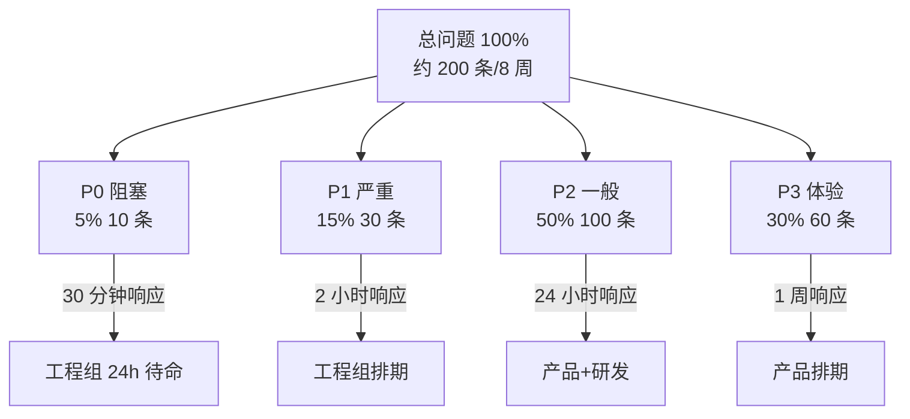
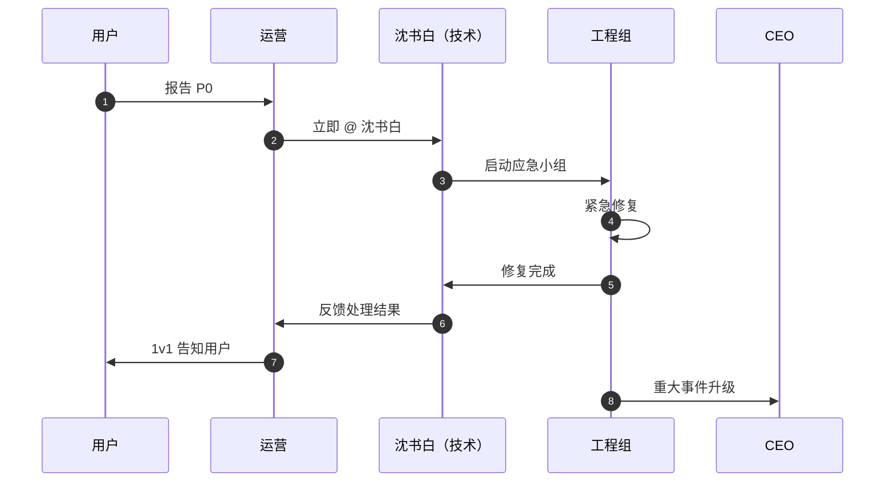
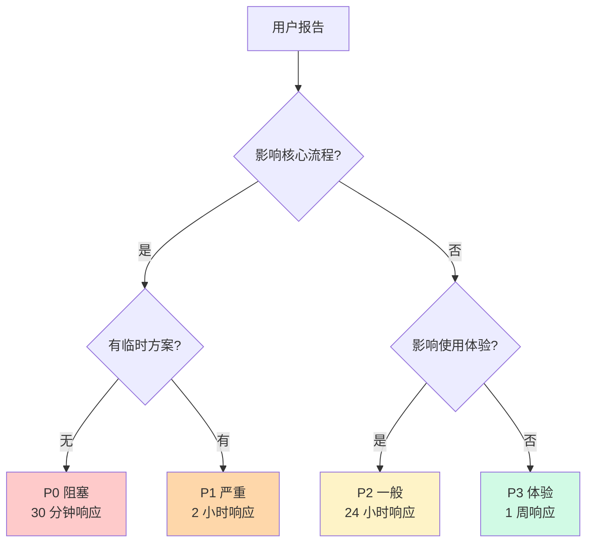

# 问题分级与处理流程

> **作者**：陈远枢（运营总监）
> **日期**：2026-06-08
> **版本**：v1.0（W4 任务 6）
> **目标**：建立 P0/P1/P2/P3 四级问题处理体系
> **执行周期**：2026-07-04 ~ 2026-08-31（8 周）
> **配合文档**：`beta-feedback-collection.md`（反馈收集）、`beta-retention-dashboard.md`（看板）

## 1. 概述

### 1.1 问题分级目的

| 维度 | 说明 |
|:--|:--|
| **快速响应** | P0 问题 30 分钟内必须有人响应 |
| **资源合理分配** | 工程组精力集中解决 P0/P1 |
| **用户预期管理** | 不同等级问题给用户明确时间承诺 |
| **数据驱动** | 积累问题数据，反哺产品迭代 |

### 1.2 4 级问题分布



---

## 2. P0 问题：阻塞级

### 2.1 定义

**P0 问题**：用户**完全无法使用**核心功能，或**大规模崩溃**

**典型场景**：
- ❌ 用户无法登录/注册
- ❌ 用户无法生成任何漫剧
- ❌ 支付/订阅系统完全瘫痪
- ❌ 数据丢失（用户作品消失）
- ❌ 服务宕机（> 30 分钟）
- ❌ 安全漏洞（数据泄露）

### 2.2 响应流程



### 2.3 响应时效

| 时点 | 要求 | 责任人 |
|:--|:--|:--|
| 0 分钟 | 用户报告 | 用户 |
| 5 分钟 | 运营响应，确认 P0 等级 | 运营 |
| 10 分钟 | @沈书白，启动应急 | 运营 + 沈书白 |
| 15 分钟 | 应急小组就位（≥ 2 人）| 沈书白 |
| 30 分钟 | 用户收到"处理中"反馈 | 运营 |
| 4 小时 | 修复完成（或临时方案）| 工程组 |
| 24 小时 | 根因分析 + 复盘 | 沈书白 + 团队 |

### 2.4 应急小组

**成员**：
- 组长：沈书白（研发对接）
- 成员：后端 2 人 + 前端 1 人 + SRE 1 人
- 升级：陈远枢（运营）+ 1 名高管

**待命制度**：
- 工作时间（09:00-21:00）：30 分钟内必响应
- 非工作时间（21:00-09:00）：2 小时内必响应
- 周末/节假日：2 小时内必响应

**激励**：
- P0 应急：每人 ¥500 红包
- 月度无 P0：团队 ¥2,000 团建费

### 2.5 P0 处理清单

- [ ] 5 分钟内：确认 P0 等级（陈远枢 + 沈书白）
- [ ] 10 分钟内：启动应急小组
- [ ] 15 分钟内：通知相关方（CEO、客服）
- [ ] 30 分钟内：联系报告用户
- [ ] 4 小时内：修复或临时方案
- [ ] 24 小时内：根因分析 + 复盘会议
- [ ] 48 小时内：用户回访 + 补偿

---

## 3. P1 问题：严重级

### 3.1 定义

**P1 问题**：**重要功能异常**，影响核心流程，但有临时方案

**典型场景**：
- ⚠️ 生成失败但可重试（成功率 < 80%）
- ⚠️ 某些风格无法使用
- ⚠️ 角色一致性失效
- ⚠️ 关键页面报错
- ⚠️ 视频导出失败
- ⚠️ 支付偶发失败（< 5% 失败率）

### 3.2 响应流程

```
用户报告 P1
    ↓
15 分钟内：运营响应 + 录入工单
    ↓
30 分钟内：@沈书白分派
    ↓
2 小时内：用户收到"处理中"反馈
    ↓
24 小时内：修复完成
    ↓
48 小时内：用户回访 + 测试验证
```

### 3.3 响应时效

| 时点 | 要求 | 责任人 |
|:--|:--|:--|
| 0 分钟 | 用户报告 | 用户 |
| 15 分钟 | 运营响应 | 运营 |
| 30 分钟 | 沈书白分派 | 沈书白 |
| 2 小时 | 用户收到"处理中" | 运营 |
| 24 小时 | 修复完成 | 工程组 |
| 48 小时 | 用户回访 | 运营 |

### 3.4 P1 处理清单

- [ ] 15 分钟内：运营响应
- [ ] 30 分钟内：沈书白分派
- [ ] 2 小时内：用户告知进度
- [ ] 24 小时内：修复完成
- [ ] 48 小时内：用户回访验证
- [ ] 1 周内：复盘同类问题

---

## 4. P2 问题：一般级

### 4.1 定义

**P2 问题**：**非核心功能异常**，不影响主流程

**典型场景**：
- 🟡 偶发卡顿（< 5% 概率）
- 🟡 提示文案错误
- 🟡 UI 显示问题
- 🟡 次要功能不工作
- 🟡 加载慢（< 10s）
- 🟡 部分用户特殊设备问题

### 4.2 响应流程

```
用户报告 P2
    ↓
2 小时内：运营响应 + 录入工单
    ↓
4 小时内：分派处理人
    ↓
24 小时内：用户收到"已记录"反馈
    ↓
1 周内：修复（排期）
    ↓
2 周内：用户回访
```

### 4.3 响应时效

| 时点 | 要求 | 责任人 |
|:--|:--|:--|
| 0 分钟 | 用户报告 | 用户 |
| 2 小时 | 运营响应 | 运营 |
| 4 小时 | 分派处理人 | 沈书白 |
| 24 小时 | 用户收到反馈 | 运营 |
| 1 周 | 修复 | 工程组 |
| 2 周 | 用户回访 | 运营 |

### 4.4 P2 处理清单

- [ ] 2 小时内：运营响应
- [ ] 4 小时内：分派处理人
- [ ] 24 小时内：用户告知已记录
- [ ] 1 周内：修复（排期）
- [ ] 2 周内：用户回访
- [ ] 1 月内：复盘同类问题

---

## 5. P3 问题：体验级

### 5.1 定义

**P3 问题**：**体验优化**，不影响功能

**典型场景**：
- 🟢 颜色不协调
- 🟢 动画卡顿
- 🟢 文案不友好
- 🟢 缺少快捷键
- 🟢 操作步骤繁琐
- 🟢 缺少教程

### 5.2 响应流程

```
用户报告 P3
    ↓
24 小时内：运营记录
    ↓
周末复盘：批量分类
    ↓
产品评审：决定排期
    ↓
下个迭代：实现
```

### 5.3 响应时效

| 时点 | 要求 | 责任人 |
|:--|:--|:--|
| 0 分钟 | 用户报告 | 用户 |
| 24 小时 | 运营记录 | 运营 |
| 周末 | 复盘分类 | 沈书白 |
| 下周 | 产品评审 | 产品经理 |
| 4 周内 | 排期实现 | 工程组 |
| 6 周内 | 用户回访 | 运营 |

### 5.4 P3 处理清单

- [ ] 24 小时内：运营记录
- [ ] 周末：批量分类
- [ ] 下周：产品评审
- [ ] 4 周内：排期实现
- [ ] 6 周内：用户回访
- [ ] 1 季度：评估效果

---

## 6. 问题分级的判断标准

### 6.1 决策树



### 6.2 评分量表

| 评分维度 | P0 | P1 | P2 | P3 |
|:--|:--|:--|:--|:--|
| **影响用户数** | ≥ 50% | 20-50% | 5-20% | < 5% |
| **核心流程** | 完全中断 | 严重受损 | 部分受损 | 无影响 |
| **可绕过性** | 不可绕过 | 难绕过 | 可绕过 | 不影响 |
| **业务影响** | 收入损失 | 用户流失 | 体验下降 | 满意度下降 |
| **数据安全** | 有风险 | 无风险 | 无风险 | 无风险 |
| **响应时间** | < 30 分钟 | < 2 小时 | < 24 小时 | < 1 周 |

**判断规则**：
- 满足任一 P0 条件 → P0
- 不满足 P0 但满足任一 P1 条件 → P1
- 不满足 P0/P1 但满足任一 P2 条件 → P2
- 都不满足 → P3

### 6.3 升级机制

**升级条件**：
- P0 修复超时（> 4 小时）→ 升级到 CEO
- P1 修复超时（> 24 小时）→ 升级到陈远枢
- 同一问题 3 天内重复 3 次 → 升级到 P0
- 用户强烈不满 → 升级 1 级

**降级条件**：
- 临时方案足够 → 降级 1 级
- 影响用户数 < 1% → 降级 1 级
- 用户接受延迟 → 降级 1 级

---

## 7. 处理流程矩阵

### 7.1 全流程对比

| 维度 | P0 | P1 | P2 | P3 |
|:--|:--|:--|:--|:--|
| **首次响应** | < 5 分钟 | < 15 分钟 | < 2 小时 | < 24 小时 |
| **处理确认** | < 15 分钟 | < 30 分钟 | < 4 小时 | 周末复盘 |
| **用户告知** | < 30 分钟 | < 2 小时 | < 24 小时 | 排期后告知 |
| **修复时间** | < 4 小时 | < 24 小时 | < 1 周 | < 4 周 |
| **用户回访** | < 24 小时 | < 48 小时 | < 2 周 | < 6 周 |
| **根因分析** | < 24 小时 | < 1 周 | 1 月内 | - |
| **复盘会议** | < 48 小时 | < 1 周 | 月度 | 季度 |
| **补偿激励** | ¥100 + 周边 | ¥50 代金券 | 1,000 积分 | 500 积分 |

### 7.2 处理人矩阵

| 角色 | P0 | P1 | P2 | P3 |
|:--|:--|:--|:--|:--|
| **运营** | 5 分钟响应 + 全程协调 | 15 分钟响应 | 2 小时响应 | 24 小时记录 |
| **沈书白** | 应急组长 | 1 小时内分派 | 4 小时内分派 | 周末评审 |
| **工程组** | 30 分钟内修复 | 24 小时内修复 | 1 周内修复 | 4 周内修复 |
| **产品经理** | 同步信息 | 同步信息 | 排期决定 | 评审优先级 |
| **陈远枢** | 5 分钟升级 | 24 小时升级 | 月度复盘 | 季度复盘 |
| **CEO** | 30 分钟升级 | - | - | - |

### 7.3 时效监控

| 指标 | 目标 | 告警 |
|:--|:--|:--|
| P0 首次响应 < 5 分钟 | 100% | < 90% |
| P0 4 小时修复率 | ≥ 90% | < 80% |
| P1 首次响应 < 15 分钟 | ≥ 95% | < 85% |
| P1 24 小时修复率 | ≥ 85% | < 70% |
| P2 1 周修复率 | ≥ 80% | < 60% |
| P3 4 周排期率 | ≥ 70% | < 50% |

---

## 8. 应急场景预案

### 8.1 场景 1：服务宕机

**触发**：API Gateway / 数据库 / Redis 不可用

**应急 SOP**：
```
监控系统告警
    ↓
0-5 分钟：SRE 确认 + 启动应急
    ↓
5-15 分钟：沈书白组织应急
    ↓
15-30 分钟：用户告知（"我们正在紧急修复"）
    ↓
30 分钟-2 小时：恢复服务
    ↓
2-4 小时：数据回补（如有）
    ↓
4-24 小时：根因分析 + 复盘
```

**用户告知模板**：
> ⚠️ 紧急通知：ManhuaWorks 服务正在紧急维护中，预计 [X] 小时内恢复。期间无法访问，对您造成的不便深表歉意。维护完成后我们会第一时间通知您，并赠送 ¥50 代金券作为补偿。感谢您的理解！

### 8.2 场景 2：AI 供应商故障

**触发**：火山/阿里/腾讯/智谱 任一不可用

**应急 SOP**：
```
ai-router 熔断器触发
    ↓
自动切换到备用供应商
    ↓
1 小时内：沈书白确认 + 公告用户
    ↓
4 小时内：联系供应商
    ↓
24 小时内：根因 + 改进熔断策略
```

**降级方案**：
- 火山宕机 → 切阿里云
- 阿里宕机 → 切腾讯
- 腾讯宕机 → 切智谱
- 全部宕机 → 排队等待 + 积分补偿

### 8.3 场景 3：数据泄露

**触发**：用户数据/支付数据/密钥泄露

**应急 SOP**：
```
0-15 分钟：沈书白 + 安全组介入
    ↓
15-60 分钟：陈远枢 + CEO 升级
    ↓
1-4 小时：隔离 + 阻断
    ↓
4-24 小时：法务 + 监管报告
    ↓
24-72 小时：用户告知 + 补偿
```

**法定时限**：
- 《网络安全法》：1 小时内向网信部门报告
- 《个人信息保护法》：立即告知用户
- 《数据安全法》：评估等级

### 8.4 场景 4：负面舆情

**触发**：小红书/微博/知乎出现负面评价（≥ 100 曝光）

**应急 SOP**：
```
运营监控发现
    ↓
1 小时内：内部评估（陈远枢 + 沈书白）
    ↓
4 小时内：私下联系发布者
    ↓
24 小时内：公开回应（如需）
    ↓
1 周内：根因改进
```

**处理原则**：
- 不删除、不狡辩、不推卸
- 私下真诚沟通
- 公开透明回应
- 用行动证明

---

## 9. 复盘机制

### 9.1 P0 必复盘

**SOP**：
- 24 小时内：根因分析（沈书白主导）
- 48 小时内：复盘会议（陈远枢 + 工程组 + 产品）
- 72 小时内：改进措施上线
- 1 周内：用户回访

**复盘文档结构**（参考 "5 Whys"）：

| 段落 | 内容 |
|:--|:--|
| 事件描述 | 时间、影响范围、损失评估 |
| 时间线 | 从发现到恢复的完整时点 |
| 根因 | 5 Whys 追问 |
| 短期措施 | 立即行动 |
| 长期措施 | 系统性改进 |
| 责任划分 | 个人 + 流程 |
| 经验教训 | 团队学习 |

### 9.2 P1 复盘

- 1 周内：工程组内部复盘
- 2 周内：改进措施上线
- 1 月内：复盘同类问题

### 9.3 P2/P3 月度复盘

- 每月最后一周：批量复盘
- 分类：高频、低频、相似、孤立
- 输出：下月产品迭代清单

---

## 10. 飞书多维表格字段

### 10.1 Bug 工单表

| 字段 | 类型 | 必填 |
|:--|:--|:--|
| Bug ID | 自动生成 | ✅ |
| 用户 ID | 文本 | ✅ |
| 报告时间 | 日期时间 | ✅ |
| Bug 标题 | 文本 | ✅ |
| 详细描述 | 文本 | ✅ |
| 复现步骤 | 文本 | ✅ |
| 期望结果 | 文本 | ✅ |
| 实际结果 | 文本 | ✅ |
| 截图/录屏 | 附件 | ❌ |
| 设备 | 文本 | ✅ |
| 浏览器 | 文本 | ✅ |
| 网络环境 | 单选 | ❌ |
| **优先级** | 单选（P0/P1/P2/P3）| ✅ |
| **影响用户数** | 数字 | ✅ |
| **处理状态** | 单选 | ✅ |
| **处理人** | 人员 | ✅ |
| 解决时间 | 日期 | ❌ |
| 修复版本 | 文本 | ❌ |
| 根因分析 | 文本 | ❌ |
| 改进措施 | 文本 | ❌ |
| 用户满意度 | 1-5 分 | ❌ |

### 10.2 视图

| 视图名 | 过滤 | 排序 |
|:--|:--|:--|
| P0 待处理 | 优先级=P0, 状态≠已关闭 | 报告时间 |
| P1 待处理 | 优先级=P1, 状态≠已关闭 | 报告时间 |
| 我的工单 | 处理人=当前用户 | 优先级 |
| 已解决未复盘 | 状态=已解决, 根因=空 | 解决时间 |
| 高频 Bug | 同标题 ≥ 3 次 | 出现次数 |

---

## 11. 团队与工具

### 11.1 团队角色

| 角色 | 人数 | 职责 |
|:--|:--|:--|
| **应急组长（沈书白）** | 1 | P0 应急指挥 |
| **应急工程师** | 4 | 后端 2 + 前端 1 + SRE 1 |
| **运营协调（陈远枢）** | 1 | 用户告知 + 升级 |
| **产品经理** | 1 | P2/P3 排期 |
| **客服专员** | 2 | 工单录入 + 1v1 跟进 |

### 11.2 工具

| 工具 | 用途 |
|:--|:--|
| **飞书多维表格** | Bug 工单管理 |
| **飞书群机器人** | 告警通知 |
| **Sentry** | 前端异常监控 |
| **Prometheus** | 服务监控 |
| **Grafana** | 可视化 |
| **PagerDuty** | P0 告警 |
| **Jira** | 长期排期 |

---

## 12. 配合文档

| 文档 | 用途 |
|:--|:--|
| `beta-50-users.md` | 总纲 |
| `beta-feedback-collection.md` | 反馈收集 |
| `beta-retention-dashboard.md` | 看板 |
| `beta-success-metrics.md` | KPI |
| `feedback-form.md` | 反馈模板 |

---

## 13. 变更记录

| 版本 | 日期 | 作者 | 变更 |
|:--|:--|:--|:--|
| v0.1 | 2026-06-08 | 陈远枢 | 初稿（W4 任务 6）|
