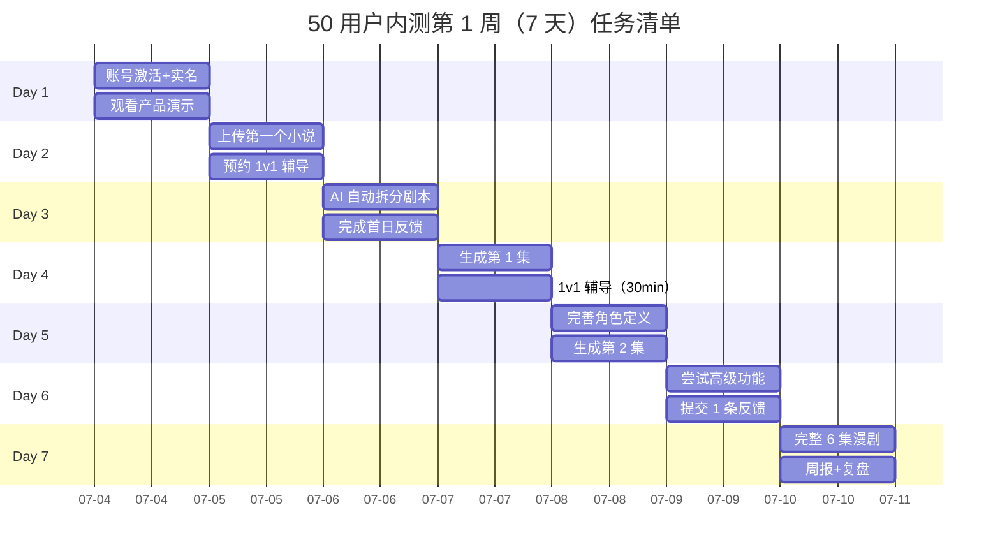

# 入组欢迎消息 + 7 天任务清单

> **作者**：陈远枢（运营总监）
> **日期**：2026-06-08
> **版本**：v1.0（W4 任务 6）
> **触发时间**：2026-07-04 16:00（启动会结束后 2h）
> **发送对象**：50 名入选用户
> **配合文档**：`onboarding-v2.md`（5 步引导）、`beta-50-users.md`（总纲）

## 1. 欢迎消息

### 1.1 飞书群欢迎（群公告 + 群机器人）

```
━━━━━━━━━━━━━━━━━━━━━━━━━━
🎉 欢迎加入 ManhuaWorks 50 用户内测！
━━━━━━━━━━━━━━━━━━━━━━━━━━

@所有人 你好，我是陈远枢（ManhuaWorks 运营总监）。

从今天（07-04）开始，接下来的 8 周（07-04 ~ 08-31），
你将作为我们的"种子用户"，深度体验 AI 漫剧工具。

━━━━━━━━━━━━━━━━━━━━━━━━━━
【你的内测账号已开通】
━━━━━━━━━━━━━━━━━━━━━━━━━━
✅ 专业版永久免费（原价 ¥149/月）
✅ 5,000 启动积分（够做 8 集漫剧）
✅ 1 对 1 接入辅导（30 分钟，本周内约）
✅ 优先 Bug 修复权
✅ 飞书群直连产品经理 + 研发负责人（沈书白）
✅ 上线后 6 折续费优惠

账号：你的注册邮箱
登录：[studio.manhuaworks.com](https://studio.manhuaworks.com)
（如未收到激活邮件，请回复本群）

━━━━━━━━━━━━━━━━━━━━━━━━━━
【本周必做 3 件事】
━━━━━━━━━━━━━━━━━━━━━━━━━━
1️⃣ 完成账号激活 + 实名认证（5 分钟）
2️⃣ 观看 5 分钟产品演示视频 [链接]
3️⃣ 提交你的第一个漫剧（哪怕只有 1 集）

📅 7 天任务清单 → 见群公告第二条
📅 1v1 辅导预约 → 见群公告第三条

━━━━━━━━━━━━━━━━━━━━━━━━━━
【反馈激励】
━━━━━━━━━━━━━━━━━━━━━━━━━━
每提交 1 条有效反馈（评分 ≥ 3 分）→ 200 积分
完整 23 题问卷 → ¥10 代金券（专业版可用）
提供脱敏案例 → 额外 2,000 积分

━━━━━━━━━━━━━━━━━━━━━━━━━━
【紧急联系】
━━━━━━━━━━━━━━━━━━━━━━━━━━
- 群内 @陈远枢（运营）
- 群内 @沈书白（技术，紧急 P0）
- 邮件：support@mhwork.cn

我们 8 周后见真章！
加油 💪

陈远枢
ManhuaWorks 运营总监
2026-07-04
```

### 1.2 1v1 私信（飞书 + 微信双发）

> 你好 [姓名]，恭喜你正式加入 ManhuaWorks 50 用户内测！
>
> 我是陈远枢，接下来 8 周由我主要负责你的体验跟踪。
>
> **【本周必读】**
> 1. 5 分钟产品演示：[视频链接]
> 2. 5 步新手指引：`docs/operations/onboarding-v2.md`
> 3. 7 天任务清单：见下条消息
>
> **【本周可约】**
> 1v1 接入辅导（30 分钟，飞书视频），本周可约时间：
> - 07-05（周一）14:00 / 16:00 / 20:00
> - 07-06（周二）10:00 / 14:00 / 20:00
> - 07-07（周三）10:00 / 14:00 / 16:00
> - 07-08（周四）14:00 / 20:00
>
> 戳我回复你方便的时段，我马上锁定。
>
> **【紧急情况】**
> 群里 @我，或直接拨 188-xxxx-xxxx（微信同号）。
>
> 期待与你一起打造最好的 AI 漫剧工具！
>
> 陈远枢
> 188-xxxx-xxxx

---

## 2. 7 天任务清单

### 2.1 任务总览



### 2.2 Day-by-Day 详细任务

#### **Day 1（07-04 周六）— 启动日**

| 任务 | 预计时间 | 完成标准 | 激励 |
|:--|:--|:--|:--|
| 账号激活 | 3 分钟 | 收到激活邮件 + 设置密码 | - |
| 实名认证 | 2 分钟 | 提交身份证 + 人脸识别 | - |
| 观看 5 分钟产品演示 | 5 分钟 | 看完视频 | - |
| 飞书群自我介绍 | 5 分钟 | 群内发"姓名+类型+目标" | - |
| **Day 1 完成度** | **15 分钟** | **4/4 任务** | **首作礼预备** |

**群内自我介绍模板**：
> 我是 [姓名]，[创作者类型]，[平台账号]。
> 我想做：[期望产出，例"把《xxx》做成 12 集漫剧"]。
> 我每周可投入：[X] 小时。
> 期待：[3 个你最想要的 1-2 个功能]。

**运营跟进**：
- 19:00 推送"今日 Top 3 优秀自我介绍"
- 22:00 推送"明早任务提醒"
- 启动会结束 24h 内必须 100% 完成激活

---

#### **Day 2（07-05 周日）— 上传小说**

| 任务 | 预计时间 | 完成标准 | 激励 |
|:--|:--|:--|:--|
| 上传第一个小说 | 10 分钟 | 至少 5,000 字（TXT） | - |
| 选择艺术风格 | 3 分钟 | 11 选 1（推荐日系/韩系）| - |
| 预约 1v1 辅导 | 2 分钟 | 提交预约表单 | - |
| **Day 2 完成度** | **15 分钟** | **3/3 任务** | - |

**预约表单字段**：

| 字段 | 类型 | 必填 |
|:--|:--|:--|
| 姓名 | 文本 | ✅ |
| 创作者类型 | 单选 | ✅ |
| 希望讨论主题 | 多选 | ✅ |
| 期望时长 | 单选 | ✅（默认 30 分钟）|
| 备选时段 | 多选 | ✅（3 个备选）|

**常见问题 FAQ**：
- Q：小说必须有完整结构吗？A：不用，5,000 字以上即可
- Q：可以用未发表的作品吗？A：可以，我们严格保密
- Q：艺术风格选错能改吗？A：可以，任意时刻切换
- Q：必须从第 1 章开始吗？A：可以选任意章节

---

#### **Day 3（07-06 周一）— 剧本拆分**

| 任务 | 预计时间 | 完成标准 | 激励 |
|:--|:--|:--|:--|
| AI 自动拆分剧本 | 5 分钟 | 看到分镜列表 | - |
| 调整 3-5 个分镜 | 15 分钟 | 修改不满意的镜头 | - |
| 提交首日反馈 | 5 分钟 | 飞书表单 5 题 | 200 积分 |
| **Day 3 完成度** | **25 分钟** | **3/3 任务** | **+200 积分** |

**首日反馈 5 题**（精简易填）：
1. 激活流程顺畅度：1-5 分
2. 5 分钟演示视频清晰度：1-5 分
3. 上传小说的易用性：1-5 分
4. AI 拆分剧本质量：1-5 分
5. 今日遇到的最大问题：开放文本

**运营动作**：
- 12:00 推送"AI 拆分剧本小技巧"
- 18:00 收集"今日 Top 3 问题"发群
- 22:00 工程组紧急修复 P0

---

#### **Day 4（07-07 周二）— 第 1 集生成**

| 任务 | 预计时间 | 完成标准 | 激励 |
|:--|:--|:--|:--|
| 生成第 1 集 | 20 分钟 | 12 个分镜全部出图 | - |
| 1v1 辅导（30 分钟）| 30 分钟 | 飞书视频会议 | - |
| 提交辅导后反馈 | 3 分钟 | 飞书表单 3 题 | 100 积分 |
| **Day 4 完成度** | **53 分钟** | **3/3 任务** | **+100 积分** |

**1v1 辅导议程**（30 分钟）：

| 时间 | 内容 | 负责人 |
|:--|:--|:--|
| 0-5 分钟 | 自我介绍 + 目标对齐 | 用户 + 沈书白 |
| 5-15 分钟 | 演示用户实际操作 | 用户操作，沈书白观察 |
| 15-25 分钟 | 优化建议 + 进阶玩法 | 沈书白 |
| 25-30 分钟 | Q&A + 下次约定 | 双方 |

**1v1 辅导记录表**：

| 字段 | 内容 |
|:--|:--|
| 用户姓名 | - |
| 辅导时间 | - |
| 用户类型 | 网文 / 短视频 / MCN / 自媒体 / 出版社 |
| 作品类型 | - |
| 遇到问题 | - |
| 优化建议 | - |
| 跟进事项 | - |
| 满意度 | 1-5 分 |

**目标**：Day 4 100% 用户完成第 1 集

---

#### **Day 5（07-08 周三）— 第 2 集 + 角色**

| 任务 | 预计时间 | 完成标准 | 激励 |
|:--|:--|:--|:--|
| 完善角色定义 | 10 分钟 | 至少 3 个角色 | - |
| 生成第 2 集 | 20 分钟 | 12 个分镜 | - |
| 尝试风格切换 | 5 分钟 | 切换到第 2 种风格 | - |
| **Day 5 完成度** | **35 分钟** | **3/3 任务** | - |

**角色定义最佳实践**（群内推送）：
1. 上传参考图 1-3 张
2. 文字描述：年龄/性别/服饰/性格
3. 至少 1 张"标志性道具"（剑/书包/眼镜）
4. 关联到 5 个以上分镜

---

#### **Day 6（07-09 周四）— 高级功能**

| 任务 | 预计时间 | 完成标准 | 激励 |
|:--|:--|:--|:--|
| 尝试"角色一致性"功能 | 10 分钟 | 同一角色 3 镜头同脸 | - |
| 尝试"分镜微调" | 10 分钟 | 修改任意镜头 | - |
| 提交 1 条完整反馈 | 15 分钟 | 23 题完整版 | ¥10 代金券 |
| **Day 6 完成度** | **35 分钟** | **3/3 任务** | **+¥10 代金券** |

**23 题完整反馈**（基于 `feedback-form.md`）：
- 5 维度评分：生成质量/工坊/计费/客服/Bug
- 7 道文字建议题
- 1 道 NPS 推荐分
- 总时长：15-20 分钟

**运营动作**：
- 14:00 推送"高级功能教程视频"
- 20:00 收集"最想要的 3 个新功能"

---

#### **Day 7（07-10 周五）— 第 1 周复盘**

| 任务 | 预计时间 | 完成标准 | 激励 |
|:--|:--|:--|:--|
| 完成 6 集漫剧 | 60 分钟 | 累计 6 集（每日 1 集）| - |
| 提交第 1 周周报 | 10 分钟 | 5 题周报 | 周活礼 500 积分 |
| 群内分享成果 | 5 分钟 | 发 1 段作品截图 | 推广大使积分 |
| **Day 7 完成度** | **75 分钟** | **3/3 任务** | **+500 积分** |

**第 1 周周报 5 题**：
1. 本周完成几集：____
2. 最满意的 1 集：____
3. 遇到的最大问题：____
4. 最想要的 1 个功能：____
5. 整体推荐分（0-10）：____

**激励小结**（完成 80%+ 任务）：

| 奖励 | 价值 |
|:--|:--|
| 首作礼（完成第 1 集）| 1,000 积分 |
| 周活礼（周内登录 ≥ 3 天）| 500 积分 |
| 反馈礼（≥ 1 条有效反馈）| 200 积分 |
| 完整反馈礼（23 题）| ¥10 代金券 |
| **第 1 周合计** | **1,700 积分 + ¥10** |

---

## 3. 任务完成度监控

### 3.1 实时看板（运营每日 09:00 / 14:00 / 20:00 检查）

| 用户 | Day 1 | Day 2 | Day 3 | Day 4 | Day 5 | Day 6 | Day 7 | 总完成度 |
|:--|:--|:--|:--|:--|:--|:--|:--|:--|
| 用户 1 | ✅ | ✅ | ✅ | ✅ | ✅ | ⏳ | ⏳ | 71% |
| 用户 2 | ✅ | ✅ | ✅ | ⏳ | ⏳ | ⏳ | ⏳ | 43% |
| ... | - | - | - | - | - | - | - | - |
| **50 人平均** | **100%** | **95%** | **90%** | **85%** | **80%** | **70%** | **65%** | **65%** |

### 3.2 滞后用户 1v1 干预

**触发条件**：
- Day 2 未完成上传小说
- Day 4 未生成第 1 集
- Day 7 未达到 6 集

**干预 SOP**：
```
运营 1v1 私信（当日下午）
    ↓
询问卡点："是功能不会用？还是没时间？还是其他原因？"
    ↓
方案 A：不会用 → 约 1v1 辅导加场
方案 B：没时间 → 协商减少任务量
方案 C：其他原因 → 升级到陈远枢
    ↓
记录到"用户风险表"
    ↓
24h 内回访
```

### 3.3 任务完成度目标

| Day | 目标完成率 | 告警阈值 |
|:--|:--|:--|
| Day 1（激活+演示）| 100% | < 95% |
| Day 2（上传小说）| 95% | < 85% |
| Day 3（AI 拆分）| 90% | < 80% |
| Day 4（第 1 集）| 85% | < 75% |
| Day 5（第 2 集）| 80% | < 70% |
| Day 6（高级功能）| 70% | < 60% |
| Day 7（6 集）| 65% | < 50% |

---

## 4. 每日推送节奏

### 4.1 群机器人推送时间表

| 时间 | 内容 | 模板 ID |
|:--|:--|:--|
| 09:00 | 早安 + 今日任务 | `daily-morning` |
| 12:00 | 午间小技巧 | `daily-tip` |
| 15:00 | 进度提醒（未完成用户）| `daily-reminder` |
| 18:00 | 当日 Top 3 优秀作品 | `daily-showcase` |
| 21:00 | 晚间 Q&A 汇总 | `daily-qa` |

### 4.2 推送文案示例

**09:00 早安推送**：
> ☀️ 早上好，种子用户们！
>
> 今天是内测第 X 天（07-XX），完成度目标：____%
>
> 📋 今日必做：
> 1. [具体任务]
> 2. [具体任务]
> 3. [具体任务]
>
> 💡 今日小技巧：[小技巧]
> 🎁 完成奖励：[激励]
>
> 加油 💪

**18:00 Top 3 优秀作品**：
> 🏆 今日作品 Top 3
>
> 1. @张三 的《[作品名]》（[X] 集，N 票）
> 2. @李四 的《[作品名]》（[X] 集，N 票）
> 3. @王五 的《[作品名]》（[X] 集，N 票）
>
> 群内点赞 + 留言互动！

---

## 5. 异常情况处理

| 异常 | 触发 | 处理 SOP |
|:--|:--|:--|
| Day 1 激活率 < 95% | 19:00 检查 | 1v1 私聊未激活用户 |
| 大量 P0 Bug | 实时 | 启动"工程组紧急通道" |
| 用户创作困难 | 1v1 辅导发现 | 提供"模板剧本"包 |
| 用户负面情绪 | 群内/私聊 | 1v1 心理疏导 + 任务减负 |
| 群内负面舆情 | 实时监控 | 私下沟通 + 必要时退群 |
| 飞书群被攻击 | 异常登录 | 立即冻结 + 安全组介入 |

---

## 6. 第 1 周交付物

| 交付物 | 截止时间 | 验收 |
|:--|:--|:--|
| 50 人 100% 完成 Day 1 | 07-04 22:00 | 激活率 ≥ 95% |
| 50 人 80% 完成 Day 7 | 07-10 22:00 | 6 集率 ≥ 60% |
| 50 条首日反馈 | 07-06 22:00 | 回收 ≥ 40 条 |
| 23 题完整反馈 ≥ 30 份 | 07-10 22:00 | 30+ 份 |
| 1v1 辅导 50 场 | 07-10 22:00 | 100% 完成 |
| 第 1 周周报 | 07-10 22:00 | 回收 ≥ 35 份 |

---

## 7. 配合文档

| 文档 | 用途 |
|:--|:--|
| `beta-50-users.md` | 总纲 |
| `onboarding-v2.md` | 5 步引导 |
| `feedback-form.md` | 23 题反馈表 |
| `beta-recruitment.md` | 招募 SOP |
| `beta-retention-dashboard.md` | 留存看板 |

---

## 8. 变更记录

| 版本 | 日期 | 作者 | 变更 |
|:--|:--|:--|:--|
| v0.1 | 2026-06-08 | 陈远枢 | 初稿（W4 任务 6）|
