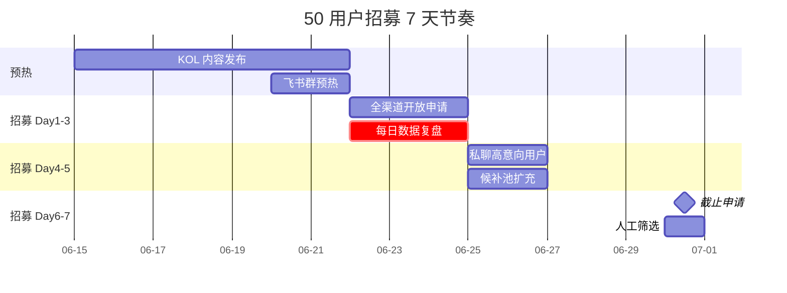

# 50 用户内测招募执行手册

> **作者**：陈远枢（运营总监）
> **日期**：2026-06-08
> **版本**：v1.0（W4 任务 6 收尾交付）
> **目标**：7 天内招募 50 名种子用户，候补 20 人
> **周期**：2026-06-22 ~ 2026-06-30
> **配合文档**：`beta-50-users.md`（总纲）、`landing-copy.md`（文案）、`testimonial-template.md`（证言）

## 1. 招募目标

| 维度 | 目标 | 截止时间 |
|:--|:--|:--|
| 总申请数 | ≥ 300 份 | 06-30 24:00 |
| 入选数 | 50 人 | 07-03 |
| 候补池 | 20 人 | 07-03 |
| 启动会到场 | 50/50（100%）| 07-04 |

---

## 2. 三大招募渠道

### 2.1 渠道总览

| 渠道 | 目标数 | 占比 | 申请成本 | 转化率 | 负责人 |
|:--|:--|:--|:--|:--|:--|
| **飞书创作者社群** | 180 份 | 60% | ¥0 | 35% | 陈远枢 |
| **小红书 + 公众号** | 80 份 | 27% | ¥5,000（博主投放）| 18% | 沈书白 |
| **B 站 + 知乎** | 40 份 | 13% | ¥3,000（资料下载引流）| 12% | 运营专员 |
| **合计** | 300 份 | 100% | ¥8,000 | 22%（66/300）| - |

### 2.2 渠道一：飞书创作者社群（主力）

**目标人群**：起点/番茄/晋江作者、M CN 运营、出版社编辑
**触达路径**：
```
飞书 100+ 创作者群（云中鹤/老魏资源）
    ↓
群内「ManhuaWorks 官方小助手」发布招募长图
    ↓
短链 → 飞书多维表格申请表
    ↓
24h 内回访 → 加 1v1 微信
```

**执行 SOP**（招募期 7 天，每天 2 小时）：

| 时间 | 动作 | 物料 |
|:--|:--|:--|
| 09:00 | 群内推送招募长图 + 短链 | `recruit-poster-feishu.png` |
| 12:00 | 私聊 5 名高意向用户 | 私信话术 §3.1 |
| 15:00 | 群内回答疑问 | FAQ `faq.md` |
| 18:00 | 当日数据复盘（DAU 申请数）| 飞书多维表格 |
| 21:00 | 推送"今日精选问题"长图 | `daily-qa.png` |

**关键资源**：
- 云中鹤飞书群（30+ 创作者群，合计 5,000 人）
- 老魏知乎/公众号粉丝（3,000+）
- 飞书云文档预热：《从小说到漫剧，AI 怎么帮你 8 分钟搞定》

### 2.3 渠道二：小红书 + 公众号（种草）

**目标人群**：短视频创作者、自媒体博主
**触达路径**：
```
小红书 KOL（10 个腰部博主，粉丝 5-20 万）
    ↓
发布"AI 漫剧工具横评"图文
    ↓
评论区引导"内测申请"
    ↓
私聊发申请表 → 加群
```

**KOL 投放清单**（预算 ¥5,000）：

| 博主 | 平台 | 粉丝 | 报价 | 内容方向 |
|:--|:--|:--|:--|:--|
| 小敏说漫剧 | 小红书 | 18 万 | ¥800 | 工具横评 + 实测截图 |
| 创作者阿橙 | 小红书 | 12 万 | ¥600 | "我用 AI 把网文做成漫剧" |
| 视频号李姐 | 视频号 | 8 万 | ¥500 | 5 分钟实操演示 |
| 公众号 10 个 | 公众号 | 合计 50 万 | ¥3,100 | 软文（200-500 字）|
| **合计** | - | - | **¥5,000** | - |

**小红书爆款公式**：
> 标题：「网文作者必看！AI 漫剧工具 8 分钟出片（附内测申请）」
> 封面：工具对比表 + 「8 分钟」红字
> 正文：痛点 + 解决方案 + 内测福利 + 申请链接

### 2.4 渠道三：B 站 + 知乎（深度内容）

**目标人群**：技术博主、网文深度作者
**触达路径**：
```
B 站 UP 主（5 个，1-10 万粉）发布工具测评视频
    ↓
视频简介放"内测申请链接 + 资料包下载"
    ↓
知乎答主（3 个）在「AI 创作工具」话题下回答
    ↓
资料包引流到私域 → 申请内测
```

**资料包钩子**（邮箱可换申请表）：
- 《2026 AI 漫剧工具白皮书》（8 页 PDF）
- 《网文转漫剧分镜模板》（10 个案例）
- 《AI 漫剧 30 天速成手册》

**预算明细**：

| 项目 | 数量 | 单价 | 总额 |
|:--|:--|:--|:--|
| B 站 UP 主 | 5 | ¥400 | ¥2,000 |
| 知乎答主 | 3 | ¥300 | ¥900 |
| 资料包设计 | 1 套 | ¥100 | ¥100 |
| **合计** | - | - | **¥3,000** |

---

## 3. 用户画像与筛选

### 3.1 4 类目标用户画像

| 画像 | 占比 | 来源渠道 | 关键特征 | 价值 |
|:--|:--|:--|:--|:--|
| **网文作者** | 35%（17-18 人）| 飞书 | 完整小说 50 万字+，想做漫剧引流 | 作品供给 |
| **短视频创作者** | 25%（12-13 人）| 小红书 | 习惯短视频，需要差异化内容 | 传播种子 |
| **MCN 运营** | 20%（10 人）| 飞书 | 帮旗下达人找工具，关注 ROI | B 端潜力 |
| **自媒体博主** | 15%（7-8 人）| 公众号 | 已有 IP，需要产能放大 | 案例素材 |
| **出版社编辑** | 5%（2-3 人）| 飞书 | 评估 IP 改编可行性 | B 端探索 |
| **合计** | 100% | - | - | - |

### 3.2 筛选标准（必须同时满足）

**硬性条件**：
- ✅ 有明确的内容产出需求（小说/视频/课程/漫剧）
- ✅ 每周能投入 ≥ 2 小时深度体验
- ✅ 愿意提交 ≥ 3 条有效反馈
- ✅ 允许使用脱敏后的案例（含公开宣传权）
- ✅ 中国大陆手机号（合规要求）

**软性加分**：
- ⭐ 粉丝数 ≥ 1,000（小红书/抖音/B 站）
- ⭐ 已有完整作品（小说/视频/课程）
- ⭐ 行业内 KOC（关键意见消费者）
- ⭐ 有付费意愿（专业版 ¥149/月）
- ⭐ 愿意录制证言视频

**一票否决**：
- ❌ 纯薅羊毛（"免费就试试"）
- ❌ AI 套利号（账号异常/批量注册）
- ❌ 无内容产出能力（"想玩玩"）
- ❌ 内容长度 < 50 字（敷衍）
- ❌ 邮箱/手机号无效

### 3.3 评分模型

| 评分维度 | 权重 | 评分标准（0-5 分）|
|:--|:--|:--|
| 创作者履历 | 30% | 0=无 1=新人 2=1 年 3=3 年 4=5 年 5=头部 |
| 现有作品质量 | 30% | 0=无 1=粗糙 2=可读 3=优质 4=爆款 5=IP 级 |
| 需求真实性 | 20% | 0=玩票 1=探索 2=认真 3=急迫 4=必须 5=商业 |
| 时间投入 | 20% | 0=<1h 1=1-2h 2=2-3h 3=3-5h 4=5-10h 5=10h+ |
| **综合分** | **100%** | **加权平均** |

**入选分数线**：
- 第一档：综合分 ≥ 4.0 → 必入选
- 第二档：综合分 3.5-3.9 → 候补优先
- 第三档：综合分 3.0-3.4 → 候补
- 第四档：综合分 < 3.0 → 婉拒

---

## 4. 招募执行时间表

### 4.1 7 天节奏



### 4.2 每日数据目标

| 日期 | DAU 申请 | 累计申请 | 当日动作 |
|:--|:--|:--|:--|
| 06-22（Day 1）| 50 | 50 | 全渠道开放，飞书群首发 |
| 06-23（Day 2）| 60 | 110 | 小红书爆款出 |
| 06-24（Day 3）| 70 | 180 | B 站视频上线 |
| 06-25（Day 4）| 50 | 230 | 私聊高意向用户 |
| 06-26（Day 5）| 30 | 260 | KOL 转发高潮 |
| 06-27（Day 6）| 20 | 280 | 资料包引流 |
| 06-28（Day 7）| 15 | 295 | 截止前最后冲刺 |
| 06-29 | 5 | 300 | 候补池维护 |
| 06-30 | 截止 | **300+** | 24:00 关闭申请 |

### 4.3 关键里程碑

| 里程碑 | 日期 | 验收标准 |
|:--|:--|:--|
| 预热完成 | 06-22 | 200+ 公众号阅读，飞书群 30+ 发布 |
| 申请破 100 | 06-23 12:00 | 12h 内达标 |
| 申请破 200 | 06-25 18:00 | 4 天内达标 |
| 申请破 300 | 06-30 24:00 | 招募期达标 |
| 50 人确认 | 07-03 18:00 | 24h 内回访完成 |
| 启动会 | 07-04 14:00 | 50/50 到场 |

---

## 5. 私域沉淀 SOP

### 5.1 申请后 24h 内必须完成

```
申请提交
    ↓
自动确认邮件（感谢 + 申请 ID）
    ↓
运营 24h 内微信/飞书加好友（通过率 ≥ 80%）
    ↓
拉入飞书群「ManhuaWorks 内测预备群」
    ↓
发送「内测候选人问卷」（15 分钟填写）
    ↓
每日群内推送：进度、案例、常见问题
```

### 5.2 微信加好友话术

> 你好 [姓名]，我是 ManhuaWorks 运营 [昵称]。
> 看到你申请了我们的 50 用户内测，想先加个好友确认下信息～
>
> 内测将在 7-4 启动，届时会拉一个 50 人的飞书群。
> 现在先在预备群里同步进度、问题、福利。
>
> 邀请你进群：[飞书群二维码]
>
> 任何问题随时戳我～

### 5.3 飞书预备群规则

| 规则 | 内容 |
|:--|:--|
| 群名 | ManhuaWorks 内测预备群（70 人）|
| 群主 | 陈远枢 |
| 管理员 | 沈书白 + 2 名运营 |
| 公告 | 内测进度、申请截止、Q&A |
| 内容 | 每日案例、教程、福利 |
| 禁言 | 0:00-9:00 禁言（防打扰）|

---

## 6. 物料清单

### 6.1 设计物料

| 文件名 | 用途 | 设计要求 | 截止 |
|:--|:--|:--|:--|
| `recruit-poster-feishu.png` | 飞书群招募长图 | 1080×1920，3 张轮播 | 06-20 |
| `recruit-poster-xhs.png` | 小红书招募图 | 1080×1440，单图 | 06-20 |
| `daily-qa.png` | 每日 Q&A 长图 | 1080×1920 | 每日 |
| `landing-page.html` | 内测申请落地页 | 响应式 + 移动端 | 06-18 |
| `welcome-card.png` | 入选欢迎卡片 | 800×800 | 07-03 |

### 6.2 文案物料

| 文件 | 用途 | 长度 |
|:--|:--|:--|
| `recruit-copy-feishu.md` | 飞书群招募文案 | 300 字 |
| `recruit-copy-xhs.md` | 小红书笔记文案 | 500 字 |
| `recruit-copy-bilibili.md` | B 站视频简介 | 200 字 |
| `welcome-message.md` | 入选欢迎消息 | 500 字 |
| `koc-talking-points.md` | KOL 投放话术 | 1000 字 |

### 6.3 预算汇总

| 项目 | 金额 |
|:--|:--|
| 小红书 KOL 投放 | ¥5,000 |
| B 站 + 知乎投放 | ¥3,000 |
| 资料包设计 | ¥100 |
| 海报设计 | ¥500 |
| **合计** | **¥8,600** |

---

## 7. 数据监控与应急预案

### 7.1 实时监控

| 指标 | 监控频率 | 告警阈值 |
|:--|:--|:--|
| 当日申请数 | 每 4h | < 30（Day 1-3）/ < 15（Day 4-7）|
| 申请转化率（落地页→提交）| 每日 | < 15% |
| KOL 内容阅读量 | 每日 | < 1,000 |
| 飞书群消息数 | 每日 | < 50 条 |

### 7.2 应急预案

| 风险 | 触发条件 | 应急动作 |
|:--|:--|:--|
| Day 2 申请 < 80 | 进度落后 30% | 加投 1 个 KOL（¥1,000）|
| Day 4 申请 < 200 | 进度落后 30% | 启动"邀请返积分"机制 |
| Day 6 申请 < 250 | 进度落后 20% | 飞书群密集推送 + 私聊 |
| KOL 内容违规 | 1 个被下架 | 立即换素材 + 申诉 |
| 飞书群被封 | 群异常 | 切换到企业微信备用群 |

### 7.3 "邀请返积分"机制（应急）

| 邀请人数 | 双方各得 |
|:--|:--|
| 1 人 | 500 积分 |
| 3 人 | 1,500 积分 + "推广大使"徽章 |
| 5 人 | 3,000 积分 + 终身 5 折 |
| 10 人 | 8,000 积分 + 联名周边大礼包 |

---

## 8. 筛选与确认 SOP

### 8.1 06-30 ~ 07-03 筛选流程

```
申请截止（06-30 24:00）
    ↓
自动筛选：邮箱/手机号/字数检查
    ↓
人工打分（300 → 100 份）
    ↓
排序：综合分 + 渠道画像匹配
    ↓
取前 50 名，候补 20 名
    ↓
飞书发确认函（07-01 09:00）
    ↓
24h 内未回复 → 候补递补
    ↓
07-03 18:00 锁定 50 人名单
    ↓
07-04 14:00 启动会
```

### 8.2 确认函模板

> **🎉 恭喜！你已通过 ManhuaWorks 50 用户内测筛选**
>
> 亲爱的 [姓名]：
>
> 感谢你申请 ManhuaWorks 50 用户内测。经过团队认真评估，你的【创作者履历 + 作品质量 + 需求真实性】综合评分 **4.5 分**，成功入选！
>
> **【内测福利】**
> - ✅ 永久免费使用专业版（原价 ¥149/月）
> - ✅ 5,000 启动积分
> - ✅ 1 对 1 接入辅导（30 分钟）
> - ✅ 直接与产品经理对话（飞书群）
> - ✅ 你的建议被优先采纳
> - ✅ 上线后 6 折续费优惠
>
> **【重要时间】**
> - 📅 启动会：2026-07-04（周六）14:00-16:00（飞书会议）
> - 📅 入组截止：07-03 18:00（请 24h 内回复本邮件）
> - 📅 启动会链接：[飞书会议链接]
>
> **【下一步】**
> 1. 回复邮件确认（"确认参加"）
> 2. 加入飞书群 [二维码]
> 3. 完善个人资料（7 项）
> 4. 准时参加 07-04 启动会
>
> 有任何问题，随时回复本邮件或加我微信 [微信号]。
>
> 我们 07-04 见！
>
> 陈远枢
> ManhuaWorks 运营总监

---

## 9. 风险与应对

| 风险 | 概率 | 影响 | 应对 |
|:--|:--|:--|:--|
| 申请不足 300 | 中 | 高 | 7 天冲刺 + 邀请返积分 + 加投 KOL |
| 50 人流失 | 中 | 高 | 候补 20 人 24h 递补 |
| 启动会到场率 < 80% | 低 | 高 | 录制回放 + 二次启动会 |
| 飞书群成员纠纷 | 低 | 中 | 群规明确 + 运营 1v1 调解 |
| 渠道合规风险 | 低 | 高 | 投放前法务审核 + 数据脱敏 |
| KOL 内容被举报 | 低 | 中 | 备用 3 个 KOL |

---

## 10. 配合文档

| 文档 | 用途 |
|:--|:--|
| `beta-50-users.md` | 总纲（W3 交付）|
| `landing-copy.md` | 落地页文案 |
| `testimonial-template.md` | 证言模板 |
| `feedback-form.md` | 反馈表单（W3 交付）|
| `onboarding-v2.md` | 5 步引导 |
| `koc-talking-points.md` | KOL 话术 |

---

## 11. 变更记录

| 版本 | 日期 | 作者 | 变更 |
|:--|:--|:--|:--|
| v0.1 | 2026-06-08 | 陈远枢 | 初稿（W4 任务 6）|
