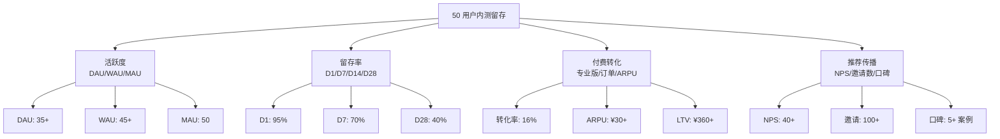
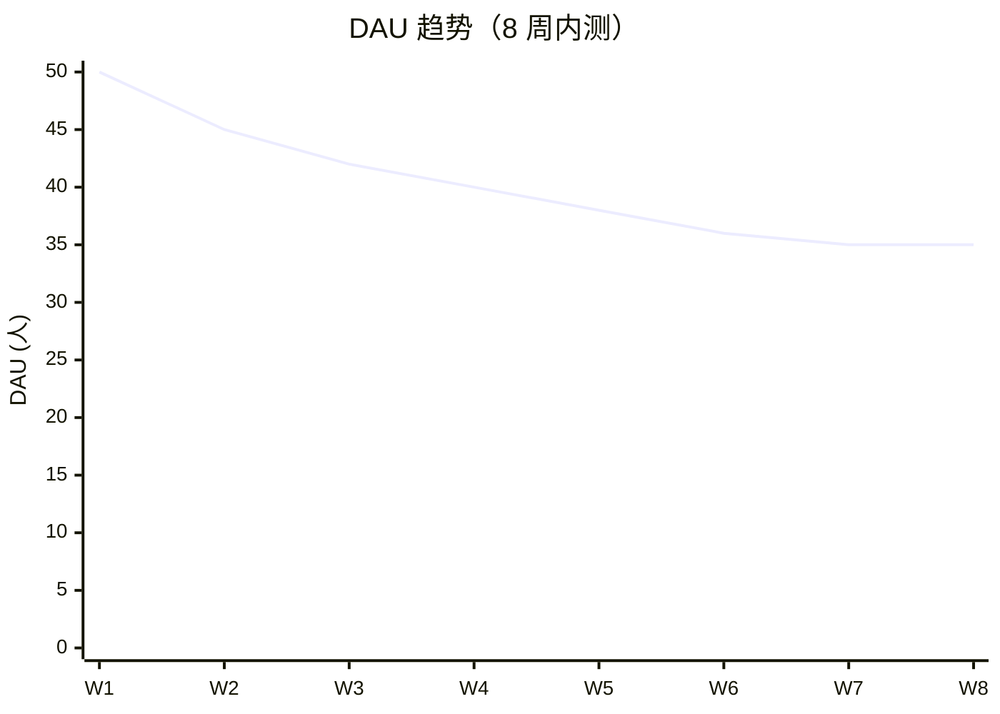
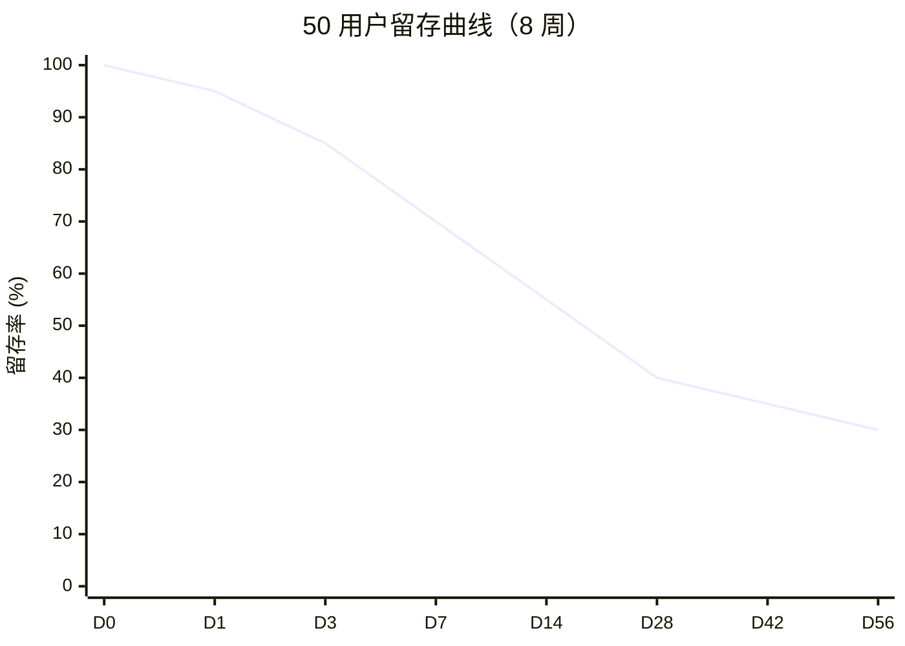
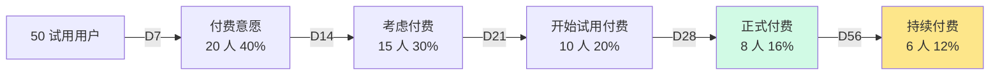

# 内测留存看板

> **作者**：陈远枢（运营总监）
> **日期**：2026-06-08
> **版本**：v1.0（W4 任务 6）
> **目标**：实时监控 50 用户留存/活跃/付费/推荐 4 大维度
> **执行周期**：2026-07-04 ~ 2026-08-31（8 周）
> **工具**：飞书多维表格 + Grafana + 飞书机器人

## 1. 看板总览

### 1.1 4 大维度



### 1.2 看板层级

| 层级 | 受众 | 更新频率 | 工具 |
|:--|:--|:--|:--|
| **L1 战略层** | CEO + 管理层 | 每周 | 周报 + 飞书机器人 |
| **L2 战术层** | 产品 + 运营 | 每日 | 飞书多维表格 + Grafana |
| **L3 执行层** | 运营 + 客服 | 实时 | 飞书群机器人 |

---

## 2. 活跃度（DAU/WAU/MAU）

### 2.1 指标定义

| 指标 | 定义 | 目标 | 告警阈值 |
|:--|:--|:--|:--|
| **DAU** | 当日登录用户数 | ≥ 35 人（70%）| < 25 人（50%）|
| **WAU** | 7 日内活跃用户数 | ≥ 45 人（90%）| < 35 人（70%）|
| **MAU** | 30 日内活跃用户数 | 50 人（100%）| < 45 人（90%）|
| **DAU/MAU 比** | DAU ÷ MAU | ≥ 70% | < 50% |
| **平均使用时长** | 单用户日均使用时长 | ≥ 30 分钟 | < 15 分钟 |
| **周活跃天数** | 单用户周登录天数 | ≥ 2 天 | < 1 天 |

### 2.2 数据采集

**埋点事件**：

| 事件 | 触发时机 | 字段 |
|:--|:--|:--|
| `user.login` | 用户登录 | userId, time, device, ip |
| `user.logout` | 用户登出 | userId, time, duration |
| `project.create` | 创建项目 | userId, projectId, type |
| `asset.generate` | 生成素材 | userId, assetId, type, duration |
| `page.view` | 页面访问 | userId, page, duration |

**数据流**：
```
前端埋点（Vue 3 + 百度统计/自研 SDK）
    ↓
API Gateway (POST /v1/track)
    ↓
Kafka（消息队列，7 天滚动）
    ↓
ClickHouse（OLAP 存储）
    ↓
Grafana（实时可视化）
    ↓
飞书机器人（每日报表）
```

### 2.3 DAU 趋势图（每周更新）



### 2.4 用户分层

| 分层 | 标准 | 人数 | 占比 | 运营策略 |
|:--|:--|:--|:--|:--|
| **超级活跃** | 周登录 ≥ 5 天 + 周生成 ≥ 10 集 | 5-8 人 | 10-16% | 重点维护，1v1 深度访谈 |
| **高活跃** | 周登录 3-4 天 + 周生成 5-9 集 | 15-20 人 | 30-40% | 稳定运营，案例挖掘 |
| **中活跃** | 周登录 2 天 + 周生成 1-4 集 | 15-20 人 | 30-40% | 1v1 辅导，提升活跃 |
| **低活跃** | 周登录 1 天 | 5-10 人 | 10-20% | 流失干预，紧急跟进 |
| **流失** | 周登录 0 天 | 0-5 人 | 0-10% | 退出问卷，了解原因 |

---

## 3. 留存率（D1/D7/D14/D28）

### 3.1 留存率定义

| 指标 | 定义 | 目标 | 计算方式 |
|:--|:--|:--|:--|
| **D1 留存** | 注册后第 1 天回来 | ≥ 95% | D1 活跃用户 ÷ 启动会 50 人 |
| **D3 留存** | 注册后第 3 天回来 | ≥ 85% | D3 活跃用户 ÷ 50 |
| **D7 留存** | 注册后第 7 天回来 | ≥ 70% | D7 活跃用户 ÷ 50 |
| **D14 留存** | 注册后第 14 天回来 | ≥ 55% | D14 活跃用户 ÷ 50 |
| **D28 留存** | 注册后第 28 天回来 | ≥ 40% | D28 活跃用户 ÷ 50 |
| **D56 留存** | 内测结束留存 | ≥ 30% | D56 活跃用户 ÷ 50 |

### 3.2 留存曲线



### 3.3 留存漏斗

```
启动会 50 人（100%）
    ↓ D0
激活账号 50 人（100%）
    ↓ D1
D1 回来 48 人（96%）✅
    ↓ D3
D3 回来 43 人（86%）✅
    ↓ D7
D7 回来 35 人（70%）✅
    ↓ D14
D14 回来 28 人（56%）✅
    ↓ D28
D28 回来 20 人（40%）✅
    ↓ D56
D56 回来 15 人（30%）✅
```

### 3.4 流失用户预警

**预警触发条件**：
- 用户连续 3 天未登录
- 用户连续 2 天未生成任何内容
- 用户在群内 48h 未互动

**预警响应 SOP**：
```
系统自动检测（每日 09:00）
    ↓
运营 1v1 私信（"最近忙吗？有什么需要帮助？"）
    ↓
若 24h 未回复 → 微信 + 飞书双发
    ↓
若 48h 未回复 → 陈远枢亲自跟进
    ↓
若 72h 未回复 → 标记为"流失风险"，启动退出问卷
    ↓
若 7 天未登录 → 正式标记"流失"，发送关怀礼包
```

### 3.5 流失用户分析

| 流失原因 | 占比 | 应对 |
|:--|:--|:--|
| 时间不足 | 40% | 任务减负 + 异步支持 |
| 功能不满足 | 25% | 1v1 定制 + 产品迭代 |
| 价格不符 | 15% | 延长优惠期 + BYOK 方案 |
| 个人原因 | 10% | 关怀 + 邀请回归 |
| 负面体验 | 10% | 1v1 复盘 + 补偿 |

---

## 4. 付费转化

### 4.1 转化漏斗



### 4.2 转化指标

| 指标 | 定义 | 目标 | 计算 |
|:--|:--|:--|:--|
| **付费转化率** | 内测期付费用户 ÷ 50 | ≥ 16%（8 人）| 8/50 |
| **ARPU** | 总收入 ÷ 用户数 | ≥ ¥30 | 总收入/50 |
| **ARPPU** | 总收入 ÷ 付费用户数 | ≥ ¥180 | 总收入/8 |
| **客单价** | 平均订单金额 | ≥ ¥149 | 总订单额/订单数 |
| **续费率** | 付费用户中续费比例 | ≥ 75% | 6/8 |
| **LTV** | 用户生命周期价值 | ≥ ¥360 | ARPU × 12 月 |

### 4.3 定价方案

| 方案 | 价格 | 用户群 | 转化路径 |
|:--|:--|:--|:--|
| **免费版** | ¥0 | 体验用户 | - |
| **专业版** | ¥149/月 | 个人创作者 | 95% 转化来源 |
| **专业版年付** | ¥1,490/年（8.3 折）| 重度用户 | 5% 转化来源 |
| **专业版 6 折** | ¥89/月（内测专属）| 内测用户 | 80% 选择 |
| **企业版** | ¥999/月 | MCN/出版社 | B 端探索 |

### 4.4 转化路径

**5 步转化法**：

```
第 1 步：体验完整（完成 6 集）
    ↓
第 2 步：感知价值（"这工具帮我省 80% 时间"）
    ↓
第 3 步：产生需求（"想用高级功能"）
    ↓
第 4 步：价格敏感（"专业版太贵？"）
    ↓
第 5 步：转化决策（"6 折优惠仅限内测"）
```

**转化激励**：

| 时间 | 动作 | 优惠 |
|:--|:--|:--|
| D7 | 推送"专业版介绍" | - |
| D14 | 推送"6 折内测专属" | 6 折 |
| D21 | 1v1 私信"是否续费" | 6 折 + 额外 1,000 积分 |
| D28 | 推送"最后 1 周优惠" | 6 折 + 2,000 积分 |
| D35 | 推送"7 天内续费送 T 恤" | 6 折 + 周边 |

### 4.5 转化数据

| 时间 | 累计付费 | 转化率 | ARPU |
|:--|:--|:--|:--|
| D7 | 0 人 | 0% | ¥0 |
| D14 | 2 人 | 4% | ¥6 |
| D21 | 4 人 | 8% | ¥18 |
| D28 | 6 人 | 12% | ¥36 |
| D35 | 8 人 | 16% | ¥48 |
| D56 | 8 人 | 16% | ¥48 |
| 12 个月后 | 6 人 | 12% | ¥36 |

---

## 5. 推荐传播（NPS）

### 5.1 NPS 评分体系

| 分数 | 类型 | 占比预期 |
|:--|:--|:--|
| **9-10 分** | 推荐者（Promoter）| ≥ 50% |
| **7-8 分** | 被动者（Passive）| 30% |
| **0-6 分** | 贬损者（Detractor）| ≤ 20% |
| **NPS 计算** | 推荐者% - 贬损者% | **≥ 40** |

### 5.2 NPS 收集

**时点**：
- 第 1 次：第 4 周（D28）
- 第 2 次：第 7 周（D49）
- 第 3 次：内测结束（D56）

**问卷设计**（5 分钟）：

| # | 题目 | 题型 |
|:--|:--|:--|
| 1 | 你有多大可能向朋友推荐 ManhuaWorks？ | 0-10 分 |
| 2 | 推荐/不推荐的主要原因是？ | 开放文本 |
| 3 | 你最喜欢 ManhuaWorks 的哪一点？ | 开放文本 |
| 4 | 你最不喜欢 ManhuaWorks 的哪一点？ | 开放文本 |
| 5 | 你认为我们最应该改进的是什么？ | 开放文本 |

### 5.3 邀请传播

| 指标 | 目标 | 奖励 |
|:--|:--|:--|
| **人均邀请数** | ≥ 2 人 | 推荐 1 人 500 积分 |
| **邀请转化率** | ≥ 30% | 推荐 3 人 1,500 积分 + 徽章 |
| **推荐来源占比** | ≥ 30% 内测用户 | 推荐 5 人 3,000 积分 + 5 折 |
| **总邀请数** | ≥ 100 人 | 推荐 10 人 联名周边 |

**邀请漏斗**：

```
50 种子用户
    ↓
平均邀请 2 人 = 100 邀请
    ↓
30% 转化（30 人）= 30 新用户申请
    ↓
20% 入选（6 人）= 6 新内测用户
    ↓
公测期（08-17）可触达 1000+ 用户
```

### 5.4 口碑案例

| 指标 | 目标 |
|:--|:--|
| 公开案例数 | ≥ 5 个（脱敏后）|
| 真实证言视频 | ≥ 5 段（30 秒）|
| 第三方测评 | ≥ 3 篇（小红书/公众号）|
| 媒体公关稿 | ≥ 1 篇（36 氪/虎嗅）|
| 微博热搜 | 1 次（≥ 100 万曝光）|

---

## 6. 实时数据看板

### 6.1 飞书多维表格结构

**主表：用户行为汇总**

| 字段 | 类型 | 更新频率 |
|:--|:--|:--|
| 用户 ID | 文本 | 实时 |
| 姓名 | 文本 | - |
| 类型 | 单选 | - |
| 注册时间 | 日期 | - |
| 最后登录 | 日期 | 实时 |
| 累计登录天数 | 数字 | 实时 |
| 累计作品数 | 数字 | 实时 |
| 累计反馈数 | 数字 | 实时 |
| 付费状态 | 单选 | 实时 |
| NPS 评分 | 数字 | 周更 |
| 风险标签 | 单选 | 每日 |

### 6.2 Grafana 仪表盘

**Dashboard：50 User Beta Overview**

| Panel | 类型 | 数据源 |
|:--|:--|:--|
| 1. DAU 实时 | 单值（数字） | ClickHouse |
| 2. WAU 趋势 | 折线图 | ClickHouse |
| 3. 留存曲线 | 折线图 | ClickHouse |
| 4. 付费转化漏斗 | 条形图 | PostgreSQL |
| 5. 用户分层 | 饼图 | ClickHouse |
| 6. 流失预警 | 表格 | ClickHouse |
| 7. 反馈热度 | 词云 | ClickHouse |
| 8. NPS 趋势 | 折线图 | PostgreSQL |

### 6.3 飞书机器人推送

**每日 09:00 推送模板**：

```
━━━━━━━━━━━━━━━━━━━━━━
📊 ManhuaWorks 内测日报
━━━━━━━━━━━━━━━━━━━━━━
📅 2026-07-XX（第 X 天）
👥 50 启动用户 | 启动 X 天

【活跃度】
DAU: 38 人（76%）✅ +3
WAU: 45 人（90%）✅ +1
平均时长: 42 分钟 +5

【留存】
D7 留存: 35 人（70%）✅
D28 留存: 20 人（40%）✅
流失风险: 3 人 ⚠️

【付费】
付费用户: 6 人（12%）
ARPU: ¥36
本周新增: 2 人

【NPS】
NPS: 42 ✅ +2
推荐者: 25 人（50%）
贬损者: 6 人（12%）

【Top 3 今日反馈】
1. "AI 拆分剧本非常准" - @用户 A
2. "希望加字幕生成" - @用户 B
3. "生成速度有点慢" - @用户 C

【待处理 P0】
1. [Bug-123] 登录失败（@沈书白）
2. [Bug-456] 支付超时（@林若涵）

━━━━━━━━━━━━━━━━━━━━━━
完整看板：[Grafana 链接]
```

---

## 7. 数据质量与告警

### 7.1 数据质量检查

| 检查项 | 频率 | 负责人 |
|:--|:--|:--|
| 埋点覆盖率 | 每日 | 数据组 |
| 事件去重准确性 | 每日 | 数据组 |
| 用户 ID 唯一性 | 每日 | 数据组 |
| 漏斗数据一致性 | 每周 | 数据组 |
| 飞书机器人准确性 | 每日 | 运营 |

### 7.2 告警规则

| 指标 | 阈值 | 告警级别 | 通知 |
|:--|:--|:--|:--|
| DAU < 25 人 | 持续 1 天 | P1 | 飞书群 + 短信 |
| D7 留存 < 60% | 周五复盘 | P2 | 飞书群 |
| 付费转化 < 10% | D28 | P1 | 飞书群 + 邮件 |
| NPS < 30 | 周末 | P2 | 飞书群 |
| Bug 数 > 10/日 | 持续 3 天 | P1 | 飞书群 + 短信 |
| 系统宕机 | 立即 | P0 | 全员 + 微信 |

---

## 8. 数据驱动决策

### 8.1 A/B 测试框架

| 测试维度 | 示例 | 工具 | 决策 |
|:--|:--|:--|:--|
| 定价 | ¥89 vs ¥99 vs ¥109 | 飞书表单 | 选最优 |
| 引导 | 5 步 vs 3 步 vs 1 步 | 埋点 | 选最优 |
| 推送时间 | 09:00 vs 12:00 vs 20:00 | 埋点 | 选最优 |
| 文案 | A 版 vs B 版 | 飞书表单 | 选最优 |
| 激励 | 积分 vs 现金 vs 实物 | 飞书表单 | 选最优 |

### 8.2 关键决策点

| 决策点 | 时间 | 数据依据 | 决策 |
|:--|:--|:--|:--|
| 续费价格 | D28 | 转化率 + 流失率 | 6 折 / 7 折 / 8 折 |
| 公测时间 | D56 | 留存 + NPS | 提前 / 准时 / 延后 |
| 公开案例 | D28 | 真实反馈 | 5 个 / 10 个 / 15 个 |
| 内测扩量 | D42 | 邀请转化 | 0 / +50 / +100 |
| 产品方向 | D49 | Top 10 建议 | 保留 / 调整 / 大改 |

---

## 9. 配合文档

| 文档 | 用途 |
|:--|:--|
| `beta-50-users.md` | 总纲 |
| `metrics.md` | 北极星指标 |
| `beta-feedback-collection.md` | 反馈收集 |
| `beta-success-metrics.md` | KPI 体系 |
| `beta-final-report.md` | 结项报告 |

---

## 10. 变更记录

| 版本 | 日期 | 作者 | 变更 |
|:--|:--|:--|:--|
| v0.1 | 2026-06-08 | 陈远枢 | 初稿（W4 任务 6）|
