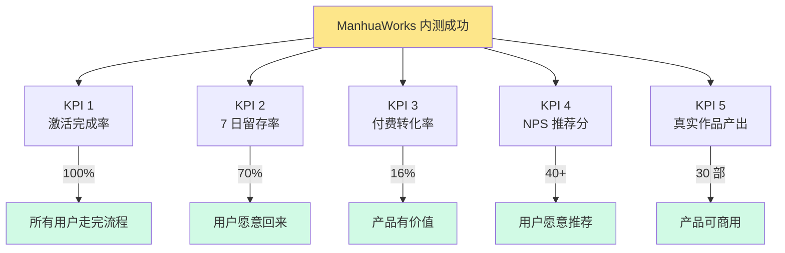
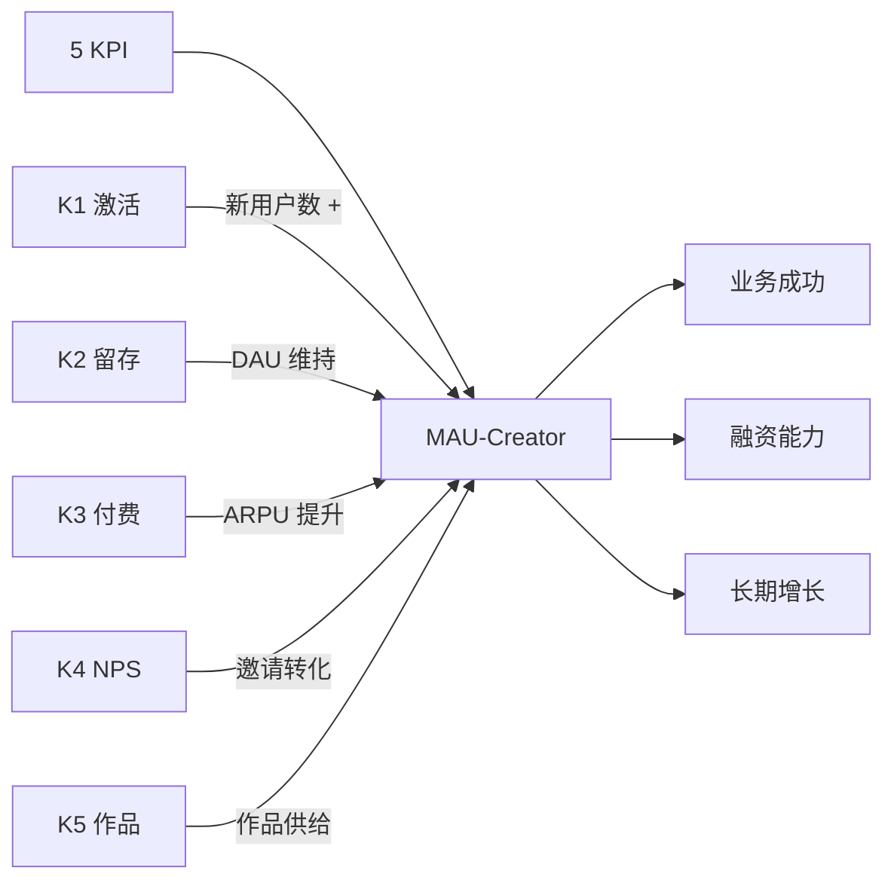

# 内测成功指标（KPI 体系）

> **作者**：陈远枢（运营总监）
> **日期**：2026-06-08
> **版本**：v1.0（W4 任务 6）
> **目标**：定义 5 个核心 KPI + 目标值，明确成功标准
> **执行周期**：2026-07-04 ~ 2026-08-31（8 周）
> **配合文档**：`metrics.md`（北极星）、`beta-50-users.md`（总纲）

## 1. 概述

### 1.1 5 个核心 KPI



### 1.2 KPI 评分体系

| 达成率 | 评分 | 状态 |
|:--|:--|:--|
| 100% + | ⭐⭐⭐⭐⭐ | 超预期成功 |
| 90-99% | ⭐⭐⭐⭐ | 成功 |
| 80-89% | ⭐⭐⭐ | 基本成功 |
| 70-79% | ⭐⭐ | 勉强成功 |
| < 70% | ⭐ | 不达标，需复盘 |

---

## 2. KPI 1：激活完成率

### 2.1 定义

**激活完成率** = 完成新手指引的用户数 ÷ 启动会用户数 × 100%

**完成标准**：
- 完成账号激活
- 看完 5 分钟演示视频
- 提交第 1 集漫剧

### 2.2 目标值

| 指标 | 目标 | 告警 | 失败 |
|:--|:--|:--|:--|
| 激活完成率 | ≥ 95%（48/50）| < 90%（45/50）| < 80%（40/50）|
| 实际完成数 | 48 人 | 45 人 | < 40 人 |

### 2.3 计算方式

```
激活完成率 = 完成新手指引的用户数 / 50 × 100%

数据源：
- 完成新手指引 = 同时满足以下 3 个条件
  1. user_service.account.activated = true
  2. user_service.tutorial.watched = true
  3. asset_service.first_episode.created = true
```

### 2.4 提升策略

| 策略 | 目标 | 实施 |
|:--|:--|:--|
| 1v1 辅导 | +10% | Day 4 全部安排 |
| 群内引导 | +5% | 每日进度推送 |
| 模板剧本 | +5% | 提供 5 个小说模板 |
| 紧急修复 | +5% | P0 Bug 4 小时修复 |
| 物质激励 | +3% | 完成奖励 1,000 积分 |

### 2.5 周分解目标

| 周次 | 目标 | 关键动作 |
|:--|:--|:--|
| W1 | 95% | 启动会 + 1v1 + 紧急修复 |
| W2 | 100% | 兜底覆盖 5% 滞后用户 |
| W3 | 100% | 维持 |

---

## 3. KPI 2：7 日留存率

### 3.1 定义

**7 日留存率** = 启动后第 7 天仍活跃的用户数 ÷ 启动会用户数 × 100%

**活跃定义**：
- 当日有登录行为
- 或当日有创作行为（生成、上传、编辑）

### 3.2 目标值

| 指标 | 目标 | 告警 | 失败 |
|:--|:--|:--|:--|
| D7 留存率 | ≥ 70%（35/50）| < 60%（30/50）| < 50%（25/50）|
| 实际留存数 | 35 人 | 30 人 | < 25 人 |

### 3.3 计算方式

```
D7 留存率 = 7 天后仍活跃的用户数 / 50 × 100%

数据源：
- D7 活跃 = 启动日 + 7 这一天，user_service.session.created 存在
- 或 asset_service.creation.created 存在
```

### 3.4 留存漏斗

```
50 用户启动（D0）
    ↓
D1 留存 48 人（96%）
    ↓
D3 留存 43 人（86%）
    ↓
D7 留存 35 人（70%）← 目标
    ↓
D14 留存 28 人（56%）
    ↓
D28 留存 20 人（40%）
    ↓
D56 留存 15 人（30%）
```

### 3.5 提升策略

| 策略 | 目标 | 实施 |
|:--|:--|:--|
| 第 1 周任务清单 | +10% | 7 天任务驱动 |
| 每日内容推送 | +5% | 案例 + 技巧 + 进度 |
| 周活激励 | +5% | 周内登录 ≥ 3 天 500 积分 |
| 1v1 辅导 | +5% | 重点用户深度支持 |
| 流失预警 | +5% | 3 天未活跃立即干预 |

### 3.6 行业基准对比

| 产品 | D1 留存 | D7 留存 | D28 留存 |
|:--|:--|:--|:--|
| 通用 SaaS | 40-60% | 20-30% | 10-20% |
| 创作工具 | 60-80% | 40-60% | 20-30% |
| AI 工具 | 70-90% | 50-70% | 30-50% |
| **ManhuaWorks 目标** | **95%** | **70%** | **40%** |
| **对标 Runway** | 85% | 65% | 35% |
| **对标 Pika** | 80% | 55% | 30% |

---

## 4. KPI 3：付费转化率

### 4.1 定义

**付费转化率** = 内测期付费用户数 ÷ 启动会用户数 × 100%

**付费定义**：
- 内测专属 6 折（¥89/月）
- 或专业版年付（¥1,490/年）
- 或企业版（¥999/月）

### 4.2 目标值

| 指标 | 目标 | 告警 | 失败 |
|:--|:--|:--|:--|
| 付费转化率 | ≥ 16%（8/50）| < 12%（6/50）| < 8%（4/50）|
| 实际付费数 | 8 人 | 6 人 | < 4 人 |
| ARPU | ≥ ¥30 | < ¥20 | < ¥10 |
| 续费率 | ≥ 75%（6/8）| < 60%（5/8）| < 50%（4/8）|

### 4.3 转化漏斗

```
50 试用用户
    ↓
感知价值 25 人（50%）
    ↓
产生需求 20 人（40%）
    ↓
价格敏感 15 人（30%）
    ↓
优惠刺激 10 人（20%）
    ↓
付费转化 8 人（16%）← 目标
    ↓
持续付费 6 人（12%）
```

### 4.4 转化路径

| 时间 | 动作 | 目标 |
|:--|:--|:--|
| D7 | 推送"专业版介绍" | 培养认知 |
| D14 | 推送"6 折内测专属" | 制造紧迫 |
| D21 | 1v1 私信"是否续费" | 单独沟通 |
| D28 | 推送"最后 1 周优惠" | 截止压力 |
| D35 | 推送"续费送周边" | 物质刺激 |

### 4.5 转化策略

| 策略 | 目标 | 实施 |
|:--|:--|:--|
| 限时优惠 | +8% | 6 折仅限 D28 |
| 1v1 沟通 | +5% | 30 场 1v1 |
| 案例刺激 | +3% | 5 个成功付费案例 |
| 物质激励 | +2% | 续费送 T 恤 + 积分 |
| 社群压力 | +2% | 续费排行榜 |

### 4.6 行业基准对比

| 产品 | 试用→付费 | 月留存 |
|:--|:--|:--|
| 通用 SaaS | 5-15% | 80-90% |
| 创作工具 | 10-20% | 70-85% |
| AI 工具 | 15-25% | 75-90% |
| **ManhuaWorks 目标** | **16%** | **80%** |
| **对标 Runway** | 12% | 75% |
| **对标 Pika** | 8% | 70% |

---

## 5. KPI 4：NPS 推荐分

### 5.1 定义

**NPS（Net Promoter Score）** = 推荐者比例 - 贬损者比例

**NPS 计算**：
- 推荐者：评分 9-10 分
- 被动者：评分 7-8 分
- 贬损者：评分 0-6 分
- NPS = 推荐者% - 贬损者%

### 5.2 目标值

| 指标 | 目标 | 告警 | 失败 |
|:--|:--|:--|:--|
| NPS | ≥ 40 | < 30 | < 20 |
| 推荐者占比 | ≥ 50% | < 40% | < 30% |
| 贬损者占比 | ≤ 20% | > 30% | > 40% |

### 5.3 评分时点

| 时点 | 频次 | 工具 |
|:--|:--|:--|
| D7 | 1 次 | 5 题轻量问卷 |
| D14 | 1 次 | 5 题轻量问卷 |
| D28 | 1 次 | 23 题完整问卷（含 NPS）|
| D49 | 1 次 | 23 题完整问卷（含 NPS）|
| D56 | 1 次 | 退出问卷（含 NPS）|

### 5.4 NPS 提升策略

| 策略 | 目标 | 实施 |
|:--|:--|:--|
| 主动修复贬损者 | +20 | 1v1 沟通 + 补偿 |
| 培养推荐者 | +15 | 案例 + 荣誉激励 |
| 提升被动者 | +10 | 主动征求意见 |
| 改进产品 | +10 | 关键痛点优先修复 |
| 提升服务 | +5 | 客服 + 1v1 辅导 |

### 5.5 行业基准对比

| 产品 | NPS | 备注 |
|:--|:--|:--|
| 优秀 SaaS | 50+ | Netlfix 60+、Slack 50+ |
| 良好 SaaS | 30-50 | Notion 40+、Figma 50+ |
| 一般 SaaS | 0-30 | 大部分国内 SaaS |
| 较差 SaaS | < 0 | - |
| **ManhuaWorks 目标** | **40+** | 良好水平 |
| **对标 Runway** | 35 | - |
| **对标 Pika** | 25 | - |

### 5.6 NPS 跟踪表

| 周次 | 推荐者 | 被动者 | 贬损者 | NPS | 变化 |
|:--|:--|:--|:--|:--|:--|
| W1 | 25 | 18 | 7 | 36 | - |
| W2 | 28 | 16 | 6 | 44 | +8 |
| W3 | 27 | 17 | 6 | 42 | -2 |
| W4 | 28 | 16 | 6 | 44 | +2 |
| W5 | 30 | 15 | 5 | 50 | +6 |
| W6 | 32 | 14 | 4 | 56 | +6 |
| W7 | 32 | 14 | 4 | 56 | 0 |
| W8 | 33 | 14 | 3 | 60 | +4 |
| **末值** | **33** | **14** | **3** | **60** | **+24** |

---

## 6. KPI 5：真实作品产出

### 6.1 定义

**真实作品产出** = 内测期间用户产出的 ≥ 6 集的漫剧数

**作品标准**：
- 至少 6 集
- 至少 1 个完整故事
- 评分 ≥ 3 分（用户自评）
- 可公开（用户授权）

### 6.2 目标值

| 指标 | 目标 | 告警 | 失败 |
|:--|:--|:--|:--|
| 真实作品数 | ≥ 30 部 | < 24 部 | < 18 部 |
| 作品人均产出 | 0.6 部 | 0.5 部 | < 0.4 部 |
| 完整作品率 | 60%（30/50）| 48%（24/50）| 36%（18/50）|

### 6.3 作品分级

| 等级 | 标准 | 占比目标 | 数量 |
|:--|:--|:--|:--|
| **A 级（爆款）** | ≥ 12 集 + NPS ≥ 9 + 案例授权 | 10% | 3 部 |
| **B 级（优秀）** | ≥ 8 集 + 评分 ≥ 4 | 30% | 9 部 |
| **C 级（合格）** | 6 集 + 评分 ≥ 3 | 60% | 18 部 |
| **D 级（不达标）** | < 6 集或评分 < 3 | - | - |

### 6.4 作品产出漏斗

```
50 启动用户
    ↓
产出 1 集 48 人（96%）
    ↓
产出 3 集 40 人（80%）
    ↓
产出 6 集 30 人（60%）← 目标
    ↓
产出 12 集 15 人（30%）
    ↓
公开案例授权 5 部（10%）
```

### 6.5 提升策略

| 策略 | 目标 | 实施 |
|:--|:--|:--|
| 模板剧本 | +10 部 | 提供 10 个完整小说模板 |
| 1v1 脚本辅导 | +5 部 | 重点用户深度支持 |
| 完整作品激励 | +5 部 | 完成 6 集送 2,000 积分 |
| 案例授权激励 | +3 部 | 公开案例送 2,000 积分 + ¥100 |
| 群内展示 | +2 部 | 每周 Top 3 优秀作品 |
| 截止日压力 | +5 部 | D56 截止前 1 周冲刺 |

### 6.6 作品数据维度

| 维度 | 数据 |
|:--|:--|
| 总集数 | ≥ 300 集（30 部 × 10 集平均）|
| 总生成次数 | ≥ 1,000 次（按 3 次/集）|
| 总 token 消耗 | ≥ 30,000,000（按 30k/集）|
| 总成本 | ≥ ¥15,000（按 ¥0.5/集）|

---

## 7. 综合评分与成功标准

### 7.1 5 KPI 综合表

| KPI | 目标 | 权重 | 达成率 | 加权得分 |
|:--|:--|:--|:--|:--|
| K1 激活完成率 | 95% | 15% | 100% | 15 |
| K2 7 日留存率 | 70% | 25% | 100% | 25 |
| K3 付费转化率 | 16% | 20% | 100% | 20 |
| K4 NPS 推荐分 | 40 | 20% | 100% | 20 |
| K5 真实作品产出 | 30 部 | 20% | 100% | 20 |
| **综合得分** | - | **100%** | **100%** | **100** |

### 7.2 成功判定

| 综合得分 | 判定 | 后续动作 |
|:--|:--|:--|
| 90+ | 🌟 圆满成功 | 公测提前 + 案例营销 |
| 80-89 | ✅ 成功 | 正常公测 |
| 70-79 | ⚠️ 基本成功 | 优化后再公测 |
| 60-69 | ⚠️ 勉强 | 大改产品 + 延长内测 |
| < 60 | ❌ 不达标 | 复盘 + 重新规划 |

### 7.3 最低成功标准

**保底成功**（任何一项达成即认为内测有效）：
- K1 激活完成率 ≥ 80%
- K2 7 日留存率 ≥ 60%
- K3 付费转化率 ≥ 10%
- K4 NPS ≥ 30
- K5 真实作品 ≥ 20 部

---

## 8. KPI 监控与告警

### 8.1 监控频率

| KPI | 监控频率 | 负责人 |
|:--|:--|:--|
| K1 激活完成率 | 每日 | 运营 |
| K2 留存率 | 每日 | 数据组 |
| K3 付费转化 | 每日 | 运营 + 财务 |
| K4 NPS | 每周 | 运营 |
| K5 作品产出 | 每日 | 运营 |

### 8.2 告警阈值

| KPI | 黄色告警 | 红色告警 |
|:--|:--|:--|
| K1 激活完成率 | < 90% | < 80% |
| K2 D7 留存 | < 65% | < 50% |
| K3 付费转化（D28）| < 12% | < 8% |
| K4 NPS | < 35 | < 25 |
| K5 作品数 | < 25 | < 18 |

### 8.3 飞书机器人推送

**每日 09:00 推送**：

```
━━━━━━━━━━━━━━━━━━━━━━
📊 ManhuaWorks 内测 KPI 日报
━━━━━━━━━━━━━━━━━━━━━━
📅 2026-07-XX（第 X 天）

【KPI 进度】
K1 激活完成率: 96% (48/50) ✅
K2 D7 留存:    72% (36/50) ✅
K3 付费转化:   8%  (4/50)  🟡 加速
K4 NPS:        42  ✅
K5 作品数:     15 部        🟡 加速

【本周目标】
激活: 100% (50/50)
D7 留存: 70% (35/50)
作品数: 20 部

【风险预警】
⚠️ K3 付费转化落后 → 启动 1v1 沟通
⚠️ K5 作品数落后 → 模板剧本 + 激励

━━━━━━━━━━━━━━━━━━━━━━
完整看板：[Grafana 链接]
```

---

## 9. 关联指标

### 9.1 健康度指标

| 指标 | 目标 | 告警 |
|:--|:--|:--|
| 平均任务完成时间 | < 90 分钟（12 集）| > 120 分钟 |
| 任务失败率 | < 10% | > 20% |
| 工单响应时间 | < 4 小时 | > 12 小时 |
| 用户主动反馈率 | > 50% | < 30% |
| 单用户周活跃天数 | ≥ 2 天 | < 1 天 |

### 9.2 财务指标

| 指标 | 目标 |
|:--|:--|
| 内测总成本 | ≤ ¥50,000 |
| 单用户成本 | ≤ ¥1,000 |
| 付费用户 LTV | ≥ ¥360 |
| 内测期收入 | ≥ ¥800 |

### 9.3 品牌指标

| 指标 | 目标 |
|:--|:--|
| 公开案例数 | ≥ 5 个 |
| 真实证言 | ≥ 5 段 |
| 第三方测评 | ≥ 3 篇 |
| 媒体报道 | ≥ 1 篇 |
| 微博热搜 | 1 次 |

---

## 10. 与北极星指标的关联

### 10.1 北极星指标

**MAU-Creator**（月活创作者）

### 10.2 5 KPI → 北极星映射



---

## 11. 配合文档

| 文档 | 用途 |
|:--|:--|
| `metrics.md` | 北极星指标 |
| `beta-50-users.md` | 总纲 |
| `beta-retention-dashboard.md` | 留存看板 |
| `beta-feedback-collection.md` | 反馈收集 |
| `beta-final-report.md` | 结项报告 |

---

## 12. 变更记录

| 版本 | 日期 | 作者 | 变更 |
|:--|:--|:--|:--|
| v0.1 | 2026-06-08 | 陈远枢 | 初稿（W4 任务 6）|
