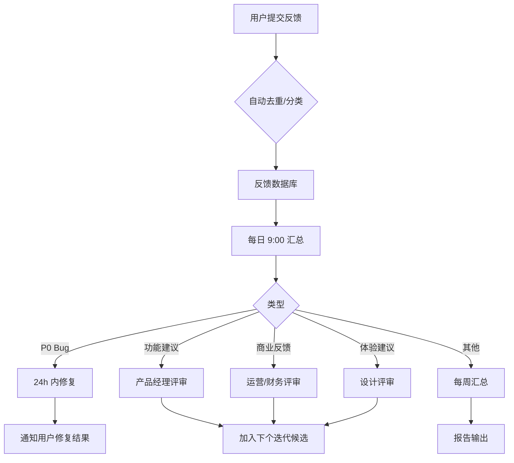
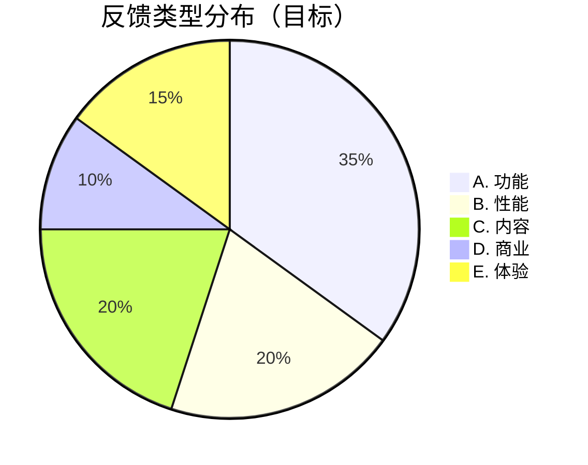

# 内测用户反馈表

> **作者**：陈远枢（运营总监）
> **日期**：2026-06-08
> **适用**：50 用户内测期间（2026-07-01 ~ 2026-08-31）
> **配套**：`beta-50-users.md`、`metrics.md`

## 1. 概述

内测期间共设计 **3 套反馈表**（轻量日常 + 中期问卷 + 结业问卷），覆盖 **5 类问题**（功能 / 性能 / 内容 / 商业 / 体验）+ **1-5 评分**。

**收集目标**：
- 100+ 条有效反馈（每用户 ≥ 3 条）
- 5 条真实证言
- 完整 NPS 报告

**收集渠道**：
- 工坊内嵌问卷（最高频）
- 飞书群 + 1v1 私信（深度）
- 邮件 + 短信（低频提醒）

---

## 2. 反馈分类（5 类问题）

| 类别 | 范围 | 负责团队 | 响应 SLA |
|:--|:--|:--|:--|
| **A. 功能类** | 想要什么 / 不想要什么 | 产品经理 | 3 天 |
| **B. 性能类** | 速度 / 稳定性 / 失败率 | 沈书白（工程）| 24 小时 |
| **C. 内容类** | AI 生成质量（图片/视频/配音/字幕）| 陈远枢 | 7 天 |
| **D. 商业类** | 定价 / 套餐 / 积分 | 林若涵 | 3 天 |
| **E. 体验类** | UI / 流程 / 引导 / 文档 | 产品经理 | 7 天 |

---

## 3. 表 1：工坊内嵌轻量反馈（高频）

> **触发位置**：每个任务完成页 + 每周一次推送
> **填写时长**：1 分钟
> **激励**：每次 200 积分

### 字段

| 字段 | 类型 | 必填 | 说明 |
|:--|:--|:--|:--|
| 1. 整体满意度 | 1-5 星 | ✅ | ⭐⭐⭐⭐⭐ |
| 2. 哪一步最满意 | 单选 | ❌ | 创建项目 / 导入剧本 / 拆分 / 风格 / 生成 |
| 3. 哪一步最不满意 | 单选 | ❌ | 同上 + "都不满意" |
| 4. 反馈类别 | 多选 | ✅ | 5 类（功能/性能/内容/商业/体验）|
| 5. 文字描述 | 多行文本 | ❌ | 200 字以内 |
| 6. 是否愿意 1v1 沟通 | 复选 | ❌ | 勾选后运营 24h 内联系 |
| 7. 截图 | 附件 | ❌ | 1-3 张 |

### 示例界面

```
┌─────────────────────────────────────────┐
│ 💬 这次体验如何？                         │
├─────────────────────────────────────────┤
│  整体满意度                               │
│  ⭐ ⭐ ⭐ ⭐ ⭐  [1] [2] [3] [4] [5]    │
│                                          │
│  最满意的步骤                             │
│  ◉ 创建项目  ◯ 导入剧本  ◯ 拆分          │
│  ◯ 风格设定  ◯ 一键生成                  │
│                                          │
│  最不满意的步骤                           │
│  ◯ 创建项目  ◯ 导入剧本  ◯ 拆分          │
│  ◯ 风格设定  ◯ 一键生成  ◯ 都不满意      │
│                                          │
│  问题类型（可多选）                       │
│  □ 功能  □ 性能  □ 内容  □ 商业  □ 体验  │
│                                          │
│  详细描述（可选）                         │
│  ┌────────────────────────────────┐      │
│  │ ...                            │      │
│  └────────────────────────────────┘      │
│                                          │
│  □ 截图  □ 愿意 1v1 沟通                  │
│                                          │
│            [跳过]    [提交 +200 积分]    │
└─────────────────────────────────────────┘
```

---

## 4. 表 2：中期问卷（深度）

> **触发时间**：2026-07-22（D+18）
> **填写时长**：10 分钟
> **激励**：500 积分 + 1 次抽奖资格

### 字段（4 大模块）

#### 模块 1：使用情况

| 字段 | 类型 | 必填 |
|:--|:--|:--|
| 1. 累计生成集数 | 单选 | ✅ |
| 2. 平均单集生成时长 | 单选 | ✅ |
| 3. 重新生成次数 | 单选 | ✅ |
| 4. 最常使用功能 Top 3 | 多选 | ✅ |
| 5. 从未使用过的功能 | 多选 | ❌ |
| 6. 卡住的环节 Top 3 | 多选 | ✅ |

#### 模块 2：5 类问题深度评分

每类问题 5 个子项，1-5 分：

| 子项 | 1 | 2 | 3 | 4 | 5 |
|:--|:--|:--|:--|:--|:--|
| **A. 功能** 完备性 | □ | □ | □ | □ | □ |
| **A. 功能** 易用性 | □ | □ | □ | □ | □ |
| **A. 功能** 创新性 | □ | □ | □ | □ | □ |
| **A. 功能** 与竞品对比 | □ | □ | □ | □ | □ |
| **A. 功能** 文档齐全 | □ | □ | □ | □ | □ |
| **B. 性能** 生成速度 | □ | □ | □ | □ | □ |
| **B. 性能** 成功率 | □ | □ | □ | □ | □ |
| **B. 性能** 稳定性 | □ | □ | □ | □ | □ |
| **B. 性能** 错误恢复 | □ | □ | □ | □ | □ |
| **B. 性能** 资源占用 | □ | □ | □ | □ | □ |
| **C. 内容** 角色一致性 | □ | □ | □ | □ | □ |
| **C. 内容** 风格统一 | □ | □ | □ | □ | □ |
| **C. 内容** 画面质量 | □ | □ | □ | □ | □ |
| **C. 内容** 配音自然度 | □ | □ | □ | □ | □ |
| **C. 内容** 字幕准确度 | □ | □ | □ | □ | □ |
| **D. 商业** 定价合理 | □ | □ | □ | □ | □ |
| **D. 商业** 积分够用 | □ | □ | □ | □ | □ |
| **D. 商业** 套餐选择 | □ | □ | □ | □ | □ |
| **D. 商业** BYOK 价值 | □ | □ | □ | □ | □ |
| **D. 商业** 退款体验 | □ | □ | □ | □ | □ |
| **E. 体验** UI 视觉 | □ | □ | □ | □ | □ |
| **E. 体验** 流程顺畅 | □ | □ | □ | □ | □ |
| **E. 体验** 引导清晰 | □ | □ | □ | □ | □ |
| **E. 体验** 错误提示 | □ | □ | □ | □ | □ |
| **E. 体验** 帮助文档 | □ | □ | □ | □ | □ |

#### 模块 3：开放问题

| 字段 | 必填 |
|:--|:--|
| 1. 你最希望我们下个迭代做什么？（200 字）| ✅ |
| 2. 你最讨厌现在的哪个功能？（200 字）| ✅ |
| 3. 如果满分 10 分，你给 ManhuaWorks 打几分？为什么？| ✅ |
| 4. 你愿意推荐给朋友吗？为什么？| ✅ |
| 5. 续费时你最看重什么？（200 字）| ✅ |

#### 模块 4：画像补充

| 字段 | 类型 | 必填 |
|:--|:--|:--|
| 1. 年龄段 | 单选 | ✅ |
| 2. 创作者年限 | 单选 | ✅ |
| 3. 月收入 | 单选 | ❌ |
| 4. 所在行业 | 单选 | ✅ |
| 5. 是否用过竞品（剪映/Runway/Pika 等）| 多选 | ✅ |

---

## 5. 表 3：结业问卷（NPS + 证言）

> **触发时间**：2026-08-19（D+46）
> **填写时长**：8 分钟
> **激励**：800 积分 + 实物礼品

### NPS 核心问题

```
0 1 2 3 4 5 6 7 8 9 10
○ ○ ○ ○ ○ ○ ○ ○ ○ ○ ○
```

**0-6**：贬损者（Detractor）
**7-8**：被动者（Passive）
**9-10**：推荐者（Promoter）

**NPS = 推荐者% − 贬损者%**

### NPS 追问

| 字段 | 必填 |
|:--|:--|
| 为什么打这个分？（200 字）| ✅ |
| 哪些改进会让你打 9-10 分？| ✅ |
| 你最想推荐给什么样的朋友？| ❌ |
| 哪些场景你觉得 ManhuaWorks 最有价值？| ❌ |

### 证言征集

| 字段 | 必填 |
|:--|:--|
| 1. 用一句话描述 ManhuaWorks（≤ 30 字）| ✅ |
| 2. 详细证言（500 字以内）| ✅ |
| 3. 你的身份/头衔 | ✅ |
| 4. 头像照授权 | ❌ |
| 5. 真名/笔名/匿名 | ✅ |
| 6. 同意公开（含脱敏）| 必勾 |

### 5 类问题结业评分

| 类别 | 评分（1-5）|
|:--|:--|
| A. 功能 | ___ |
| B. 性能 | ___ |
| C. 内容 | ___ |
| D. 商业 | ___ |
| E. 体验 | ___ |

### 续费意愿

| 问题 | 选项 |
|:--|:--|
| 1. 8 月底内测结束，你会续费专业版吗？| 一定 / 可能 / 不确定 / 可能不 / 一定不 |
| 2. 什么价位你会续费？| ≤ ¥99 / ¥100-149 / ¥150-199 / ¥200+ / 不续 |
| 3. 你希望增加什么套餐？| 多选 |

---

## 6. 反馈处理流程



---

## 7. 反馈数据看板

### 7.1 关键指标

| 指标 | 目标 | 告警阈值 |
|:--|:--|:--|
| 总反馈数 | ≥ 100 条 | < 60 |
| 有效反馈率 | ≥ 70% | < 50% |
| 1-5 平均分 | ≥ 4.0 | < 3.5 |
| P0 Bug 数 | 0 | > 3 |
| P1 Bug 数 | ≤ 5 | > 10 |
| 24h 响应率 | 100% | < 80% |
| 72h 修复率 | ≥ 80% | < 50% |
| 建议采纳率 | ≥ 30% | < 15% |
| NPS | ≥ 40 | < 20 |

### 7.2 反馈分布（示例）



---

## 8. 反馈激励规则

| 动作 | 积分 | 限制 |
|:--|:--|:--|
| 提交任意反馈 | 200 | 1 次/天 |
| 提交带截图的反馈 | +100 | 无上限 |
| 提交被采纳为产品需求 | 1,000 | 一次性 |
| 提交 P0 Bug 报告 | 2,000 | 一次性 |
| 提交 P1 Bug 报告 | 500 | 一次性 |
| 提交有效证言 | 1,000 | 一次性 |
| 完成中期问卷 | 500 | 1 次 |
| 完成结业问卷 | 800 | 1 次 |
| 接受 1v1 访谈 | 1,500 | 1 次 |
| **单人最多可获** | - | **约 8,000 积分** |

---

## 9. 反馈隐私与脱敏

- 反馈内容仅团队内可见（≤ 10 人）
- 公开证言前必须获得用户书面授权
- 截图自动去除敏感信息（手机号/邮箱/地址）
- 保留期 2 年，2 年后可申请删除

---

## 10. 报告输出

| 报告 | 输出时间 | 内容 |
|:--|:--|:--|
| 周报 | 每周五 17:00 | 本周反馈数/Top 5/紧急 Bug |
| 中期报告 | 07-23 | 5 类问题评分+开放问题+用户分层 |
| 结业报告 | 08-31 | NPS+证言+5 类问题+续费预测 |

---

## 11. 变更记录

| 版本 | 日期 | 作者 | 变更 |
|:--|:--|:--|:--|
| v0.1 | 2026-06-08 | 陈远枢 | 初稿（W3 任务 6）|
