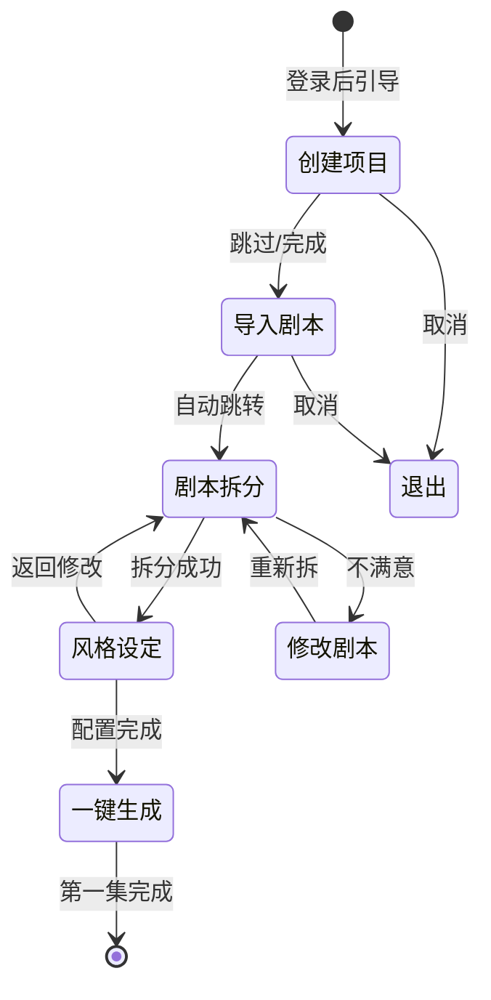
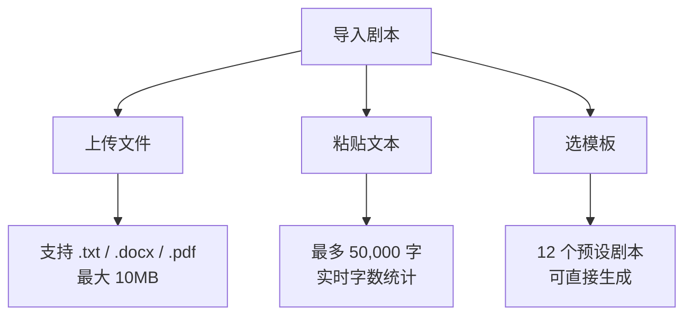
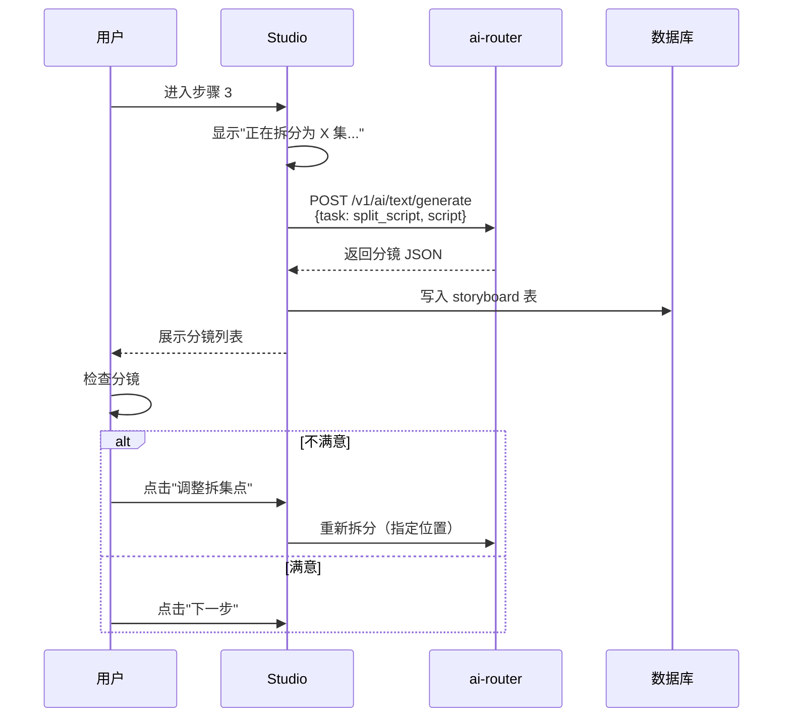
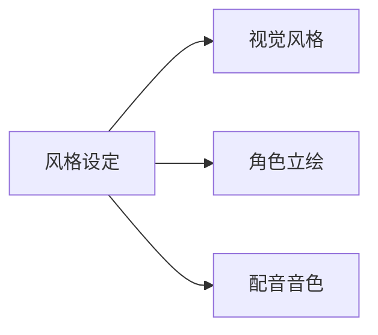
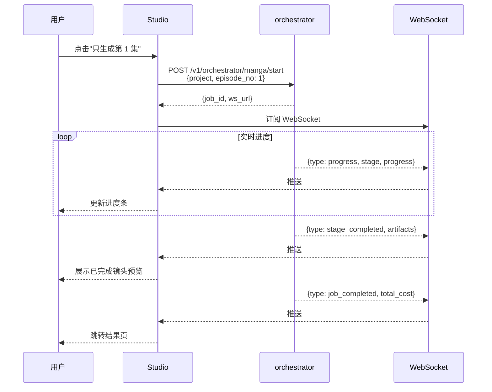

# 新手指引 v2：工坊流程 5 步走通第一集

> **作者**：陈远枢（运营总监）
> **日期**：2026-06-08
> **版本**：v2.0（覆盖 `onboarding.md`）
> **配套**：W3 工坊（Studio）新版界面
> **目标**：让 100% 内测用户在 30 分钟内完成第一集漫剧

## 1. 概述

W3 阶段的工坊（Studio）采用**5 步向导**替代 W2 的"自由探索"模式。每一步都有明确产出物和"完成"判定，确保用户**不会卡住**。

**5 步流程**：
1. **创建项目** → 命名 + 选类型
2. **导入剧本** → 上传 / 粘贴 / 选模板
3. **剧本拆分** → LLM 自动拆为分镜
4. **风格设定** → 选艺术风格 + 角色参考
5. **一键生成** → 排队 + 实时进度

**成功标准**：
- 30 分钟内完成
- 产出 1 集（90-180 秒）漫剧
- 用户对流程评分 ≥ 4.5/5

---

## 2. 5 步流程总览



**关键设计**：
- ✅ 任何一步都可"上一步"修改
- ✅ 进度条常驻顶部，可跳转已完成步骤
- ✅ 关键步骤有"示例视频"和"模板库"
- ❌ 不强制顺序：老用户可跳过向导进自由模式

---

## 3. 步骤 1：创建项目

### 3.1 界面

```
┌─────────────────────────────────────────┐
│ 创建你的第一个漫剧项目                  │
├─────────────────────────────────────────┤
│  📁 项目封面（可跳过）                  │
│  ┌────────┐                              │
│  │  [+]   │  [从模板选]                  │
│  └────────┘                              │
│                                          │
│  📝 项目名 *                              │
│  ┌────────────────────────────────────┐ │
│  │ 我的第一个漫剧                      │ │
│  └────────────────────────────────────┘ │
│                                          │
│  🎬 项目类型 *                            │
│  ◉ 漫剧（多集）                          │
│  ◯ 短剧（1-3 集）                        │
│  ◯ 同人作品                              │
│                                          │
│  🔒 隐私设置                             │
│  ◉ 私有 ◯ 公开（发布到社区）            │
│                                          │
│            [取消]    [下一步 →]         │
└─────────────────────────────────────────┘
```

### 3.2 字段说明

| 字段 | 必填 | 校验 | 提示 |
|:--|:--|:--|:--|
| 项目封面 | ❌ | JPG/PNG < 5MB | 可上传也可用 AI 生成 |
| 项目名 | ✅ | 1-50 字符，不能含特殊符号 | 后续可改 |
| 项目类型 | ✅ | 3 选 1 | 影响后续模板 |
| 隐私 | ❌ | 默认私有 | 公开后会进入社区审核 |

### 3.3 完成后

- 数据库写入 `projects` 表
- 自动跳转第 2 步
- 顶部进度条：`[████░░░░░░] 20%`

### 3.4 异常处理

| 情况 | 提示 |
|:--|:--|
| 项目名重复 | "项目名已存在，请换一个" |
| 名称含敏感词 | "项目名不能含 [敏感词]" |
| 网络错误 | "创建失败，重试？" |

---

## 4. 步骤 2：导入剧本

### 4.1 三种导入方式



### 4.2 界面

```
┌─────────────────────────────────────────┐
│ 导入你的剧本                             │
├─────────────────────────────────────────┤
│  📂 上传文件                              │
│  ┌──────────────────────────────┐        │
│  │  [拖拽 .txt / .docx / .pdf]  │        │
│  │       或 [点击选择]          │        │
│  └──────────────────────────────┘        │
│                                          │
│  ✏️ 或粘贴文本                            │
│  ┌──────────────────────────────┐        │
│  │ 三百年后，地球已是一片废墟... │        │
│  │                              │        │
│  │                              │        │
│  └──────────────────────────────┘        │
│  字数：1,234 / 50,000                    │
│                                          │
│  📚 或选模板（12 个）                    │
│  [科幻] [玄幻] [都市] [古风] [校园]...  │
│  ┌──────┐ ┌──────┐ ┌──────┐             │
│  │模板1 │ │模板2 │ │模板3 │             │
│  └──────┘ └──────┘ └──────┘             │
│                                          │
│         [← 上一步]    [下一步 →]         │
└─────────────────────────────────────────┘
```

### 4.3 模板库（首批 12 个）

| 模板名 | 类型 | 字数 | 风格 |
|:--|:--|:--|:--|
| 废墟探险 | 科幻 | 2,000 | 末日废土 |
| 仙侠少年 | 玄幻 | 3,000 | 古典水墨 |
| 都市爱情 | 都市 | 2,500 | 现代插画 |
| 校园青春 | 校园 | 2,000 | 日系动漫 |
| 宫廷权谋 | 古风 | 3,500 | 国风工笔 |
| 末日求生 | 科幻 | 2,800 | 写实 CG |
| 江湖恩仇 | 武侠 | 3,200 | 港漫风 |
| 魔法学院 | 奇幻 | 2,200 | 欧美卡通 |
| 商战风云 | 都市 | 3,000 | 现代插画 |
| 星际探索 | 硬科幻 | 2,500 | 写实 CG |
| 童话冒险 | 儿童 | 1,500 | 治愈系 |
| 悬疑推理 | 推理 | 2,800 | 黑白线稿 |

### 4.4 字数限制

| 套餐 | 单次导入上限 | 单项目总量 |
|:--|:--|:--|
| 免费 | 30,000 字 | 100,000 字 |
| 基础 | 50,000 字 | 500,000 字 |
| 专业 | 100,000 字 | 不限 |

**预估集数**：`剧本字数 / 2,500` ≈ 集数（按 3 分钟/集算）

### 4.5 完成后

- 文本入库 `scripts` 表
- 提取前 200 字做"剧本摘要"展示
- 跳转第 3 步（自动触发拆分）

---

## 5. 步骤 3：剧本拆分

### 5.1 流程



### 5.2 拆分预览

```
┌─────────────────────────────────────────┐
│ 剧本已拆分为 8 集（3 分钟/集）           │
├─────────────────────────────────────────┤
│  📖 第 1 集：废墟入口                    │
│  ┌──────────────────────────────────┐    │
│  │ 镜头 1：远景，废墟入口鸟瞰       │    │
│  │ 镜头 2：中景，林启背对镜头走入   │    │
│  │ 镜头 3：特写，机械守卫眼睛亮起   │    │
│  │ ... (12 个镜头)                  │    │
│  └──────────────────────────────────┘    │
│                                          │
│  📖 第 2 集：第一场战斗                  │
│  ...                                    │
│                                          │
│  ⚙️ 调整拆集点：[+ 重新拆分] [✏️ 编辑]  │
│                                          │
│  💡 智能提示：第 3 集镜头数偏多 (18 个)，│
│     建议拆成 2 集                        │
│                                          │
│        [← 上一步]    [下一步 →]         │
└─────────────────────────────────────────┘
```

### 5.3 拆分规则

| 规则 | 默认 | 可调 |
|:--|:--|:--|
| 单集目标时长 | 180 秒 | 60-600 秒 |
| 单集镜头数 | 9-12 个 | 6-20 个 |
| 拆集点 | 场景切换 + 高潮 | 可手动指定 |
| 单镜头时长 | 5-15 秒 | AI 自动 |

### 5.4 完成后

- 写入 `storyboards` 表（每集 1 条）+ `shots` 表（每个镜头 1 条）
- 跳转第 4 步

### 5.5 异常处理

| 情况 | 提示 |
|:--|:--|
| 剧本 < 500 字 | "剧本太短，建议至少 1,000 字生成 1 集" |
| LLM 超时 | "拆分较慢，重试或减少剧本长度" |
| 内容不合规 | "剧本含敏感内容，请修改" |

---

## 6. 步骤 4：风格设定

### 6.1 三大配置



### 6.2 视觉风格（30+ 预设）

| 类别 | 风格示例 |
|:--|:--|
| **日漫** | 90 年代日系 / 新海诚 / 京都动画 / 吉卜力 |
| **国漫** | 仙侠水墨 / 国风工笔 / 玄幻厚涂 / 校园清新 |
| **欧美** | 迪士尼 / 皮克斯 / 漫威 / DC / 梦工厂 |
| **3D** | 写实 CG / 卡通 3D / Low Poly / 黏土风 |
| **特殊** | 黑白线稿 / 赛博朋克 / 蒸汽朋克 / 像素风 |

**选择器**（网格 4×8）：
```
[风格1]  [风格2]  [风格3]  [风格4]
[风格5]  [风格6]  [风格7]  [风格8]
... (30 个)
[自定义风格 ⭐]  →  上传参考图 + 文字描述
```

### 6.3 角色立绘

**智能识别**：从剧本中自动识别角色名（如"林启"、"陈雪"），列出 5-8 个待设计角色。

**生成方式**：
- **方式 A：AI 自动生成**（推荐）
  - 输入：角色名 + 剧本描述 + 选定风格
  - 输出：4 张候选立绘 → 用户选 1 张
- **方式 B：手动上传**
  - 上传用户已画好的角色图
- **方式 C：参考图模式**
  - 上传参考图，AI 生成相似风格

**角色一致性**：
- 一旦选定，立绘作为后续所有镜头中该角色的"参考图"
- 支持手动"修正"：在某一镜头不满意时，标注后系统重新生成该镜头的角色

### 6.4 配音音色

| 音色 ID | 描述 | 适用 |
|:--|:--|:--|
| `male_young_01` | 青年男声 | 少年主角 |
| `male_mature_01` | 成熟男声 | 中年角色 |
| `male_narrator_01` | 磁性男声 | 旁白 |
| `female_young_01` | 少女声 | 女主 |
| `female_mature_01` | 御姐声 | 女强 |
| `child_01` | 童声 | 儿童角色 |
| `robot_01` | 电子音 | AI/系统 |

**自动分配**（可改）：
- 旁白：男声
- 主角：根据性别自动匹配
- 配角：复用同性别主音色

### 6.5 完成后

- 配置写入 `project_settings` 表
- 跳转第 5 步
- 顶部进度条：`[████████░░] 80%`

---

## 7. 步骤 5：一键生成

### 7.1 启动确认

```
┌─────────────────────────────────────────┐
│ 准备开始生成第 1 集                      │
├─────────────────────────────────────────┤
│  📊 预估信息：                            │
│  - 集数：8 集                            │
│  - 镜头数：96 个                         │
│  - 预计耗时：90 分钟                     │
│  - 预计消耗：5,800 积分                  │
│  - 你的余额：8,000 积分 ✓                │
│                                          │
│  🎬 第 1 集：废墟入口                    │
│  - 12 个镜头                             │
│  - 预计耗时：8 分钟                      │
│  - 预计消耗：580 积分                    │
│                                          │
│  💡 智能建议：                            │
│  - 首次生成建议先试 1 集，满意后再批量  │
│  - 生成过程中可关闭页面，进度会推送通知  │
│                                          │
│      [只生成第 1 集]   [批量生成 8 集]  │
│                                          │
│                [← 上一步]                │
└─────────────────────────────────────────┘
```

### 7.2 生成进度



### 7.3 实时进度界面

```
┌─────────────────────────────────────────┐
│ 🎬 正在生成第 1 集                       │
├─────────────────────────────────────────┤
│  总体进度：████████░░░░░░░░ 47%          │
│                                          │
│  当前阶段：分镜生成                      │
│  [镜头 7/12] 运镜：推近                 │
│  ┌────────────────────┐                 │
│  │  ⏳ 渲染中...      │                 │
│  │                    │                 │
│  └────────────────────┘                 │
│                                          │
│  已完成镜头：                            │
│  ✓ 镜头1 远景-废墟入口    [查看]         │
│  ✓ 镜头2 中景-林启走入    [查看]         │
│  ✓ 镜头3 特写-机械眼      [查看]         │
│  ✓ 镜头4 中景-对质        [查看]         │
│  ✓ 镜头5 慢镜-刀光        [查看]         │
│  ✓ 镜头6 远景-追逃        [查看]         │
│  ⏳ 镜头7 推近-发现       渲染中...       │
│  ○ 镜头8 ...                            │
│                                          │
│  ⏱️ 剩余：约 5 分钟                     │
│  💰 已消耗：320 / 580 积分              │
│                                          │
│       [后台运行]   [取消生成]           │
└─────────────────────────────────────────┘
```

### 7.4 完成后

- 跳转到"第 1 集预览"页
- 展示完整视频（带字幕）
- 显示 4 个 CTA 按钮：
  - **"立即发布"**：一键发到小红书
  - **"生成下一集"**：保持风格生成第 2 集
  - **"重新生成此集"**：保留分镜但重新跑
  - **"下载源文件"**：导出视频/分镜图/字幕

---

## 8. 向导结束

### 8.1 完成庆祝

```
┌─────────────────────────────────────────┐
│  🎉 恭喜！你的第一集完成啦              │
├─────────────────────────────────────────┤
│  ┌────────────────────────────────┐      │
│  │  ▶  预览视频（带字幕）        │      │
│  │                                │      │
│  └────────────────────────────────┘      │
│                                          │
│  📊 你的第一集数据：                     │
│  - 耗时：7 分 32 秒                      │
│  - 消耗：580 积分                       │
│  - 镜头数：12 个                        │
│  - 角色：3 个                          │
│  - 时长：2 分 48 秒                     │
│                                          │
│  🏆 解锁成就：                           │
│  ✅ "漫剧新人" 徽章                     │
│  ✅ 1000 积分奖励（已到账）              │
│                                          │
│  ➡️ 接下来你想：                         │
│  [生成下一集]  [再生成 8 集]  [优化此集]│
│  [探索高级功能]  [邀请朋友得 500 积分]  │
│                                          │
│  💬 给这次体验打分：                     │
│  ⭐⭐⭐⭐⭐  [5] [4] [3] [2] [1]         │
│  [选 1 个改进点]  [提交反馈]            │
└─────────────────────────────────────────┘
```

### 8.2 7 天后召回

| 时间 | 推送内容 | 渠道 |
|:--|:--|:--|
| D+1 | "你的第 1 集已被浏览 23 次" | 站内信 |
| D+3 | "试试批量生成剩下 7 集？" | 邮件 + 飞书 |
| D+5 | "3 个优化技巧让漫剧更专业" | 公众号 |
| D+7 | "你已 7 天没来，新模板上线了" | 短信 |

---

## 9. 异常处理总表

| 错误 | 触发条件 | 用户提示 | 系统动作 |
|:--|:--|:--|:--|
| 剧本为空 | 用户粘贴 0 字 | "请粘贴至少 100 字" | 阻止下一步 |
| 剧本超长 | 超过 50,000 字 | "建议分段上传" | 截断提示 |
| LLM 拆分失败 | 3 次重试仍失败 | "拆分服务暂不可用，请稍后重试" | 写入重试队列 |
| 风格生成失败 | AI 返回错误 | "该风格暂不可用，换一个试试" | 自动推荐替代风格 |
| 配音失败 | TTS 全部失败 | "音色服务异常，可改用纯文字字幕" | 切换降级模式 |
| 余额不足 | 积分 < 600 | "余额不足，请充值或领取新人礼包" | 跳转充值页 |
| 任务超时 | > 2 小时 | "生成超时，可联系客服" | 自动退款 |
| 用户中途关闭 | 关闭浏览器 | - | 任务后台继续，3 天有效 |

---

## 10. 性能目标

| 步骤 | 目标耗时 | P95 上限 |
|:--|:--|:--|
| 创建项目 | < 30 秒 | 1 分钟 |
| 导入剧本 | < 1 分钟 | 2 分钟 |
| 剧本拆分 | < 2 分钟 | 5 分钟 |
| 风格设定 | < 3 分钟 | 5 分钟 |
| 一键生成（1 集）| < 10 分钟 | 15 分钟 |
| **全流程总计** | **< 17 分钟** | **< 30 分钟** |

---

## 11. A/B 测试计划

W3 阶段同时跑两个版本对比：

| 版本 | 差异 | 目标 |
|:--|:--|:--|
| **A：向导模式**（本方案）| 5 步强制顺序 | 完成率 |
| **B：自由模式** | 全部按钮可点 | 自由度 |

**对比指标**：
- 30 分钟完成率（A 目标 ≥ 80%）
- 用户评分
- 跳出率
- 高级功能使用率

W4 决定 W5 采用哪个版本。

---

## 12. 与 v1 的差异

| 维度 | v1 (W2) | v2 (W3) |
|:--|:--|:--|
| 模式 | 自由探索 | 5 步向导 |
| 完成率 | 35% | 目标 80% |
| 引导时长 | 15 分钟视频 | 内嵌提示 |
| 错误恢复 | 重新开始 | 断点续做 |
| 模板库 | 0 个 | 12 个 |
| 角色设计 | 后期补 | 第 4 步必做 |

---

## 13. 变更记录

| 版本 | 日期 | 作者 | 变更 |
|:--|:--|:--|:--|
| v0.1 | 2026-06-08 | 陈远枢 | 初稿（W3 任务 6）|
