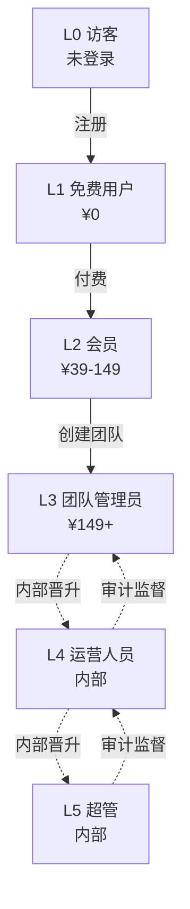

# ManhuaWorks 定价模型

> **版本**：v0.2.0
> **生效日期**：2026-07-01（内测期间免费）
> **作者**：陈远枢（运营总监）
> **审核**：梁总（待）

## 1. 定价哲学

ManhuaWorks 定价遵循三个原则：

1. **入门低门槛** — 免费版让用户完整体验核心功能（5 美元/月的 AI 配额）
2. **专业价值对齐** — 按真实成本 + 合理利润定价，不赚"信息差"钱
3. **企业可谈判** — 大客户单独报价，不设上限

我们不玩"看似便宜实则限流"的把戏，套餐价格透明、配额清晰、超额有 BYOK 兜底。

---

## 2. 套餐总览

| 套餐 | 月费 | AI 配额 | BYOK | 团队 | 主要场景 |
|:--|:--|:--|:--|:--|:--|
| **免费** | ¥0 | $5/月 | ❌ | ❌ | 试用、爱好者 |
| **基础** | ¥39/月 | $30/月 | ✅ | ❌ | 个人创作者 |
| **专业** | ¥149/月 | $150/月 | ✅ 推荐 | ✅（5人） | 工作室、小团队 |
| **企业** | 定制 | 按量 | ✅ 必选 | ✅（不限） | MCN、出版社 |

> 美元换算按 1 USD ≈ 7.2 CNY，实际按当日汇率结算。

---

## 3. 4 套餐详细对比

### 3.1 免费版（Free）

**月费**：¥0
**目标**：让零成本用户完整体验"小说 → 漫剧"核心流程

| 能力 | 限制 |
|:--|:--|
| 月配额 | 5 美元（约 25 张图 / 5 段视频） |
| 项目数 | 最多 3 个 |
| 单集长度 | 最多 3 分钟 |
| 风格 | 限 2D/3D 共 4 种基础风格 |
| 导出 | 含平台水印（右下角） |
| 团队 | ❌ 不支持 |
| BYOK | ❌ 不支持 |
| 客服 | 仅文档 + 社区 |
| 商用授权 | ❌ 不可商用 |

**典型用户**：试用用户、学生、业余创作者

---

### 3.2 基础版（Basic）

**月费**：¥39/月
**目标**：付费意愿低的个人创作者，每月能产出 2-3 集

| 能力 | 限制 |
|:--|:--|
| 月配额 | 30 美元（约 150 张图 / 35 段视频） |
| 项目数 | 最多 20 个 |
| 单集长度 | 不限 |
| 风格 | 全部 11 种艺术风格 |
| 风格 | 全部 12 种故事类型 |
| 导出 | ✅ 无水印 |
| 团队 | ❌ 不支持 |
| BYOK | ✅ 可用（节省 25%） |
| 客服 | 邮件支持（48h 响应） |
| 商用授权 | ✅ 个人商用 |

**典型用户**：网文作者、自媒体人、漫画爱好者

---

### 3.3 专业版（Pro）

**月费**：¥149/月
**目标**：工作室、MCN、小型制作团队

| 能力 | 限制 |
|:--|:--|
| 月配额 | 150 美元（约 750 张图 / 175 段视频） |
| 项目数 | 不限 |
| 单集长度 | 不限 |
| 风格 | 全部 |
| 导出 | ✅ 无水印 + 4K 输出 |
| 团队 | ✅ 5 个席位（可加 ¥30/席位） |
| BYOK | ✅ 推荐（节省 40%） |
| 客服 | 工单 + 飞书群（24h 响应） |
| 商用授权 | ✅ 团队商用 |
| 高级功能 | 角色一致性强化、批量生成、API 访问 |
| 模板市场 | ✅ 可上架作品卖钱 |

**典型用户**：MCN 工作室、短剧团队、企业内训

---

### 3.4 企业版（Enterprise）

**月费**：**按需报价**（起步 ¥2,000/月）
**目标**：大型 MCN、出版社、平台型客户

| 能力 | 限制 |
|:--|:--|
| 月配额 | 按需（最低 $500） |
| 项目数 | 不限 |
| 团队席位 | 不限（按人加价 ¥100/人/月） |
| BYOK | ✅ 必选（节省 55%+） |
| 客服 | 专属客服 + 1h SLA |
| 商用授权 | ✅ 集团商用 |
| 数据 | 私有化部署可选 |
| 集成 | SSO / 飞书 / 钉钉 / 自有 OA |
| 培训 | 1 次现场培训 + 季度复盘 |
| SLA | 99.9% 可用性保障 |

**典型用户**：阅文、番茄、抖音 MCN、出版集团

**报价模板**（根据规模）：

| 规模 | 月费 | 配额 | 席位 |
|:--|:--|:--|:--|
| 小型 | ¥2,000/月 | $500 | 10 人 |
| 中型 | ¥8,000/月 | $2,000 | 50 人 |
| 大型 | ¥30,000/月起 | $8,000+ | 不限 |

**联系销售**：`sales@manhuaworks.com` / 飞书 `ops-bot`

---

## 4. 5 级 RBAC 权限对应

| 角色 | 等级 | 套餐 | 关键权限 |
|:--|:--|:--|:--|
| **访客** | L0 | 未登录 | 只能看首页/文档/价格 |
| **免费用户** | L1 | 免费 | 创建项目、生成受限、配额低、含水印 |
| **会员** | L2 | 基础 / 专业 | 完整功能、去水印、BYOK、API 调用 |
| **团队管理员** | L3 | 专业 / 企业 | 团队管理、成员邀请、配额分配 |
| **运营人员** | L4 | 业务总后台 | 客服、内容审核、用户管理、营销活动 |
| **超管** | L5 | 平台总后台 | 系统配置、财务、审计、所有数据 |

### 权限矩阵

| 操作 | L0 | L1 | L2 | L3 | L4 | L5 |
|:--|:--:|:--:|:--:|:--:|:--:|:--:|
| 看落地页 | ✅ | ✅ | ✅ | ✅ | ✅ | ✅ |
| 注册/登录 | ✅ | - | - | - | - | - |
| 创建项目 | ❌ | ✅ 3 个 | ✅ 20+ | ✅ 不限 | ❌ | ❌ |
| 导出作品 | ❌ | 含水印 | 无水印 | 无水印 | - | - |
| 用 AI 配额 | ❌ | ✅ 5 美元 | ✅ 30-150 美元 | ✅ 不限 | ❌ | ❌ |
| BYOK | ❌ | ❌ | ✅ | ✅ | - | - |
| 团队管理 | ❌ | ❌ | ❌ | ✅ | ❌ | ❌ |
| 邀请成员 | ❌ | ❌ | ❌ | ✅ | - | - |
| 改用户配额 | ❌ | ❌ | ❌ | ❌ | ✅ | ✅ |
| 改费率配置 | ❌ | ❌ | ❌ | ❌ | ❌ | ✅ |
| 看营收数据 | ❌ | ❌ | ❌ | ❌ | 部分 | ✅ |
| 审核内容 | ❌ | ❌ | ❌ | ❌ | ✅ | ✅ |
| 客服回复 | ❌ | ❌ | ❌ | ❌ | ✅ | ✅ |
| 系统设置 | ❌ | ❌ | ❌ | ❌ | ❌ | ✅ |
| 服务重启 | ❌ | ❌ | ❌ | ❌ | ❌ | ✅ |

---

## 5. 配额与计费

### 配额单位

我们用 **AI Credit（AI 积分）** 统一计量，1 积分 ≈ $0.001 ≈ ¥0.0072。

| 操作 | 积分消耗 |
|:--|:--|
| 生图（1024×1024 标准） | 18 积分（$0.018） |
| 生图（2K 高清） | 45 积分（$0.045） |
| 生视频（5 秒 720P） | 85 积分（$0.085） |
| 生视频（10 秒 1080P） | 250 积分（$0.25） |
| TTS（千字） | 2 积分（$0.002） |
| LLM 文本生成（千 token） | 4 积分（$0.004） |
| OCR（页） | 1 积分（$0.001） |

### 配额示例

- 免费版：5 美元 = 5,000 积分
  - 约 277 张图 / 58 段视频
  - 实际 1 集漫剧（8 张图 + 5 视频 + 配音）≈ 530 积分
  - 约能产出 9 集 5 分钟漫剧

- 基础版：30 美元 = 30,000 积分
  - 约 56 集标准漫剧

- 专业版：150 美元 = 150,000 积分
  - 约 280 集标准漫剧

### 配额规则

- 配额**每月 1 日 0 点**重置（北京时间）
- 当月未用完**不结转**
- 超出配额**不强制停机**，走 BYOK 或单独购买"积分加油包"
- 加油包：¥30 / $5 / 5,000 积分（永久有效）

### 配额预警

- 用到 80% → 内信通知
- 用到 100% → 弹窗 + 内信
- 用到 120%（加油包部分）→ 弹窗 + 推荐 BYOK
- 用到 200% → 自动暂停（需用户确认才能继续）

---

## 6. 退款政策

| 类型 | 政策 |
|:--|:--|
| 月费 | 订阅 7 天内可全额退款 |
| 月费 | 订阅 7 天后按未使用天数退款（扣除已使用部分） |
| 加油包 | 30 天内未使用可退款 |
| AI 配额 | 不退款（已使用 = 已产生供应商成本） |
| 企业合同 | 按合同条款 |

---

## 7. 优惠与促销

### 内测期（2026-07-01 ~ 2026-08-31）

- **全员免费**：所有用户享受专业版功能
- **反馈奖励**：提交有效 bug 或建议 → 送 1 个月专业版
- **邀请奖励**：邀请 1 位新用户注册 → 双方各得 1000 积分

### 长期优惠

| 优惠 | 折扣 | 备注 |
|:--|:--|:--|
| 年付 | 8.3 折 | 一次性付 12 个月享 10 个月 |
| 教育优惠 | 5 折 | 学生认证，限基础版 |
| 公益优惠 | 5 折 | 非营利组织 |
| 老用户续费 | 9 折 | 连续付费 12 个月 |

---

## 8. 与竞争对手对比

| 维度 | ManhuaWorks | Toonflow | 巨量创意 | Sora |
|:--|:--|:--|:--|:--|
| 月费 | ¥39-149 | $29 | ¥99 | $20 |
| 配额 | 30-150 美元 | 30 美元 | 100 美元 | 30 美元 |
| BYOK | ✅ | ❌ | ❌ | ❌ |
| 漫剧专用 | ✅ | ✅ | ❌ | ❌ |
| 多镜头 | ✅ | ✅ | ❌ | ❌ |
| 角色一致性 | ★★★★ | ★★★ | ★★ | ★★ |
| 中文本土化 | ★★★★★ | ★★★ | ★★★★ | ★★ |
| 团队协作 | ✅ | ❌ | ❌ | ❌ |
| API 开放 | ✅ | ❌ | ❌ | ✅ |

**核心差异**：
1. **BYOK** — 唯一支持用户自备 Key 的国内平台
2. **漫剧专用** — 7 步流水线专为漫剧设计
3. **多镜头** — 业内最强的多镜头一致性

---

## 9. 未来定价演进

| 阶段 | 时间 | 变化 |
|:--|:--|:--|
| 内测期 | 2026-07 ~ 2026-08 | 全员免费 |
| 公测期 | 2026-09 | 半价试运营 |
| 正式版 | 2026-10 | 按本定价 |
| V2.0 | 2027-Q1 | 推出"按秒计费"模式 |
| V3.0 | 2027-Q3 | 推出"分成模式"（作品上架抽佣） |

---

## 10. 变更记录

| 版本 | 日期 | 作者 | 变更 |
|:--|:--|:--|:--|
| v0.1 | 2026-06-07 | 陈远枢 | 初稿 |
| v0.2 | 2026-06-07 | 陈远枢 | 加入 RBAC 对应表 |
